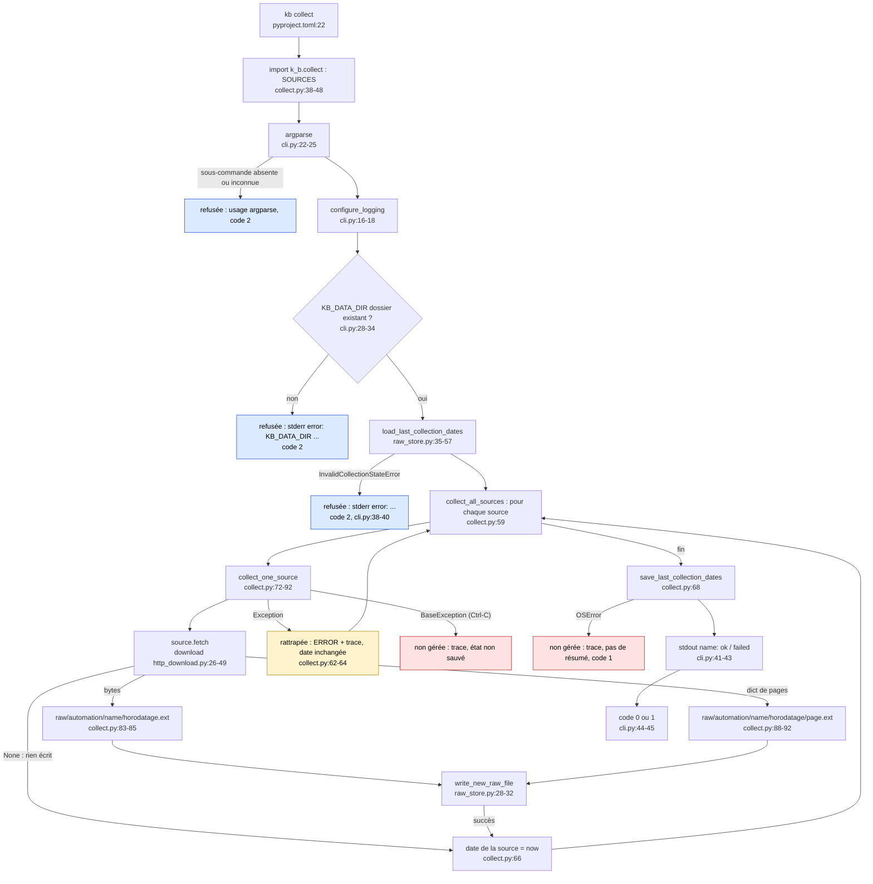
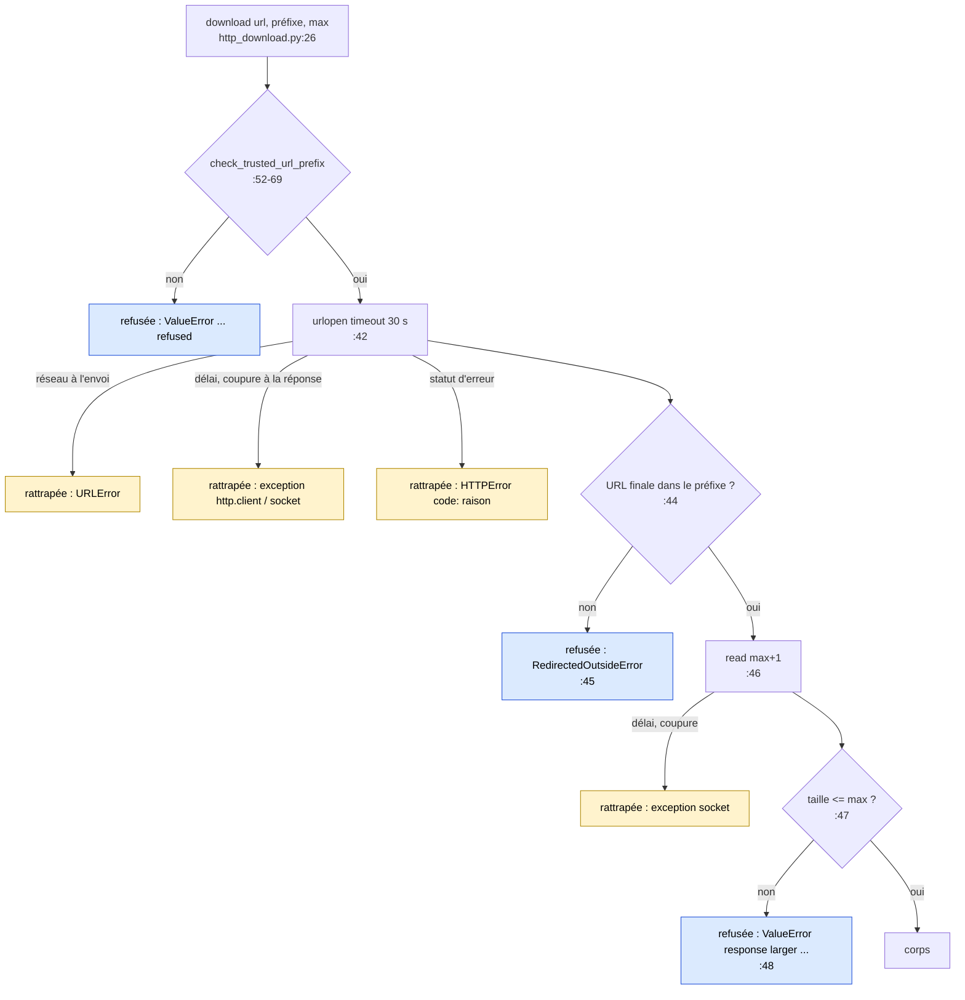
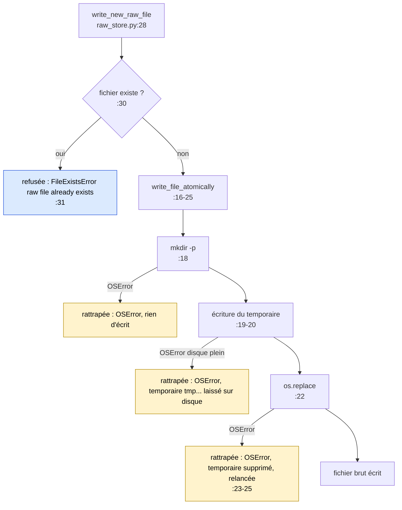
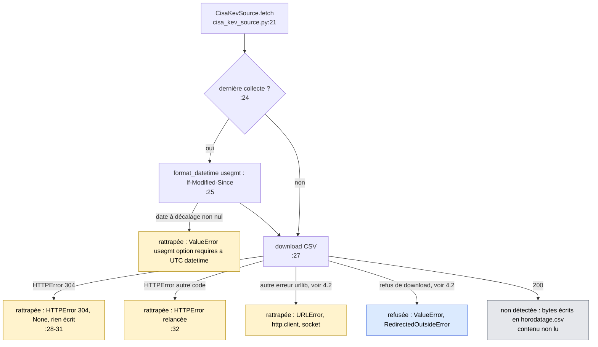
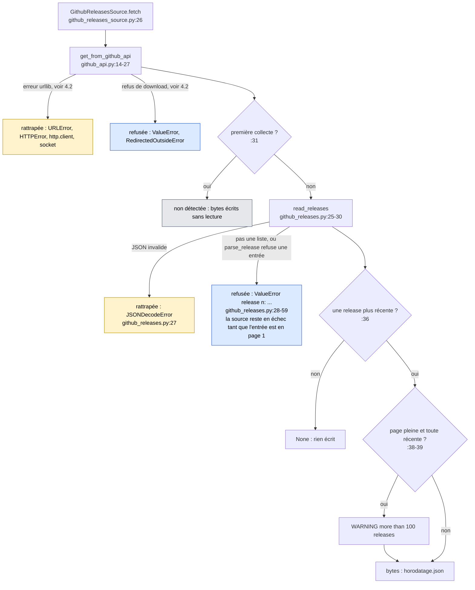
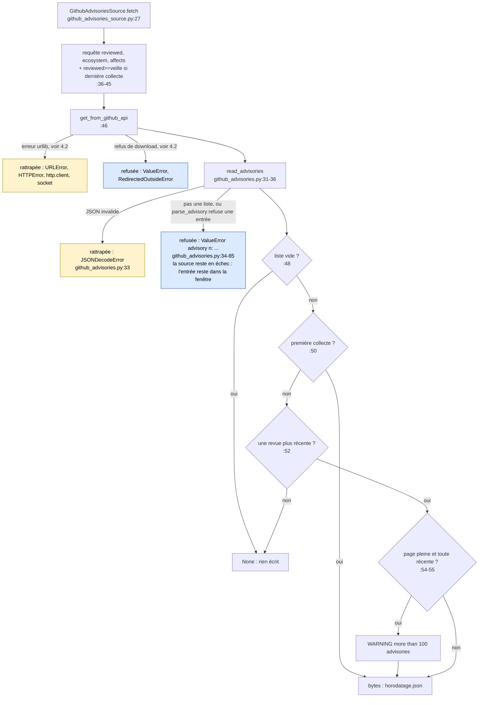
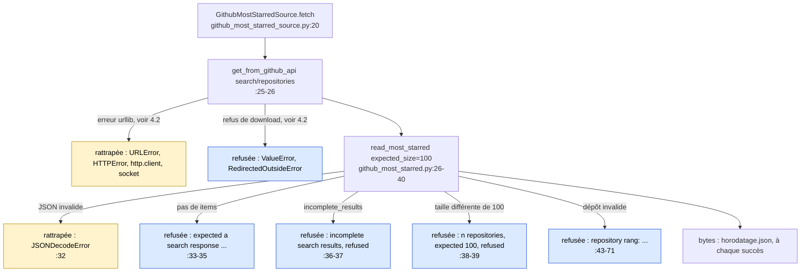
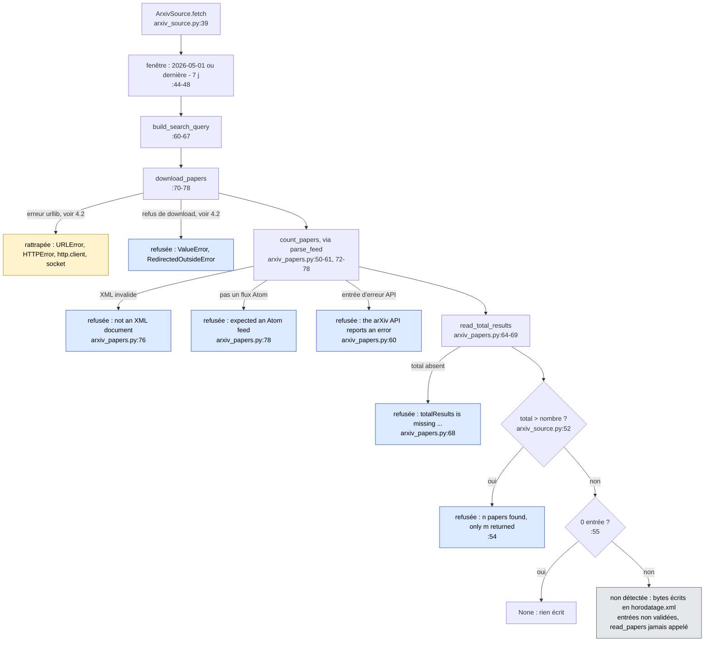

# Flux de données de `kb collect` — état du code au 2026-10-04

Fondé sur le code seul (`src/k_b/`, `pyproject.toml`), au commit `0d303eb`. La doc n'est lue
qu'à la section 5. Aucun code de K-B n'a été exécuté. Deux opérations hors K-B : la lecture des
sources de la bibliothèque standard installée (Python 3.13.13), pour citer le texte exact des
messages d'erreur, et le rendu des schémas de la section 4 avec `mmdc`.
Ce qui ne se tranche qu'en exécutant est marqué **non vérifié**.

Classes d'erreur employées :

- **Rattrapée** : l'exception est interceptée ; la suite est indiquée.
- **Refusée** : K-B lève lui-même l'erreur, avec son message. Levée dans une source, elle est
  ensuite rattrapée par le filet de `collect.py:62` (voir 2.1).
- **Non gérée** : l'exception remonte jusqu'à Python ; la commande s'arrête avec une trace.

## 1. Flux de données

### 1.1 Chemin de `kb collect`

| # | Étape | Référence |
|---|---|---|
| 0 | Le script `kb` appelle `k_b.cli:main` | `pyproject.toml:22` |
| 1 | L'import de `k_b.collect` construit la liste `SOURCES` (13 sources), avant `main` | `cli.py:10`, `collect.py:38-48` |
| 2 | `argparse` : sous-commande `collect` obligatoire | `cli.py:22-25` |
| 3 | `configure_logging()` | `cli.py:26`, `cli.py:16-18` |
| 4 | Lecture de `KB_DATA_DIR`, refus si absente ou si ce n'est pas un dossier | `cli.py:28-34` |
| 5 | `collect_all_sources(SOURCES, <KB_DATA_DIR>/raw, datetime.now(UTC))` | `cli.py:37` |
| 6 | Contrôle que l'heure est en UTC | `collect.py:55-56` |
| 7 | `load_last_collection_dates(raw_dir)` lit `raw/collection_state.json` | `collect.py:57`, `raw_store.py:35-57` |
| 8 | Pour chaque source, dans l'ordre de `SOURCES` : `collect_one_source(...)` sous `try` | `collect.py:59-67` |
| 8a | Contrôle du nom et de l'extension de la source (`[a-z0-9_]+`) | `collect.py:75-77` |
| 8b | `source.fetch(last_collected_at)` : téléchargement (détail en 1.2) | `collect.py:78` |
| 8c | `None` → rien n'est écrit | `collect.py:79-80` |
| 8d | `bytes` → `write_new_raw_file(raw/automation/<source>/<horodatage>.<ext>)` | `collect.py:81-85` |
| 8e | `dict` → contrôle de chaque nom de page, puis un fichier par page dans `raw/automation/<source>/<horodatage>/<page>.<ext>` | `collect.py:88-92` |
| 8f | `write_new_raw_file` refuse un fichier existant, puis `write_file_atomically` : `mkdir -p`, fichier temporaire, `os.replace` | `raw_store.py:28-32`, `raw_store.py:16-25` |
| 9 | Succès (fichier écrit **ou** `None`) : la date de la source devient `now` ; échec : la date reste | `collect.py:62-67` |
| 10 | `save_last_collection_dates` réécrit `raw/collection_state.json` (atomique) | `collect.py:68`, `raw_store.py:60-66` |
| 11 | Une ligne par source sur stdout : `<source>: ok` ou `<source>: failed (<TypeErreur>)` | `cli.py:41-43` |
| 12 | Code de sortie 1 si une source a échoué, 0 sinon | `cli.py:44-45` |

L'horodatage `<AAAA-MM-JJTHHMMSSZ>` vient d'un seul `now` par exécution (`cli.py:37`,
`collect.py:82`) : toutes les sources d'une même exécution partagent le même nom.

Tout téléchargement passe par `download()` (`http_download.py:26-49`) : contrôle du préfixe de
confiance (`http_download.py:38`, `52-69`), `User-Agent` fixe (`http_download.py:39`,
`user_agent.py:5`), `urlopen` avec délai de 30 s (`http_download.py:8`, `42`), refus si l'URL
finale sort du préfixe (`http_download.py:44-45`), lecture de `max_bytes + 1` octets au plus,
refus au-delà (`http_download.py:46-48`). Les appels GitHub passent par `get_from_github_api`
(`github_api.py:14-27`), qui ajoute le jeton `KB_GITHUB_TOKEN` s'il existe, en en-tête jamais
transmis à une redirection (`github_api.py:19`, `26` ; `http_download.py:40-41`).

### 1.2 Sources gérées par le code

Ordre d'exécution (`collect.py:38-48`) : `cisa_kev`, 4 × `github_releases_*`,
`github_advisories_pip`, `github_advisories_npm`, `github_most_starred`, `arxiv`, `tldr_ai`,
`tldr_infosec`, `tldr_dev`.

| Source (`name`) | Ce qui est téléchargé, d'où | Fonction | Écrit où, sous quel nom | Quand rien n'est écrit |
|---|---|---|---|---|
| `cisa_kev` | catalogue CSV `https://www.cisa.gov/sites/default/files/csv/known_exploited_vulnerabilities.csv`, avec `If-Modified-Since` = dernière collecte ; 10 Mo au plus | `CisaKevSource.fetch` (`cisa_kev_source.py:21-32`) | `raw/automation/cisa_kev/<horodatage>.csv` | réponse 304 (`cisa_kev_source.py:28-31`) |
| `github_releases_langchain_ai_langchain`, `…_langchain_ai_langgraph`, `…_run_llama_llama_index`, `…_anthropics_claude_code` | JSON `https://api.github.com/repos/<owner>/<repo>/releases?per_page=100` (première page seulement) ; 5 Mo au plus | `GithubReleasesSource.fetch` (`github_releases_source.py:26-46`) ; dépôts : `tracked_repositories.py:19-26` ; nom : `github_releases_source.py:24` | `raw/automation/<name>/<horodatage>.json` | aucune release publiée après la dernière collecte (`github_releases_source.py:36-37`) ; à la première collecte, toujours écrit (`:31-32`) |
| `github_advisories_pip`, `github_advisories_npm` | JSON `https://api.github.com/advisories?type=reviewed&ecosystem=<eco>&affects=<paquets>&per_page=100[&reviewed=>=<veille de la dernière collecte>]` | `GithubAdvisoriesSource.fetch` (`github_advisories_source.py:27-62`) ; paquets regroupés par `list_packages_by_ecosystem` (`tracked_repositories.py:29-36`) | `raw/automation/<name>/<horodatage>.json` | liste vide (`:48-49`) ou aucune revue après la dernière collecte (`:52-53`) |
| `github_most_starred` | JSON `https://api.github.com/search/repositories?q=stars:>10000&sort=stars&order=desc&per_page=100` | `GithubMostStarredSource.fetch` (`github_most_starred_source.py:20-28`) | `raw/automation/github_most_starred/<horodatage>.json` | jamais : écrit à chaque succès (`:28`) |
| `arxiv` | Atom XML `https://export.arxiv.org/api/query?search_query=…&start=0&max_results=2000&sortBy=submittedDate&sortOrder=ascending` ; fenêtre `submittedDate` depuis le 2026-05-01 (première fois) ou dernière collecte − 7 j ; 6 Mo au plus | `ArxivSource.fetch` (`arxiv_source.py:39-57`), requête `build_search_query` (`:60-67`), appel `download_papers` (`:70-78`) | `raw/automation/arxiv/<horodatage>.xml` | 0 entrée dans le flux (`arxiv_source.py:55-56`) |
| `tldr_ai`, `tldr_infosec`, `tldr_dev` | une page HTML par jour `https://tldr.tech/<édition>/<AAAA-MM-JJ>`, du jour de la dernière collecte (ou J−7) à aujourd'hui UTC, pause de 2 s entre deux pages ; 1 Mo par page | `TldrSource.fetch` (`tldr_source.py:33-68`), jours : `list_days_to_collect` (`:75-87`) | `raw/automation/<name>/<horodatage>/<AAAA-MM-JJ>.html`, un fichier par jour qui a une page | aucun jour n'a de page (`tldr_source.py:66-68`) |

Quand `fetch` renvoie `None`, rien n'est écrit mais la source compte comme réussie : sa date
avance (`collect.py:79-80`, `66`).

Lecture faite **pendant la collecte** (validation, pas transformation) : releases à partir de la
deuxième collecte (`github_releases_source.py:33-35`), alertes (`github_advisories_source.py:47`),
plus étoilés (`github_most_starred_source.py:27`), arXiv : comptage et total seulement
(`arxiv_source.py:50-51`). CISA KEV et TLDR : aucune lecture du contenu. `read_papers`
(`arxiv_papers.py:36`) et `read_new_vulnerabilities` (`cisa_kev.py:30`) existent mais ne sont
appelés nulle part dans `src/`.

Sources citées dans la doc sans code : Obsidian Web Clipper, Zotero, GH Archive sur BigQuery
(`README.md:36-39`, `docs/specs-collecte.md:114-183`). Aucune étape de lecture, fusion,
stockage en base ou API n'est appelée par `kb collect` (`src/k_b/database/` ne contient que
`__init__.py` et deux scripts SQL).

## 2. Erreurs

### 2.1 Le filet par source

Toute exception de classe `Exception` levée dans `collect_one_source` est rattrapée
(`collect.py:62-64`) :

- journalisée en ERROR avec la trace : `collection failed for source '<name>'` (`collect.py:63`) ;
- la date de la source n'avance pas (`collect.py:66` sauté) : la prochaine collecte redemande
  la même fenêtre ;
- la source suivante continue ; l'état est sauvegardé à la fin (`collect.py:68`) ;
- stdout : `<name>: failed (<TypeErreur>)` (`cli.py:42-43`), code de sortie 1 (`cli.py:45`).

Une exception hors `Exception` (`KeyboardInterrupt`, Ctrl-C) n'est pas rattrapée : non gérée,
voir 2.2.

### 2.2 Avant et après les sources (commande entière)

| Déclencheur | Classe | Message exact ou suite | Référence |
|---|---|---|---|
| Sous-commande absente ou inconnue | refusée par `argparse` | usage d'`argparse`, code 2 | `cli.py:22-25` |
| `KB_DATA_DIR` absente ou vide | refusée | `error: KB_DATA_DIR must point to the data directory`, code 2 | `cli.py:29-31` |
| `KB_DATA_DIR` n'est pas un dossier existant | refusée | `error: KB_DATA_DIR is not an existing directory`, code 2 | `cli.py:32-34` |
| `collection_state.json` illisible (droits…) | refusée | `error: <chemin> cannot be read: <strerror>`, code 2, aucune source lancée | `raw_store.py:41-44`, `cli.py:38-40` |
| `collection_state.json` : JSON invalide, non UTF-8, pas un objet, date non ISO ou sans fuseau | refusée | `error: <chemin> is invalid (<détail>); fix it, or delete it to collect every source from scratch`, code 2 | `raw_store.py:45-57`, `69-76` |
| Heure de collecte non UTC | refusée | `collection time must be in UTC, got …` ; inatteignable depuis la CLI, qui passe `datetime.now(UTC)` | `collect.py:55-56`, `cli.py:37` |
| Constructeur de source invalide (slug, dépôt, écosystème) | refusée à l'import, avant `main` | inatteignable avec les constantes actuelles | `tldr_source.py:28-29`, `github_releases_source.py:21-22`, `github_advisories_source.py:21-22` |
| **Écriture de `collection_state.json` impossible** (disque plein, droits sur `raw/`) | **non gérée** | `OSError` remonte : `cli.py:38` n'attrape que `InvalidCollectionStateError`. Trace Python, aucun résumé par source affiché, code 1 (comportement par défaut de Python). Les fichiers bruts déjà écrits restent ; les dates ne sont pas sauvées, donc tout est recollecté la fois suivante. Un fichier temporaire peut rester dans `raw/` (voir la ligne disque plein en 2.3). | `collect.py:68`, `raw_store.py:66`, `raw_store.py:19-20` |
| **Ctrl-C ou autre `BaseException`** pendant les sources | **non gérée** | trace, état non sauvé : les sources déjà collectées dans cette exécution le seront de nouveau (doublons de brut) | `collect.py:62`, `68` |

### 2.3 Communes à toutes les sources (téléchargement, écriture)

Toutes passent par le filet de 2.1 : la source échoue, les suivantes continuent.

| Déclencheur | Classe | Message exact ou suite | Référence |
|---|---|---|---|
| DNS, connexion refusée, TLS, délai dépassé à l'envoi | rattrapée (aucun code K-B dédié) | `urllib` enveloppe l'`OSError` : `<urlopen error <raison>>` | `http_download.py:42` ; stdlib `urllib/request.py:1321-1322`, `error.py:31-32` |
| Délai dépassé en attendant la réponse ou en lisant le corps, connexion coupée | rattrapée (aucun code K-B dédié) | l'exception de `http.client` / `socket` remonte sans enveloppe (`getresponse` est hors du `try` qui enveloppe) | `http_download.py:42`, `46` ; stdlib `urllib/request.py:1323` |
| Durée totale d'un téléchargement | non bornée | le délai de 30 s est passé à `urlopen` ; le code ne borne pas la durée totale | `http_download.py:8`, `42` |
| Statut HTTP d'erreur (4xx, 5xx, et 304 hors CISA) | rattrapée (aucun code K-B dédié) | `HTTP Error <code>: <raison>` ; l'URL n'est pas dans le message | stdlib `urllib/error.py:49-50`, `request.py:612-613` |
| Redirection hors du préfixe de confiance | refusée **après** avoir suivi la redirection | `response redirected to <url>, outside <préfixe>, refused` | `http_download.py:19-23`, `43-45` |
| Réponse trop grande | refusée | `response larger than <max> bytes, refused` | `http_download.py:47-48` |
| Préfixe de confiance mal formé, ou URL hors préfixe | refusée | `trusted prefix '
' is not https://<host>/, refused` / `url outside its trusted prefix '
', refused` ; inatteignable avec les URL construites aujourd'hui | `http_download.py:66-69` |
| Nom de source ou extension hors `[a-z0-9_]+` | refusée | `not a safe path segment: '<x>'` ; inatteignable avec les noms actuels | `collect.py:75-77` |
| Nom de page hors `[a-z0-9_-]+` | refusée | `not a safe page name: '<x>'`, avant toute écriture | `collect.py:88-90` |
| Fichier brut déjà présent (deux exécutions dans la même seconde) | refusée | `raw file already exists: <chemin>` | `raw_store.py:30-31` |
| Création du dossier impossible (droits) | rattrapée (aucun code K-B dédié) | `OSError` ; rien d'écrit | `raw_store.py:18` |
| **Disque plein pendant l'écriture du temporaire** | rattrapée (aucun code K-B dédié) | `OSError` (`[Errno 28] …`, sans chemin si l'erreur vient de l'écriture — **non vérifié**). **Le fichier temporaire `tmp…` reste** dans le dossier cible : `delete=False`, et le nettoyage ne couvre que l'échec de `os.replace` | `raw_store.py:19-20`, `21-25` |
| Échec de `os.replace` | rattrapée (aucun code K-B dédié) | temporaire supprimé, `OSError` relancée | `raw_store.py:21-25` |
| Échec d'écriture au milieu d'une source multi-pages (TLDR) | rattrapée (aucun code K-B dédié) | **les pages déjà écrites restent** ; la date n'avance pas, la prochaine exécution les réécrit dans un nouveau dossier | `collect.py:86-87`, `91-92` |
| `KB_GITHUB_TOKEN` absente ou vide | aucun traitement | requêtes sans jeton, sans aucun journal ; au-delà du quota GitHub sans jeton, statut HTTP d'erreur (code exact **non vérifié**) | `github_api.py:19`, `26` |
| `KB_GITHUB_TOKEN` invalide ou expiré | rattrapée (aucun code K-B dédié) | statut HTTP d'erreur pour chacune des 7 sources GitHub (code exact **non vérifié**) | `github_api.py:26` |

### 2.4 Par source

**`cisa_kev`**

| Déclencheur | Classe | Suite | Référence |
|---|---|---|---|
| 304 Not Modified | rattrapée | `None` : rien n'est écrit, `cisa_kev: ok` | `cisa_kev_source.py:28-31` |
| Tout autre statut d'erreur | rattrapée par le filet | échec de la source | `cisa_kev_source.py:32` |
| Date d'état au décalage non nul (fichier édité à la main) | rattrapée par le filet | `ValueError` de `format_datetime` : `usegmt option requires a UTC datetime`. La date n'avançant jamais, la source échouera à chaque exécution | `cisa_kev_source.py:25` ; stdlib `email/utils.py:276-278` |
| Réponse 200 mal formée (page HTML, CSV tronqué) | non détectée | écrite telle quelle en `.csv` : aucune lecture du contenu à la collecte | `cisa_kev_source.py:27` |

**`github_releases_*`**

| Déclencheur | Classe | Suite | Référence |
|---|---|---|---|
| Première collecte, réponse mal formée | non détectée | écrite telle quelle (pas de lecture) | `github_releases_source.py:31-32` |
| Corps non JSON | rattrapée par le filet | `json.JSONDecodeError` | `github_releases.py:27` |
| JSON qui n'est pas une liste | refusée | `expected a list of releases` | `github_releases.py:28-29` |
| Une entrée invalide | refusée | `release <n>: not an object` / `tag_name is not a string` / `html_url is not a https://github.com/ URL` / `prerelease is not a boolean` / `name or body is not a string` / `release <n>: published_at is not a date` / `… is invalid: '<v>'` / `… has no time zone` | `github_releases.py:33-59`, `github_dates.py:11-18` |
| Conséquence d'une entrée invalide | — | toute la source échoue, la date n'avance pas ; tant que l'entrée reste dans la première page de 100, la source échoue à chaque exécution (déduit du code, **non observé**) | `github_releases_source.py:33-35`, `collect.py:62-66` |
| Page pleine plus récente que la dernière collecte | avertissement, la source réussit | WARNING `<dépôt>: more than 100 releases since the last collection, some may be missing; time to read the next pages` | `github_releases_source.py:38-45` |

**`github_advisories_*`**

| Déclencheur | Classe | Suite | Référence |
|---|---|---|---|
| Corps non JSON | rattrapée par le filet | `json.JSONDecodeError` | `github_advisories.py:33` |
| JSON qui n'est pas une liste | refusée | `expected a list of advisories` | `github_advisories.py:34-35` |
| Une entrée invalide (y compris à la première collecte) | refusée | `advisory <n>: not an object` / `not a GHSA identifier: …` / `not a CVE identifier: …` / `summary is not a string` / `unknown severity: …` / `html_url is not a https://github.com/advisories/ URL` / dates comme ci-dessus (`published_at`, `github_reviewed_at`) / `vulnerabilities is not a list` / `a vulnerability has no package name` | `github_advisories.py:39-85`, `github_dates.py:11-18` |
| Conséquence d'une entrée invalide | — | la fenêtre `reviewed>=` part de la dernière collecte **réussie** : l'entrée y reste, et la source échoue à chaque exécution (déduit du code, **non observé**) | `github_advisories_source.py:42-47`, `collect.py:66` |
| Page pleine plus récente que la dernière collecte | avertissement | WARNING `<name>: more than 100 advisories since the last collection, some may be missing; time to read the next pages` | `github_advisories_source.py:54-61` |

**`github_most_starred`**

| Déclencheur | Classe | Suite | Référence |
|---|---|---|---|
| Corps non JSON | rattrapée par le filet | `json.JSONDecodeError` | `github_most_starred.py:32` |
| Pas d'objet avec une liste `items` | refusée | `expected a search response with a list of items` | `github_most_starred.py:33-35` |
| `incomplete_results` différent de `false` | refusée | `incomplete search results, refused` | `github_most_starred.py:36-37` |
| Moins ou plus de 100 dépôts | refusée | `<n> repositories, expected 100, refused` | `github_most_starred.py:38-39` |
| Un dépôt invalide | refusée | `repository <rang>: not an object` / `not an owner/name: …` / `html_url is not a https://github.com/ URL` / `description is not a string` / `stargazers_count is not an integer` / `topics is not a list of strings` / dates | `github_most_starred.py:43-71` |

Pas de fenêtre de dates : un échec ne bloque pas la fois suivante.

**`arxiv`**

| Déclencheur | Classe | Suite | Référence |
|---|---|---|---|
| Corps non XML | refusée | `not an XML document: <erreur expat>` | `arxiv_papers.py:73-76` |
| Racine qui n'est pas un flux Atom | refusée | `expected an Atom feed` | `arxiv_papers.py:77-78` |
| Entrée d'erreur de l'API | refusée | `the arXiv API reports an error: '<id>'` | `arxiv_papers.py:57-60` |
| `totalResults` absent ou non numérique | refusée | `totalResults is missing or not a number` | `arxiv_papers.py:66-68` |
| Plus de résultats que la page | refusée | `<total> papers found, only <n> returned` | `arxiv_source.py:52-54` |
| 0 entrée | rattrapée | `None` : rien n'est écrit, `arxiv: ok` | `arxiv_source.py:55-56` |
| Entrée mal formée | non détectée à la collecte | comptée et écrite ; `read_papers`, qui la rejetterait, n'est pas appelé | `arxiv_papers.py:50-61`, `36-47` |

**`tldr_*`**

| Déclencheur | Classe | Suite | Référence |
|---|---|---|---|
| Jour de la dernière collecte postérieur à aujourd'hui (UTC) | refusée, avant tout téléchargement | `last collection day <jour> is after today <jour>` | `tldr_source.py:85-86` |
| Redirection vers `https://tldr.tech/<édition>` (avec ou sans `/` final) | rattrapée | INFO, jour sauté, les jours suivants continuent | `tldr_source.py:50-60` |
| Toute autre erreur sur un jour (autre redirection, statut HTTP, réseau, taille) | journalisée puis relancée | ERROR `<name> <jour>: <message>, from <url>`, puis le filet. **Les pages déjà téléchargées dans cette exécution sont perdues** (en mémoire, rien n'est écrit pour cette source) ; les jours suivants ne sont pas demandés | `tldr_source.py:61-63` |
| Aucun jour avec page | rattrapée | INFO, `None`, rien n'est écrit, `tldr_<éd>: ok` | `tldr_source.py:66-68` |
| Page 200 au contenu inattendu | non détectée | écrite telle quelle | `tldr_source.py:48`, `64-65` |

## 3. Logs

### 3.1 Production

- Module `logging` de la bibliothèque standard ; un logger par module :
  `logging.getLogger(__name__)` dans `collect.py:18`, `tldr_source.py:21`,
  `github_releases_source.py:10`, `github_advisories_source.py:10`, `arxiv_papers.py:9`.
- Configuration unique : `logging.basicConfig(level=logging.INFO, format="%(levelname)s %(name)s: %(message)s")`
  (`cli.py:18`), appelée après l'analyse des arguments (`cli.py:26`).
- Destination : stderr. `basicConfig` sans `stream` ni `filename` crée un `StreamHandler`, qui
  écrit sur `sys.stderr` par défaut (stdlib `logging/__init__.py:2105`, `1124-1128`). Aucun
  fichier de journal.
- Le format n'a **pas d'horodatage**.
- Hors `logging` : le résumé par source va sur stdout par `print` (`cli.py:43`) ; les refus de
  configuration vont sur stderr par `print` (`cli.py:30`, `33`, `39`).

Niveaux employés : INFO (TLDR seulement), WARNING (pages pleines GitHub), ERROR (TLDR, et
`logger.exception` du filet, avec la trace).

### 3.2 Ce qui est journalisé, et ce qui ne l'est pas

| Étape ou source | Journalisé | Non journalisé |
|---|---|---|
| Démarrage, configuration, état chargé | — | début et fin de collecte, chemin de `raw/`, dates lues dans l'état, présence ou absence de `KB_GITHUB_TOKEN` |
| Téléchargement commun | — | URL demandée, statut HTTP, taille reçue, durée |
| Écriture | — | chemin du fichier écrit, taille, sauvegarde de l'état |
| Échec de toute source | ERROR `collection failed for source '<name>'` + trace contenant le message de l'exception (`collect.py:63`) | l'URL, sauf pour TLDR |
| `cisa_kev` | rien en cas de succès | 304 (rien de neuf) ou catalogue écrit : indiscernables |
| `github_releases_*` | WARNING page pleine | rien de neuf ou fichier écrit : indiscernables ; nombre de releases |
| `github_advisories_*` | WARNING page pleine | idem ; nombre d'alertes |
| `github_most_starred` | rien en cas de succès | (un succès écrit toujours un fichier) |
| `arxiv` | rien en cas de succès | 0 papier ou fichier écrit : indiscernables ; nombre de papiers et total annoncé |
| `tldr_*` | INFO par jour : page gardée (`<name> <jour>: edition page, <n> bytes`) ou redirection (`… no edition page, redirected to <url>`) ; INFO si aucune page ; ERROR jour + message + URL avant l'échec | les jours non demandés après une erreur |
| Fin de collecte | stdout : `<name>: ok` / `<name>: failed (<Type>)` | rien si l'écriture de l'état échoue (trace seule) |

### 3.3 Après un `kb collect`, puis-je savoir ce qui a marché, ce qui a échoué et pourquoi ?

| Source | Réponse | Ce qui manque |
|---|---|---|
| `cisa_kev` | **Non** | « ok » ne dit pas si un catalogue a été écrit ou si la réponse était 304 |
| `github_releases_*` (×4) | **Non** | « ok » ne dit pas si un fichier a été écrit ; l'URL n'est pas dans l'erreur (elle se déduit du nom) |
| `github_advisories_*` (×2) | **Non** | idem ; l'URL dépend de la date d'état et n'est pas journalisée |
| `github_most_starred` | **Oui** | « ok » implique un fichier écrit ; l'échec porte son message |
| `arxiv` | **Non** | « ok » ne dit pas si 0 papier ou un fichier ; l'URL n'est pas journalisée |
| `tldr_*` (×3) | **Oui** | chaque jour a sa ligne, l'échec porte jour, message et URL |

Pour toutes les sources : sans horodatage ni fichier de journal, un journal non redirigé à la
main est perdu ; et si l'écriture de l'état échoue, aucune ligne de résumé n'est affichée.

## 4. Schémas

Légende de tous les schémas : chaque nœud d'erreur commence par sa classe, en toutes lettres, et
porte sa couleur : jaune = rattrapée, bleu = refusée, rouge = non gérée, gris = non détectée. Toute
erreur rattrapée ou refusée d'une source finit dans le filet (`collect.py:62-64`). Une branche
« voir 4.2 » est scindée en deux : erreurs de `urllib` (rattrapées) et refus de `download`.

### 4.1 Global

### 4.2 Téléchargement commun (`download`)

### 4.3 Écriture commune

### 4.4 `cisa_kev`

### 4.5 `github_releases_*`

### 4.6 `github_advisories_*`

### 4.7 `github_most_starred`

### 4.8 `arxiv`

### 4.9 `tldr_*`

```mermaid
flowchart TD
    A["TldrSource.fetch<br/>tldr_source.py:33"] --> B["list_days_to_collect<br/>:75-87"]
    B -- "dernier jour après aujourd'hui" --> B1["refusée : ValueError last collection day ... is after today ...<br/>:86"]:::refused
    B --> C["jour suivant, pause 2 s<br/>:42-45"]
    C --> D["download page du jour<br/>:48"]
    D -- "RedirectedOutsideError vers tldr.tech/édition" --> E["rattrapée : INFO no edition page<br/>jour sauté :49-60"]:::caught
    E --> C
    D -- "erreur urllib, voir 4.2" --> F["rattrapée : ERROR name jour: message, from url<br/>relancée :61-63<br/>pages déjà lues perdues"]:::caught
    D -- "autre refus de download, voir 4.2" --> F2["refusée : ERROR name jour: message, from url<br/>relancée :61-63<br/>pages déjà lues perdues"]:::refused
    D -- "200" --> G["INFO edition page, n bytes<br/>:64-65"]
    G --> C
    C -- "plus de jour" --> H{"au moins une page ?<br/>:66"}
    H -- non --> H1["INFO no edition page from ... to ...<br/>None : rien écrit"]
    H -- oui --> I["non détectée : dict jour vers page, contenu non lu<br/>horodatage/AAAA-MM-JJ.html"]:::undetected

    classDef caught fill:#fff3cd,stroke:#b08800,color:#000
    classDef refused fill:#dbeafe,stroke:#1d4ed8,color:#000
    classDef undetected fill:#e5e7eb,stroke:#4b5563,color:#000
```

Chaque schéma a été rendu avec `mmdc` (mermaid-cli 11.17.0) sans erreur de syntaxe, après les
compléments de la section 6. Le rendu visuel (lisibilité, croisements) n'a pas été regardé.

## 5. Écarts doc ↔ code

| Doc | Code | Écart |
|---|---|---|
| `docs/specs-collecte.md:21-23` : « refuse une redirection hors du domaine attendu » | `http_download.py:42-45` | la redirection est **suivie** (la requête part vers l'autre domaine), puis la réponse est refusée. Le jeton GitHub, lui, n'est pas transmis (`http_download.py:40-41`). |
| `docs/specs-collecte.md:19-20` : « une source qui n'a rien de neuf n'écrit rien » | `github_most_starred_source.py:28`, `tldr_source.py:84`, `arxiv_source.py:48` | la règle commune ne vaut pas pour 3 sources : `github_most_starred` écrit à chaque fois, TLDR réécrit la page du jour de la dernière collecte, arXiv réécrit 7 jours de recouvrement. Leurs propres sections le disent (`specs-collecte.md:58-59`, `143-144`, `94-95`). |
| `docs/specs-collecte.md:96-97` : une entrée arXiv mal formée « entre dans le brut, et sa lecture la rejette et la journalise » | `arxiv_papers.py:36-47` | `read_papers` existe mais n'est appelé nulle part dans `src/` : aujourd'hui, aucun rejet n'est journalisé. |
| `docs/specs-collecte.md:12-13` : « une source en panne n'arrête pas les autres (code de sortie 1, détail par source) » | `collect.py:68`, `cli.py:38` | vrai pour les erreurs dans une source ; faux si l'écriture de `collection_state.json` échoue : trace, aucun détail par source. Les codes 2 (`cli.py:31`, `34`, `40`) ne sont pas documentés. |
| `docs/specs-collecte.md:135-137` : TLDR, « chaque jour donne une ligne » | `tldr_source.py:61-63` | après une erreur, les jours suivants ne sont pas demandés ni journalisés, et les pages déjà lues ne sont pas écrites. |
| `docs/specs-collecte.md:191-192` et `README.md:43` : lecture, fusion, rejets tracés | — | aucun code de lecture ou de fusion n'est appelé ; `kb collect` s'arrête au brut. |
| `README.md:36-39`, `docs/specs-collecte.md:114-183` : Web Clipper, Zotero, GH Archive | — | aucun code. |
| `docs/sources-detaillees.md:8-26` (présenté comme « réglages de départ », `docs/sources.md:23-24`) : `ARXIV_BASE_URL`, `GITHUB_RELEASES_TOKEN`, `GITHUB_WATCHED_REPOS`, `TLDR_EDITIONS` (9 éditions), `RSS_FEEDS`… | `arxiv_source.py:9`, `github_api.py:9`, `tracked_repositories.py:19-26`, `tldr_source.py:11` | le code ne lit aucune de ces variables : tout est en constantes ; le jeton s'appelle `KB_GITHUB_TOKEN` ; 3 éditions TLDR ; pas de RSS. |
| `README.md:9` : collecte « chaque semaine » ; `docs/specs-collecte.md:139-140` : « une par jour, lancée à la main » | — | le code ne planifie rien ; les deux docs se contredisent entre elles. |
| — (la doc ne le dit pas) | `github_releases_source.py:33-35`, `github_advisories_source.py:47` | une seule release ou alerte mal formée fait échouer toute la source, et la bloque tant qu'elle reste dans la réponse. arXiv évite ce cas de propos délibéré (`arxiv_papers.py:53-55`), pas GitHub. |
| — | `raw_store.py:19-20` | un disque plein laisse un fichier temporaire `tmp…` dans `raw/`, que rien ne nettoie. |
| — | `github_api.py:19` | l'absence de `KB_GITHUB_TOKEN` n'est signalée nulle part à l'exécution. |

Le fichier non suivi `docs/2026-10-04-etat-du-flux-collecte.md`, présent dans l'arbre de travail,
n'a pas été lu ni comparé.

## 6. Contrôle du prompt complet

Trois passages du prompt manquaient à la première rédaction. Contrôle de la note contre chacun,
au 2026-10-04.

| Passage | Verdict | Où |
|---|---|---|
| 1. « Un schéma global : `kb collect` → sources → écriture. » | **Déjà couvert**, complété d'une branche : le refus d'`argparse` (sous-commande absente ou inconnue, code 2) manquait au schéma | 4.1 |
| 2. « Un schéma par source : les fonctions en jeu et les branches d'erreur (rattrapée, refusée, non gérée), chacune avec sa classe visible. » | **Complété** (détail ci-dessous) | 4.2 à 4.9, légende en tête de la section 4 |
| 3. « Uniquement des faits observés : si tu ne peux pas trancher sans exécuter, dis-le au lieu de supposer. » | **Déjà couvert** : ce qui demande une exécution est marqué **non vérifié** (2.3) ou **déduit du code, non observé** (2.4). **Complété** sur deux points : l'en-tête disait « rien n'a été exécuté » alors que les schémas ont été rendus avec `mmdc` ; et la note dit maintenant que le rendu visuel des schémas n'a pas été regardé | en-tête, fin de 4.9 |

Compléments du passage 2 :

- **Classe visible** : elle n'était portée que par la couleur. Chaque nœud d'erreur commence
  maintenant par sa classe en toutes lettres (« rattrapée : », « refusée : », « non gérée : »,
  « non détectée : »).
- **Classe fausse** : les branches « erreur de download, voir 4.2 » de 4.5 à 4.8 étaient jaunes
  (rattrapée), alors que `download` refuse aussi (redirection hors préfixe, taille, préfixe :
  `http_download.py:45`, `48`, `67-69`). Chacune est scindée en deux branches : erreurs `urllib`
  (rattrapées) et refus de `download`. Même correction pour l'erreur d'un jour TLDR (4.9).
- **Branche manquante** : `cisa_kev` (4.4) ne montrait que les `HTTPError` ; les autres erreurs
  de `download`, qui ne passent pas par l'`except HTTPError` (`cisa_kev_source.py:28`), sont
  ajoutées.
- **Fonctions nommées** qui manquaient : `format_datetime` (4.4), `write_file_atomically` (4.3),
  `check_trusted_url_prefix` (4.2), `build_search_query` et `parse_feed` (4.8),
  `parse_release` / `parse_advisory` (4.5, 4.6), `collect_all_sources` (4.1).
- **Non détectée** : les sorties écrites sans lecture du contenu (TLDR, 4.9) portent la classe
  grise, comme CISA KEV et arXiv.

Aucune source n'a de branche « non gérée » propre : toute exception de classe `Exception` levée
dans une source finit dans le filet (`collect.py:62`) ; les cas non gérés (Ctrl-C, écriture de
l'état) sont au schéma global.
