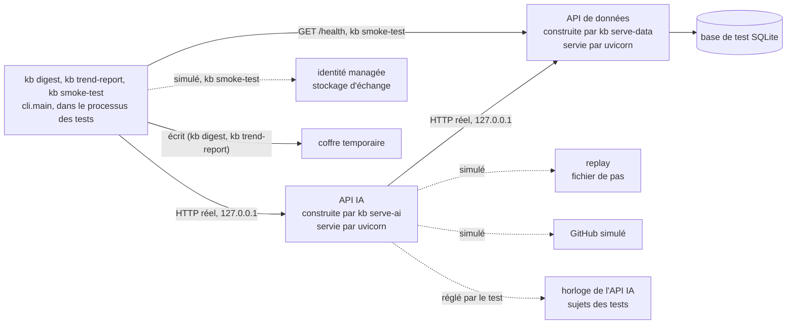

# Compte rendu des tests de l'API IA et de la chaîne des fiches — 2026-11-08

Ce compte rendu dit ce que prouvent les tests de l'API IA et de la chaîne des fiches et des comptes rendus de
tendances, et ce qu'ils ne prouvent pas, sans relire les tests un à un. Il ne recopie pas les contrats : ils sont
dans [fiches-veille.md](fiches-veille.md) (`POST /digests`), [tendances.md](tendances.md) (`POST /trend-reports`)
et [architecture-api-ia.md](architecture-api-ia.md) (ce qui compose l'API IA).

Les tests ont été lancés le 2026-11-08, de 11:17:45 à 11:18:34 UTC, sur le Mac, sans `.env`, sur `main` au commit
`f91bb97`. Chaque `fichier:ligne` vaut pour ce commit. Les chemins `tests/…` partent de la racine du dépôt, les
autres de `src/k_b/`. La section « Rejouer ce compte rendu » donne les commandes.

## Relance du 2026-11-18

Les commandes locales de ce compte rendu ont été relancées le 2026-11-18, de 17:15:02 à 17:16:05 UTC, sur le Mac,
sans variable `KB_` ni `OTEL_` dans l'environnement. Le code lancé est celui de `main` au commit `a7d7c309` : la
branche de la relance n'en diffère que par la documentation (`git diff --stat a7d7c309 -- src tests Makefile
pyproject.toml uv.lock` est vide). Ces fichiers sont les mêmes au commit `1bef80f2`, où cette section est écrite. Le reste de ce compte rendu, à partir de « Résultat de l'exécution », date du
2026-11-08 et du commit `f91bb97` : ses `fichier:ligne` valent pour ce commit-là.

| Commande | Ce qu'elle lance | 2026-11-08, `f91bb97` | 2026-11-18, `a7d7c309` |
|---|---|---|---|
| `make test` | toute la suite, comme `uv run pytest` | 4061 réussis, 328 écartés | 5628 réussis, 365 écartés, en 36,95 s |
| `make test-ai-api` (1re commande) | `tests/ai_api` | 1087 réussis | 1154 réussis, en 13,66 s |
| `make test-ai-api` (2e commande) | les tests du code commun aux deux API | 8 réussis | 8 réussis, en 0,44 s |
| `uv run pytest` sur la partie `kb` (« Rejouer ce compte rendu ») | `tests/post` sans `test_top_sheets.py`, et quatre fichiers de `tests/commands/` | 455 réussis, 33 écartés | 543 réussis, 48 écartés, en 2,68 s |

Aucun échec, aucun test sauté. Le périmètre compte **1705 tests** (1154 + 8 + 543), tous réussis. Les 365 tests
écartés par `make test` sont 15 tests `e2e` et 350 tests `postgresql` (`uv run pytest -m e2e --co -q`, puis
`-m postgresql`).

**Non relancés : les tests `e2e` et `postgresql`.** Les tests `e2e` lisent les clés de `.env.e2e_test` et appellent
de vrais services, dont Grafana Cloud pour l'export des mesures : la relance se limite aux commandes locales, sans
clé ni appel réseau. Les tests `postgresql` demandent un serveur PostgreSQL ; aucun des 1705 tests du périmètre ne
porte ce marqueur. La CI les lance à chaque PR et à chaque fusion : sur `main` au commit `a7d7c309`, le job
`tests-postgresql` a réussi (exécution 44281667496, `gh run view 44281667496`). Les tests `e2e` sont passés de 11 à
15 depuis `f91bb97` : `tests/e2e/test_sandbox_alerts.py` (4 tests, #517, lancés par `make sandbox-alerts`) construit
lui aussi l'API IA. La phrase « Un seul test `e2e` touche l'API IA », plus bas, vaut pour `f91bb97` seulement.

Le tableau suivant recompte les groupes de la section « Les groupes » sur `a7d7c309`, fichier par fichier, avec la
commande de comptage de « Rejouer ce compte rendu ».

| Groupe | 2026-11-08 | 2026-11-18 | Fichiers dont le nombre a changé |
|---|---|---|---|
| Routes et démarrage | 227 | 243 | `test_digest_router.py` 81 → 92, `test_serve_ai.py` 39 → 43, `test_trend_report_router.py` 87 → 88 |
| Contrôles | 440 | 453 | `test_fidelity.py` 108 → 115, `test_digests.py` 64 → 70 |
| Modèle de remplacement | 163 | 201 | `test_llm_settings.py` 28 → 57, `test_llm_client.py` 125 → 130, `test_digests_reference.py` nouveau (4) |
| Lecture de la veille et de GitHub | 183 | 183 | aucun |
| Mesures et traces | 82 | 82 | aucun |
| Chaîne côté `kb` | 452 | 540 | `tests/post/test_digest_sheets.py` 92 → 153, `tests/commands/test_digest_command.py` 25 → 38, `tests/post/test_ai_api_client.py` 59 → 69, `tests/post/test_vault_files.py` 24 → 26, `tests/commands/test_trend_report_command.py` 27 → 28, `tests/post/test_trend_report_sheets.py` 69 → 70 |
| Bout en bout | 3 | 3 | aucun |
| **Total** | **1550** | **1705** | |

Les fichiers des trois premiers groupes sont dans `tests/ai_api/`. `test_digests_reference.py` est nouveau : il
rejoue le jeu de référence des sorties de gpt-6-luna (#479), il est donc compté avec le modèle de remplacement.

Les PR fusionnées qui ont modifié ces fichiers depuis `f91bb97`, du plus ancien au plus récent
(`git log --first-parent --merges f91bb97..a7d7c309 -- <fichiers>`), sont les suivantes. Le nombre de tests que
chacune a ajoutés n'est pas compté.

- #516 (#479) : le jeu de référence de sorties réelles de `POST /digests`.
- #524 (#518) : les faits trouvés dans leur item et dans leur texte, comptés à part.
- #539 (#295) : une fiche ou un brut écrit une seule fois, même quand deux lancements se chevauchent.
- #548 (#424) : les fiches de la veille téléchargées dans le coffre du Mac.
- #567 (#558) : le client du stockage d'échange passe dans le paquet `exchange/` ; dans les fichiers comptés, les
  imports seulement.
- #574 (#566, #569) : l'en-tête `Server` retiré de `kb serve-data` et de `kb serve-ai`.
- #582 (#565) : chaque compte rendu d'un sujet commence au `until` de sa fiche précédente.
- #625 (#560) : les comptes rendus servis au site depuis le jumeau JSON de leur fiche.
- #628 (#627) : l'API IA appelle les modèles du banc de C7.
- #636 (#631 à #635) : K-B passe à gpt-6.1-sol (seuils du monitorage, prix, durée d'une demande, effort `low` en
  production).
- #645 (#630, #640) : les sujets d'une demande rédigés en parallèle, et le délai de lecture d'un appel réglé sur
  l'échéance.

Les issues que ce compte rendu cite, relues le 2026-11-18 par `gh issue view` : #210, #370 et #436 sont encore
ouvertes ; #280 et #462 sont fermées depuis le 2026-11-08, et la PR #472 est fusionnée. Les manques de « Ce que les
tests ne prouvent pas » restent donc portés par les mêmes issues.

## Résultat de l'exécution

| Commande | Ce qu'elle lance | Résultat |
|---|---|---|
| `make test` | toute la suite, comme `uv run pytest` | 4061 réussis, 328 écartés, en 31,34 s |
| `make test-ai-api` (1re commande) | `tests/ai_api` | 1087 réussis, en 13,08 s |
| `make test-ai-api` (2e commande) | les tests du code commun aux deux API (`API_COMMON_TESTS`) | 8 réussis, en 0,47 s |
| `uv run pytest` sur la partie `kb` (voir « Rejouer ») | `tests/post` sans `test_top_sheets.py` ; dans `tests/commands/` : `test_digest_command.py`, `test_trend_report_command.py`, `test_digest_watch_command.py` et `test_live_apis.py` | 455 réussis, 33 écartés (`test_top_sheets.py`), en 2,23 s |

Aucun échec, aucun test sauté. Le périmètre de ce compte rendu compte **1550 tests** (1087 + 8 + 455), tous réussis.

Les 328 tests écartés par `make test` sont ceux que `tests/conftest.py` laisse de côté sans `-m`
(`MARKERS_LEFT_OUT_BY_DEFAULT`, `tests/conftest.py:46`) : 11 marqués `e2e` et 317 marqués `postgresql`. Aucun des
1550 tests du périmètre ne porte ces marqueurs. Un seul test `e2e` touche l'API IA :
`tests/e2e/test_real_export.py` (section « Ce que les tests ne prouvent pas »).

### Hors du compte

Les 1550 tests sont ceux des fichiers du tableau des groupes. Les fichiers ci-dessous testent aussi, en entier ou
en partie, l'API IA ou la chaîne : ils sont dans les 4061 de `make test` (sauf les 79 marqués `postgresql`, parmi les
328 écartés), pas dans les 1550. Chaque nombre vient de
`uv run pytest --co -q <fichier>`.

| Fichier | Tests | Ce qu'il teste de l'API IA ou de la chaîne | Pourquoi hors du compte |
|---|---|---|---|
| `tests/post/test_top_sheets.py` | 33 | rien : il teste `kb write-tops` (`tests/post/test_top_sheets.py:21`), qui écrit les fiches des tops depuis la base, sans l'API IA | hors de la chaîne |
| `tests/data_api/` | 201, plus 79 marqués `postgresql` | l'API de données, que l'API IA appelle ; dont la clé de chaque client, code commun aux deux API (`tests/data_api/test_api_keys.py:1`, 14 tests), les plafonds d'une demande de fiches et d'un compte rendu sous les limites de l'API de données (`tests/data_api/test_rate_limit.py:82`), l'échéance d'une requête sous le délai de lecture du client de l'API IA (`tests/data_api/test_api_errors.py:181`) | son propre groupe (`make test-data-api`) |
| `tests/architecture/test_apis.py` | 55 | ce que les deux API peuvent importer (`:1-3`), dont la règle 7 de `.claude/rules/poc.md` pour l'API IA | test d'architecture, commun aux deux API |
| `tests/architecture/test_opentelemetry.py` | 13 | les quatre modules de l'API IA, seuls à importer OpenTelemetry (`:1-3`) | test d'architecture |
| `tests/test_outbound.py` | 35 | les règles d'une connexion HTTP de K-B : l'URL acceptée, le client HTTP, la borne d'un corps lu (`:1-2`) | code commun à tous les clients HTTP de K-B (`core/outbound.py`) |
| `tests/commands/test_smoke_test_command.py` | 14 | `kb smoke-test` : la santé des deux API, puis le listage du stockage d'échange (`:1-2`) | une commande des jobs en ligne |
| `tests/jobs/test_api_health.py` | 12 | `GET /health` d'une API depuis un job (`:1-2`) | code des jobs |
| `tests/jobs/test_watch_publication.py` | 11 | la publication de `veille` (`:1-2`), dans le code des jobs | code des jobs |
| `tests/commands/test_job_transfers.py` | 8 | les transferts des jobs (`:1-2`), dont la publication de `veille` (`:131`, `:143`, `:161`) : `publish_the_watch`, dernière étape de `kb digest-watch` (`commands/digest_watch_command.py:16`, `:77`) | code des jobs |
| `tests/commands/test_wait_display.py` | 6 | l'attente d'une commande affichée sur la sortie d'erreur (`:1`), dont `kb digest` se sert (`commands/digest_command.py:23`) | affichage commun aux commandes |
| `tests/commands/test_job_routine.py:155`, `tests/commands/test_sigint.py:73`, `tests/commands/test_exit_codes.py:31`, `tests/commands/test_daily_routine_command.py:109`, `tests/architecture/test_layers.py:206` | en partie | les étapes de `kb digest-watch` (`DIGEST_WATCH_STEPS`) ; un SIGINT pendant l'attente de `kb digest` ; le code de sortie de `kb digest` ; l'arrêt de `kb digest-watch` sur SIGTERM ; `post` n'importe aucune des deux API | fichiers communs à d'autres commandes, ou test d'architecture |

## Les groupes

Chaque fichier est compté dans un seul groupe ; la somme redonne 1550.

| Groupe | Fichiers (nombre de tests) | Tests | Résultat |
|---|---|---|---|
| Routes et démarrage | `tests/ai_api/` : `test_digest_router.py` (81), `test_trend_report_router.py` (87), `test_serve_ai.py` (39), `test_ai_api_openapi.py` (9), `test_deadline.py` (3) ; code commun : `tests/test_api_methods.py` (1), `tests/test_api_rate_limit.py` (6), `tests/test_api_telemetry.py` (1) | 227 | réussis |
| Contrôles | `tests/ai_api/` : `test_fidelity.py` (108), `test_trend_writing.py` (81), `test_digests.py` (64), `test_repository_texts.py` (54), `test_stages.py` (52), `test_trend_selection.py` (30), `test_trajectories.py` (27), `test_watch_items.py` (18), `test_repository_cards.py` (6) | 440 | réussis |
| Modèle de remplacement | `tests/ai_api/` : `test_llm_client.py` (125), `test_llm_settings.py` (28), `test_llm_replay.py` (10) | 163 | réussis |
| Lecture de la veille et de GitHub | `tests/ai_api/` : `test_github_client.py` (89), `test_data_api_client.py` (77), `test_data_api_settings.py` (11), `test_github_settings.py` (6) | 183 | réussis |
| Mesures et traces | `tests/ai_api/` : `test_metrics_export.py` (50), `test_tracing.py` (19), `test_trace_export.py` (13) | 82 | réussis |
| Chaîne côté `kb` | `tests/post/` : `test_trend_report_client.py` (129), `test_digest_sheets.py` (92), `test_trend_report_sheets.py` (69), `test_ai_api_client.py` (59), `test_vault_files.py` (24), `test_trend_report_registry.py` (15) ; `tests/commands/` : `test_trend_report_command.py` (27), `test_digest_command.py` (25), `test_digest_watch_command.py` (12) | 452 | réussis |
| Bout en bout | `tests/commands/test_live_apis.py` (3) | 3 | réussis |
| **Total** | | **1550** | **réussis** |

Le groupe « clé » du critère de #280 n'a pas de fichier à lui : ses tests sont dans les routes et dans les clients.
Ils sont listés dans sa section, et comptés dans leur groupe.

## Routes et démarrage

**Ce qu'il prouve.**

- Les deux routes répondent comme leurs contrats le disent, dans les cas testés, sur la vraie application de l'API IA
  (`create_app`, `tests/ai_api/test_digest_router.py:26`), appelée par le `TestClient` de FastAPI, dans le
  processus des tests (`tests/ai_api/test_digest_router.py:244`).
- La vraie application de l'API de données sert la base de test (`data_api`, `tests/ai_api/test_digest_router.py:179-187`).
  La base de test est un fichier SQLite construit une fois pour la session (`items_database`,
  `tests/conftest.py:262-273`).
- `POST /trend-reports` est testé sur une API de données et un GitHub simulés, qui comptent leurs requêtes
  (docstring de `tests/ai_api/test_trend_report_router.py:1-2`), puis sur l'API de données de la base de test
  (`test_the_report_of_the_test_base_reads_its_two_windows`, `tests/ai_api/test_trend_report_router.py:434`).
- Une demande mal formée est refusée en 422 : avant tout appel au modèle pour `/digests`
  (`tests/ai_api/test_digest_router.py:389`), avant toute lecture de l'API de données pour `/trend-reports`
  (`tests/ai_api/test_trend_report_router.py:488`, assertion `tests/ai_api/test_trend_report_router.py:501`). Un
  corps trop gros est refusé, en 413, avant même la clé (`tests/ai_api/test_digest_router.py:448`).
- L'échéance d'une demande de fiches : le temps restant, et les délais d'une requête raccourcis à ce temps, jamais
  allongés (`tests/ai_api/test_deadline.py:1-2`, `:20`, `:43`).
- `kb serve-ai` vérifie ses clés et ses réglages au démarrage (`tests/ai_api/test_serve_ai.py:1-2`), puis s'arrête sur
  SIGTERM avec le code d'un processus arrêté par ce signal (`tests/ai_api/test_serve_ai.py:435`).
- L'OpenAPI versionnée (`docs/api/openapi-ia.json`) est celle que produit l'application
  (`tests/ai_api/test_ai_api_openapi.py:1-2`).
- Le code commun aux deux API : le retrait du `HEAD` que Starlette ajoute (`tests/test_api_methods.py:1`), la fenêtre
  glissante de la limite de débit (`tests/test_api_rate_limit.py:63`) sur une horloge réglée par le test (`SetClock`,
  `tests/test_api_rate_limit.py:10`), et l'OpenTelemetry natif de FastAPI éteint (`tests/test_api_telemetry.py:1-2`).

**Ce qu'il ne prouve pas.**

- Le transport réseau : le `TestClient` appelle l'application sans socket. Le transport réel n'est vu que par le
  bout en bout et, pour `/health` seul, par `tests/ai_api/test_serve_ai.py:435`, qui lance `kb serve-ai` dans un
  sous-processus et l'appelle sur `127.0.0.1` (`wait_for_health`, `tests/ai_api/test_serve_ai.py:460`, `:471-475`).
- Les dépendances de production qui ouvrent les clients et lisent l'heure : les tests remplacent
  `open_data_api_client` et `read_request_time`, et `open_llm_client` sauf quand ils prennent le replay des réglages
  (`replay_from_settings`, `tests/ai_api/test_digest_router.py:238-243`), puis `open_github_client`
  (`tests/ai_api/test_trend_report_router.py:222`, `:247`). `open_github_client` et
  `read_request_time` (`ai_api/dependencies.py:28-34`) ne sont exécutées par aucun test, bout en bout compris
  (`tests/commands/test_live_apis.py:179-182`) : la couverture de toute la suite laisse
  `ai_api/dependencies.py:29-30` et `:34` non exécutées.
- La limite de débit sous une vraie charge, ni sa tenue dans le temps : elle est comptée en mémoire, et un
  redémarrage la vide (`core/config.py:306-308`).
- Une base PostgreSQL derrière l'API de données : ces tests lisent la base SQLite de test.

## Clé

**Ce qu'il prouve.** Les tests de la clé et du droit de chaque client, dans leurs groupes :

| Ce qui est prouvé | Test |
|---|---|
| Une demande sans clé valide est refusée avant toute lecture | `tests/ai_api/test_digest_router.py:341`, `tests/ai_api/test_trend_report_router.py:529` |
| Une demande refusée pour sa clé ne consomme aucun appel de la limite | `tests/ai_api/test_digest_router.py:1496` |
| Seules les routes publiques, dont `/health`, répondent sans clé | `tests/ai_api/test_digest_router.py:1108`, `:1117` |
| Un client est refusé en 403 sur une route qui n'est pas la sienne | `tests/ai_api/test_digest_router.py:1509`, `:1524` |
| Une route absente de la table des droits est refusée à tout client | `tests/ai_api/test_digest_router.py:1537` |
| Le journal de `kb serve-ai` nomme ses clients, jamais une clé | `tests/ai_api/test_serve_ai.py:384` |
| `kb serve-ai` sort en 2 quand un client a la clé qu'il envoie à l'API de données | `tests/ai_api/test_serve_ai.py:503` |
| Côté `kb digest`, une clé refusée devient `ai_api_unauthorized`, sans être citée, et un 403 `ai_api_forbidden` | `tests/post/test_ai_api_client.py:268`, `:354` |
| `kb trend-report` lit sa propre variable de clé | `tests/post/test_trend_report_client.py:176` |

La table des droits est `AI_API_CLIENT_BY_ROUTE` : `/digests` à `KB_DIGEST`, `/trend-reports` à `KB_TREND_REPORT`
(`core/config.py:300-305`).

**Ce qu'il ne prouve pas.**

- Dans les tests des routes et du client de `kb digest`, les clés des clients de l'API IA sont tirées au hasard une
  fois, au chargement du module
  (`secrets.token_urlsafe(32)`, `tests/ai_api/test_digest_router.py:81-87`, `tests/ai_api/test_trend_report_router.py:55`,
  `tests/post/test_ai_api_client.py:41`) ; celle de l'API de données l'est à chaque test
  (`tests/ai_api/test_digest_router.py:181`), comme celles du bout en bout (`tests/commands/test_live_apis.py:161-163`).
  Aucun test ne lit les clés d'un déploiement en ligne, ni leur rotation.
- La comparaison des clés en temps constant (`hmac.compare_digest`, `core/api_access.py:55-60`) : aucun test ne la
  prouve (`grep -rn compare_digest tests/` ne rend rien).

## Contrôles

**Ce qu'il prouve.**

- **La fidélité** : un fait d'une affirmation est normalisé, puis cherché dans son texte et dans l'item qu'elle
  cite, entre ses limites (docstring de `tests/ai_api/test_fidelity.py:1-2`). Une affirmation piégée est retirée,
  écrite en clair (`tests/ai_api/test_fidelity.py:361`) ou déguisée (`:416`).
- **Ce qui part au modèle** : les champs d'un item, les lots, le schéma et la consigne
  (`tests/ai_api/test_stages.py:1-2`) ; les items passent par la liste blanche, masqués, puis coupés pour la rédaction
  (`tests/ai_api/test_watch_items.py:1-2`).
- **Le texte d'une source n'est jamais une consigne** (règle 8 de `.claude/rules/poc.md`) : chaque consigne dit que
  le message utilisateur est une donnée (`tests/ai_api/test_stages.py:363`) ; les items vont dans le message
  utilisateur, jamais dans un message `system` (`tests/ai_api/test_digests.py:634`) ; une description piégée et un
  README piégé n'entrent dans aucun message `system`, même à la nouvelle tentative
  (`tests/ai_api/test_trend_selection.py:236`, `tests/ai_api/test_trend_writing.py:229`).
- **Une sortie hors contrat n'est jamais rendue** : un modèle qui obéit à un item piégé donne un état nommé et
  aucune fiche (`tests/ai_api/test_digests.py:947`) ; l'affirmation piégée sur une CVE est retirée et la fiche rendue
  (`:1156`).
- **Les comptes rendus de tendances** : rangs, trajectoires et critères en code pur
  (`tests/ai_api/test_trajectories.py:1-2`) ; la fiche d'un candidat et ses mises en garde
  (`tests/ai_api/test_repository_cards.py:1-2`) ; le nettoyage d'un texte de dépôt, un piège par cas
  (`tests/ai_api/test_repository_texts.py:1-3`) ; le choix du modèle et la rédaction, leurs contrôles et leurs
  échecs (`tests/ai_api/test_trend_selection.py:1-3`, `tests/ai_api/test_trend_writing.py:1-3`).

**Ce qu'il ne prouve pas.** Les contrôles sont prouvés sur des sorties écrites à l'avance. Ils ne disent rien de la
part des sorties d'un vrai modèle qu'ils retirent ou refusent : c'est ce que mesurent les essais de #210 pour les
fiches, et de #370 pour les comptes rendus de tendances (section « Ce que les tests ne prouvent pas »).

## Modèle de remplacement

**Ce qu'il prouve.**

- Le *replay* donne des réponses connues à l'avance, dans l'ordre, par le transport du client HTTP : un appel réel
  passe en entier, sans réseau, sans clé et sans coût (docstring de `ai_api/connectors/llm_replay.py:1-3` ;
  `ReplayTransport`, `ai_api/connectors/llm_replay.py:87`). Le client du modèle le prend comme transport
  (`ai_api/connectors/llm_client.py:210`) : le code de l'appel est celui de la production, seul le transport
  change.
- Chaque état nommé d'un appel a son test (docstring de `tests/ai_api/test_llm_client.py:1`), par exemple : une
  sortie valide rendue avec ses mesures (`:181`), une sortie refusée deux fois (`llm_invalid_output`, `:246`), une
  sortie coupée (`llm_truncated`, `:387`), une sortie filtrée (`llm_content_filtered`, `:399`), une limite de débit
  atteinte deux fois après l'attente du `Retry-After` (`llm_rate_limited`, `:426`). Un item piégé reste dans le message
  utilisateur, et sa sortie n'est jamais rendue (`tests/ai_api/test_llm_client.py:574`).
- Le fichier des pas est lu (`tests/ai_api/test_llm_replay.py:24`), vérifié (`:54`), puis rendu dans l'ordre et
  refusé une fois épuisé (`:64`). Les réglages du modèle se lisent d'un dictionnaire, jamais du `.env`
  (`tests/ai_api/test_llm_settings.py:1`).

**Ce qu'il ne prouve pas.** Aucun test n'appelle un vrai modèle : en CI, le job `tests` (`.github/workflows/ci.yml:26`)
ne règle aucune variable `KB_LLM_*`. Le *replay* ne dit rien de la qualité d'une fiche ou d'un compte rendu, ni du
filtre de contenu d'Azure, ni du temps de réponse réel : ce sont les essais de #210 (fiches) et de #370 (tendances).

## Lecture de la veille et de GitHub

**Ce qu'il prouve.**

- Le client de l'API de données lit la veille sur la vraie API de données de la base de test, et sur un transport
  simulé pour les réponses que la base ne peut pas donner (docstring de `tests/ai_api/test_data_api_client.py:1-2`).
- Le client GitHub lit la fiche et le README d'un dépôt sur un GitHub simulé, qui sert une vraie réponse
  (`tests/fixtures/github_repository_extract.json`) et un README de la forme d'un vrai
  (`tests/fixtures/github_readme_extract.md`) ; aucun test n'appelle GitHub (docstring de
  `tests/ai_api/test_github_client.py:1-3`).
- Les réglages des deux clients se lisent d'un dictionnaire, jamais du `.env`, et le jeton GitHub n'est jamais cité
  (`tests/ai_api/test_data_api_settings.py:1`, `tests/ai_api/test_github_settings.py:1-2`).

**Ce qu'il ne prouve pas.** Le vrai GitHub : un changement de la forme de ses réponses, sa limite de débit, un
jeton réel. L'API de données sur PostgreSQL : ses tests marqués `postgresql` sont dans `tests/data_api`, hors de ce
périmètre, et passent par le job `tests-postgresql` de la CI (`.github/workflows/ci.yml:60`, `:86`).

## Mesures et traces

**Ce qu'il prouve.** L'export des mesures et des traces en OpenTelemetry : ses réglages, refusés sans citer les
en-têtes ; une ressource fermée ; le dernier export à l'arrêt ; un arrêt borné quand le point d'arrivée ne répond
pas (docstrings de `tests/ai_api/test_metrics_export.py:1-2` et `tests/ai_api/test_trace_export.py:1-3`) ; un span
par étape (`tests/ai_api/test_tracing.py:1-2`). `KB_TRACE_CONTENT=all` est refusé en production, sans citer de valeur
(`tests/ai_api/test_metrics_export.py:135`). Les deux docstrings disent « no network » (pour les traces : sauf une
socket locale).

**Ce qu'il ne prouve pas.**

- L'arrivée des mesures chez Grafana Cloud : seul le test `e2e` `tests/e2e/test_real_export.py` les envoie au vrai
  point d'arrivée (`tests/e2e/test_real_export.py:1-3`), et la CI l'écarte.
- L'arrivée des traces et des journaux dans Tempo et Loki : aucun test, même `e2e`. Le test `e2e` n'exporte aucune
  trace (`TraceExport.from_settings(None, …)`), et son commentaire dit que les traces sont essayées par Sabine sur
  `kb serve-ai` (`tests/e2e/test_real_export.py:95-96`).

## Chaîne côté `kb`

**Ce qu'il prouve.**

- Les clients de `kb digest` et de `kb trend-report` : leur demande, et la réponse qu'ils acceptent. Chaque 200 des
  tests est construit par le schéma de l'API IA, ce qui lie le client au contrat (docstrings de
  `tests/post/test_ai_api_client.py:1-2` et `tests/post/test_trend_report_client.py:1-2`).
- Les fiches et les comptes rendus dans le coffre : leur chemin, leur Markdown, les refus avant l'écriture (fiche
  du jour déjà là, dossier ou fiche liés ailleurs : `tests/post/test_digest_sheets.py:414`, `:438`, `:452`) et
  pendant l'écriture (fiche écrite entre-temps, `:469` ; fiche vue par l'écriture, `:485` ; dossier lié après le
  contrôle, `:498`) ; de même pour les comptes rendus et tout fichier du coffre
  (`tests/post/test_trend_report_sheets.py:1-2`, `tests/post/test_vault_files.py:1-2`).
- Le registre des comptes rendus (`KB_DATA_DIR/trend_reports.json`) : absent, lu, refusé, réécrit avec une entrée de
  plus (`tests/post/test_trend_report_registry.py:1`).
- Les commandes : `kb digest` écrit la fiche de chaque sujet et le dit (`tests/commands/test_digest_command.py:100`),
  et ne demande rien quand la fiche du jour existe (`:160`) ; `kb trend-report` écrit le premier compte rendu puis l'ajoute au registre
  (`tests/commands/test_trend_report_command.py:102`), et ne nomme jamais un dépôt dans le journal (`:164`) ;
  `kb digest-watch` réveille les deux API avant `kb digest` et avant `kb trend-report`
  (`tests/commands/test_digest_watch_command.py:56`).

**Ce qu'il ne prouve pas.** Dans ces tests, l'API IA est simulée : ses réponses sont construites par son schéma,
pas rendues par l'application. `kb digest-watch` y enchaîne des étapes simulées (`check_api`,
`tests/commands/test_digest_watch_command.py:48-52`). La chaîne de `kb digest` et de `kb trend-report` n'est vue
entière que par le bout en bout ; celle de `kb digest-watch`, par aucun test.

## Bout en bout



Le schéma se lit ainsi :

- **Ce qui est réel.** `kb digest`, `kb trend-report` et `kb smoke-test` sont lancés par `cli.main`, dans le
  processus des tests (`tests/commands/test_live_apis.py:203`, `:292`, `:335`). `kb digest` et `kb trend-report`
  écrivent dans un coffre temporaire (`data_and_vault_dirs`, `tests/commands/conftest.py:67-73`, pris par
  `tests/commands/test_live_apis.py:188`, `:265`). Les deux API sont construites par `kb serve-data` et `kb serve-ai` depuis leur environnement,
  comme en production (`build_app_as_served`, `tests/commands/test_live_apis.py:111-118`), puis servies par uvicorn
  sur un port libre de `127.0.0.1` (`serving`, `tests/commands/test_live_apis.py:86-108`). `kb` les appelle en
  HTTP, avec ses clés : une par client, car `kb serve-ai` refuse une même clé pour deux
  (`tests/commands/test_live_apis.py:161-163`). L'API de données lit la base de test SQLite
  (`tests/commands/test_live_apis.py:150-159`). `kb smoke-test` appelle le `/health` de chacune des deux API.
- **Ce qui est simulé.** Le modèle est le *replay* (`PROVIDER_VARIABLE: "replay"`,
  `tests/commands/test_live_apis.py:168`). GitHub est simulé sur les dépôts de la base de test
  (`tests/commands/test_live_apis.py:180-182`). L'horloge de l'API IA est fixée, pour que la fenêtre des fiches
  tombe sur la base de test (`tests/commands/test_live_apis.py:179`), et les sujets sont ceux des tests
  (`:164`). Pour `kb smoke-test`, l'identité managée et le stockage d'échange sont simulés
  (`tests/commands/test_live_apis.py:304-329`).

Les trois tests :

| Test | Ce qu'il prouve |
|---|---|
| `test_digest_writes_the_sheets_through_the_ai_api_and_the_data_api` (`tests/commands/test_live_apis.py:198`) | `kb digest` sort avec succès et écrit une fiche par sujet ; la fiche des alertes porte le titre d'une vulnérabilité que seule l'API de données lui donne (`:206-215`) |
| `test_trend_report_writes_the_chosen_through_the_ai_api_and_the_data_api` (`tests/commands/test_live_apis.py:287`), le test de #462 (PR #472) | `kb trend-report` écrit le compte rendu ; sa section « Choisis par le modèle » est celle attendue, y compris le secteur que les contrôles retirent (`:297`) ; la période vient des fenêtres de la base de test (`:300`) |
| `test_smoke_test_reaches_the_health_of_both_apis_served` (`tests/commands/test_live_apis.py:332`) | `kb smoke-test` atteint le `/health` des deux API servies ; l'identité et le stockage d'échange sont simulés (`:304-329`) |

**Ce qu'il ne prouve pas.**

- Le vrai modèle, le vrai GitHub et l'API en ligne. Le réseau ne sort pas de la machine.
- PostgreSQL : l'API de données y lit la base de test SQLite (`tests/commands/test_live_apis.py:150-159`).
- HTTPS : les API sont appelées en `http` sur `127.0.0.1` ; hors de la machine et, dans le bac à sable, des services
  compose, K-B exige `https` (`core/outbound.py:42-61`).
- `kb digest-watch` : aucun test de bout en bout ; ses tests simulent ses étapes
  (`tests/commands/test_digest_watch_command.py:48-52`).

## Ce que les tests ne prouvent pas

| Manque | Ce qui le porte |
|---|---|
| La qualité d'une fiche rédigée par un vrai modèle : fidélité, schémas valides, items oubliés, filtre de contenu, temps de réponse | #210, encore ouverte (`gh issue view 210` → `OPEN`). Ses essais ne sont pas tous consignés : le seul essai de #210 cité dans `docs/fiches-veille.md` est l'essai 1 du 2026-10-26, sur le classement ([fiches-veille.md](fiches-veille.md), « Pourquoi une propriété par item ») |
| La qualité d'un compte rendu de tendances rédigé par un vrai modèle, ses seuils, et la durée de `POST /trend-reports` face au délai de l'ingress d'ACA | #370, encore ouverte (`gh issue view 370` → `OPEN`) : « L'essai réel de bout en bout est #370 » ([tendances.md](tendances.md), ligne 596) ; les seuils (ligne 135) et la durée (lignes 614-615) y sont renvoyés |
| Le vrai GitHub | aucun test ; la fixture de `tests/ai_api/test_github_client.py:1-3` est une vraie réponse, figée |
| L'API IA en ligne (Azure Container Apps) : son réveil, l'identité managée, l'ingress, `POST /digests` et `POST /trend-reports` en ligne | aucun test des PR. `kb smoke-test`, la commande du job `caj-kb-smoke-test`, ne vérifie que le `/health` des deux API et le listage du stockage d'échange (README, « Vérifier un job en ligne ») ; le workflow de déploiement le lance après chaque tag (`.github/workflows/deploy.yml:206-209`) |
| La chaîne sur PostgreSQL | aucun des 1550 tests ne lit PostgreSQL : ceux qui lisent une base lisent la base de test SQLite ; PostgreSQL n'est testé que dans les tests marqués `postgresql`, hors de ce périmètre |
| L'arrivée des mesures chez Grafana Cloud | `tests/e2e/test_real_export.py`, marqué `e2e`, écarté de la CI, lancé sur le Mac ; sa preuve finit dans Grafana Explore (`tests/e2e/test_real_export.py:7`) |
| L'arrivée des traces et des journaux dans Tempo et Loki | aucun test, même `e2e` (`tests/e2e/test_real_export.py:95-96`) ; les traces sont essayées à la main par Sabine sur `kb serve-ai` (le commentaire de `:95`) |
| Une lecture bornée avant le premier morceau décodé | #436, ouverte : `read_bounded_body` ne borne rien avant le premier morceau (MEMORY.md, « Problèmes connus ») |

## Rejouer ce compte rendu

```sh
git switch --detach f91bb97         # le commit de l'exécution
make test                           # 4061 passed, 328 deselected
make test-ai-api                    # 1087 passed, puis 8 passed
uv run pytest tests/post tests/commands/test_digest_command.py tests/commands/test_trend_report_command.py \
  tests/commands/test_digest_watch_command.py tests/commands/test_live_apis.py \
  --deselect tests/post/test_top_sheets.py -q          # 455 passed, 33 deselected
# Le nombre de tests de chaque fichier (pour le tableau des groupes) :
uv run pytest --co -q tests/ai_api tests/post tests/test_api_methods.py tests/test_api_rate_limit.py \
  tests/test_api_telemetry.py tests/commands/test_digest_command.py tests/commands/test_trend_report_command.py \
  tests/commands/test_digest_watch_command.py tests/commands/test_live_apis.py \
  --deselect tests/post/test_top_sheets.py | grep '::' | sed -E 's/::.*//' | sort | uniq -c
# Les tests écartés par défaut : 11 e2e, 317 postgresql.
uv run pytest -m e2e --co -q | tail -1
uv run pytest -m postgresql --co -q | tail -1
```
