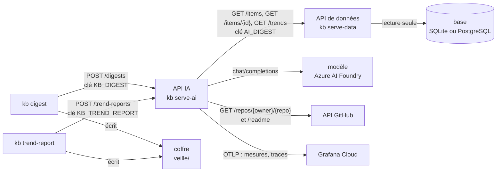
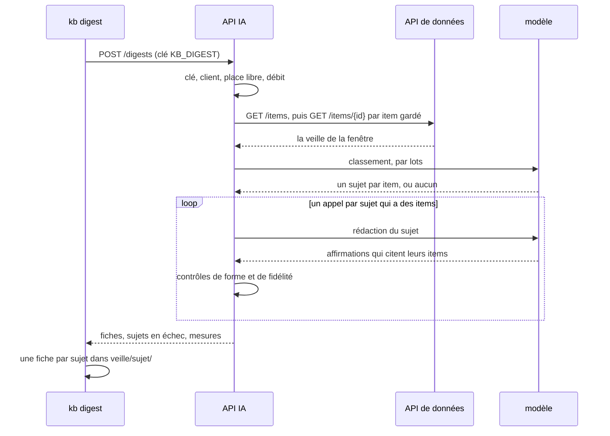
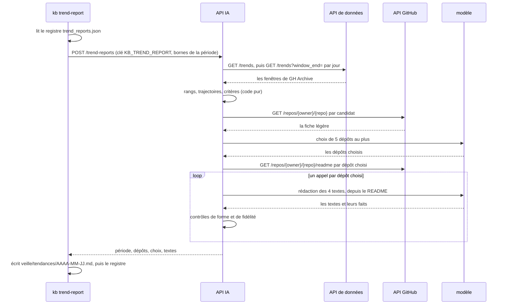
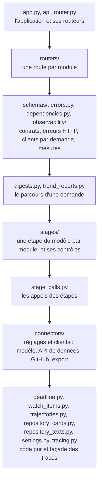

# Architecture de l'API IA

L'API IA est la seule porte de K-B vers le modèle. Ce document montre ce qui la compose, ce qu'elle appelle et
qui l'appelle, sans lire le code. Ses contrats (demandes, réponses, contrôles, états nommés) sont dans
[fiches-veille.md](fiches-veille.md) pour `POST /digests` et dans [tendances.md](tendances.md) pour
`POST /trend-reports`. Ce document ne les recopie pas.

Chaque `fichier:ligne` vaut pour `main` au commit `ef64e95`. Les chemins sans dossier de tête sont sous
`src/k_b/`. La section « Vérifier ce document » donne les commandes qui retrouvent ces faits.

## Vue d'ensemble



Le schéma se lit ainsi :

- **Deux clients appellent l'API IA**, chacun avec sa clé. `kb digest` envoie `POST /digests`
  (`post/ai_api_client.py:51`), et `kb trend-report` envoie `POST /trend-reports`
  (`post/trend_report_client.py:60`). Chaque route n'est ouverte qu'à un client :
  `/digests` à `KB_DIGEST`, `/trend-reports` à `KB_TREND_REPORT` (`core/config.py:295-300`).
- **L'API IA lit la veille par l'API de données**, jamais dans la base. Elle appelle `GET /items`,
  `GET /items/{item_id}` et `GET /trends` (`ai_api/connectors/data_api_client.py:45-46`, `:289`, `:308`), avec la
  clé du client `AI_DIGEST` (`ai_api/connectors/data_api_settings.py:15`).
- **L'API de données lit la base** : ses routeurs importent `database.reading`
  (`data_api/routers/item_router.py:19`, `data_api/routers/trend_router.py:12`). La base est le fichier SQLite du dossier de données,
  ou la base PostgreSQL que nomme `KB_DATABASE_URL` (`database/location.py:1-3`) : PostgreSQL en ligne
  (`infra/main.bicep:181`).
- **L'API IA appelle le modèle** par une interface compatible OpenAI, sur le chemin `chat/completions`
  (`ai_api/connectors/llm_client.py:40`). Le fournisseur est `openai_compatible` ou `replay`
  (`ai_api/connectors/llm_settings.py:31`). Le code ne nomme pas Azure : l'adresse et le modèle sont des réglages
  (`infra/main.bicep:218-222`). Le modèle retenu est gpt-6-luna sur Azure AI Foundry (journal ADR, « Modèle des
  fiches : gpt-6-luna sur l'abonnement de l'organisme de formation »).
- **L'API IA lit GitHub** pour les seules tendances : la fiche de chaque candidat et le README de chaque dépôt
  choisi (`ai_api/connectors/github_client.py:169`, `:189`).
- **L'API IA envoie ses mesures et ses traces** en OTLP, quand l'export est réglé. Leur destinataire est Grafana
  Cloud ([registre](registre-traitements.md), « Envoi des mesures à Grafana Cloud »).
- **Seul `kb` écrit dans le coffre.** L'API IA rend les fiches et le compte rendu, sans rien garder
  (« Ce qui est interdit »).

## Le parcours de `POST /digests`



Le schéma se lit ainsi :

1. `kb digest` vérifie d'abord le coffre. Si une fiche du jour existe déjà, rien n'est demandé
   (`commands/digest_command.py:70`). Sinon, il envoie la demande (`:88`).
2. L'app refuse une demande dans cet ordre : clé inconnue (401), client d'une autre route (403), route déjà
   occupée, débit dépassé (429) (`ai_api/app.py:62-67`). Une demande refusée ne consomme rien de ce qui suit.
3. Toute la demande est bornée par une échéance de 200 s (`core/config.py:451`, `ai_api/routers/digest_router.py:100`).
4. L'API IA lit la fenêtre par l'API de données (`ai_api/routers/digest_router.py:108`). Si cette lecture échoue,
   la demande échoue sans appel au modèle (`:166-176`).
5. Le modèle classe les items (`ai_api/digests.py:68`), puis rédige chaque sujet, un appel après l'autre
   (`:101`). Le code revalide chaque sortie (`ai_api/stages/checking.py:61`, `ai_api/stages/fidelity.py:119`).
6. Chaque appel au modèle écrit une ligne JSON sur la sortie standard et compte dans les mesures OpenTelemetry
   (`ai_api/routers/digest_router.py:120`, `:134`).
7. `kb digest` écrit une fiche par sujet (`commands/digest_command.py:96`).

Les étapes, leurs bornes et leurs états nommés sont dans [fiches-veille.md](fiches-veille.md), « Le parcours
d'une demande ».

## Le parcours de `POST /trend-reports`



Le schéma se lit ainsi :

1. `kb trend-report` lit le registre des comptes rendus et vérifie que le fichier du jour n'existe pas
   (`commands/trend_report_command.py:70`, `post/trend_report_registry.py:62`). Puis il envoie la demande, avec
   les bornes de la période (`commands/trend_report_command.py:76`). L'API IA reçoit ces bornes : c'est ce qui la
   garde sans état.
2. Les mêmes contrôles d'accès que pour `POST /digests` s'appliquent (`ai_api/app.py:62-67`), puis une échéance de
   200 s (`core/config.py:459`).
3. L'API IA lit les fenêtres par l'API de données (`ai_api/trend_reports.py:158`). Elle calcule les rangs et les
   critères en code pur (`:166`, `ai_api/trajectories.py:68`), puis retient les candidats (`ai_api/trend_reports.py:179`).
4. Elle lit sur GitHub la fiche de chaque candidat (`:181`). Le modèle en choisit 5 au plus (`:192`,
   `core/config.py:377`).
5. Elle lit le README des seuls dépôts choisis (`ai_api/trend_reports.py:205`). Le modèle écrit ensuite quatre
   textes par dépôt, un appel par dépôt (`:206`) : `sector`, `watch_link`, `readme_summary` et `promise`
   (`ai_api/schemas/trend_report_schema.py:105-119`). Ce sont les textes de #369 (PR #468).
6. Si une lecture des fenêtres ou des fiches échoue, toute la demande échoue
   (`ai_api/routers/trend_report_router.py:139-149`). Si le choix échoue, le compte rendu reste factuel. Si un
   README ou une rédaction échoue, les textes de ce dépôt restent vides et l'échec est nommé
   (`ai_api/trend_reports.py:1-5`, [tendances.md](tendances.md), « Défenses et échecs »).
7. `kb trend-report` écrit le fichier, puis ajoute l'entrée au registre (`commands/trend_report_command.py:102-104`).

Les étapes, les critères et la rédaction sont dans [tendances.md](tendances.md), « Le parcours d'une demande ».

## Les couches de `src/k_b/ai_api/`

Les 35 modules de `ai_api/` sont rangés en 16 couches. Un module n'importe que les couches en dessous de la
sienne : deux modules d'une même couche ne s'importent pas entre eux. La table vient de `AI_API_LAYERS`
(`tests/architecture/test_apis.py:151-194`). Deux tests la tiennent : chaque module est dans une seule couche
(`:212`), et aucun n'importe sa couche ni celles du dessus (`:223`). Le rangement par rôle date de #242 (journal ADR,
« API IA : organisation par rôle »).



Le schéma se lit de haut en bas : chaque bloc n'importe que les blocs plus bas. Il regroupe les 16 couches par rôle.
La table donne le détail, de la couche la plus basse à la plus haute.

| Couche | Modules | Rôle |
|---|---|---|
| 1 | `deadline`, `watch_items`, `trajectories`, `repository_cards`, `settings`, `tracing`, `connectors/metrics_export` | Code pur (échéance, items envoyés, trajectoires, fiches), réglages de `kb serve-ai`, façade des traces, réglages de l'export |
| 2 | `connectors/trace_export`, `repository_texts` | Export des traces ; nettoyage des textes d'un dépôt |
| 3 | `connectors/llm_replay` | Fournisseur de rejeu : réponses connues d'avance, sans réseau |
| 4 | `connectors/llm_settings`, `connectors/data_api_settings`, `connectors/github_settings` | Réglages lus dans l'environnement |
| 5 | `connectors/llm_client`, `connectors/data_api_client`, `connectors/github_client` | Clients HTTP sortants |
| 6 | `stage_calls` | Ce que les lignes de mesure et la réponse lisent d'un appel |
| 7 | `stages/classification`, `stages/writing`, `stages/trend_selection` | Classement, rédaction d'un sujet, choix des dépôts |
| 8 | `stages/fidelity` | Fidélité d'une affirmation à son item |
| 9 | `stages/checking` | Contrôles d'une rédaction |
| 10 | `stages/trend_writing` | Rédaction des textes d'un dépôt choisi |
| 11 | `digests`, `trend_reports` | Le parcours de chaque route |
| 12 | `errors`, `dependencies`, `schemas/digest_schema`, `schemas/trend_report_schema`, `observability/metrics` | Erreurs HTTP, clients par demande, contrats, ligne JSON |
| 13 | `observability/metric_instruments` | Les mêmes mesures en instruments OpenTelemetry |
| 14 | `routers/digest_router`, `routers/trend_report_router` | Les deux routes |
| 15 | `api_router` | Le routeur qui les réunit |
| 16 | `app` | L'application |

Deux règles de plus tiennent l'app. `app.py` n'importe aucun routeur : il ne branche que `api_router`
(`tests/architecture/test_apis.py:76-81`). Chaque routeur déclare son préfixe et ses étiquettes (`:87-99`).

## Clés, réglages et métriques

L'environnement n'est lu qu'à un seul endroit, `read_environment` (`commands/environment.py:20`). `kb serve-ai`
reçoit ses variables en paramètre (`commands/serve_ai_command.py:36`). Si une variable est refusée, rien n'est
servi (`:51-59`).

### Les secrets

Aucun secret n'a de valeur par défaut. Sur le Mac, ils sont dans le `.env`, chargé par `uv run --env-file`. En
ligne, ce sont des secrets du coffre Key Vault, que l'app lit par son identité (`infra/main.bicep:136-143`,
[infra/README.md](../infra/README.md), « 4. Poser les secrets »).

| Variable | Ce qu'elle porte | Lue dans le code | Secret en ligne |
|---|---|---|---|
| `KB_AI_API_KEY_KB_DIGEST` | clé du client `KB_DIGEST` | `core/api_keys.py:13`, `post/ai_api_client.py:47` | `kb-ai-api-key-kb-digest` |
| `KB_AI_API_KEY_KB_TREND_REPORT` | clé du client `KB_TREND_REPORT` | `core/api_keys.py:13`, `post/trend_report_client.py:59` | `kb-ai-api-key-kb-trend-report` |
| `KB_DATA_API_KEY_AI_DIGEST` | clé de l'API IA vers l'API de données | `ai_api/connectors/data_api_settings.py:15` | `kb-data-api-key-ai-digest` |
| `KB_LLM_API_KEY` | clé du modèle | `ai_api/connectors/llm_settings.py:27` | `kb-llm-api-key` |
| `KB_AI_GITHUB_TOKEN` | jeton GitHub des tendances | `ai_api/connectors/github_settings.py:10` | `kb-ai-github-token` |
| `KB_OTLP_HEADERS` | en-tête d'authentification de l'export OTLP | `ai_api/connectors/metrics_export.py:50` | `kb-otlp-headers` |

Un client de l'API IA ne peut pas avoir la clé de l'API IA vers l'API de données. `kb serve-ai` refuse de démarrer
si une clé de client est égale à `KB_DATA_API_KEY_AI_DIGEST` (`commands/serve_ai_command.py:65-73`).

### Les réglages

| Variable | Ce qu'elle règle | Lue dans le code | Défaut | En ligne (`infra/main.bicep`) |
|---|---|---|---|---|
| `KB_AI_API_HOST`, `KB_AI_API_PORT` | écoute | `ai_api/settings.py:17-18` | `127.0.0.1`, `8001` (`core/config.py:278-279`) | `0.0.0.0`, `8001` (`:213-214`) |
| `KB_DIGEST_WINDOW_DAYS` | fenêtre par défaut des fiches | `ai_api/settings.py:19` | 3 jours (`core/config.py:325`) | défaut |
| `KB_LLM_PROVIDER`, `KB_LLM_BASE_URL`, `KB_LLM_MODEL`, `KB_LLM_REASONING_EFFORT` | modèle | `ai_api/connectors/llm_settings.py:24-28` | aucun pour les trois premiers | `:218-222` |
| `KB_LLM_REPLAY_FILE` | réponses du rejeu | `ai_api/connectors/llm_settings.py:29` | aucun | non posé |
| `KB_DATA_API_URL` | adresse de l'API de données | `ai_api/connectors/data_api_settings.py:13` | `http://127.0.0.1:8000` (`core/config.py:333`) | nom interne en HTTPS (`:223`) |
| `KB_OTLP_ENDPOINT`, `KB_TRACE_CONTENT` | export OTLP, contenu des appels dans les traces | `ai_api/connectors/metrics_export.py:49`, `:51` | pas d'export ; `none` | `:224`, `none` (`:217`) |
| `KB_DEPLOYMENT_ENVIRONMENT` | `sandbox` sert l'OpenAPI et `/docs` | `core/api_settings.py:11`, `:41-46` | rien servi | `production` (`:216`) |

Les bornes ne sont pas des variables. Ce sont des constantes de `core/config.py` : corps de demande de 1 024 octets
au plus (`:283`), 20 demandes par jour et par route (`:304-307`), 200 s par demande (`:451`, `:459`), 90 s par appel
au modèle (`:232`). La liste fermée des sujets est aussi une constante (`:392`).

### Les métriques et les journaux

| Quoi | Où, sur le Mac | Où, en ligne | Code |
|---|---|---|---|
| Une ligne JSON par appel au modèle : durée, jetons, coût estimé, états ; jamais un texte ni une clé | sortie standard | sortie standard, lue par l'espace Log Analytics `log-kb` | `ai_api/observability/metrics.py:1-2`, `:35-51` |
| Les mêmes mesures en instruments OpenTelemetry | rien ne part sans `KB_OTLP_ENDPOINT` | Grafana Cloud, en OTLP | `ai_api/observability/metric_instruments.py`, `ai_api/connectors/metrics_export.py` |
| Une trace par demande, un span par étape | rien ne part sans export | Grafana Cloud (Tempo) | `ai_api/tracing.py`, `ai_api/connectors/trace_export.py` |
| Journal de fonctionnement | sortie d'erreur et `logs/kb-serve-ai.log` | sortie d'erreur seule (`KB_LOG_TO_FILE=false`, `Dockerfile:46`), lue par `log-kb` | `cli.py:68` |

L'environnement Container Apps envoie les journaux des apps à `log-kb` ([infra/README.md](../infra/README.md),
table des modules, `container-apps-environment.bicep`). Les mesures et les traces partent vers Grafana Cloud. Le
détail des noms et des attributs est dans [fiches-veille.md](fiches-veille.md), « Métriques » et « Traces de
`POST /digests` ».

## Ce qui est interdit

| Interdit | Pourquoi | Ce qui le tient |
|---|---|---|
| Importer `etl`, `database`, `data_api`, `cli` ou `core/atomic_write` | l'API IA lit la veille par l'API de données, jamais dans la base, et n'écrit aucun fichier | `AI_API_ALLOWED_MODULES` et `AI_API_FORBIDDEN_MODULES` (`tests/architecture/test_apis.py:105-106`), testés par `:118-121` et `:124-146` |
| Écrire ce qui doit survivre à son redémarrage | l'API doit pouvoir être déplacée et redémarrée sans rien perdre (règle 7 de `.claude/rules/poc.md`) | la commande de la règle 7 ne renvoie rien sur `src/k_b/ai_api` (« Vérifier ce document ») ; seul `kb` écrit le coffre |
| Importer une couche au-dessus de la sienne | un parcours se lit sans ouvrir ses étapes | `tests/architecture/test_apis.py:223` |
| Importer OpenTelemetry hors de quatre modules | les règles de l'export restent à un seul endroit | `tests/architecture/test_opentelemetry.py:52`, `:79` |
| Démarrer avec une variable `OTEL_*` | le SDK la lirait sans que K-B la voie | `ai_api/connectors/metrics_export.py:52`, test `tests/ai_api/test_metrics_export.py:302` |
| Envoyer tout le contenu des appels en production | ce sont des données personnelles chez Grafana | `ai_api/connectors/metrics_export.py:186-187`, test `tests/ai_api/test_metrics_export.py:135` |

Ce que l'API IA garde en mémoire est perdu à son redémarrage, et rien n'en dépend : les mesures, spans et
enregistrements pas encore envoyés, et le compte des demandes récentes (`ai_api/app.py:1-4`). Elle garde aussi un
verrou par route, qui refuse une seconde demande pendant qu'une première tourne, et le compteur de débit (`:80-81`).
Les clients HTTP vers le modèle, l'API de données et GitHub sont ouverts pour une demande, puis fermés
(`ai_api/dependencies.py:16-30`).

## En ligne, sur Azure Container Apps

En ligne, l'API IA est l'app `ca-kb-ai-api`. Elle lance `kb serve-ai` depuis l'image de K-B
(`infra/main.bicep:199-235`). La procédure (deux passes, secrets, vérification) est dans
[infra/README.md](../infra/README.md), « Appliquer ».

- **Ingress interne seul**, en HTTPS : l'app n'a pas d'adresse publique (`infra/modules/api-container-app.bicep:74-81`).
  Les clients la joignent par son nom interne, `https://ca-kb-ai-api.internal.<domaine>` (`infra/main.bicep:129`).
- **De 0 à 1 réplique** (`infra/modules/api-container-app.bicep:149-152`). Au repos, l'API met environ 20 s à se
  réveiller (mesure du 06/11, [infra/README.md](../infra/README.md), « 6. Vérifier la mise en ligne »).
- **L'API de données est jointe par son nom interne**, en HTTPS (`infra/main.bicep:223`).
- **Arrêt** : 250 s de grâce. C'est la plus longue demande que l'ingress laisse passer (240 s), plus les derniers
  exports (`infra/main.bicep:228-230`, `ai_api/app.py:106-116`).
- **Sonde** `GET /health`, hors clé (`infra/modules/api-container-app.bicep:40-41`, `ai_api/app.py:100`).
- **Ni OpenAPI ni `/docs`** : `KB_DEPLOYMENT_ENVIRONMENT=production` (`infra/main.bicep:216`).

**Ce qui appelle l'API IA en ligne.** Au commit `ef64e95`, seul le job `caj-kb-smoke-test` l'appelle, et seulement
par `GET /health` (`commands/smoke_test_command.py:118-127`, `infra/deployment.json`). La commande
`kb digest-watch` existe (`commands/digest_watch_command.py`, [README](../README.md), « Les commandes des jobs
planifiés ») : elle enchaîne `kb digest` puis `kb trend-report`. Son job, `caj-kb-digest-watch`, est prévu par
#423, mais il n'est pas encore déclaré dans `infra/`. En ligne, aucune demande de fiches ni de compte rendu n'est
donc encore planifiée.

## Ce que ce document ne dit pas

- Les contrats, les contrôles, les états nommés et les bornes de chaque étape : [fiches-veille.md](fiches-veille.md)
  et [tendances.md](tendances.md).
- La sécurité de l'API, point par point de l'OWASP API Security Top 10 : [fiches-veille.md](fiches-veille.md),
  « Sécurité : OWASP API Security Top 10 (2023) ».
- Les données envoyées au modèle et à Grafana Cloud : [registre des traitements](registre-traitements.md).
- L'OpenAPI versionnée de l'API IA : [api/openapi-ia.json](api/openapi-ia.json).
- Les limites connues de la lecture des réponses (`read_bounded_body`, #436) : `MEMORY.md`, « Problèmes connus ».

## Vérifier ce document

Depuis la racine du dépôt, au commit `ef64e95` :

```sh
uv run pytest tests/architecture/test_apis.py tests/architecture/test_opentelemetry.py    # couches et imports
# Règle 7 de .claude/rules/poc.md : 0 ligne attendue.
grep -rnE "raw_store|writers|write_file_atomically|write_text|write_bytes|[^a-z_]open\(" src/k_b/ai_api | wc -l
# Modules de K-B importés par l'API IA : ai_api, core et items seulement.
grep -rhoE "^(from|import) k_b\.[a-z_]+" src/k_b/ai_api | sort | uniq -c
# Les modules qui importent OpenTelemetry : les quatre de l'API IA.
grep -rlE "^(from|import) opentelemetry" src/k_b | sort
# Les jobs déclarés en ligne : caj-kb-digest-watch n'y est pas.
cat infra/deployment.json; grep -rn "caj-kb-digest-watch" infra/
```

Chaque `fichier:ligne` du document se relit par `sed -n '<ligne>p' <fichier>` au même commit.
