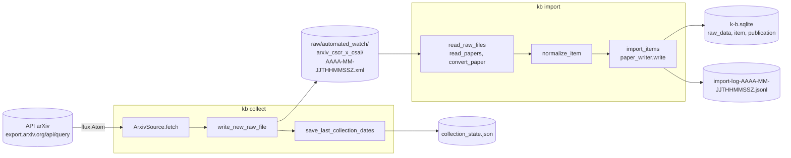
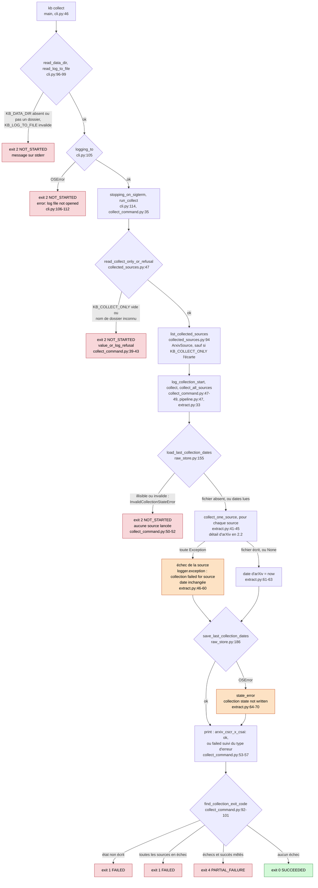
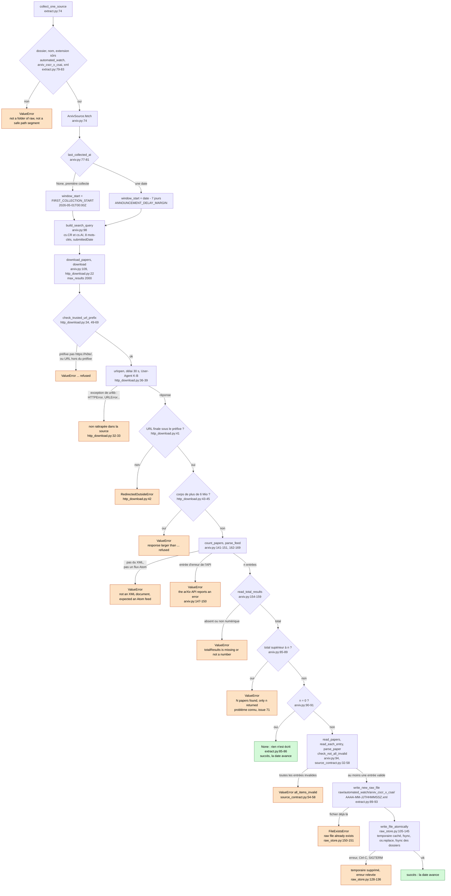
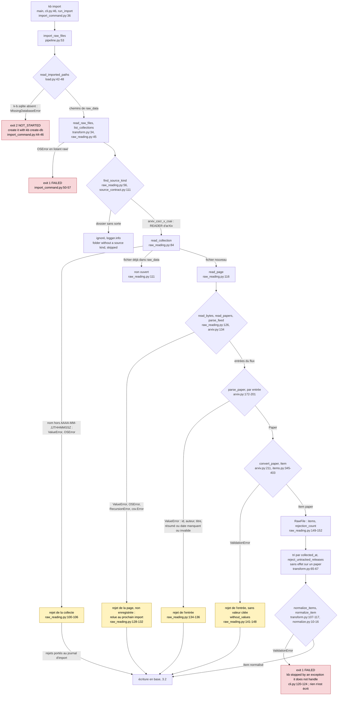

# Flux de données d'arXiv, de la collecte à la base

Instantané du code au commit `4626e24` (`main`, 2026-10-24). Fondé sur la lecture du code seul :
aucune commande de K-B n'a été exécutée. Les numéros de ligne valent pour ce commit ; ce qui ne se
tranche qu'en exécutant est marqué **non vérifié**.

| | |
|---|---|
| Source | `ArxivSource` (`src/k_b/etl/sources/arxiv.py`), déclarée dans `SOURCE_KINDS` (`src/k_b/etl/source_kinds.py`) |
| API interrogée | `https://export.arxiv.org/api/query`, flux Atom (XML) |
| Brut | `raw/automated_watch/arxiv_cscr_x_csai/AAAA-MM-JJTHHMMSSZ.xml`, un fichier par collecte |
| Sorte d'item | `paper`, `source_code` `arxiv` |
| Tables écrites | `raw_data`, `item`, `publication` |
| Commandes | `kb collect`, puis `kb import` |

## Légende

Les couleurs des nœuds disent ce que devient une erreur.

| Couleur | Sens |
|---|---|
| Orange | **Échec de la source** (collecte) : l'exception remonte jusqu'à `collect_all_sources`, qui la journalise ; la date de dernière collecte d'arXiv reste, les autres sources continuent. |
| Jaune | **Rejet nommé** (import) : `reject` (`etl/rejections.py:11`) écrit une ligne `rejected from <fichier>: <motif>` au journal de fonctionnement, puis une ligne `rejection` dans le journal d'import ; l'import continue. |
| Gris | **Écarté** : la base garde la version qu'elle a ; une ligne `discard` dans le journal d'import. |
| Rouge | **Fin de la commande** sur un code de sortie nommé (`commands/exit_codes.py`). |
| Vert | Succès. |

## 1. Vue d'ensemble

Les deux commandes ne communiquent que par `raw/` (`etl/pipeline.py:1-5`). L'import ne relit pas
un fichier déjà inscrit dans `raw_data`.

## 2. Collecte : `kb collect`

### 2.1 De la commande à la boucle des sources

### 2.2 La collecte d'arXiv

### 2.3 Erreurs de la collecte

| Erreur | Levée par | Traitée par | Effet |
|---|---|---|---|
| `KB_DATA_DIR` absent ou pas un dossier ; `KB_LOG_TO_FILE` ni `true` ni `false` | `read_data_dir`, `read_log_to_file` (`commands/environment.py:16-45`) | `main` (`cli.py:96-99`) | exit 2, rien n'est lancé |
| Fichier de journal non ouvert (`OSError`) | `logging_to` | `main` (`cli.py:106-112`) | exit 2 |
| `KB_COLLECT_ONLY` vide ou nom inconnu | `find_collect_only_refusal` (`collected_sources.py:63-85`) | `run_collect` (`collect_command.py:39-43`) | exit 2 |
| `collection_state.json` illisible ou invalide (`InvalidCollectionStateError`) | `load_last_collection_dates` (`raw_store.py:163-183`) | `run_collect` (`collect_command.py:50-52`) | exit 2, aucune source lancée |
| Préfixe ou URL refusés, redirection hors préfixe, réponse de plus de 6 Mio | `download` (`http_download.py:34-45`) | `collect_all_sources` (`extract.py:46-60`) | échec de la source |
| Erreur réseau ou HTTP (`urllib`) | `urlopen` (`http_download.py:39`) | `collect_all_sources` | échec de la source ; types exacts **non vérifiés** |
| Pas du XML, pas un flux Atom, entrée d'erreur de l'API, `totalResults` absent | `parse_feed`, `count_papers`, `read_total_results` (`arxiv.py:141-169`) | `collect_all_sources` | échec de la source |
| Plus de 2 000 papiers dans la fenêtre | `ArxivSource.fetch` (`arxiv.py:85-89`) | `collect_all_sources` | échec de la source, à chaque collecte tant que la fenêtre dépasse (#71) |
| Toutes les entrées invalides (`all_items_invalid`) | `check_not_all_invalid` (`source_contract.py:51-58`) | `collect_all_sources` | échec de la source |
| Une partie des entrées invalides | `read_each_entry` (`source_contract.py:32-48`) | — | le brut est écrit entier ; les entrées invalides sont rejetées à l'import (3.1) |
| Brut déjà présent (`FileExistsError`) ; erreur d'écriture | `write_new_raw_file`, `write_file_atomically` (`raw_store.py:105-152`) | `collect_all_sources` | échec de la source ; le temporaire est supprimé |
| État non écrit (`OSError`) | `save_last_collection_dates` (`raw_store.py:186-197`) | `collect_all_sources` (`extract.py:64-70`) | exit 1 ; les bruts écrits restent, la collecte suivante repart des anciennes dates |
| SIGTERM | `raise_stopped_by_sigterm` (`commands/sigterm.py:43-46`) | `main` (`cli.py:116-119`) | exit 143 ; `StoppedBySigtermError` est une `SystemExit`, que `except Exception` (`extract.py:46`) ne rattrape pas : l'état n'est pas écrit, les bruts déjà écrits restent |

## 3. Import : `kb import`

### 3.1 Lecture du brut, avant toute écriture

### 3.2 Écriture en base, dans une transaction

```mermaid
flowchart TD
    A["import_items<br/>load.py:51"] --> B{"check_database_exists, connect_database<br/>load.py:62-63"}
    B -- MissingDatabaseError --> X2a["exit 2 NOT_STARTED"]:::stop
    B -- ok --> C["write_tracked_repositories<br/>load.py:66"]
    C --> D["write_files : rejets de la lecture en tête<br/>load.py:85-100"]
    D --> E["list_files_in_collection_order, write_file<br/>load.py:143, file_writing.py:39"]
    E --> F["write_items_file, register_raw_file<br/>file_writing.py:47-50, 97-105"]
    F --> G{"write_raw_data<br/>shared_rows.py:20-41"}
    G -- "arxiv absent de la table source :<br/>UnknownSourceError, ou sqlite3.Error" --> RB["rollback de toute la transaction<br/>load.py:69-72"]:::fail
    G -- "raw_data inséré, ou déjà là" --> H["write_item_in_savepoint, pour chaque item<br/>file_writing.py:51-54, 108-121"]
    H --> S["SAVEPOINT entry<br/>savepoint.py:38"]
    S --> W["write_item, paper_writer.write<br/>writing.py:64-71, paper_writer.py:28"]
    W --> W1{"publication connue par arxiv_id ?<br/>paper_writer.py:32-36"}
    W1 -- non --> W2["insert_item paper<br/>paper_writer.py:37-41, shared_rows.py:44"]
    W1 -- oui --> W3["item_id connu"]
    W2 --> UP{"UPSERT_PUBLICATION<br/>paper_writer.py:13-25, 42-53"}
    W3 --> UP
    UP -- "aucune ligne rendue :<br/>révision pas plus récente" --> DS["Discard revision_not_newer<br/>paper_writer.py:54-56"]:::discard
    UP -- "ligne rendue, item connu" --> PT["point_item_at_raw_data<br/>paper_writer.py:57-58"]
    UP -- "ligne rendue, item nouveau" --> RL["RELEASE SAVEPOINT entry<br/>savepoint.py:48"]
    PT --> RL
    DS --> RL
    W -- "IntegrityError CHECK, UNIQUE, NOT NULL,<br/>OverflowError, UnicodeEncodeError" --> RT["ROLLBACK TO SAVEPOINT entry<br/>EntryRefusedError<br/>savepoint.py:41-46"]
    RT --> R5["rejet : paper refused by the base<br/>l'import continue<br/>file_writing.py:116-121"]:::reject
    W -- "autre erreur : FOREIGN KEY,<br/>disque plein, base verrouillée" --> RT2["ROLLBACK TO SAVEPOINT entry,<br/>erreur relevée<br/>savepoint.py:41-47"]
    RT2 --> RB
    RL --> NX{"item suivant ?"}
    R5 --> NX
    NX -- oui --> H
    NX -- non --> WD["mark_withdrawn_vulnerabilities,<br/>mark_withdrawn_zotero_rows : 0 pour un fichier d'arXiv<br/>file_writing.py:61-63, withdrawals.py:25-26, 42-43"]
    WD --> NF{"fichier suivant ?"}
    NF -- oui --> E
    NF -- non --> CL{"commit_with_log, check_log_absent<br/>load.py:103-114, 138-140"}
    CL -- "journal de cette seconde déjà là :<br/>ImportLogExistsError" --> RB
    CL -- absent --> LG["write_import_log<br/>import_log.py:37-85<br/>une ligne par rejet, puis par discard"]
    LG --> CM{"connection.commit<br/>load.py:123"}
    CM -- "sqlite3.Error, ou interruption<br/>avant la fin du commit" --> UL["journal supprimé<br/>load.py:124-131"]
    UL --> RB
    CM -- ok --> SM["print_import_summary<br/>import_command.py:58, 74-89"]
    RB --> X{"run_import<br/>import_command.py:44-57"}
    X -- ImportLogExistsError --> X2b["exit 2 NOT_STARTED<br/>run kb import again"]:::stop
    X -- "sqlite3.Error, OSError,<br/>UnknownSourceError, KindWithoutTableError" --> X1a["exit 1 FAILED"]:::stop
    X -- "autre Exception" --> X1b["exit 1 FAILED<br/>cli.py:120-124"]:::stop
    SM --> PG{"purge_superseded_raw<br/>import_command.py:59-69<br/>zotero et cisa_kev seulement"}
    PG -- "sqlite3.Error, OSError, ValueError" --> X1c["exit 1 FAILED<br/>import committed, raw purge failed"]:::stop
    PG -- ok --> X0["exit 0 SUCCEEDED"]:::ok

    classDef stop fill:#f8d7da,stroke:#b02a37,color:#000
    classDef fail fill:#fde2c4,stroke:#c2410c,color:#000
    classDef reject fill:#fff3bf,stroke:#b08800,color:#000
    classDef discard fill:#e9ecef,stroke:#6c757d,color:#000
    classDef ok fill:#d3f9d8,stroke:#2b8a3e,color:#000
```

Le brut d'arXiv n'est jamais purgé : `LATEST_ONLY_FOLDER_KEYS` ne nomme que Zotero et CISA KEV
(`import_command.py:30-33`).

### 3.3 Erreurs de l'import

| Erreur | Levée par | Traitée par | Effet |
|---|---|---|---|
| Base absente (`MissingDatabaseError`) | `check_database_exists` (`database/connection.py:13-16`) | `run_import` (`import_command.py:44-46`) | exit 2 |
| Nom de collection hors `AAAA-MM-JJTHHMMSSZ` | `parse_collection_name` (`raw_files.py:13-18`) | `read_collection` (`raw_reading.py:100-106`) | rejet ; non enregistré |
| Page illisible : pas du XML, pas un flux Atom, fichier non lu | `parse_feed` (`arxiv.py:162-169`), `read_bytes` | `read_page` (`raw_reading.py:128-132`) | rejet ; page non enregistrée, relue au prochain import |
| Entrée invalide : `id` absent ou pas un papier arXiv, aucun auteur, `title`, `summary`, `published` ou `updated` absent, date invalide ou sans fuseau | `parse_paper`, `read_required_text`, `parse_aware_datetime` (`arxiv.py:172-208`, `items.py:143-154`) | `read_each_entry` (`source_contract.py:42-46`), puis `read_page` (`raw_reading.py:134-136`) | rejet de l'entrée ; le fichier est enregistré, l'entrée n'est pas relue |
| Item refusé par Pydantic : texte vide, NUL ou surrogate isolé, URL pas `https`, longueurs (identifiant 20, titre 500, résumé 5 000, 1 000 auteurs de 200 caractères au plus) | `Item` (`items.py:345-403`) | `read_page` (`raw_reading.py:141-148`) | rejet de l'entrée, motif sans la valeur reçue (`without_values`) |
| Item refusé à la normalisation (`ValidationError`) | `normalize_item` (`normalize.py:16`) | `main` (`cli.py:120-124`) | exit 1, rien n'est écrit. L'URL d'arXiv est construite sans paramètre (`arxiv.py:200`) : la normalisation la rend inchangée |
| `arxiv` absent de la table `source` (`UnknownSourceError`) | `write_raw_data` (`shared_rows.py:31-32`) | `run_import` (`import_command.py:50-57`) | rollback, exit 1. La table est remplie par `database/seed_sources.sql:6` |
| Révision pas plus récente que celle en base | `UPSERT_PUBLICATION` (`paper_writer.py:23`) | `paper_writer.write` (`paper_writer.py:54-56`) | écarté (`revision_not_newer`), ligne `discard` avec `compared_with_revised_at` |
| Contrainte `CHECK`, `UNIQUE`, `NOT NULL` ; `OverflowError`, `UnicodeEncodeError` | SQLite, `sqlite3` | `write_in_savepoint` (`savepoint.py:41-46`), `write_item_in_savepoint` (`file_writing.py:116-121`) | `ROLLBACK TO` de cet item seul ; rejet ; l'import continue |
| Autre erreur de la base (clé étrangère, disque plein, base verrouillée) | SQLite | `write_in_savepoint`, puis `import_items` (`load.py:69-72`) | rollback de toute la transaction, exit 1 |
| Journal d'import de la même seconde déjà là (`ImportLogExistsError`) | `check_log_absent` (`load.py:138-140`) | `run_import` (`import_command.py:47-49`) | rollback, exit 2 |
| Commit refusé (`sqlite3.Error`) | `connection.commit` (`load.py:123`) | `commit_with_log` (`load.py:124-135`) | journal supprimé, rollback, exit 1 |
| Purge refusée | `purge_superseded_raw` | `run_import` (`import_command.py:61-69`) | exit 1 ; l'import reste validé |
| SIGTERM avant la fin du commit | `raise_stopped_by_sigterm` (`commands/sigterm.py:43-46`) | `write_in_savepoint`, `commit_with_log`, `import_items`, puis `main` (`cli.py:116-119`) | rollback, journal supprimé s'il était écrit (`load.py:129-131`), exit 143 |
| SIGTERM pendant le commit | idem | `commit_with_log` (`load.py:132-134`) | import et journal gardés, exit 143 |

## 4. Non vérifié

- Les types exacts des exceptions de `urlopen` sur un délai dépassé ou un code HTTP d'erreur de
  l'API arXiv : le code les laisse remonter sans les nommer (`http_download.py:32-33`).
- Le comportement de l'API arXiv au-delà de `max_results` : le code compare `totalResults` au
  nombre d'entrées reçues (`arxiv.py:83-89`) ; le constat d'échec répété vient de #71.
