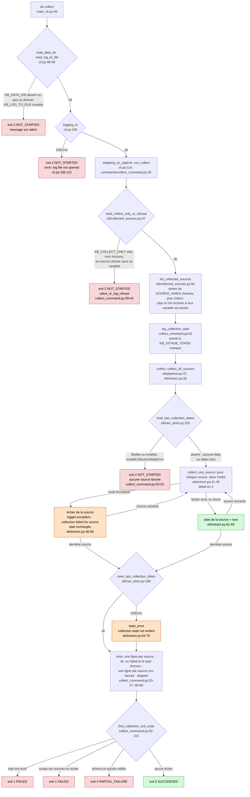
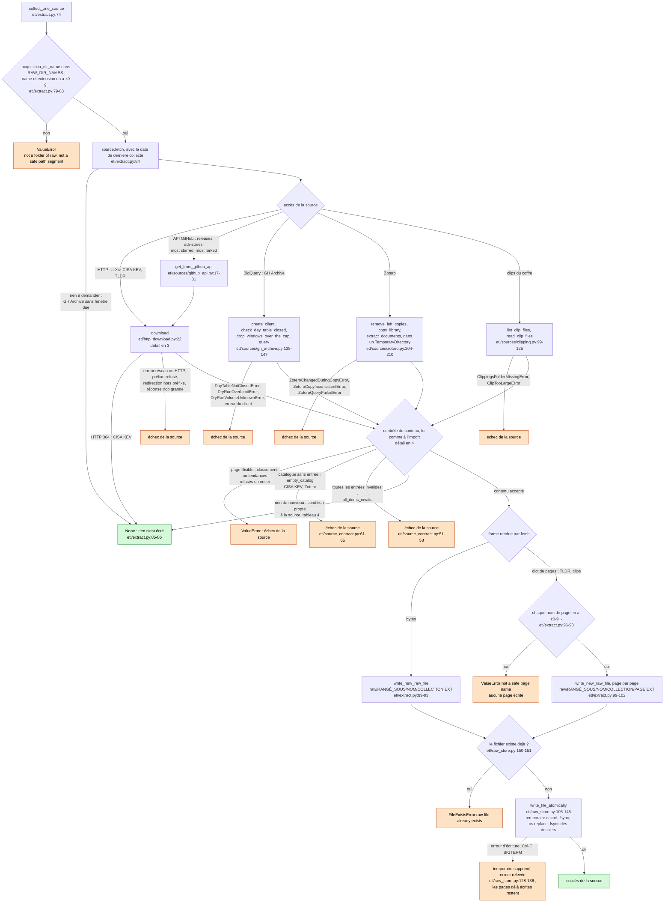
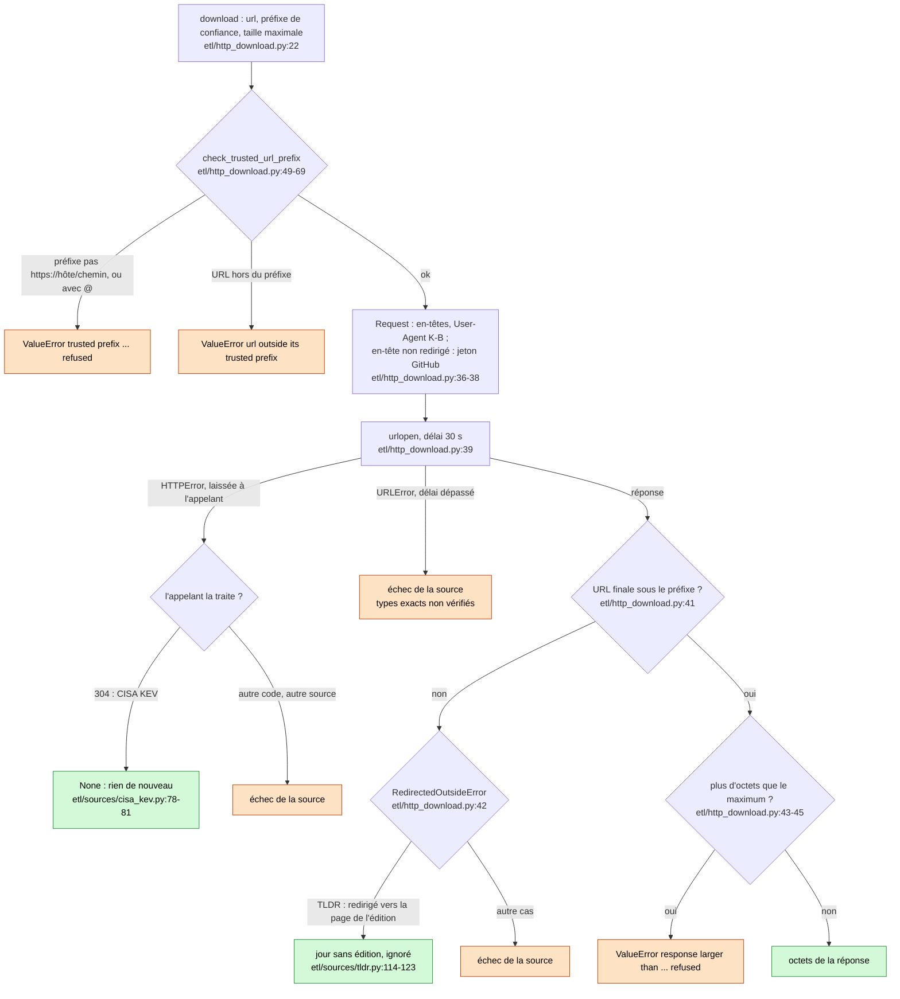

# Flux de données de la collecte : `kb collect`

Instantané du code au commit `4626e24` (`main`, 2026-10-24). Fondé sur la lecture du code seul :
aucune commande de K-B n'a été exécutée. Les chemins sont relatifs à `src/k_b/` ; les numéros de
ligne valent pour ce commit ; ce qui ne se tranche qu'en exécutant est marqué **non vérifié**.

Flux générique, valable pour toutes les sources, des sources jusqu'à `raw/` et
`collection_state.json`. Vue d'ensemble : [flux complet](flux-de-donnees-complet-24102026.md).
Suite : [l'import](flux-de-import-24102026.md).

## Légende

| Couleur | Sens |
|---|---|
| Orange | **Échec de la source** : l'exception remonte jusqu'à `collect_all_sources` (`etl/extract.py:46-60`), qui la journalise une fois, avec ses notes, puis passe à la source suivante ; la date de dernière collecte de la source reste. |
| Rouge | **Fin de la commande** sur un code de sortie nommé (`commands/exit_codes.py`). |
| Vert | Succès de la source : sa date de dernière collecte devient l'heure de la collecte. |

## 1. De la commande à la boucle des sources

## 2. La collecte d'une source

`COLLECTION` est l'heure de la collecte au format `AAAA-MM-JJTHHMMSSZ` (`COLLECTION_NAME_FORMAT`,
`etl/raw_files.py:10`), la même pour toutes les sources d'une collecte. `RANGÉ_SOUS` vaut
`automated_watch` ou `selected_library` (`etl/raw_store.py:19-24`).

## 3. Le téléchargement, commun à HTTP et à l'API GitHub

Tailles maximales : arXiv 6 Mio (`arxiv.py:31`), CISA KEV 10 Mio (`cisa_kev.py:36`), une page TLDR
1 Mio (`tldr.py:25`), une réponse de l'API GitHub 5 Mio (`github_api.py:14`).

## 4. Ce que chaque source contrôle avant d'écrire

Chaque `fetch` relit son contenu comme l'import le lira, pour qu'une page fausse fasse échouer la
source au lieu d'être gardée (`conventions.md`, règle 1).

| Source | Contrôle du contenu dans `fetch` | `None` quand |
|---|---|---|
| CISA KEV | `read_catalog`, `check_not_empty`, `check_not_all_invalid` (`cisa_kev.py:83-85`) | HTTP 304 sur `If-Modified-Since` (`cisa_kev.py:70-81`) |
| GitHub Releases | `read_releases`, `check_not_all_invalid`, chaque release du dépôt suivi (`github_releases.py:59-68`) | aucune release publiée après la dernière collecte (`github_releases.py:73-77`) |
| GitHub Advisories | `read_advisories`, `check_not_all_invalid` (`github_advisories.py:67-68`) | aucun avis valide ; ou aucun revu depuis la dernière collecte et aucun rejet (`github_advisories.py:69-79`) |
| GitHub most starred, most forked | `read_ranking` : classement plus court que demandé ou incomplet refusé en entier (`github_most_starred.py:43`, `github_most_forked.py:40`) | jamais |
| arXiv | `count_papers`, `read_total_results`, `check_not_all_invalid` (`arxiv.py:83-94`) | aucun papier dans la fenêtre (`arxiv.py:90-91`) |
| TLDR | `find_refusal` par page : un refus après la dernière édition lue fait échouer la source, un refus avant est abandonné, celui du jour est relu à la collecte suivante (`tldr.py:62-95`) | aucune page d'édition (`tldr.py:96-100`) |
| Zotero | `check_document`, `check_not_empty`, `check_not_all_invalid` (`zotero.py:211-213`) | extrait identique, octet pour octet, au dernier brut (`zotero.py:222-224`) |
| Clips | `find_rejection_reason` par clip, `check_not_all_invalid` (`clipping.py:128-138`) | aucun clip changé depuis la dernière collecte et stable depuis `CLIP_CHANGE_MARGIN` (`clipping.py:106-127`) |
| GH Archive | `read_trends` : l'extrait est refusé en entier (`TrendsExtractInvalidError`, `gh_archive.py:148`, `286-320`) | aucune fenêtre due (`gh_archive.py:135-137`) |

## 5. Erreurs de la collecte

| Erreur | Levée par | Traitée par | Effet |
|---|---|---|---|
| `KB_DATA_DIR` absent ou pas un dossier ; `KB_LOG_TO_FILE` ni `true` ni `false` | `read_data_dir`, `read_log_to_file` (`commands/environment.py:16-45`) | `main` (`cli.py:96-99`) | exit 2, rien n'est lancé |
| Fichier de journal non ouvert (`OSError`) | `logging_to` | `main` (`cli.py:106-112`) | exit 2 |
| `KB_COLLECT_ONLY` vide, nom inconnu, ou source choisie sans sa variable | `find_collect_only_refusal` (`etl/collected_sources.py:63-85`) | `run_collect` (`collect_command.py:39-43`) | exit 2 |
| `collection_state.json` illisible ou invalide (`InvalidCollectionStateError`) | `load_last_collection_dates` (`etl/raw_store.py:163-183`) | `run_collect` (`collect_command.py:50-52`) | exit 2, aucune source lancée |
| Dossier, nom ou extension de source non sûrs ; nom de page non sûr | `collect_one_source` (`etl/extract.py:79-83`, `96-98`) | `collect_all_sources` (`etl/extract.py:46-60`) | échec de la source, rien d'écrit |
| Préfixe ou URL refusés, redirection hors préfixe, réponse trop grande | `download` (`etl/http_download.py:34-45`) | `collect_all_sources` | échec de la source |
| Erreur réseau ou HTTP (`urllib`) non traitée par la source | `urlopen` (`etl/http_download.py:39`) | `collect_all_sources` | échec de la source ; types exacts **non vérifiés** |
| Erreur propre à une source : `DayTableNotClosedError`, `DryRunOverLimitError`, `DryRunVolumeUnknownError` (GH Archive), `ZoteroChangedDuringCopyError`, `ZoteroCopyInconsistentError`, `ZoteroQueryFailedError` (Zotero), `ClippingsFolderMissingError`, `ClipTooLargeError` (clips), refus d'une page TLDR | la source (`etl/sources/`) | `collect_all_sources` | échec de la source |
| Page illisible, classement ou tendances refusés, `empty_catalog`, `all_items_invalid` | lecteur de la source, `check_not_empty`, `check_not_all_invalid` (`etl/source_contract.py:51-65`) | `collect_all_sources` | échec de la source |
| Une partie seulement des entrées invalides | `read_each_entry` (`etl/source_contract.py:32-48`) | — | le brut est écrit entier ; les entrées invalides sont rejetées à l'import |
| Brut déjà présent (`FileExistsError`) ; erreur d'écriture | `write_new_raw_file`, `write_file_atomically` (`etl/raw_store.py:105-152`) | `collect_all_sources` | échec de la source ; le temporaire est supprimé ; pour un dossier de pages, celles déjà écrites restent (`etl/extract.py:94-95`) |
| État non écrit (`OSError`) | `save_last_collection_dates` (`etl/raw_store.py:186-197`) | `collect_all_sources` (`etl/extract.py:64-70`) | exit 1 ; les bruts écrits restent, la collecte suivante repart des anciennes dates |
| Exception hors de la boucle des sources, non traitée | — | `main` (`cli.py:120-124`) | exit 1, `kb stopped by an exception it does not handle` |
| SIGTERM | `raise_stopped_by_sigterm` (`commands/sigterm.py:43-46`) | `main` (`cli.py:116-119`) | exit 143. `StoppedBySigtermError` est une `SystemExit`, que `except Exception` (`etl/extract.py:46`) ne rattrape pas : la boucle s'arrête, l'état n'est pas écrit, les bruts déjà écrits restent |
