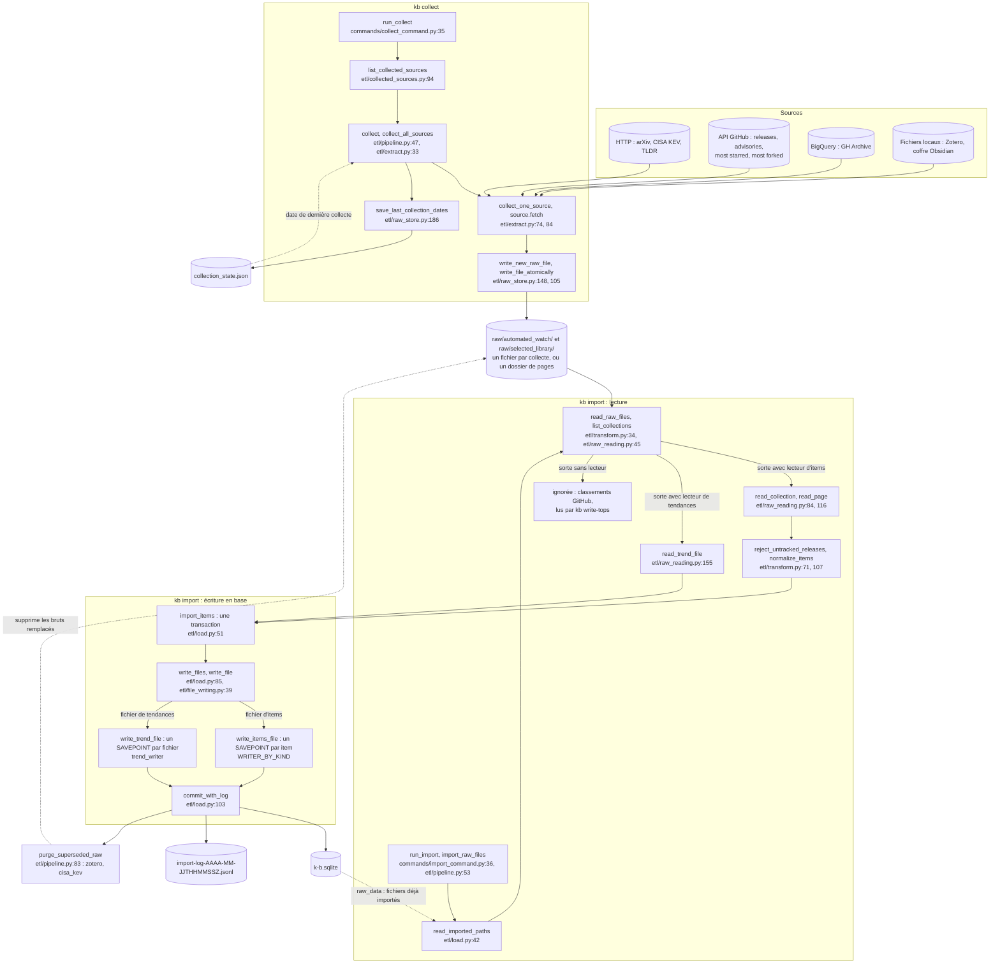

# Flux de données complet de K-B, de la collecte à la base

Instantané du code au commit `4626e24` (`main`, 2026-10-24). Fondé sur la lecture du code seul :
aucune commande de K-B n'a été exécutée. Les chemins sont relatifs à `src/k_b/` ; les numéros de
ligne valent pour ce commit.

Ce flux est générique : il vaut pour toutes les sources. Ce qui varie d'une source à l'autre est
résumé au tableau de la section 2. Le détail de chaque étape et de ses erreurs est dans trois
fichiers :

- [la collecte](flux-de-collecte-24102026.md) : `kb collect`, des sources jusqu'à `raw/` ;
- [l'import](flux-de-import-24102026.md) : `kb import`, de `raw/` jusqu'aux items prêts à écrire ;
- [l'écriture en base](flux-de-ecriture-en-base-24102026.md) : la transaction, jusqu'au commit.

## 1. Schéma

Les deux commandes ne communiquent que par `raw/` (`etl/pipeline.py:1-5`). Une collecte n'écrit
jamais sur un brut existant (`etl/raw_store.py:148-152`) ; un import ne relit jamais un fichier
inscrit dans `raw_data` (`etl/raw_reading.py:111`, `etl/transform.py:131`).

## 2. Ce qui varie selon la source

Chaque sorte est déclarée une fois dans `SOURCE_KINDS` (`etl/source_kinds.py`) ; Zotero, les clips
et GH Archive reçoivent leur instance dans `etl/collected_sources.py:94-115`, quand leur variable
d'environnement est posée.

| Dossier de `raw/` | Instances | Rangé sous | Ext. | Accès | `fetch` rend `None` quand | Lecteur | Écrit dans | Règle de l'écrivain |
|---|---|---|---|---|---|---|---|---|
| `cisa_kev` | 1 | `automated_watch` | `csv` | `download`, `If-Modified-Since` | HTTP 304 (`etl/sources/cisa_kev.py:78-81`) | items | `vulnerability` | catalogue d'état |
| `github_releases_<dépôt>` | une par dépôt suivi | `automated_watch` | `json` | `get_from_github_api` | aucune release publiée après la dernière collecte (`github_releases.py:73-77`) | items | `release` | flux d'actualité |
| `github_advisories_<écosystème>` | une par écosystème suivi | `automated_watch` | `json` | `get_from_github_api` | aucun avis valide, ou aucun revu depuis et aucun rejet (`github_advisories.py:69-79`) | items | `advisory`, `vulnerability` | flux d'actualité |
| `github_most_starred` | 1 | `automated_watch` | `json` | `get_from_github_api` | jamais | aucun | — | — |
| `github_most_forked` | 1 | `automated_watch` | `json` | `get_from_github_api` | jamais | aucun | — | — |
| `arxiv_cscr_x_csai` | 1 | `automated_watch` | `xml` | `download` | aucun papier dans la fenêtre (`arxiv.py:90-91`) | items | `publication` | flux à révisions |
| `tldr_<édition>` | une par édition suivie | `automated_watch` | `html` | `download`, une page par jour | aucune page d'édition (`tldr.py:100`) | items | `newsletter_article` | flux d'actualité |
| `zotero` | 1, si `KB_ZOTERO_DIR` | `selected_library` | `json` | copie de `zotero.sqlite` | extrait identique au dernier brut (`zotero.py:222-224`) | items | `zotero_entry`, `highlight`, `publication` | catalogue d'état |
| `clipping` | 1, si `KB_VAULT_DIR` | `selected_library` | `md` | lecture de `Clippings/` | aucun clip changé et stable (`clipping.py:126-127`) | items | `clip`, `tag`, `item_has_tag` | dernière version d'une URL |
| `gh_archive` | 1, si `GOOGLE_APPLICATION_CREDENTIALS` | `automated_watch` | `json` | client BigQuery | aucune fenêtre due (`gh_archive.py:135-137`) | tendances | `trend` | première fenêtre vue |

Chaque fichier lu est inscrit dans `raw_data` ; chaque item dans `item`, puis dans la table de sa
sorte. Les règles des écrivains sont décrites dans
[l'écriture en base](flux-de-ecriture-en-base-24102026.md), section 3.

## 3. Ce que K-B écrit

| Fichier | Écrit par | Quand |
|---|---|---|
| `raw/<rangé sous>/<dossier>/AAAA-MM-JJTHHMMSSZ.<ext>`, ou un dossier de ce nom avec une page par fichier | `kb collect` (`etl/extract.py:87-102`) | une fois, jamais réécrit |
| `collection_state.json` | `kb collect` (`etl/raw_store.py:186-197`) | à la fin de chaque collecte, en entier |
| `k-b.sqlite` | `kb import` (`etl/load.py:51-82`) | une transaction par import |
| `import-log-AAAA-MM-JJTHHMMSSZ.jsonl` | `kb import` (`etl/import_log.py:37-85`) | avec le commit, un par import |
| `logs/kb.log` | `kb collect` et `kb import`, entre autres (`cli.py:100-105`) | ligne à ligne ; sortie d'erreur seule si `KB_LOG_TO_FILE=false` |

Tous les fichiers de cette table, sauf la base et le journal de fonctionnement, passent par
`write_file_atomically` (`etl/raw_store.py:105-145`).
