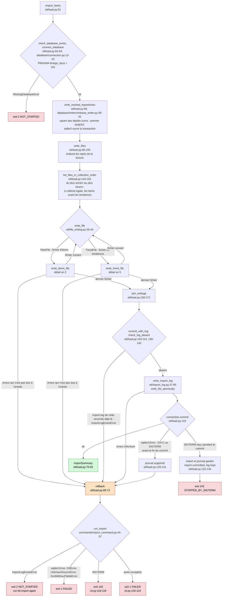
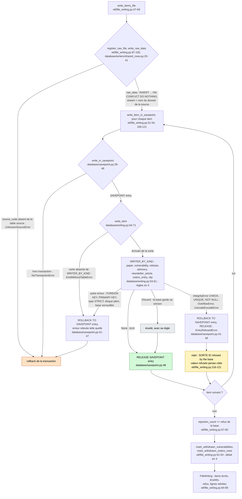
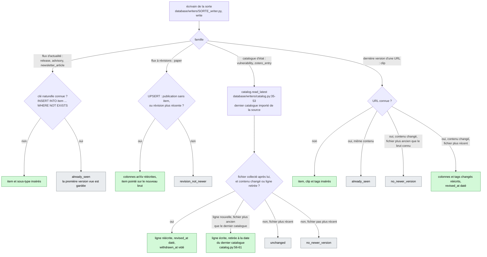
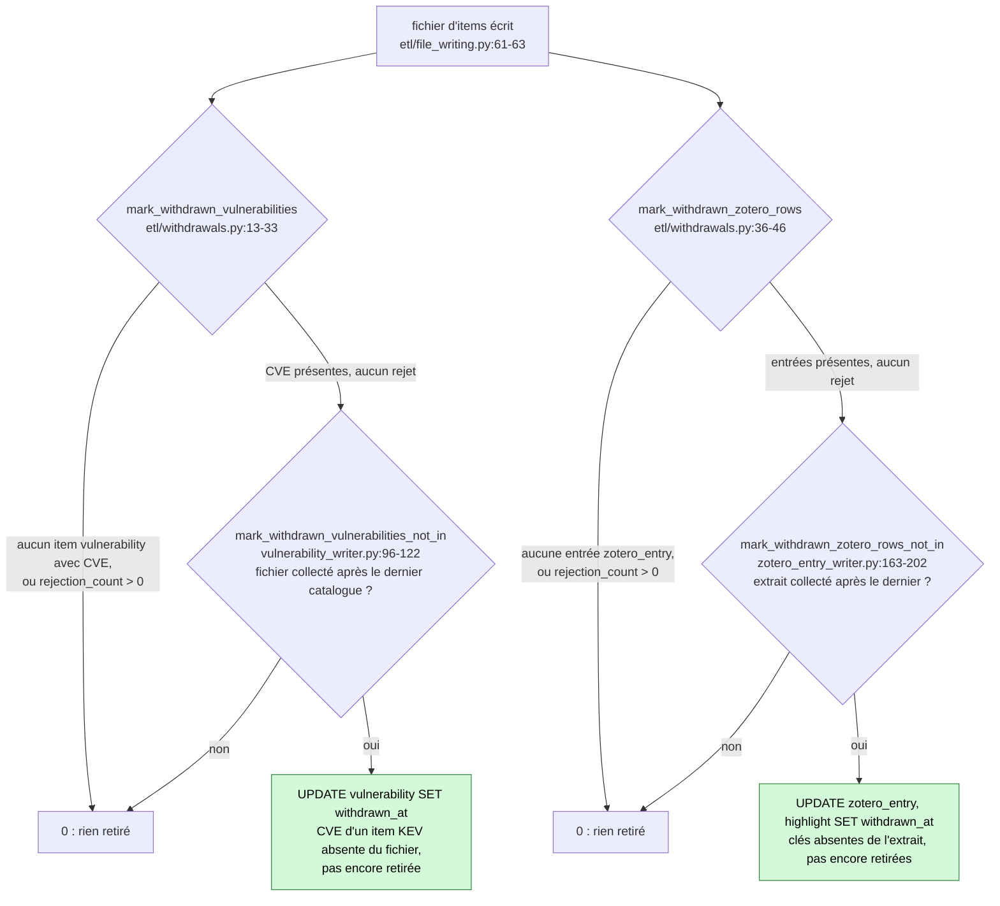
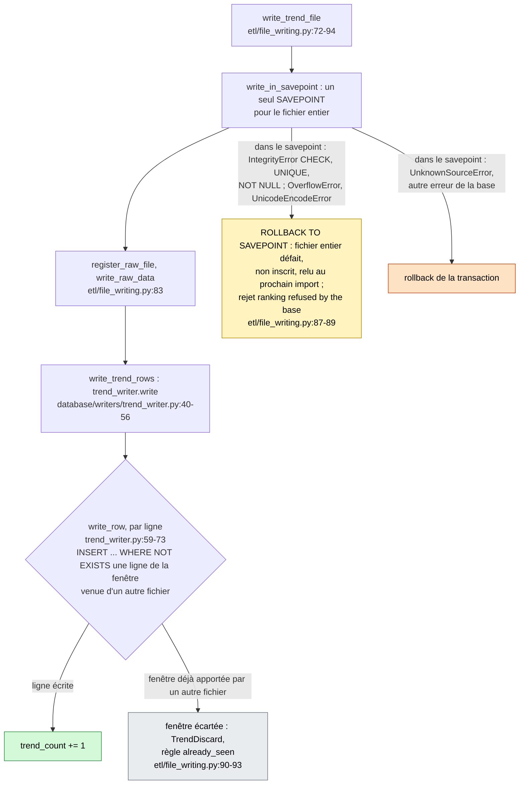

# Flux de données de l'écriture en base

Instantané du code au commit `4626e24` (`main`, 2026-10-24). Fondé sur la lecture du code seul :
aucune commande de K-B n'a été exécutée. Les chemins sont relatifs à `src/k_b/` ; les numéros de
ligne valent pour ce commit.

Flux générique, valable pour toutes les sources : de `import_items`, qui reçoit les fichiers lus,
jusqu'au commit de la transaction et au journal d'import. Vue d'ensemble :
[flux complet](flux-de-donnees-complet-24102026.md). Avant : [l'import](flux-de-import-24102026.md),
qui lit `raw/` et rend les fichiers lus.

## Légende

| Couleur | Sens |
|---|---|
| Jaune | **Rejet nommé** : `reject` (`etl/rejections.py:11-13`) écrit `rejected from <fichier>: <motif>` au journal de fonctionnement, puis une ligne `rejection` du journal d'import ; l'import continue. |
| Gris | **Écarté** : la base garde la version qu'elle a ; une ligne `discard` du journal d'import, avec sa règle. |
| Orange | **Rollback** de toute la transaction : rien n'est écrit, aucun journal d'import ne reste. |
| Rouge | **Fin de la commande** sur un code de sortie nommé (`commands/exit_codes.py`). |
| Vert | Écrit. |

## 1. La transaction

Le journal est écrit avant le commit : un fichier inscrit dans `raw_data` n'est plus relu, son
journal ne doit donc pas se perdre (`etl/load.py:109-111`). `check_log_absent` est appelé une
fois la base verrouillée en écriture : deux imports de la même seconde ne peuvent pas tous deux
trouver le journal absent (`etl/load.py:112-114`).

## 2. Un fichier d'items

Le fichier est inscrit dans `raw_data` hors de tout savepoint, même si la base refuse ensuite un
de ses items (`etl/file_writing.py:48-50`). Seules les erreurs dues à l'entrée deviennent un
rejet (`database/savepoint.py:8-16`, `conventions.md` règle 1) ; les autres arrêtent tout l'import.

## 3. Les règles des écrivains

Chaque écrivain trouve l'item par sa clé naturelle, puis applique la règle de sa famille. Il rend
`None` (écrit) ou un `Discard` (écarté), jamais une erreur pour une version déjà connue.

| Sorte | Écrivain | Clé naturelle | Tables écrites | Écarté : règle, date comparée au journal |
|---|---|---|---|---|
| `release` | `release_writer.write` (`:55-90`) | `release_id` | `item`, `release` (le dépôt suivi doit exister dans `tracked_repository`) | `already_seen` (`:67`), `compared_with_collected_at` |
| `advisory` | `advisory_writer.write` (`:25-63`) | `ghsa_id` | `item`, `advisory`, `vulnerability` (CVE créée sans ses colonnes KEV si nouvelle) | `already_seen` (`:37`), `compared_with_collected_at` |
| `newsletter_article` | `newsletter_article_writer.write` (`:36-68`) | édition, date d'édition, rang | `item`, `newsletter_article` | `already_seen` (`:53`), `compared_with_collected_at` |
| `paper` | `paper_writer.write` (`:28-59`) | `arxiv_id` | `item`, `publication` | `revision_not_newer` (`:56`), `compared_with_revised_at` |
| `vulnerability` | `vulnerability_writer.write` (`:57-93`) | `cve_id` | `item`, `vulnerability` | `unchanged` ou `no_newer_version` (`catalog.py:64-72`), `compared_with_collected_at` |
| `zotero_entry` | `zotero_entry_writer.write` (`:84-147`) | `zotero_key` de l'entrée et de chaque surlignage | `item`, `zotero_entry`, `highlight`, `publication` (citée, créée sans ses colonnes arXiv si absente) | `unchanged` ou `no_newer_version` (`:143`), `compared_with_collected_at` |
| `clip` | `clip_writer.write` (`:89-149`) | URL sans paramètres `utm_` | `item`, `clip`, `tag`, `item_has_tag` | `already_seen` ou `no_newer_version` (`:141-143`), `compared_with_collected_at` |

Les lignes de la table renvoient à `database/writers/`. Le champ de date du journal d'import
dépend de la règle : `COMPARED_FIELD_BY_RULE` (`etl/import_log.py:15-25`).

## 4. Les retraits d'un catalogue

Un catalogue qui a une entrée rejetée, par le lecteur, par `Item` ou par la base, ne retire rien :
une entrée rejetée est dans le catalogue, pas absente de lui (`etl/withdrawals.py:18-19`). Une
ligne retirée n'est jamais supprimée ; le premier retrait garde sa date.

## 5. Un fichier de tendances

Contrairement à un fichier d'items, un fichier de tendances est écrit ou refusé en entier : une
ligne refusée par la base le défait, inscription dans `raw_data` comprise
(`etl/file_writing.py:75-79`).

## 6. Le journal d'import

`import-log-AAAA-MM-JJTHHMMSSZ.jsonl`, dans le dossier de données, un par import, jamais réécrit
(`etl/pipeline.py:36-37`, `65-67`). Une ligne JSON par événement, dans cet ordre
(`etl/import_log.py:44-81`) :

| `kind` | Champs | Origine |
|---|---|---|
| `rejection` | `imported_at`, `raw_file_path`, `reason` | rejets de la lecture (import), puis refus de la base, fichier par fichier |
| `discard` | `imported_at`, `rule`, `source_code`, `source_item_id`, `raw_file_path`, date comparée | items écartés par un écrivain |
| `discard` | idem, `rule` `already_seen`, `source_item_id` = fin de la fenêtre | fenêtres de tendances écartées |

Aucun dépôt n'y est nommé : son nom porte le login de son propriétaire (`etl/import_log.py:44-45`).

## 7. Erreurs de l'écriture en base

| Erreur | Levée par | Traitée par | Effet |
|---|---|---|---|
| Base absente (`MissingDatabaseError`) | `check_database_exists` (`database/connection.py:13-16`) | `run_import` (`commands/import_command.py:44-46`) | exit 2 |
| `source_code` absent de la table `source` (`UnknownSourceError`) | `write_raw_data` (`database/writers/shared_rows.py:31-32`) | `import_items` (`etl/load.py:69-72`), puis `run_import` | rollback, exit 1. La table est remplie par `database/seed_sources.sql` |
| Sorte sans table (`KindWithoutTableError`) | `write_item` (`database/writing.py:69-70`) | `write_in_savepoint`, `import_items`, `run_import` | rollback, exit 1 |
| Savepoint hors transaction (`NoTransactionError`) | `write_in_savepoint` (`database/savepoint.py:34-37`) | `import_items`, puis `main` (`cli.py:120-124`) | rollback, exit 1 |
| Contrainte `CHECK`, `UNIQUE`, `NOT NULL` ; `OverflowError`, `UnicodeEncodeError` sur un item | SQLite, `sqlite3` | `write_in_savepoint` (`database/savepoint.py:41-46`), `write_item_in_savepoint` (`etl/file_writing.py:116-121`) | `ROLLBACK TO` de cet item seul ; rejet ; l'import continue |
| Même erreur sur une ligne de tendance | SQLite, `sqlite3` | `write_trend_file` (`etl/file_writing.py:87-89`) | fichier de tendances défait en entier, non inscrit ; rejet ; l'import continue |
| Version déjà connue | écrivain de la sorte (section 3) | l'écrivain | écarté, ligne `discard` |
| Clé étrangère, clé primaire, type `STRICT`, disque plein, base verrouillée | SQLite | `write_in_savepoint` (relève telle quelle), `import_items` | rollback, exit 1 |
| Journal de la même seconde déjà là (`ImportLogExistsError`) | `check_log_absent` (`etl/load.py:138-140`) | `run_import` (`commands/import_command.py:47-49`) | rollback, exit 2 |
| Journal non écrit (`OSError`) | `write_import_log`, `write_file_atomically` | `commit_with_log`, `import_items`, `run_import` | rollback, exit 1 |
| Commit refusé (`sqlite3.Error`) | `connection.commit` (`etl/load.py:123`) | `commit_with_log` (`etl/load.py:124-135`) | journal supprimé, rollback, exit 1 |
| SIGTERM avant la fin du commit | `raise_stopped_by_sigterm` (`commands/sigterm.py:43-46`) | `write_in_savepoint`, `commit_with_log`, `import_items`, puis `main` (`cli.py:116-119`) | rollback, journal supprimé s'il était écrit, exit 143 |
| SIGTERM pendant le commit | idem | `commit_with_log` (`etl/load.py:132-134`) | import et journal gardés, exit 143 |
| Ctrl-C (`KeyboardInterrupt`) avant la fin du commit | Python | `commit_with_log`, `import_items` (`except BaseException`) | rollback, journal supprimé s'il était écrit ; `main` ne rattrape que `Exception` (`cli.py:120`) : Python s'arrête sur sa trace, code de sortie **non vérifié** |
