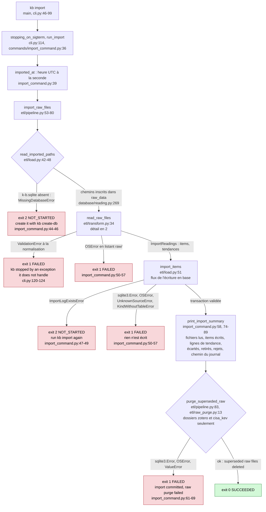
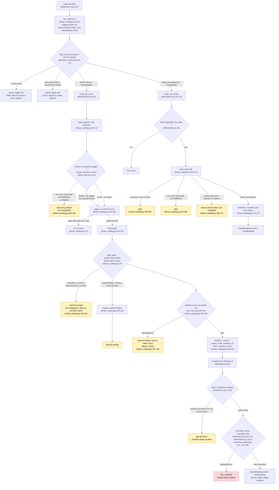

# Flux de données de l'import : `kb import`

Instantané du code au commit `4626e24` (`main`, 2026-10-24). Fondé sur la lecture du code seul :
aucune commande de K-B n'a été exécutée. Les chemins sont relatifs à `src/k_b/` ; les numéros de
ligne valent pour ce commit.

Flux générique, valable pour toutes les sources : de `raw/` jusqu'aux fichiers lus, prêts à
écrire. Vue d'ensemble : [flux complet](flux-de-donnees-complet-24102026.md). Avant :
[la collecte](flux-de-collecte-24102026.md). L'écriture elle-même, de la transaction au commit :
[l'écriture en base](flux-de-ecriture-en-base-24102026.md).

## Légende

| Couleur | Sens |
|---|---|
| Jaune | **Rejet nommé** : `reject` (`etl/rejections.py:11-13`) écrit `rejected from <fichier>: <motif>` au journal de fonctionnement, puis le rejet devient une ligne `rejection` du journal d'import ; l'import continue. |
| Rouge | **Fin de la commande** sur un code de sortie nommé (`commands/exit_codes.py`) ; rien n'est écrit en base. |
| Vert | Succès. |

## 1. La commande

La purge ne garde, de chaque dossier de `LATEST_ONLY_FOLDER_KEYS` (`import_command.py:30-33`),
que le dernier brut importé ; elle lit la liste des bruts dans `raw_data`, jamais dans le dossier :
un brut non importé n'est jamais supprimé (`etl/raw_purge.py:16-33`).

## 2. La lecture de `raw/`

`rejection_count` compte les entrées rejetées par le lecteur ou refusées comme items, pas les
releases hors liste (`etl/transform.py:91-95`) : il sert ensuite aux retraits d'un catalogue
([l'écriture en base](flux-de-ecriture-en-base-24102026.md), section 4). Un fichier lu, même
sans item, est inscrit dans `raw_data` à l'écriture ; ses entrées rejetées ne sont donc pas relues.
Une page ou un fichier de tendances illisible n'est pas inscrit : il est relu à l'import suivant.

## 3. Lecteurs des sources

Le lecteur d'une sorte est la constante `READER` (ou `TREND_READER`) de son module, passée à
`SourceKind` dans `etl/source_kinds.py`.

| Dossier de `raw/` | Lecteur | `read_entries` ou `read_rows` | `convert` |
|---|---|---|---|
| `cisa_kev` | `cisa_kev.READER` (`cisa_kev.py:196`) | `read_catalog` | `convert_vulnerability`, item `vulnerability` |
| `github_releases_<dépôt>` | `github_releases.READER` (`github_releases.py:185`) | `read_releases` | `convert_release`, item `release` |
| `github_advisories_<écosystème>` | `github_advisories.READER` (`github_advisories.py:194`) | `read_advisories` | `convert_advisory`, item `advisory` |
| `arxiv_cscr_x_csai` | `arxiv.READER` (`arxiv.py:227`) | `read_papers` | `convert_paper`, item `paper` |
| `tldr_<édition>` | `tldr.READER` (`tldr.py:300`) | `read_articles` | `convert_article`, item `newsletter_article` |
| `zotero` | `zotero.READER` (`zotero.py:441`) | `read_documents` | `convert_document`, item `zotero_entry` |
| `clipping` | `clipping.READER` (`clipping.py:375`) | `read_clip` | `convert_clip`, item `clip` |
| `gh_archive` | `gh_archive.TREND_READER` (`gh_archive.py:363`) | `read_trend_rows` | — (lignes de tendance) |
| `github_most_starred`, `github_most_forked` | aucun | — | — |

## 4. Erreurs de l'import, avant l'écriture

| Erreur | Levée par | Traitée par | Effet |
|---|---|---|---|
| `KB_DATA_DIR`, `KB_LOG_TO_FILE`, journal non ouvert | `read_data_dir`, `read_log_to_file`, `logging_to` | `main` (`cli.py:96-112`) | exit 2 |
| Base absente (`MissingDatabaseError`) | `check_database_exists` (`database/connection.py:13-16`) | `run_import` (`import_command.py:44-46`) | exit 2 |
| `OSError` en listant `raw/` | `list_collections`, `list_visible_entries` (`etl/raw_reading.py:45-81`, `189-192`) | `run_import` (`import_command.py:50-57`) | exit 1 |
| Dossier sans sorte, sorte sans lecteur, sous-dossier dans une collection | `list_collections`, `list_pages` | — | ignoré, `logger.info` |
| Nom de collection hors format | `parse_collection_name` (`etl/raw_files.py:13-18`) | `read_collection` (`etl/raw_reading.py:100-106`) | rejet ; non inscrit |
| Page illisible | lecteur de la source, `read_bytes` | `read_page` (`etl/raw_reading.py:128-132`) | rejet ; page non inscrite, relue au prochain import |
| Entrée invalide | lecteur de la source, par `read_each_entry` (`etl/source_contract.py:42-46`) | `read_page` (`etl/raw_reading.py:134-136`) | rejet de l'entrée ; le fichier sera inscrit |
| Item refusé par Pydantic (`ValidationError`) | `Item` (`items.py:345-403`) | `read_page` (`etl/raw_reading.py:141-148`) | rejet de l'entrée, motif sans la valeur reçue |
| Release d'un dépôt hors de la liste suivie | `is_untracked_release` (`etl/transform.py:99-104`) | `reject_untracked_releases` (`etl/transform.py:82-89`) | rejet de l'item ; le fichier sera inscrit |
| Fichier de tendances : dossier, nom hors format, lignes refusées | `read_trend_file`, lecteur de tendances | `read_trend_file` (`etl/raw_reading.py:159-171`) | rejet du fichier entier ; non inscrit |
| Item refusé à la normalisation (`ValidationError`) | `normalize_item` (`etl/normalize.py:16`) | `main` (`cli.py:120-124`) | exit 1 ; rien n'est écrit |
| SIGTERM pendant la lecture | `raise_stopped_by_sigterm` (`commands/sigterm.py:43-46`) | `main` (`cli.py:116-119`) | exit 143 ; rien n'est écrit |

Les erreurs de l'écriture, du commit et de la purge sont dans
[l'écriture en base](flux-de-ecriture-en-base-24102026.md), section 5.
