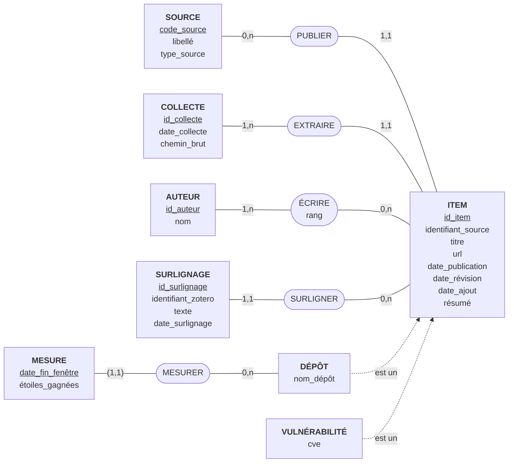
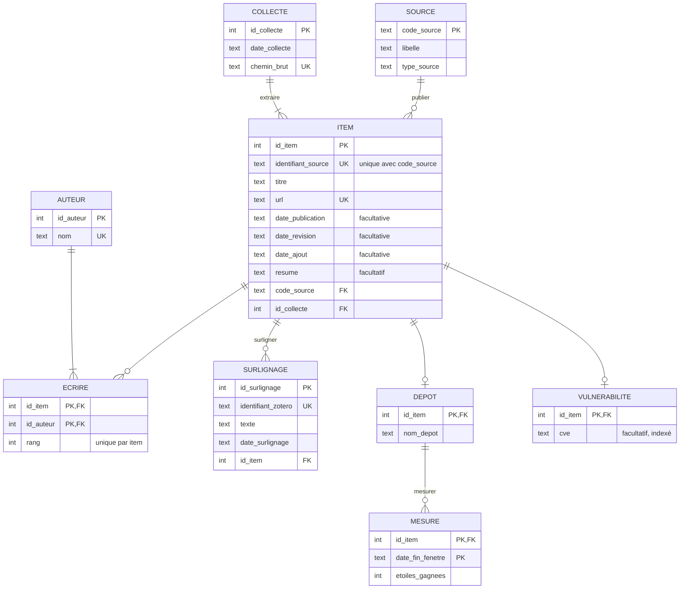

# Spécifications de stockage et modèles de la base

La base garde le jeu d'items fusionné (étape 4 de [specs-collecte.md](specs-collecte.md)) et le
sert à l'API REST, donc aux fiches de veille et aux agents. Ce document fixe le format de l'item,
le SGBD, et les trois modèles Merise : MCD, MLD, MPD. Le MPD est le script
[`src/k_b/database/schema.sql`](../src/k_b/database/schema.sql). Les décisions et leur pourquoi
sont aussi dans le [journal ADR](ADR/journal-decisions-projet.md).

```
collecte → raw/ (brut intact) → lecture + fusion → base → API REST → fiches, agents
```

La base n'est pas le brut : elle se reconstruit en rejouant la lecture et la fusion sur `raw/`.
Elle ne contient que ce que le brut contient (les papiers arXiv écartés à la requête n'y sont pas).

## Le SGBD : SQLite

Retenu : **SQLite**, un fichier dans le dossier de données hors du dépôt (`~/K-B-data/`), lu avec
le module `sqlite3` de la bibliothèque standard.

| | SQLite (retenu) | PostgreSQL (écarté pour l'instant) |
|---|---|---|
| Installation | aucune : un fichier, rejouable par un tiers | un serveur à installer, lancer et sécuriser |
| Écritures | une à la fois ; ici un seul écrivain, le pipeline | plusieurs en parallèle (MVCC) |
| Lectures pendant l'écriture | oui, en mode WAL | oui (MVCC) |
| Droits | aucun compte : l'API ouvre la base en lecture seule, le fichier est lisible par sa seule propriétaire | rôles SQL, dont un rôle en lecture seule pour l'API |
| Typage | souple par défaut ; strict avec les tables `STRICT` | strict |
| Dépendance | aucune | un pilote (`psycopg`) |

Pourquoi : un utilisateur, un écrivain par jour, quelques milliers d'items par an. Le besoin
est local et léger : un serveur n'apporterait que de la charge. Limite assumée : pas de rôles
dans la base. Une migration vers PostgreSQL reste possible si le besoin change (plusieurs
écrivains, accès distant) : le schéma est du SQL standard, à part `STRICT` et les `PRAGMA`.

## Spécifications de stockage

- **Clés étrangères** : SQLite les ignore si la connexion n'exécute pas `PRAGMA foreign_keys = ON`.
  `connect_database` (`src/k_b/database/__init__.py`) l'exécute à chaque ouverture.
- **Mode WAL** (`PRAGMA journal_mode = WAL`, gardé dans le fichier) : le pipeline écrit pendant
  que l'API lit, sans se bloquer. Tous les programmes tournent sur la même machine.
- **Dates** : du texte `AAAA-MM-JJTHH:MM:SSZ`, en UTC. Un `CHECK` refuse toute autre forme. Une
  source qui ne donne qu'un jour est stockée à minuit UTC (convention d'écriture, pas de donnée
  ajoutée).
- **Types** : tables `STRICT`, une valeur du mauvais type est refusée.
- **Dédoublonnage porté par la base** : `url` et (`source_code`, `source_item_id`) sont uniques.
  Si le code de fusion laisse passer un doublon, l'insertion échoue. `cve` n'est **pas** unique :
  une entrée CISA et une alerte GitHub de même CVE sont deux items, reliés par leur CVE
  (décision du 2026-10-05, journal ADR).

### Ce que chaque source met dans l'item

| Source | `source_item_id` | `url` | `published_at` | `saved_at` |
|---|---|---|---|---|
| GitHub (releases, alertes) | id de la release, id GHSA | page de la release ou de l'alerte | date de la release ou de l'alerte | vide |
| GitHub (plus étoilés) | `owner/repo` | page du dépôt | vide | vide |
| arXiv | id sans version (`2509.12345`) | `https://arxiv.org/abs/<id>` | soumission de la v1 | vide |
| CISA KEV | CVE | fiche NVD : `https://nvd.nist.gov/vuln/detail/<CVE>` | `dateAdded` | vide |
| Web Clipper | nom du fichier | propriété `source` | propriété `published`, **vide si absente** | propriété `created` |
| tldr.tech | URL de l'article | URL sans paramètres `utm_*` | date de l'édition | vide |
| Zotero | clé Zotero du document | champ `url` (papier arXiv) | date du papier | `dateAdded` |
| GH Archive | `owner/repo` | page du dépôt | vide | vide |

- `url` est obligatoire : un document sans URL est rejeté et journalisé. En v0, Zotero ne
  contient que des papiers arXiv ; une URL arXiv versionnée (`…v2`) est normalisée sans sa
  version, pour se recouper avec la collecte arXiv.
- Une absence reste une absence : une date manquante n'est pas remplacée par une autre.
- Un dépôt est un seul item, qu'il vienne de la recherche GitHub ou de GH Archive (même URL).
  Chaque fenêtre de 3 jours où il monte ajoute une mesure (MESURE) : on garde l'historique.
- « Quoi de neuf » ne peut pas filtrer sur `published_at` seul (vide pour certains clips) ; la
  règle se décide dans l'API (#21).
- Le login GitHub de l'auteur d'une release ou d'une alerte n'entre pas dans la base
  (minimisation, voir specs-collecte.md).

## MCD

Entités en rectangle, identifiant souligné ; associations en ovale ; cardinalités sur les traits.



- **ITEM** : une nouveauté de veille après fusion ; le socle commun à toutes les sources.
- **SOURCE** : les 7 sources ; chaque item référence une source qui existe, et le type de source
  est écrit une fois.
- **COLLECTE** : un fichier brut qui a produit au moins un item. `chemin_brut` détermine
  `date_collecte` (l'horodatage est dans le nom) : les deux vivent ici, pas dans ITEM (3e forme
  normale). Une révision arXiv rattache l'item à la collecte qui l'a apportée.
- **AUTEUR** : un auteur par ligne (1re forme normale) ; donnée personnelle, purgeable par un
  `DELETE` ciblé. Deux homonymes sont confondus (limite assumée). `rang` garde l'ordre des
  auteurs d'un papier.
- **SURLIGNAGE** : les surlignages Zotero ; `identifiant_zotero` les reconnaît d'une collecte à
  l'autre.
- **Spécialisation** : DÉPÔT et VULNÉRABILITÉ sont des sous-types d'ITEM, exclusifs, qui portent
  les champs propres à une nature d'item. N'y entre qu'un champ dont une question de veille a
  besoin : le nom du dépôt (« quels dépôts montent ? ») et le CVE (croisement
  entre CISA et les alertes GitHub).
- **MESURE** : les étoiles gagnées par un dépôt sur une fenêtre de 3 jours (GH Archive). Son
  identifiant `date_fin_fenêtre` est relatif au dépôt, d'où le (1,1) entre parenthèses : une
  mesure n'existe pas sans son dépôt, et un dépôt n'a qu'une mesure par fenêtre.
- Hors de la base : les rejets et doublons de la fusion (journal à côté du brut, #20), les
  étiquettes Zotero, et les documents de `raw/manual/` (wiki de savoir, v1).

## MLD

Règles de passage :

1. Une entité devient une table ; son identifiant, la clé primaire.
2. Une association 1,1 devient une clé étrangère du côté 1,1 (ITEM porte `code_source` et
   `id_collecte` ; SURLIGNAGE porte `id_item`).
3. Une association n,n devient une table dont la clé primaire réunit les deux clés étrangères
   (ÉCRIRE), avec ses attributs (`rang`).
4. Un sous-type prend la clé de son parent comme clé primaire, qui est aussi une clé étrangère.
5. Une entité à identifiant relatif (MESURE) prend la clé de son entité de rattachement dans sa
   clé primaire.



Clés techniques (entiers) pour ITEM, COLLECTE, AUTEUR et SURLIGNAGE : une clé primaire ne change
jamais, alors qu'une URL ou un nom peut être corrigé. Les clés naturelles restent uniques par
contrainte. SOURCE garde une clé naturelle courte et stable (`arxiv`, `cisa_kev`…).

Contraintes que SQL ne porte pas, vérifiées par le code de fusion (#20) :

- un item a au plus un sous-type ;
- DÉPÔT ne concerne que GitHub et GH Archive, VULNÉRABILITÉ que CISA KEV et les alertes GitHub ;
- un auteur a au moins un item : la purge supprime les auteurs orphelins (#8).

Un dépôt vu seulement par la recherche GitHub n'a pas de mesure : elle ne donne qu'un total
d'étoiles. `cve` est vide pour une alerte GitHub sans CVE : elle a quand même sa ligne
VULNÉRABILITÉ. Le CVE seul ne dit donc pas la nature de l'item : `Item.is_vulnerability` la porte,
vrai pour CISA KEV et les alertes GitHub (décision de Sabine du 2026-10-05, #82).

## MPD

Deux scripts, exécutés dans cet ordre à la création de la base :

- [`schema.sql`](../src/k_b/database/schema.sql) crée les tables, contraintes et index ;
- [`seed_sources.sql`](../src/k_b/database/seed_sources.sql) insère les 7 sources (données de
  référence). Il se rejoue sans risque : une source déjà présente est laissée telle quelle.
  Sans lui, aucun item ne peut entrer (clé étrangère vers `source`).

La structure et les données de référence changent pour des raisons différentes : ajouter une
source ne touche pas aux tables.

Noms SQL en anglais, comme le code ; correspondance avec le MLD :

| MLD | Table | Colonnes |
|---|---|---|
| SOURCE | `source` | `source_code`, `label`, `source_type` |
| COLLECTE | `collection` | `collection_id`, `collected_at`, `raw_file_path` |
| ITEM | `item` | `item_id`, `source_code`, `source_item_id`, `title`, `url`, `published_at`, `revised_at`, `saved_at`, `summary`, `collection_id` |
| AUTEUR | `author` | `author_id`, `name` |
| ÉCRIRE | `item_author` | `item_id`, `author_id`, `position` |
| SURLIGNAGE | `highlight` | `highlight_id`, `zotero_key`, `text`, `highlighted_at`, `item_id` |
| DÉPÔT | `repository` | `item_id`, `repository_name` |
| MESURE | `star_gain` | `item_id`, `window_end`, `stars_gained` |
| VULNÉRABILITÉ | `vulnerability` | `item_id`, `cve` |

- **Index** : sur `published_at`, `saved_at` et `window_end` (« quoi de neuf », « quels dépôts
  montent »), sur `cve` (croisement CISA ↔ GitHub), et sur les clés étrangères,
  que SQLite n'indexe pas d'office. Les contraintes `UNIQUE` créent leur propre index.
- **Suppressions en cascade** : supprimer un item supprime ses liens d'auteurs, ses surlignages
  et son sous-type (et les mesures d'un dépôt) ; supprimer un auteur supprime ses liens. Pas de cascade vers `source` ni
  `collection`.
- **Formats contrôlés** : dates (ci-dessus), `cve` (`CVE-AAAA-NNNN…`), `repository_name`
  (`owner/repo`), `position` ≥ 1, `stars_gained` ≥ 0.

### Ce qui est propre à SQLite

Le MPD est écrit pour SQLite. Pour migrer vers un autre SGBD, voici ce qui change, avec
l'équivalent PostgreSQL :

| Dans le script SQLite | Pourquoi | En PostgreSQL |
|---|---|---|
| `STRICT` sur chaque table | sinon SQLite accepte une valeur du mauvais type | inutile : typage strict par défaut |
| dates en `TEXT` + `CHECK (… IS strftime(…))` | SQLite n'a pas de type date | `timestamptz`, sans `CHECK` de format |
| `INTEGER PRIMARY KEY` | numérotation automatique (alias de `rowid`) | `bigint GENERATED ALWAYS AS IDENTITY` |
| `GLOB` dans les `CHECK` (`cve`, `repository_name`) | motif simple | `~` (expression régulière) |
| `IS` dans les `CHECK` de date | compare sans que `NULL` fasse passer le contrôle | `IS NOT DISTINCT FROM` |
| `PRAGMA foreign_keys = ON` à chaque connexion | clés étrangères ignorées sinon | inutile : toujours vérifiées |
| `PRAGMA journal_mode = WAL` | lire pendant l'écriture | inutile : MVCC |

Reste identique : les tables, les clés, `UNIQUE`, `ON DELETE CASCADE`, les index, et
`ON CONFLICT (…) DO NOTHING` du seed. Le MCD et le MLD ne dépendent d'aucun SGBD.

Vérifié le 2026-10-02 avec SQLite 3.50.4 : le script s'exécute, et chaque contrainte refuse une
ligne fautive (date sans `Z`, 30 février, URL ou identifiant en double, source inconnue, CVE mal
formée, texte dans une colonne entière, deux mesures sur la même fenêtre, mesure sur un
item qui n'est pas un dépôt). Sans `PRAGMA foreign_keys = ON`, une clé étrangère
fausse passe : d'où la règle ci-dessus.

## Faire évoluer le schéma

- Les champs propres d'une source s'ajoutent quand on traite sa lecture : l'issue de la source
  ajoute ses champs au sous-type (ou crée le sien) et met à jour MCD, MLD et MPD dans sa PR.
  Les champs propres de CISA KEV (fournisseur, produit, usage par rançongiciel) se décident
  dans #20.
- SQLite ajoute, renomme ou supprime une colonne en place (`ALTER TABLE`) ; tout autre
  changement passe par une reconstruction de la table. Au pire, la base se reconstruit depuis
  le brut.

## Sources (consultées le 2026-10-02)

- [Appropriate Uses For SQLite](https://www.sqlite.org/whentouse.html)
- [Write-Ahead Logging](https://www.sqlite.org/wal.html) — SQLite
- [ALTER TABLE](https://www.sqlite.org/lang_altertable.html) — SQLite
- [MVCC](https://www.postgresql.org/docs/current/mvcc-intro.html) — PostgreSQL
- [Variables](https://help.obsidian.md/web-clipper/variables) — Obsidian Web Clipper
