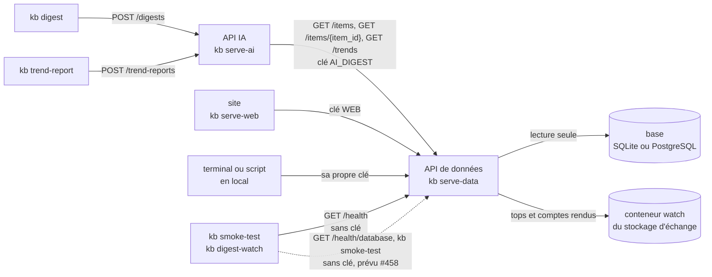

# L'API de données de K-B

!!! note "Compétences de la certification"

    > La documentation technique de l'API (REST) couvre tous les points de terminaisons.

    — C5

    > La documentation technique couvre les règles d'authentification et/ou d'autorisation de l'API.

    — C5

    > La documentation technique respecte les standards du modèle choisi (par exemple OpenAPI).

    — C5

    > Rédaction de la documentation technique d'accès à la base de données adaptée aux environnements techniques du
    > projet.

    — C5

Cette fiche dit ce qu'est l'API de données, comment elle est construite, ce que fait chacun de ses points de
terminaison, qui peut l'appeler, comment une clé se change, ce que dit son contrat OpenAPI, et comment elle lit la
base dans chaque environnement de K-B. Le contrat de ses sept routes est
[l'OpenAPI versionnée de l'API de données](https://github.com/SabineLaurent/K-B/blob/main/docs/api/openapi-donnees.json),
`docs/api/openapi-donnees.json`: la fiche y renvoie et ne la remplace pas. Elle est écrite d'après le code de `main`
au commit `39cb5eb9`; ce qui porte « #458 », d'après le code de la demande de fusion de #458. Les chemins du code de
K-B (`data_api/…`, `core/…`, `database/…`, …) partent de
`src/k_b/`, les autres de la racine du dépôt.

## Ce qu'est l'API de données

L'API de données est la seule porte de lecture de la base pour les autres briques de K-B. L'API IA et le site lisent
la veille par elle, en HTTP, jamais dans la base: un test refuse que le paquet de l'API IA importe autre chose que
`ai_api`, `items` et `core` (`tests/architecture/test_apis.py:107`, `:120`), un autre refuse que le paquet du site
importe autre chose que `web`, `core` et `items` (`tests/architecture/test_layers.py:471`, `:489`).

Elle sert en lecture seule: chaque route ne répond qu'à `GET`, et la base est ouverte en lecture seule sur ses deux
moteurs, SQLite et PostgreSQL (section
[L'accès à la base selon l'environnement](#lacces-a-la-base-selon-lenvironnement)). Elle sert aussi au site les tops
GitHub et les comptes rendus de veille, qu'elle lit dans le conteneur `watch` du stockage d'échange, pas dans la base
(`data_api/app.py:1-2`).

Elle se lance par `kb serve-data`. En local, elle écoute par défaut sur `127.0.0.1:8000`, la machine seule, et ne
répond qu'aux hôtes `127.0.0.1` et `localhost` (`core/config.py:214-219`); `KB_DATA_API_HOST`, `KB_DATA_API_PORT` et
`KB_DATA_API_ALLOWED_HOSTS` les changent (`data_api/settings.py:21-53`). En ligne, c'est l'app `ca-kb-data-api`
d'Azure Container Apps, sans adresse publique (section [En ligne](#en-ligne)). `kb serve-data` sort en code 2, sans
écouter, si un réglage est refusé (`commands/serve_data_command.py:38-52`), et en code 3 si uvicorn ne démarre pas,
par exemple quand le port est déjà pris (`commands/exit_codes.py:40-45`; [Utiliser K-B](utilisation.md), « L'API de données: `kb serve-data` »).

## Architecture

Le schéma suivant montre qui appelle l'API de données et ce qu'elle lit. Le paragraphe qui le suit, « Texte
équivalent du schéma », le décrit en texte, flèche par flèche.



Texte équivalent du schéma. `kb digest` et `kb trend-report` n'appellent pas l'API de données: ils demandent leurs
comptes rendus à l'API IA, par `POST /digests` et `POST /trend-reports`. L'API IA lit alors les items et les tendances
par l'API de données, `GET /items`, `GET /items/{item_id}` et `GET /trends`
(`ai_api/connectors/data_api_client.py:268`, `:289`, `:308`), avec la clé du client `AI_DIGEST`
(`ai_api/connectors/data_api_settings.py:15`). Le site appelle avec la clé du client `WEB` (`web/settings.py:40`). En
local, le terminal ou un script appelle avec sa propre clé, par exemple celle du client `TERMINAL`
([Utiliser K-B](utilisation.md), « La lancer et l'appeler »). Les jobs `kb smoke-test` et `kb digest-watch` appellent `GET /health` sans clé
(`commands/smoke_test_command.py:94-101`, `commands/digest_watch_command.py:43-48`); `kb smoke-test` y ajoute des
sondes sans clé, qui attendent chacune son refus, hors du bac à sable, où `/docs` répond 200 (`jobs/api_probes.py:75-84`), et
`GET /health/database`, sans clé, qui dit si l'API lit sa base (`commands/smoke_test_command.py:112`, `:162-173`, #458); ce trait est en
pointillés, prévu en ligne. L'API de données lit la base, SQLite
ou PostgreSQL, en lecture seule, et le conteneur `watch` du stockage d'échange pour les tops et les comptes rendus
(`data_api/watch_reading.py:1-4`).

### Les couches du code

Le paquet `data_api/` compte 14 modules. Le tableau suivant donne chaque couche, du point d'entrée à la lecture, ses
modules et leur rôle.

| Couche | Modules | Rôle |
|---|---|---|
| Présentation | `commands/serve_data_command.py`, `data_api/settings.py` | lit les clés et les réglages, ouvre la base et `watch`, lance uvicorn |
| L'app | `data_api/app.py`, `data_api/api_router.py` | construit l'app: la clé et le débit sur chaque route de données, les <span lang="en">middlewares</span>, `/health`; `api_router.py` rassemble les quatre routeurs |
| Les routes | `data_api/routers/` (4 modules), `data_api/dependencies.py`, `data_api/errors.py` | une fonction par route, ses paramètres et leurs bornes; la connexion de chaque requête et le lecteur de `watch`; les erreurs nommées |
| Les contrats | `data_api/schemas/` (4 modules) | les modèles de réponse propres à l'API, jamais les modèles de lecture: un champ ajouté à la lecture n'est pas servi (`data_api/schemas/item_schema.py:1-2`) |
| La lecture | `database/reading.py`, `database/engine.py`, `database/postgresql.py`; `data_api/watch_reading.py` et `exchange/` | les requêtes SQL; les connexions en lecture seule; la lecture de `watch` |
| Le vocabulaire commun | `items.py`, `core/` (`api_access.py`, `api_keys.py`, `api_errors.py`, `api_rate_limit.py`, `api_request_log.py`, `api_health.py`, `api_methods.py`, `api_settings.py`) | les types, et ce que l'API de données partage avec l'API IA |

Des tests tiennent ces couches. `test_data_api_imports_only_data_api_database_items_core_and_exchange`
(`tests/architecture/test_apis.py:42-45`) refuse qu'un module de `data_api/` importe autre chose que `data_api`,
`database`, `items`, `core` et `exchange` (`:22`), ou qu'il atteigne `database.writers`, `database.writing`,
`database.purge` ou `core.atomic_write` (`:23-28`): l'API n'écrit ni la base ni un fichier.
`test_the_app_of_an_api_imports_no_router` (`:78-83`) garde `api_router.py` seul à rassembler les routeurs, et
`test_each_router_of_an_api_declares_its_prefix_and_its_tags` (`:89-101`) oblige chaque routeur à déclarer son
préfixe et ses étiquettes (`tags`): `items`, `trends`, `tops` et `digests`, qui rangent les routes dans l'OpenAPI.

## Les points de terminaison

L'API de données a onze chemins. Les sept routes de données sont dans le contrat, `docs/api/openapi-donnees.json`.
`GET /health`, `GET /health/database`, `/docs` et `/openapi.json` sont **hors du contrat**: ils sont décrits ici d'après le code (section
[Hors du contrat, d'après le code](#hors-du-contrat-dapres-le-code)). Le test `test_the_routes_are_listed` tient la
liste des onze (`tests/data_api/test_api_keys.py:37-50`, #458). Le tableau suivant donne, pour chaque chemin, s'il est dans
le contrat, ce qu'il rend, ce qu'il lit et les clients permis.

| Chemin | Dans le contrat | Ce qu'il rend | Lit | Clients permis |
|---|---|---|---|---|
| `GET /items` | oui | une page des items, les plus récents d'abord, et leur total | la base | tout client à clé valide |
| `GET /items/{item_id}` | oui | un item, et ce que sa sorte sert de plus que la liste | la base | tout client à clé valide |
| `GET /trends` | oui | le classement des dépôts d'une fenêtre de 3 jours, par les étoiles et les <span lang="en">forks</span> comptés dans GH Archive | la base | tout client à clé valide |
| `GET /tops/{top}` | oui | le top d'un jour des dépôts GitHub les plus étoilés ou les plus forkés | `watch` | le client `WEB` seul |
| `GET /tops/{top}/days` | oui | les jours qui ont un top | `watch` | le client `WEB` seul |
| `GET /digests/{subject}` | oui | le compte rendu de veille d'un sujet d'un jour | `watch` | le client `WEB` seul |
| `GET /digests/{subject}/days` | oui | les jours qui ont un compte rendu du sujet | `watch` | le client `WEB` seul |
| `GET /health` | non | `{"status": "ok"}` | rien | sans clé |
| `GET /health/database` | non | `{"status": "ok"}`, ou l'erreur d'une route de données | la base, une ligne au plus | sans clé, un appel à la fois |
| `GET /openapi.json` | non | l'OpenAPI de l'app | rien | sans clé, avec `KB_DEPLOYMENT_ENVIRONMENT=sandbox` seulement; 404 sinon |
| `GET /docs` | non | Swagger UI, qui lit `/openapi.json` | rien | comme `/openapi.json` |

Chaque champ des réponses, son type et ses bornes sont dans l'OpenAPI, sous `components.schemas`; la fiche ne les
recopie pas. Un paramètre hors de ses bornes, ou mal formé, reçoit 422 `invalid_parameter` sur chaque route.

### `GET /items`

Une page des items, les plus récents d'abord. Le tableau suivant donne ses paramètres, tous facultatifs, et leurs
bornes (`data_api/routers/item_router.py:38-44`, `:101-108`).

| Paramètre | Forme | Bornes | Défaut |
|---|---|---|---|
| `kind` | une sorte d'item, répétable (`kind=paper&kind=release`) | une des 7 sortes, `paper`, `vulnerability`, `newsletter_article`, `release`, `advisory`, `zotero_entry`, `clip` (`items.py:39-47`); 7 valeurs au plus | toutes les sortes |
| `since` | une date-heure de la norme ISO 8601, avec son fuseau (`2026-10-07T00:00:00Z`); dans une URL, `+` s'écrit `%2B` | une date sans fuseau, ou un nombre, est refusée (`data_api/routers/item_router.py:57-75`) | aucun filtre de date |
| `q` | un texte | de 1 à 200 caractères | aucune recherche |
| `limit` | un entier | de 1 à 100 | 20 |
| `offset` | un entier | de 0 à 10 000 | 0 |

- **Le filtre de date.** `since` porte sur la date que la source donne, propre à chaque sorte, `source_date` dans
    la réponse; il est converti en UTC, arrondi à la seconde supérieure, puis comparé en `>=`
    (`database/reading.py:94`, `:416-429`). Ni la date de collecte ni une date de révision n'y entrent: c'est la
    décision du
    [journal des décisions](https://github.com/SabineLaurent/K-B/blob/main/docs/ADR/journal-decisions-projet.md),
    entrée « API de données » (`docs/ADR/journal-decisions-projet.md:1562`).
- **La recherche.** `q` cherche un morceau de texte dans le titre et le résumé de chaque item, sans égard à la casse
    des lettres sans accent, par le même SQL sur les deux moteurs, `lower(champ) LIKE lower(q)`
    (`database/reading.py:86-98`); `%`, `_` et `\` y sont cherchés tels quels (`database/reading.py:432-440`). Le
    champ résumé de chaque sorte est dans
    [la spécification de l'API de données](https://github.com/SabineLaurent/K-B/blob/main/docs/specs-api.md),
    « Date, titre et résumé par sorte ».
- **Le tri et la pagination.** Par `source_date` décroissante, puis par `id` décroissant
    (`database/reading.py:102-105`). La réponse donne `next_offset`, l'`offset` de la page suivante, nul à la
    dernière page et au-delà de la borne de `offset` (`database/reading.py:372-376`, `data_api/routers/item_router.py:141-145`), et
    `total`, le nombre des items de `kind`, `since` et `q`, toutes pages ensemble. La page et son total sont lus dans
    une même transaction de lecture (`database/reading.py:362-371`).
- **La réponse**, `ItemPageSchema`: `items`, `next_offset` et `total` (`data_api/schemas/item_schema.py:93-100`).
    Chaque item a six champs, `id`, `kind`, `title`, `source_date` (un texte UTC `AAAA-MM-JJTHH:MM:SSZ`, comme en
    base), `url` et `withdrawn_at` (`data_api/schemas/item_schema.py:19-28`), puis les identifiants de sa sorte, et
    aucun autre champ: `kind` dit le schéma suivi (`data_api/schemas/item_schema.py:81-90`). Ni le chemin d'un
    fichier brut ni une date de collecte ne sont servis, par aucune route (test
    `test_no_route_documents_a_raw_file_path_or_a_collection_date`, `tests/data_api/test_openapi.py:201-205`).

Le tableau suivant donne les identifiants que la liste sert pour chaque sorte, après les six champs communs
(`data_api/schemas/item_schema.py:36-78`).

| Sorte | Identifiants servis par la liste |
|---|---|
| `paper` | `arxiv_id` |
| `vulnerability` | `cve_id`, `exploited` |
| `release` | `repository_name`, `tag_name` |
| `advisory` | `ghsa_id`, `cve_id`, `exploited`, `packages` (les 10 premiers paquets touchés), `packages_truncated` (il en manque) |
| `newsletter_article` | `edition`, la lettre d'information |
| `zotero_entry`, `clip` | aucun |

`exploited` dit si la CVE (<span lang="en">Common Vulnerabilities and Exposures</span>, l'identifiant public d'une
vulnérabilité) est au catalogue CISA KEV (<span lang="en">Known Exploited Vulnerabilities</span>, de la
<span lang="en">Cybersecurity and Infrastructure Security Agency</span> américaine); il est nul pour une alerte sans
CVE (`data_api/schemas/item_schema.py:13-16`). La liste sert 10 paquets d'une alerte au plus, et son détail les sert
tous (`data_api/routers/item_router.py:51-54`, `:129-138`).

### `GET /items/{item_id}`

Un item, et ce que sa sorte sert de plus que la liste.

- **Le paramètre.** `item_id` est l'`id` de la liste: un entier écrit en chiffres, sans zéro en tête, sans `+`, sans
    espace ni décimale (`1` ou `-1`, mais pas `01`, `1.0` ni `+1`), tenu sur 64 bits; sinon 422
    `invalid_parameter` (`data_api/routers/item_router.py:77-89`). Un entier qu'aucun item ne porte reçoit 404
    `item_not_found` (`data_api/routers/item_router.py:159-160`).
- **La réponse** reprend l'item de la liste, ses six champs et ses identifiants, puis les champs de sa sorte, et
    aucun autre (`data_api/schemas/item_schema.py:103-184`). Les lectures d'un détail partagent une transaction de
    lecture (`database/reading.py:457-483`).
- **Les bornes du détail.** Une entrée Zotero sert ses surlignages par date, tant qu'ils sont 100 au plus et que
    leur texte et leur commentaire font ensemble 125 000 caractères au plus; un clip sert les 125 000 premiers
    caractères de son texte. `highlights_truncated` et `body_truncated` disent la coupe, et valent faux sans coupe
    (`data_api/routers/item_router.py:45-50`, `:169-201`). La base n'en lit qu'un de plus que ce qui est servi, pour
    que la route voie la coupe (`data_api/routers/item_router.py:153-158`).

Le tableau suivant donne les champs que le détail sert en plus de la liste, pour chaque sorte.

| Sorte | En plus de la liste |
|---|---|
| `paper` | `authors`, `summary`, `arxiv_updated_at` |
| `vulnerability` | `description`, `vendor`, `product`, `ransomware_use`, `revised_at` |
| `release` | `release_id`, `body` |
| `advisory` | aucun champ de plus: `packages` entier, et `packages_truncated` toujours faux (`data_api/routers/item_router.py:179-181`) |
| `newsletter_article` | `edition_date`, `rank`, `summary` |
| `zotero_entry` | `zotero_key`, `item_type`, `arxiv_id`, `revised_at`, `highlights` (chacun avec `text`, `comment`, `highlighted_at`, `revised_at`, `withdrawn_at`), `highlights_truncated` |
| `clip` | `published_at`, `body`, `body_truncated` |

### `GET /trends`

Le classement des dépôts GitHub d'une fenêtre de 3 jours, par les étoiles et les <span lang="en">forks</span> qu'y compte GH Archive. Ces
comptes sont un échantillon, comme le dit [La collecte des données de K-B](collecte.md). Le tableau suivant donne son
paramètre.

| Paramètre | Forme | Défaut |
|---|---|---|
| `window_end` | une date écrite `AAAA-MM-JJ` exactement, le dernier jour de la fenêtre; une autre forme, un nombre ou une date qui n'existe pas reçoit 422 (`items.py:133-138`, `:324`) | la fenêtre la plus récente en base (`database/reading.py:162-169`) |

- Aucune tendance pour cette fenêtre, ou aucune en base: 404 `trend_window_not_found`
    (`data_api/routers/trend_router.py:29-31`).
- La réponse donne `window_end` et `trends`, une ligne par dépôt: `repository_id`, `repository_name`,
    `stars_gained`, `forks_gained` (`data_api/schemas/trend_schema.py:8-18`). Les lignes sont triées par
    `stars_gained`, puis par `forks_gained`, décroissants, puis par `repository_id` (`database/reading.py:168`).
- Pas de pagination: une fenêtre a 60 lignes au plus, les 30 premiers dépôts par étoiles et les 30 premiers par
    <span lang="en">forks</span>, bornés à la collecte (`core/config.py:83`, `etl/sources/gh_archive.py:282`).

### `GET /tops/{top}`

Le top d'un jour des dépôts GitHub les plus étoilés ou les plus forkés. La route lit le jumeau JSON que
`kb write-tops` écrit à côté de chaque fiche d'un top, `tops/<top>/<AAAA-MM-JJ>.json` dans `watch`
(`data_api/watch_reading.py:49-51`, `:90-99`). Elle est réservée au client `WEB` (section
[Authentification et autorisation](#authentification-et-autorisation)). Le tableau suivant donne ses paramètres.

| Paramètre | Forme | Bornes | Défaut |
|---|---|---|---|
| `top`, dans le chemin | `most_starred` ou `most_forked` (`items.py:58`) | une autre valeur reçoit 422 | requis |
| `day` | une date écrite `AAAA-MM-JJ` exactement | comme `window_end` de `GET /trends` | le jour le plus récent |
| `limit` | un entier | de 1 à 100, la taille d'un relevé (`core/config.py:74`, `:389-390`) | 10 |

- Aucun jumeau du jour demandé, ou aucun jumeau: 404 `top_not_found` (`data_api/routers/top_router.py:48-50`).
- La réponse donne `top`; `day`, le jour de `ranked_at` en UTC; `ranked_at`, l'heure du relevé du top chez GitHub;
    et `repositories`, les `limit` premiers dépôts par rang, chacun avec `rank`, `repository_name`, `url`,
    `description`, `description_truncated` (la description coupée à 1 000 caractères) et `count`, ses étoiles dans
    `most_starred`, ses <span lang="en">forks</span> dans `most_forked` (`data_api/schemas/top_schema.py:12-35`).

### `GET /tops/{top}/days`

Les jours qui ont un top. Le tableau suivant donne ses paramètres, en plus de `top`
(`data_api/routers/top_router.py:63-72`, `core/config.py:391-393`).

| Paramètre | Forme | Bornes | Défaut |
|---|---|---|---|
| `limit` | un entier | de 1 à 100 | 30 |
| `offset` | un entier | de 0 à 5 000 | 0 |

La réponse donne `days`, les jours qui ont un jumeau, du plus récent au plus ancien, aucun après aujourd'hui en UTC,
et `total`, leur nombre, toutes pages comptées (`data_api/schemas/top_schema.py:38-41`,
`data_api/watch_reading.py:164-167`, `:196-197`). Un dossier sans jumeau rend une liste vide et un total nul.

### `GET /digests/{subject}`

Le compte rendu de veille d'un sujet d'un jour. La route lit le jumeau JSON que `kb digest` écrit à côté de chaque
fiche, `<sujet>/<AAAA-MM-JJ>.json` à la racine de `watch` (`data_api/watch_reading.py:100-110`). Elle est réservée au
client `WEB`. Le tableau suivant donne ses paramètres.

| Paramètre | Forme | Bornes | Défaut |
|---|---|---|---|
| `subject`, dans le chemin | un des 9 sujets: `vulnerabilities`, `llm_security`, `agent_frameworks`, `coding_assistants`, `models`, `ai_industry`, `cybersecurity`, `software_engineering`, `tech_industry` (`data_api/schemas/watch_digest_schema.py:14-24`) | une autre valeur reçoit 422 | requis |
| `day` | une date écrite `AAAA-MM-JJ` exactement | comme `window_end` de `GET /trends` | le jour le plus récent |

- La liste des sujets de la route est tenue égale à celle des comptes rendus, `DIGEST_SUBJECTS`, par le test
    `test_the_subjects_of_the_route_are_those_of_the_digests` (`tests/data_api/test_watch_digest_router.py:319`).
- Aucun jumeau du jour demandé, ou aucun jumeau: 404 `digest_not_found`
    (`data_api/routers/watch_digest_router.py:41-43`).
- La réponse donne `subject`; `day`, le jour de `until` en UTC; `since` et `until`, la fenêtre du sujet; `model`, le
    modèle qui a rédigé; `items_capped`, `capped_kind` et `covered_after`, qui disent si la lecture des items a été
    coupée; `outcome`, `written`, `no_claim` ou `no_item`; `claims`, chacune avec son `text` et les `item_ids` de ses
    sources; et `sources`, chacune avec `item_id`, `title` et `url` (`data_api/schemas/watch_digest_schema.py:30-72`).

### `GET /digests/{subject}/days`

Les jours qui ont un compte rendu du sujet: les paramètres `limit` et `offset` de `GET /tops/{top}/days`, avec les
mêmes bornes et les mêmes défauts, et la même réponse, `days` et `total`
(`data_api/routers/watch_digest_router.py:47-56`, `data_api/schemas/watch_digest_schema.py:75-78`).

### La lecture de `watch`

Les quatre routes de `watch` lisent par le même lecteur, `WatchReader` (`data_api/watch_reading.py:144-241`).

- **Les noms.** Seul un nom `<dossier>/<AAAA-MM-JJ>.json`, dont le jour est une date du calendrier, est lu; tout
    autre nom du dossier est laissé de côté, et un jour postérieur à aujourd'hui en UTC aussi
    (`data_api/watch_reading.py:260-271`, `:301-307`, `:196-197`).
- **La liste.** Par le préfixe du dossier, 5 000 noms par page, sur deux pages au plus; au-delà, 502
    `watch_listing_too_long` (`data_api/watch_reading.py:274-298`, `core/config.py:398-399`).
- **Le jumeau.** Téléchargé tel que listé, il est refusé avant le téléchargement au-delà de 4 000 000 octets pour un
    top et de 400 000 pour un compte rendu (`data_api/watch_reading.py:228-234`, `core/config.py:725`, `:409`), puis
    relu par le schéma fermé de sa sorte, `TopProduction` ou `DigestProduction` (`items.py`). Hors de son schéma,
    d'un autre dossier que le sien ou d'un autre jour que son nom, il est refusé et jamais servi: 502
    `watch_production_refused` (`data_api/watch_reading.py:244-257`). Changé depuis la liste, il reçoit 503
    `watch_production_changed`, et la requête suivante relit la liste (`data_api/watch_reading.py:235-240`).
- **Le cache.** La liste de chaque dossier est gardée 60 s, et les 8 derniers tops et les 16 derniers comptes rendus
    lus, chacun par son nom et son `etag` (`core/config.py:403-405`, `data_api/watch_reading.py:183-221`).
- **Le stockage.** Le lecteur joint le stockage par l'identité managée de l'app (`AZURE_CLIENT_ID`), avec 5 s pour
    se connecter et 10 s pour lire, sans nouvelle tentative (`data_api/watch_reading.py:310-334`,
    `core/config.py:412-413`). Son échec rend son état: 504 `exchange_storage_timeout`, 503
    `exchange_storage_not_found`, 502 sinon (`data_api/errors.py:44-49`, `:112-120`).
- **Les réglages.** `kb serve-data` lit `KB_EXCHANGE_BLOB_URL` et `AZURE_CLIENT_ID` au démarrage
    (`data_api/settings.py:63-76`); une valeur mal formée l'empêche de démarrer, en code 2
    (`commands/serve_data_command.py:47-50`).

### Hors du contrat, d'après le code

- `GET /health` répond 200 `{"status": "ok"}`, sans clé: il dit que le processus répond, rien de plus, et n'ouvre ni
    la base ni `watch` (`core/api_health.py:1-13`). C'est une route de Starlette, ajoutée hors du schéma, que la clé
    de l'app n'atteint pas (`data_api/app.py:80-82`). Une réponse 200 de `/health` n'est pas journalisée
    (`core/api_request_log.py:36-38`). En ligne, c'est la sonde du conteneur.
- Depuis #458, `GET /health/database` dit si l'API lit sa base, sans clé, pour l'opératrice, `kb smoke-test` et la surveillance,
    jamais pour les sondes du conteneur, qui feraient redémarrer l'API à chaque panne de la base (test
    `test_no_probe_of_azure_container_apps_asks_the_database_health`). Elle lit une ligne au plus de la première table
    du schéma, `SELECT 1 FROM source LIMIT 1`, par la connexion d'une route de données, sous ses délais
    (`database/reading.py:25-27`, `:328-330`, `data_api/database_health.py:17-37`). Elle répond 200
    `{"status": "ok"}`, sans aucune valeur de la base, ou l'erreur d'une route de données pour la même cause: 503
    `database_missing`, même pour une base PostgreSQL sans la table `source`, la seule qu'elle lit, où `SELECT 1`
    passerait, 503
    `database_unavailable`, 503 `query_timeout` ou 500 `database_error` (`tests/data_api/test_database_health.py`).
    Un second appel pendant qu'un premier tourne reçoit 429 `request_already_running`, avec `Retry-After: 7`, les 2 s
    d'attente d'une connexion et les 5 s de l'instruction (`core/config.py:427-429`): sans clé, elle ne prend qu'une
    des 4 connexions du <span lang="en">pool</span> à la fois. Chaque appel est journalisé, 200 compris: seul `/health` à 200 ne l'est pas
    (`core/api_request_log.py:39`). C'est une route de Starlette, ajoutée hors du schéma (`data_api/app.py:89-94`).
- `/openapi.json` et `/docs` ne sont servis que si `KB_DEPLOYMENT_ENVIRONMENT` vaut exactement `sandbox`; toute
    autre valeur, ou aucune, ne sert ni l'un ni l'autre (`core/api_settings.py:69-79`). ReDoc n'est pas servi
    (`data_api/app.py:58-59`, test `test_docs_openapi_and_health_are_public_and_no_other_page_is_served`).
- `HEAD` est retiré de chaque route `GET`, où Starlette l'ajoute: une requête `HEAD` reçoit 405, comme toute autre
    méthode que `GET` (`core/api_methods.py:7-13`, test
    `test_every_route_answers_get_only_and_405_to_any_other_method`).
- Un chemin terminé par `/`, comme `/items/`, reçoit 404, sans redirection (`data_api/app.py:60-61`).
- Un `Host` hors des hôtes permis reçoit le 400 de `TrustedHostMiddleware`, en texte, avant l'app
    (`data_api/app.py:73-74`).
- Chaque réponse porte l'en-tête `X-Request-ID`, l'identifiant que reprend la ligne de journal de la requête, dans
    `logs/kb-serve-data.log` sous `KB_DATA_DIR` (`core/api_request_log.py:17-49`, `commands/run_log.py:30`). Cette
    ligne nomme le client, jamais sa clé ni une valeur de paramètre (`core/api_request_log.py:1-2`).

### Les erreurs

Toute erreur a pour corps `{"error": "<état>"}`; un 422 ajoute `parameters`, les noms des paramètres refusés, jamais
leurs valeurs (`core/api_errors.py:49-55`, `:97-114`). Aucun corps d'erreur ne contient le chemin d'un fichier (test
`test_no_error_body_holds_a_raw_file_path_or_a_path`). Le tableau suivant donne chaque état du contrat, son statut,
quand il vient et sur quelles routes (`core/api_errors.py:58-63`, `data_api/errors.py:28-68`).

| Statut | État | Quand | Routes |
|---|---|---|---|
| 401 | `invalid_api_key` | clé absente ou inconnue, avec le même corps | toutes les routes de données |
| 403 | `client_not_allowed` | clé valide d'un autre client que `WEB` | tops et comptes rendus |
| 404 | `item_not_found` | aucun item de cet identifiant | `GET /items/{item_id}` |
| 404 | `trend_window_not_found` | aucune tendance pour cette fenêtre, ou aucune en base | `GET /trends` |
| 404 | `top_not_found` | aucun jumeau du jour demandé, ou aucun jumeau | `GET /tops/{top}` |
| 404 | `digest_not_found` | aucun jumeau du jour demandé, ou aucun jumeau | `GET /digests/{subject}` |
| 422 | `invalid_parameter` | paramètre hors de ses bornes ou mal formé | toutes les routes de données |
| 429 | `rate_limit_exceeded` | client au-delà du débit de la route, avec `Retry-After` | toutes les routes de données |
| 500 | `database_error` | toute autre erreur de la base, sans détail | items et tendances |
| 500 | `internal_error` | erreur imprévue, journalisée par son type seul | toutes les routes de données |
| 502 | `watch_listing_too_long` | plus de 5 000 noms, ou plus de deux pages, dans le dossier | tops et comptes rendus |
| 502 | `watch_production_refused` | jumeau refusé (section [La lecture de `watch`](#la-lecture-de-watch)) | tops et comptes rendus |
| 502 | `exchange_storage_unavailable`, `exchange_storage_no_token`, `exchange_storage_unauthorized`, `exchange_storage_forbidden`, `exchange_storage_failed` | le stockage d'échange, ou l'identité, a échoué ou refusé | tops et comptes rendus |
| 503 | `database_missing` | le fichier SQLite de la base n'existe pas; sur PostgreSQL, une table de K-B manque (#458) | items et tendances |
| 503 | `database_unavailable` | sur PostgreSQL, aucune connexion du <span lang="en">pool</span> en 2 s: toutes prêtées, ou aucune qui joigne la base (#458) | items et tendances |
| 503 | `query_timeout` | la requête a passé sa borne de temps dans la base | items et tendances |
| 503 | `watch_unconfigured` | `kb serve-data` n'a pas `KB_EXCHANGE_BLOB_URL` ou `AZURE_CLIENT_ID` | tops et comptes rendus |
| 503 | `watch_production_changed` | le jumeau a changé depuis la liste gardée | tops et comptes rendus |
| 503 | `exchange_storage_not_found` | le conteneur `watch` est absent | tops et comptes rendus |
| 504 | `exchange_storage_timeout` | le stockage n'a pas répondu dans ses délais | tops et comptes rendus |

Hors du contrat: le 400 d'un hôte refusé, 404 `route_not_found` et 405 `method_not_allowed`
(`core/api_errors.py:31-35`).

## Authentification et autorisation

**Le mécanisme.** Un seul: une clé par client, envoyée dans l'en-tête `Authorization: Bearer <clé>`
(`core/api_access.py:16-23`). Il n'y a ni route de connexion, ni jeton délivré par l'API, ni compte: la clé
identifie un programme, jamais une personne. La clé est contrôlée sur l'app entière, pas route par route: aucune
route de données ne peut l'oublier (`data_api/app.py:53-56`). L'OpenAPI déclare ce mécanisme dans
`components.securitySchemes.HTTPBearer`, et chaque route le demande (`security`), ce que vérifie
`test_the_versioned_openapi_is_valid_and_declares_its_security_scheme` (`tests/data_api/test_openapi.py:28-42`).

**Les clés.** `kb serve-data` lit au démarrage chaque variable `KB_DATA_API_KEY_<CLIENT>` (`core/api_keys.py:12`,
`:17-34`, `commands/serve_data_command.py:38-40`), et journalise le nom des clients, jamais leurs clés
(`commands/serve_data_command.py:53`). Il refuse de démarrer, en code 2, s'il n'en trouve aucune ou si l'une est
refusée; le message nomme la variable, jamais la clé (`core/api_keys.py:37-56`):

- `<CLIENT>` est fait de `A-Z`, `0-9` et `_`;
- une clé a 32 caractères au moins, pris dans `A-Z`, `a-z`, `0-9`, `_` et `-`, l'alphabet de
    `secrets.token_urlsafe` (`core/config.py:228-229`);
- deux clients n'ont pas la même clé.

**Les clients.** Le tableau suivant donne les clients que nomment le code et l'infrastructure, leur variable et les
routes qui leur sont permises.

| Client | Programme | Variable | Routes permises |
|---|---|---|---|
| `AI_DIGEST` | l'API IA, `kb serve-ai` | `KB_DATA_API_KEY_AI_DIGEST` (`ai_api/connectors/data_api_settings.py:15`) | les items et les tendances |
| `WEB` | le site, `kb serve-web` | `KB_DATA_API_KEY_WEB` (`web/settings.py:40`) | toutes les routes de données |
| tout autre nom, `TERMINAL` par exemple | en local, le terminal, un script ([Utiliser K-B](utilisation.md), « La lancer et l'appeler ») | `KB_DATA_API_KEY_<CLIENT>` | les items et les tendances |

**L'authentification.** La clé reçue est comparée à chaque clé connue, en temps constant (`hmac.compare_digest`) et
en octets (`core/api_access.py:52-62`): la comparaison est conçue pour que le temps de la réponse ne dise ni la clé ni
son client. Une clé absente ou inconnue reçoit le même 401 `invalid_api_key`, avec l'en-tête
`WWW-Authenticate: Bearer` de la RFC 6750 (<span lang="en">Request for Comments</span>) (`core/api_access.py:25`,
`:28-41`); une clé qui porte une lettre accentuée, ou un autre caractère hors de l'alphabet latin de base, aussi,
sans erreur 500 (test `test_a_non_ascii_key_gives_401_not_500`).

**L'autorisation.** Les routes des items et des tendances s'ouvrent à tout client qui a une clé valide; celles des
tops et des comptes rendus au seul client `WEB` (`core/config.py:378-386`). Le code cite pour ce choix la règle API5
de l'<span lang="en">API Security Top 10</span> 2023 de l'OWASP (<span lang="en">Open Worldwide Application Security
Project</span>): aucune fonction ouverte à un client qui n'en a pas l'usage. Les deux routeurs de `watch` portent le
contrôle `check_client_allowed` (`data_api/routers/top_router.py:27-30`,
`data_api/routers/watch_digest_router.py:21-24`): une clé valide d'un autre client reçoit 403 `client_not_allowed`,
et une route de ces routeurs absente de la table est refusée à tous (`core/api_access.py:44-49`). Le test
`test_another_client_is_refused_and_the_items_stay_open_to_it` le prouve pour les tops et pour les comptes rendus
(`tests/data_api/test_top_router.py`, `tests/data_api/test_watch_digest_router.py`).

**L'ordre des contrôles.** D'abord l'hôte: un `Host` hors des hôtes permis reçoit 400, avant l'app
(`data_api/app.py:73-78`). Puis les dépendances de l'app, puis celles du routeur, que FastAPI résout avant celles de la
route: la clé (401), le débit (429) (`data_api/app.py:56`), puis le client de la route (403)
(`data_api/routers/top_router.py:27-30`). Puis la connexion à la base, ou le lecteur de `watch`, que FastAPI résout
avant de valider les paramètres de la route: 503 `database_missing` ou `watch_unconfigured`. Puis le 422 d'un
paramètre refusé, puis la route. Deux tests en prouvent une part: sans clé, un paramètre refusé reçoit 401, et avec
une clé mais sans base, 503 (`test_without_a_key_a_wrong_parameter_gives_401`,
`test_with_a_key_a_wrong_parameter_and_no_database_gives_503`, `tests/data_api/test_api_keys.py:130-146`).

**Le débit.** Chaque client a sa limite sur chaque route de données, sur une fenêtre glissante de 60 s
(`core/config.py:369-377`, `core/api_rate_limit.py:17-44`). Au-delà, 429 `rate_limit_exceeded`, avec l'en-tête
`Retry-After`: les secondes avant que l'appel le plus ancien sorte de la fenêtre (`core/api_rate_limit.py:47-54`).
C'est la règle API4 du même référentiel de l'OWASP: limiter la consommation. Le tableau suivant donne la limite de
chaque route.

| Route | Requêtes par client et par minute |
|---|---|
| `GET /items` | 120 |
| `GET /items/{item_id}` | 1 200 |
| `GET /trends` | 120 |
| `GET /tops/{top}`, `GET /tops/{top}/days` | 120 chacune |
| `GET /digests/{subject}`, `GET /digests/{subject}/days` | 120 chacune |

La limite de `GET /items/{item_id}` tient une demande de comptes rendus de l'API IA, qui lit jusqu'à 300 détails, et
celle de `GET /trends` un compte rendu des tendances (test
`test_a_digest_and_a_trend_report_at_their_caps_stay_under_the_limits`). Une requête refusée avant le débit ne compte
pas: un 401 ne compte pas
(`test_a_request_without_a_valid_key_counts_for_nothing`). Une requête admise par le débit compte, même refusée
ensuite: un 422 compte (`test_a_parameter_refused_counts`, `tests/data_api/test_rate_limit.py:58-72`), et un 403
aussi, le débit passant avant le client de la route. `/health`, `/health/database`, `/docs` et `/openapi.json` n'ont
pas de limite par client (test `test_the_public_routes_have_no_limit`, #458); `/health/database` en a une d'un appel à la
fois.

## Expiration et changement d'une clé

**Une clé de l'API de données n'expire pas.** C'est le choix écrit au
[journal des décisions](https://github.com/SabineLaurent/K-B/blob/main/docs/ADR/journal-decisions-projet.md), entrée
« API de données » (`docs/ADR/journal-decisions-projet.md:1562`): une clé fixe par client nommé, révocable seule, parce que la clé identifie le programme qui
appelle et qu'aucune personne ne se connecte. Options écartées: une clé partagée, qui ne permet pas de retirer un
client seul, et un jeton signé, avec renouvellement, que la même API délivrerait et vérifierait. La clé n'a ni
durée de vie ni date de fin, et le client n'a pas d'étape de renouvellement: elle reste valide jusqu'à ce qu'on la
change ou la retire. L'OpenAPI le dit dans la description de `HTTPBearer` (`core/api_access.py:16-21`).

### Faire une clé

Une clé de 43 caractères, par cette commande:

```sh
uv run python -c "import secrets; print(secrets.token_urlsafe(32))"
```

### La changer en local

1. Ranger la nouvelle clé dans la variable du client, dans le `.env`: `KB_DATA_API_KEY_<CLIENT>`. Un client de K-B
    lit la même variable que le serveur: l'API IA lit `KB_DATA_API_KEY_AI_DIGEST`
    (`ai_api/connectors/data_api_settings.py:15`), le site `KB_DATA_API_KEY_WEB` (`web/settings.py:40`).
2. Redémarrer `kb serve-data`, et le programme qui lit la même variable: `kb serve-ai` pour `AI_DIGEST`,
    `kb serve-web` pour `WEB`. Les clés ne sont lues qu'au démarrage (`commands/serve_data_command.py:38-40`):
    l'ancienne clé est refusée dès le redémarrage. Tant qu'un côté garde l'ancienne, ses demandes reçoivent 401, que
    l'API IA et le site nomment `data_api_unauthorized` (`ai_api/connectors/data_api_client.py:368-369`,
    `web/data_api_client.py:384-385`).

Pour retirer un client: retirer sa variable, puis redémarrer `kb serve-data`; les autres clients restent servis
(test `test_a_removed_key_gives_401_and_the_other_clients_are_still_served`).

### La changer en ligne

Chaque clé est un secret d'Azure Key Vault, que chaque app lit par son identité, sans numéro de version:
`kb-data-api-key-ai-digest`, lu par `ca-kb-data-api` et `ca-kb-ai-api`, et `kb-data-api-key-web`, lu par
`ca-kb-data-api` et `ca-kb-web` (`infra/main.bicep:197-202`, `:207`, `:222-224`,
`infra/modules/api-container-app.bicep:68-81`). Une nouvelle version du secret remplace l'ancienne; Container Apps la
lit dans les 30 minutes, mais un conteneur qui tourne garde ses variables. La procédure pose la nouvelle version,
générée par `secrets.token_urlsafe(32)` sans être affichée, puis redémarre la révision active de chaque app qui lit
ce secret ([le README de l'infrastructure](https://github.com/SabineLaurent/K-B/blob/main/infra/README.md),
« 4. Poser les secrets », et « Les deux secrets du site » pour la clé du site).

## Le contrat OpenAPI

[L'OpenAPI versionnée de l'API de données](https://github.com/SabineLaurent/K-B/blob/main/docs/api/openapi-donnees.json),
`docs/api/openapi-donnees.json`, est la référence de l'API au standard OpenAPI 3.1.0. Sa version, `0.15.0`, est celle
de l'app (`data_api/app.py:31-32`, #458) et de
[la spécification de l'API de données](https://github.com/SabineLaurent/K-B/blob/main/docs/specs-api.md)
(`docs/specs-api.md:11`); un changement visible par un client change les trois. Il décrit les sept routes, leurs
paramètres et leurs bornes, leurs réponses, chaque état d'erreur dans la description de chaque statut, et le schéma
de sécurité `HTTPBearer`. La réponse de la liste et celle du détail y sont des unions `oneOf` discriminées par `kind`
(`discriminator`), une branche par sorte (tests `test_the_detail_is_a_union_discriminated_by_kind` et
`test_a_listed_item_is_a_union_discriminated_by_kind_in_a_page_with_its_total`,
`tests/data_api/test_openapi.py:145-179`). Sa description porte le remerciement qu'arXiv demande à qui sert ses
papiers (`data_api/app.py:30-34`).

- **Il est généré, pas écrit à la main.** `uv run kb openapi`, lancé à la racine du dépôt, le réécrit d'après l'app,
    avec celui de l'API IA (`commands/openapi_command.py:29-55`). L'app est faite sans base ni clé: le document n'en
    dépend pas (`commands/openapi_command.py:58-60`).
- **Un test le tient égal au code**: `test_the_versioned_openapi_is_the_one_the_app_produces`
    (`tests/data_api/test_openapi.py:21-25`). Si le code change sans `kb openapi`, l'intégration continue échoue.
    `test_the_versioned_openapi_is_valid_and_declares_its_security_scheme` (`tests/data_api/test_openapi.py:28-42`)
    le valide comme un OpenAPI 3.1, par `openapi-spec-validator`, et vérifie sa version, son schéma de sécurité et la
    sécurité de chaque route. Trois autres tests vérifient que chaque route documente ses erreurs
    (`tests/data_api/test_openapi.py:52-142`).
- **Le lire**: ouvrir le fichier, ou lancer `kb serve-data` avec `KB_DEPLOYMENT_ENVIRONMENT=sandbox` et ouvrir
    `http://127.0.0.1:8000/docs`. Le sens de chaque champ, la règle de « quoi de neuf » et le choix de chaque borne
    sont écrits dans la spécification de l'API de données.

## L'accès à la base selon l'environnement

Au démarrage, `kb serve-data` choisit la base (`database/location.py:106-155`). Sans `KB_DATABASE_URL`, c'est le
fichier SQLite `<KB_DATA_DIR>/k-b.sqlite` (`core/config.py:189`). Avec elle, c'est la base PostgreSQL de cette URL,
`postgresql://…` ou `postgres://…`, ouverte comme libpq le dit (`KB_DATABASE_AUTH` absente ou `libpq`) ou par
Microsoft Entra (`KB_DATABASE_AUTH=entra`). Un réglage refusé l'arrête en code 2, sans que l'URL soit citée
(`commands/serve_data_command.py:42-46`). Il ouvre alors les lecteurs de la base, par `open_readers`
(`commands/serve_data_command.py:62-66`, `database/engine.py:58-68`), et chaque requête en emprunte une connexion,
par `connect_reader` (`data_api/dependencies.py:15-21`, `database/engine.py:71-87`). Le tableau suivant donne, pour
chaque environnement, la base, ses réglages, la connexion, la lecture seule et la borne de temps.

| Environnement | Base | Réglages | Connexion | Lecture seule | Borne de temps |
|---|---|---|---|---|---|
| En local, SQLite | le fichier `<KB_DATA_DIR>/k-b.sqlite` | `KB_DATA_DIR` | une connexion neuve par requête, fermée après | le fichier ouvert en `mode=ro` | 5 s par requête, toutes ses lectures comptées (`set_query_timeout`) |
| En local, PostgreSQL | une base d'un serveur PostgreSQL local | `KB_DATABASE_URL` | un <span lang="en">pool</span> de 1 à 4 connexions | chaque transaction en `REPEATABLE READ READ ONLY` | 5 s par instruction (`statement_timeout`, posé par `configure_reader`) |
| En ligne, PostgreSQL sur Azure | la base `kb` du serveur PostgreSQL d'Azure | `KB_DATABASE_URL` avec `sslmode=verify-full`, `KB_DATABASE_AUTH=entra`, `AZURE_CLIENT_ID` | le même <span lang="en">pool</span>, un jeton Entra pour chaque connexion neuve | la même, et le rôle `kb_reader`, qui n'a que `SELECT` | la même |

### En local: le fichier SQLite

Avec la clé d'un client dans le `.env`, les commandes d'[Utiliser K-B](utilisation.md) lancent l'API, puis
l'appellent:

```sh
KB_DATA_DIR=~/.knowledge_base uv run --env-file .env kb serve-data
curl -H "Authorization: Bearer <la clé>" "http://127.0.0.1:8000/items?kind=paper&limit=5"
```

- **L'ouverture.** Chaque requête ouvre le fichier en lecture seule, `mode=ro`, après avoir vérifié qu'il existe:
    `mode=ro` ne crée pas un fichier absent, mais son erreur ne le distingue pas d'une autre
    (`database/engine.py:106-119`). Un fichier absent reçoit 503 `database_missing` (`database/location.py:167-171`,
    `data_api/errors.py:71-74`).
- **La borne de temps.** `set_query_timeout` pose un contrôle de SQLite toutes les 1 000 instructions: la requête a
    5 s dans la base, toutes ses lectures comptées, depuis le premier contrôle. Au-delà, SQLite arrête la lecture, et
    l'API répond 503 `query_timeout`, sans le message de SQLite (`database/engine.py:23-26`, `:122-146`,
    `core/config.py:420`, `data_api/errors.py:77-97`).
- **Plusieurs lectures, un seul état.** La page de la liste et son total, ou les lectures d'un détail, s'ouvrent par
    `begin_reading`, un `BEGIN` sur SQLite, et se ferment par `end_reading` (`database/engine.py:90-103`,
    `database/reading.py:362-371`, `:466-483`): leurs lectures voient un seul état de la base.

### En local: une base PostgreSQL

La base se crée à la main, puis ses tables par `kb create-db`, comme le dit
[L'agrégation, l'import et la base](donnees.md); puis:

```sh
KB_DATA_DIR=~/.knowledge_base KB_DATABASE_URL=postgresql://<rôle>@127.0.0.1:5432/kb uv run --env-file .env kb serve-data
```

- **Le <span lang="en">pool</span>.** `kb serve-data` ouvre au démarrage un <span lang="en">pool</span> de 1 à 4 connexions, par `psycopg-pool`, qui se connecte
    en arrière-plan: l'API démarre sans attendre la base (`database/postgresql.py:236-268`,
    `core/config.py:207-208`). Une requête attend une connexion 2 s au plus (`core/config.py:209`,
    `database/postgresql.py:286-290`), puis reçoit 503 `database_unavailable` (`data_api/errors.py:94-102`, #458).
- **La lecture seule et la borne de temps.** `configure_reader` fait de chaque connexion neuve une lectrice: chaque
    transaction en `REPEATABLE READ READ ONLY`, si bien que le serveur refuse toute écriture et que les lectures d'une
    requête voient un seul état de la base, et un `statement_timeout` de 5 s par instruction, posé par K-B et non par
    le serveur (`database/postgresql.py:51`, `:271-284`). Au-delà, le serveur arrête l'instruction, et l'API répond
    le même 503 `query_timeout` (`database/errors.py:97-103`, `data_api/errors.py:77-79`). Un délai de moins d'1 ms
    est refusé au démarrage: à 0, `statement_timeout` n'arrêterait rien (`database/postgresql.py:246-250`).
- **Une base absente.** Une base injoignable reçoit 503 `database_unavailable`, une base sans les tables de K-B 503
    `database_missing`, sans détail (tests `test_serve_on_a_base_out_of_reach_answers_503_and_writes_no_text_of_libpq`,
    `test_on_postgresql_a_base_without_its_tables_gives_503_database_missing_and_logs_its_state`, #458).
- **Un échec de connexion.** Chaque échec du <span lang="en">pool</span> à ouvrir une connexion s'écrit au journal par sa
    cause, jamais par le texte de libpq, qui cite l'hôte, le port et l'utilisateur: `database_connection_failed: <cause>`,
    la cause parmi `database_no_token`, `database_connect_timeout`, `database_unreachable`, `database_tls_refused` (un
    serveur sans TLS, ou un texte qui nomme un certificat; une coupure pendant l'échange TLS reste
    `database_connection_failed`) et `database_authentication_refused`, lue dans la classe de l'erreur ou dans une
    table fixe de fragments de son texte, sinon `database_connection_failed` (`database/postgresql.py:66-88`,
    `:329-376`; tests
    `test_the_cause_of_a_failed_connection_is_named_by_its_class_or_a_fragment_of_libpq`,
    `test_the_pool_names_the_cause_of_a_failed_connection_without_the_text_of_libpq`, #458).
- **Plusieurs lectures, un seul état.** `begin_reading` ne fait rien sur PostgreSQL: psycopg ouvre la transaction à
    la première instruction, en `REPEATABLE READ READ ONLY` (`database/engine.py:90-95`).

### En ligne: PostgreSQL sur Azure

- **La base.** L'app lit la base `kb` du serveur PostgreSQL d'Azure, par l'URL
    `postgresql://id-kb-data-api@<serveur>:5432/kb?sslmode=verify-full&sslrootcert=…`
    (`infra/main.bicep:285-286`, `:463-464`), avec `KB_DATABASE_AUTH=entra` et l'`AZURE_CLIENT_ID` de son identité
    managée (`infra/main.bicep:287-288`).
- **L'authentification par Entra.** Chaque connexion neuve du <span lang="en">pool</span> reçoit pour mot de passe un jeton de l'identité
    managée; le <span lang="en">pool</span> garde son jeton et en demande un nouveau avant qu'il expire (`database/postgresql.py:195-213`,
    `database/entra.py:39-43`). K-B refuse alors, avant de demander un jeton, une URL qui porte un mot de passe ou qui
    ne pose pas `sslmode=verify-full` (`database/postgresql.py:161-192`).
- **Les droits.** L'identité `id-kb-data-api` est membre du rôle `kb_reader` (`infra/postgresql/grant-roles.sql:58`),
    qui n'a que `SELECT` sur les tables (`database/grants_postgresql.sql:6`): la lecture seule est tenue aussi par les
    droits de la base.
- **Le <span lang="en">pool</span>, la lecture seule et la borne de temps** sont ceux de la section
    [En local: une base PostgreSQL](#en-local-une-base-postgresql).

Pour lire la base sans passer par l'API, en local ou en ligne, la fiche de l'import décrit les voies permises:
[Lire la base sans l'API](donnees.md#lire-la-base-sans-lapi).

## En ligne

- L'app `ca-kb-data-api` lance `kb serve-data` depuis l'image de K-B (`infra/main.bicep:270-305`).
- Son entrée est interne, en HTTPS: elle n'a pas d'adresse publique, une requête HTTP est redirigée vers HTTPS, et
    les clients de K-B ne suivent aucune redirection (`infra/modules/api-container-app.bicep:39-40`, `:118-125`). Ses clients la joignent à
    `https://ca-kb-data-api.internal.<domaine de l'environnement>` (`infra/main.bicep:186-190`), et ce nom est son
    seul hôte permis (`infra/main.bicep:293-294`). Le trafic entre les apps de l'environnement est chiffré
    (`infra/modules/container-apps-environment.bicep:30-36`).
- Ses clients en ligne sont l'API IA, `ca-kb-ai-api` (`infra/main.bicep:332`), le site, `ca-kb-web` (`:367`), et les
    jobs `caj-kb-smoke-test` et `caj-kb-digest-watch`, qui appellent `GET /health` (`:397`, `:447`). Depuis #458, `caj-kb-smoke-test` appelle aussi
    `GET /health/database`. En ligne, l'appel part au premier tag qui porte ce code.
- Ses variables, des valeurs qui ne sont pas des secrets (`infra/main.bicep:283-296`): `KB_DATA_DIR`,
    `KB_DATABASE_URL`, `KB_DATABASE_AUTH=entra`, `AZURE_CLIENT_ID`, `KB_EXCHANGE_BLOB_URL`,
    `KB_DATA_API_HOST=0.0.0.0`, `KB_DATA_API_PORT=8000`, `KB_DATA_API_ALLOWED_HOSTS` et
    `KB_DEPLOYMENT_ENVIRONMENT=production`, donc ni `/docs` ni `/openapi.json`. L'image pose `KB_LOG_TO_FILE=false`:
    le journal va sur la sortie d'erreur, qui est le journal du conteneur (`Dockerfile:42-47`).
- Ses secrets, deux clés lues dans Key Vault par son identité, sous leur nom (`infra/main.bicep:197-202`,
    `infra/modules/api-container-app.bicep:68-81`): `KB_DATA_API_KEY_AI_DIGEST`, du secret
    `kb-data-api-key-ai-digest`, et `KB_DATA_API_KEY_WEB`, du secret `kb-data-api-key-web`.
- Son identité, `id-kb-data-api`, sert aussi à son code, qui en demande les jetons de la base et du stockage
    d'échange (`infra/main.bicep:276-278`, `infra/modules/api-container-app.bicep:133-140`).
- Ses sondes appellent `GET /health`, avec son nom interne pour `Host` (`infra/main.bicep:300`,
    `infra/modules/api-container-app.bicep:48-61`, `:157-181`).
- De 0 à 1 réplique (`infra/modules/api-container-app.bicep:184-189`).

## Vérifier cette fiche

Depuis la racine du dépôt, au commit `39cb5eb9`:

```bash
# Le contrat: OpenAPI 3.1.0, version 0.14.0, les sept routes, le schéma HTTPBearer.
python3 -c "import json; d=json.load(open('docs/api/openapi-donnees.json')); print(d['openapi'], d['info']['version'], list(d['paths']), list(d['components']['securitySchemes']))"
# Le contrat égal au code, valide, chaque route avec ses erreurs: 22 tests passent.
uv run pytest tests/data_api/test_openapi.py
# Les dix chemins, la clé, ses refus et son retrait, l'ordre clé puis base puis paramètres: 16 tests passent.
uv run pytest tests/data_api/test_api_keys.py
# Le débit, ce qui compte et ce qui ne compte pas: 7 tests passent.
uv run pytest tests/data_api/test_rate_limit.py
# Les erreurs: hôte refusé, route inconnue, base absente, borne de temps, méthodes autres que GET.
# 18 tests passent, 4 écartés (marqués postgresql).
uv run pytest tests/data_api/test_api_errors.py
# Les tops et les comptes rendus au client WEB seul, leurs bornes, leurs sujets, sans réglage de watch: 27 tests passent.
uv run pytest tests/data_api/test_top_router.py tests/data_api/test_watch_digest_router.py -k "another_client or out_of_its_bounds or subjects_of_the_route or without_the_settings"
# kb serve-data: 127.0.0.1:8000 par défaut, clés refusées en code 2, /docs en sandbox seulement: 14 tests passent.
uv run pytest tests/data_api/test_serve_data.py -k "127_0_0_1 or names_the_variable or same_key or documentation"
# Ce que l'API de données importe, son app et ses routeurs: 22 tests passent.
uv run pytest tests/architecture/test_apis.py -k "data_api_imports or data_api_rule or app_of_an_api or router_of_an_api"
# Toute l'API de données: 332 tests passent, 95 écartés (marqués postgresql).
uv run pytest tests/data_api
# Les défauts d'écoute, le pool et la borne de temps: 127.0.0.1, 8000, 1 à 4 connexions, 2 s, 5 s.
grep -n "^DATA_API_HOST =\|^DATA_API_PORT =\|^DATA_API_QUERY_TIMEOUT_SECONDS =\|^READING_POOL" src/k_b/core/config.py
# Le débit de chaque route (120 par minute, 1 200 pour le détail), et les quatre routes réservées au client WEB.
grep -n -A8 "^DATA_API_RATE_LIMITS" src/k_b/core/config.py
grep -n -A5 "^DATA_API_CLIENT_BY_ROUTE" src/k_b/core/config.py
# Les bornes de GET /items, du détail et des tops.
grep -n "^DEFAULT_LIMIT\|^MAX_LIMIT\|^MAX_OFFSET\|^MAX_SEARCH_LENGTH\|^MAX_KINDS\|^MAX_SERVED\|^MAX_LISTED" src/k_b/data_api/routers/item_router.py
grep -n "^TOP_LIMIT\|^MAX_TOP_LIMIT\|^DAYS_LIMIT\|^MAX_DAYS" src/k_b/core/config.py
# La lecture seule: mode=ro en SQLite; REPEATABLE READ READ ONLY et statement_timeout en PostgreSQL.
grep -n "mode=ro\|read_only = True\|REPEATABLE_READ\|^SET_STATEMENT_TIMEOUT" src/k_b/database/engine.py src/k_b/database/postgresql.py
# Le rôle de lecture de l'identité de l'API en ligne, et ses droits: SELECT seul.
grep -n 'GRANT kb_reader TO "id-kb-data-api"' infra/postgresql/grant-roles.sql
grep -n "TO kb_reader;" src/k_b/database/grants_postgresql.sql
# En ligne: l'app, sa commande, ses variables; ses secrets, par leur nom.
sed -n 270,300p infra/main.bicep
grep -n "KB_DATA_API_KEY_AI_DIGEST: 'kb\|KB_DATA_API_KEY_WEB: 'kb" infra/main.bicep
# Son entrée interne, sans HTTP, de 0 à 1 réplique.
grep -n "external:\|allowInsecure\|minReplicas\|maxReplicas" infra/modules/api-container-app.bicep
```

Ce qui porte « #458 », depuis la racine du dépôt, au code de la demande de fusion de #458:

```bash
# Le contrat: version 0.15.0.
python3 -c "import json; print(json.load(open('docs/api/openapi-donnees.json'))['info']['version'])"
# GET /health/database: ses réponses, un appel à la fois, hors des sondes d'ACA: 13 tests passent, 3 écartés (marqués postgresql).
uv run pytest tests/data_api/test_database_health.py
# La cause d'un échec de connexion du pool, jamais le texte de libpq: 12 tests passent.
uv run pytest tests/database/test_reading_pool.py -k cause
```

Un `fichier:ligne` se relit sans changer de commit: `git show 39cb5eb9:<chemin> | sed -n '<début>,<fin>p'`, avec
`src/k_b/` devant un chemin du code de K-B.
