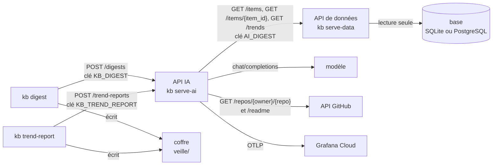

# L'API IA de K-B

!!! note "Compétences de la certification"

    > Rédaction et/ou génération de la documentation de l'API.

    — C9

    > Les éventuelles étapes d'authentification et de renouvellement de l'authentification (expiration des jetons par
    > exemple) sont intégrées correctement en suivant la documentation de l'API.

    — C10

Cette fiche dit ce qu'est l'API IA, comment elle est construite, ce que fait chacun de ses points de terminaison,
qui peut l'appeler, et comment une clé se change. Le contrat de ses deux routes est
[l'OpenAPI versionnée de l'API IA](https://github.com/SabineLaurent/K-B/blob/main/docs/api/openapi-ia.json),
`docs/api/openapi-ia.json`: la fiche y renvoie et ne la remplace pas. Elle est écrite d'après le code de `main` au
commit `fd956430`. Les chemins du code de K-B (`ai_api/…`, `core/…`, `database/…`, `post/…`,
`commands/…`) partent de `src/k_b/`, les autres de la racine du dépôt.

## Ce qu'est l'API IA

L'API IA est la seule porte de K-B vers le modèle. Elle rédige les comptes rendus de veille par sujet
(`POST /digests`) et le compte rendu des tendances de GitHub (`POST /trend-reports`). Elle ne garde rien d'une
demande à l'autre, sauf ce que sa mémoire tient jusqu'au redémarrage: le compte des demandes récentes, et les
mesures, traces et enregistrements de journal pas encore envoyés (`ai_api/app.py:1-4`). Seul `kb` écrit dans le
coffre.

Elle se lance par `kb serve-ai`. En local, elle écoute par défaut sur `127.0.0.1:8001`, la machine seule
(`core/config.py:307-308`). En ligne, c'est l'app `ca-kb-ai-api` d'Azure Container Apps, sans adresse publique
(section [En ligne](#en-ligne)).

## Architecture

Le schéma suivant montre qui appelle l'API IA et ce qu'elle appelle. La liste qui le suit le décrit en texte,
flèche par flèche.



Le schéma se lit ainsi:

- **Deux clients appellent l'API IA**, chacun avec sa clé et sa route. `kb digest` est le client `KB_DIGEST` et
    n'ouvre que `POST /digests`; `kb trend-report` est le client `KB_TREND_REPORT` et n'ouvre que
    `POST /trend-reports` (`core/config.py:346-351`).
- **L'API IA lit la veille par l'API de données**, jamais dans la base. Elle appelle `GET /items`,
    `GET /items/{item_id}` et `GET /trends` (`ai_api/connectors/data_api_client.py:268`, `:289`, `:308`) avec la
    clé du client `AI_DIGEST` de l'API de données (`ai_api/connectors/data_api_settings.py:15`). Un test refuse
    qu'elle importe autre chose que `ai_api`, `items` et `core` (`tests/architecture/test_apis.py:120`). L'API de
    données, elle, lit la base, SQLite ou PostgreSQL, en lecture seule: le fichier SQLite ouvert en `mode=ro`, ou
    chaque transaction PostgreSQL en `READ ONLY` (`database/engine.py:72-87`, `:106-119`,
    `database/postgresql.py:274-279`).
- **Elle appelle le modèle** par une interface compatible OpenAI, sur le chemin `chat/completions`
    (`ai_api/connectors/llm_client.py:40`). Le fournisseur est `openai_compatible`, ou `replay`, qui rejoue des
    réponses d'un fichier, sans réseau (`ai_api/connectors/llm_settings.py:44`).
- **Elle lit GitHub** pour les seules tendances: la fiche de chaque candidat, par `GET /repos/{owner}/{repo}`, puis
    le README de chaque dépôt choisi, par `/readme` (`ai_api/connectors/github_client.py:1-2`).
- **Elle envoie ses mesures et ses traces en OpenTelemetry** vers Grafana Cloud, par OTLP (le protocole d'export
    d'OpenTelemetry), quand l'export est réglé. Ce qu'elles contiennent et comment les lire:
    [la fiche du monitorage](monitorage.md).
- **Les deux commandes écrivent le coffre** à partir de la réponse. Le paquet `ai_api` n'écrit aucun fichier
    (règle 7 de `.claude/rules/poc.md`): ses imports sont tenus par `tests/architecture/test_apis.py:120` et `:144`;
    son écriture se vérifie à la main par la commande `grep` de la règle 7 (section
    [Vérifier cette fiche](#verifier-cette-fiche)). Le processus `kb serve-ai` tient son journal,
    `logs/kb-serve-ai.log` dans `KB_DATA_DIR` (`commands/run_log.py:30`, `cli.py:74`), sauf avec
    `KB_LOG_TO_FILE=false` (`commands/environment.py:16`).

### Le parcours de `POST /digests`

1. Les contrôles d'accès (section [Authentification et autorisation](#authentification-et-autorisation)).
2. Une fois les contrôles passés, la lecture et les appels au modèle sont bornés par une échéance de 200 s
    (`core/config.py:569`, `ai_api/routers/digest_router.py:170`, `ai_api/deadline.py:1-3`).
3. L'API IA lit les items de la fenêtre par l'API de données (`ai_api/routers/digest_router.py:173`). Si cette
    lecture échoue, la demande échoue sans appel au modèle.
4. Le modèle classe les items par sujet, par lots (`ai_api/digests.py:85`). Si le classement échoue, la demande
    échoue.
5. Le modèle rédige chaque sujet qui a des items, un appel par sujet. Un sujet dont la rédaction échoue est nommé
    dans `failed_subjects`, les autres sont rendus.
6. Le code revalide chaque rédaction avant de la rendre: les bornes de chaque affirmation, puis sa fidélité
    (`ai_api/stages/checking.py:63-119`).

**La fidélité, telle que le code la contrôle.** Chaque affirmation rédigée cite ses items et déclare ses faits,
chacun avec l'item qui le porte. Le code garde l'affirmation si chacune de ces conditions tient
(`ai_api/stages/fidelity.py:150-185`):

- chaque fait, normalisé (casse, caractères invisibles, tirets, guillemets, espaces,
    `ai_api/stages/fidelity.py:188-194`), se retrouve à la fois dans le texte de l'affirmation
    et dans un champ envoyé de l'item qu'il cite: le titre et le résumé d'un article, par exemple
    (`ai_api/stages/fidelity.py:97-103`). Un identifiant CVE (<span lang="en">Common Vulnerabilities and
    Exposures</span>, l'identifiant public d'une vulnérabilité) ou GHSA (<span lang="en">GitHub Security Advisory</span>) ne se retrouve que dans le `cve_id`
    ou le `ghsa_id` de l'item;
- chaque identifiant CVE ou GHSA du texte est un fait déclaré;
- chaque item cité porte au moins un fait retrouvé;
- le texte ne cache ni ne déguise rien (caractères invisibles, lettres d'un autre alphabet qui imitent les
    latines, `ai_api/stages/fidelity.py:213-228`).

Sinon, l'affirmation est retirée. La réponse en donne le nombre, `claims_removed`, et les items qui ne sont plus
cités, `items_removed_by_checks` (`ai_api/stages/checking.py:63-119`).

### Le parcours de `POST /trend-reports`

1. Les mêmes contrôles d'accès, puis une échéance de 200 s sur les lectures et les appels au modèle
    (`core/config.py:570-577`, `ai_api/routers/trend_report_router.py:127`).
2. La demande porte les bornes du compte rendu précédent, que `kb trend-report` lit dans son registre: c'est ce qui
    garde l'API IA sans état.
3. L'API IA lit les fenêtres de GH Archive par l'API de données (`ai_api/trend_reports.py:158`), calcule les rangs
    et les critères en code, puis retient les candidats (`:179`).
4. Elle lit sur GitHub la fiche de chaque candidat (`:181`). Le modèle en choisit 5 au plus (`:192`,
    `core/config.py:478`).
5. Elle lit le README des seuls dépôts choisis, puis le modèle rédige quatre textes par dépôt, un appel par dépôt
    (`ai_api/trend_reports.py:204-206`). Le code retire un texte, et le nomme dans `texts_removed`, s'il sort de
    ses bornes, s'il n'a pas de source, si l'un de ses faits ne se retrouve pas à la fois dans le texte et dans la
    source de ce texte, s'il contient un identifiant CVE ou GHSA, s'il porte un nombre qui n'est pas un fait
    déclaré, ou s'il se déguise (`ai_api/stages/trend_writing.py:468-523`, `:539-547`).
6. Si la lecture des fenêtres échoue (`ai_api/trend_reports.py:158-165`), ou si celle des fiches échoue par un
    état nommé de GitHub, `github_…` (`:341-344`), la demande échoue. Un candidat disparu, indisponible pour raison
    légale (451), déplacé, remplacé ou refusé est seulement écarté (`ai_api/connectors/github_client.py:177-185`,
    `ai_api/repository_cards.py:14-16`); au troisième refus, la lecture s'arrête en `github_forbidden`
    (`ai_api/connectors/github_client.py:324-330`, `core/config.py:114`). Si le choix du modèle échoue, le compte
    rendu reste factuel et la réponse est un 200 (`ai_api/errors.py:92-93`).

### Les couches du code

Les 35 modules de `ai_api/` sont rangés en 16 couches (`AI_API_LAYERS`, `tests/architecture/test_apis.py:154-197`):
du code pur en bas, puis les clients sortants (`connectors/`), les étapes du modèle (`stages/`), le parcours de
chaque route (`digests.py`, `trend_reports.py`), les contrats (`schemas/`), les routeurs (`routers/`) et l'app
(`app.py`). Deux tests tiennent la table: chaque module est dans une seule couche (`:215`), et aucun n'importe sa
couche ni celles du dessus (`:226`). La table complète, couche par couche, est dans
[l'architecture de l'API IA](https://github.com/SabineLaurent/K-B/blob/main/docs/architecture-api-ia.md),
« Les couches de `src/k_b/ai_api/` ».

## Les points de terminaison

L'API IA a cinq chemins. Seuls `POST /digests` et `POST /trend-reports` sont dans le contrat,
`docs/api/openapi-ia.json`. `GET /health`, `/docs` et `/openapi.json` sont **hors du contrat**: ils sont décrits
ici d'après le code. Le tableau suivant donne, pour chaque chemin, s'il est dans le contrat, qui y accède, le corps
de sa demande et sa réponse 200.

| Chemin | Dans le contrat | Accès | Corps de la demande | Réponse 200 |
|---|---|---|---|---|
| `POST /digests` | oui | clé du client `KB_DIGEST` | `DigestRequestSchema`: un objet JSON, avec `window_days` facultatif, un entier de 1 à 14 (`core/config.py:420-421`), la fenêtre d'un sujet sans début; absent ou `null`, celle de `KB_DIGEST_WINDOW_DAYS`, 3 jours par défaut (`:419`); et `since_by_subject` facultatif, le début de chaque sujet, une date avec son fuseau, au plus l'instant de la demande, ramenée à 14 jours au plus (`ai_api/schemas/digest_schema.py:36`, `ai_api/routers/digest_router.py:136-138`, `:149-154`) | `DigestsSchema`: une fiche par sujet, les sujets en échec, les sujets sans item, le début appliqué à chaque sujet, la fenêtre lue (`ai_api/schemas/digest_schema.py:88`) |
| `POST /trend-reports` | oui | clé du client `KB_TREND_REPORT` | `TrendReportRequestSchema`: `after` et `previous_first_window`, tous deux requis, tous deux `null` (premier compte rendu) ou tous deux un jour; alors `previous_first_window` n'est pas après `after`, et les deux jours, compris, couvrent 15 fenêtres quotidiennes au plus (`ai_api/schemas/trend_report_schema.py:35-49`, `items.py:713-716`, `core/config.py:88`) | `TrendReportSchema`: la période, les dépôts qui remplissent un critère, ceux que le modèle a choisis, leurs textes |
| `GET /health` | non | sans clé | aucun | `{"status": "ok"}` |
| `GET /openapi.json` | non | sans clé, avec `KB_DEPLOYMENT_ENVIRONMENT=sandbox` seulement; 404 sinon | aucun | l'OpenAPI de l'app |
| `GET /docs` | non | comme `/openapi.json` | aucun | Swagger UI, qui lit `/openapi.json` |

Chaque champ de ces corps et de ces réponses, son type et ses bornes sont dans l'OpenAPI, sous
`components.schemas`, sauf trois règles du corps de `POST /trend-reports`; la fiche ne les recopie pas. Les deux
schémas de demande refusent tout champ non déclaré et lisent les types sans conversion: `3.0` ou `"3"` n'est pas
un entier (`ai_api/schemas/digest_schema.py:27-29`, `ai_api/schemas/trend_report_schema.py:24-49`). Trois règles
du corps de `POST /trend-reports` ne sont pas dans le schéma de l'OpenAPI, qui en donne les types, le format
`date`, les champs requis, le refus d'un champ non déclaré et les descriptions: les deux jours ensemble `null` ou
ensemble donnés (la description le dit, pas le schéma), leur ordre, et le nombre de fenêtres. Le code seul les
tient (le tableau des chemins, ligne `POST /trend-reports`).

### Hors du contrat, d'après le code

- `GET /health` dit que le processus répond, rien de plus: il n'ouvre ni la base ni l'API de données
    (`core/api_health.py:1-13`). C'est une route de Starlette, ajoutée hors du schéma (`include_in_schema=False`),
    que la clé de l'app n'atteint pas (`ai_api/app.py:98-100`). En ligne, c'est la sonde du conteneur.
- `/openapi.json` et `/docs` ne sont servis que si `KB_DEPLOYMENT_ENVIRONMENT` vaut exactement `sandbox`; toute
    autre valeur, ou aucune, ne sert ni l'un ni l'autre (`core/api_settings.py:69-79`). FastAPI ne sert `/docs` que
    si l'app a un chemin d'OpenAPI (fastapi 0.143.1, `applications.py:1158`). ReDoc n'est pas servi
    (`ai_api/app.py:68-70`).
- `HEAD` est retiré de chaque route `GET`, où Starlette l'ajoute: une requête `HEAD` reçoit 405
    (`core/api_methods.py:7-13`).

### Les erreurs

Toute erreur a pour corps `{"error": "<état>"}`; un 422 ajoute `parameters`, les noms des paramètres refusés,
jamais leurs valeurs (`core/api_errors.py:49-55`). Les statuts du contrat:

| Statut | État | Quand |
|---|---|---|
| 401 | `invalid_api_key` | clé absente ou inconnue |
| 403 | `client_not_allowed` | clé valide d'un autre client que celui de la route |
| 413 | `content_too_large` | corps de plus de 1 024 octets (`core/config.py:312`) |
| 422 | `invalid_parameter` | corps illisible ou hors de son schéma |
| 429 | `request_already_running` | une demande tourne déjà sur la route, avec `Retry-After: 200` |
| 429 | `rate_limit_exceeded` | 20 demandes en 24 h glissantes déjà admises de ce client sur cette route, avec `Retry-After` |
| 500 | `internal_error` | erreur imprévue |
| 502, 503, 504 | un état de l'amont | l'API de données (`data_api_…`), le modèle (`llm_…`, `/digests` seule) ou GitHub (`github_…`, `/trend-reports` seule) a échoué; 503 pour un débit dépassé, 504 pour un délai (`ai_api/errors.py:25-43`) |

La liste exacte des états de l'amont, par statut et par route, est dans l'OpenAPI (la description de chaque
réponse). Hors du contrat: 404 `route_not_found` et 405 `method_not_allowed` (`core/api_errors.py:31-35`).
Chaque réponse porte l'en-tête `X-Request-ID`, l'identifiant que reprend le journal de `kb serve-ai`
(`core/api_request_log.py:1-2`, `:17`).

## Authentification et autorisation

**Le mécanisme.** Un seul: une clé par client, envoyée dans l'en-tête `Authorization: Bearer <clé>`
(`core/api_access.py:17-23`). Il n'y a ni route de connexion, ni jeton délivré par l'API, ni compte: la clé
identifie un programme, `KB_DIGEST` ou `KB_TREND_REPORT`, jamais une personne. L'OpenAPI le déclare dans
`components.securitySchemes.HTTPBearer`, et chaque route le demande (`security`).

**Les clés.** `kb serve-ai` lit au démarrage chaque variable `KB_AI_API_KEY_<CLIENT>` (`core/api_keys.py:13`,
`commands/serve_ai_command.py:39-41`). Il refuse de démarrer, avec le code de sortie 2, s'il n'en trouve aucune ou
si l'une est refusée; le message nomme la variable, ou le motif `KB_AI_API_KEY_<CLIENT>` s'il n'y en a aucune,
jamais la clé (`core/api_keys.py:17-56`):

- `<CLIENT>` est fait de `A-Z`, `0-9` et `_`;
- une clé a 32 caractères au moins, pris dans `A-Z`, `a-z`, `0-9`, `_` et `-`, l'alphabet de
    `secrets.token_urlsafe` (`core/config.py:228-229`);
- deux clients n'ont pas la même clé;
- aucune clé d'un client n'est celle que l'API IA envoie à l'API de données, `KB_DATA_API_KEY_AI_DIGEST`
    (`commands/serve_ai_command.py:65-73`). Le contrôle ne compare pas avec les autres clés de l'API de données
    (`:60-64`).

**L'authentification.** La clé reçue est comparée à chaque clé connue en temps constant (`hmac.compare_digest`,
`core/api_access.py:52-62`): la comparaison est conçue pour que le temps de la réponse ne dise ni la clé ni son
client. Ce n'est pas mesuré par un test. Une clé absente ou inconnue reçoit le même 401 `invalid_api_key`, avec
l'en-tête `WWW-Authenticate: Bearer` de la RFC 6750 (<span lang="en">Request for Comments</span>)
(`core/api_access.py:25-41`).

**L'autorisation.** Chaque route s'ouvre à un seul client (`core/config.py:346-351`). Une clé valide d'un autre
client reçoit 403 `client_not_allowed`; une route absente de la table est refusée à tous
(`core/api_access.py:44-49`).

**L'ordre des contrôles.** Avant la clé: le 413 d'un corps trop grand (`ai_api/app.py:94`,
`core/api_body_limit.py:12-17`), puis le 422 d'un corps qui n'est pas du JSON lisible, que FastAPI lit avant
tout contrôle (test `test_without_key_only_a_body_that_cannot_be_read_gets_422`,
`tests/ai_api/test_digest_router.py`). Puis, dans l'ordre de l'app: la clé (401), le client de la route (403),
une demande à la fois par route (429), le débit (429) (`ai_api/app.py:62-67`). Une demande refusée par l'un ne
consomme rien de ce qui suit: un 401 ne compte pas dans le débit. Puis le 422 d'un corps hors de son schéma, puis
la route.

**Les limites.** Une demande à la fois par route, sans file d'attente: la suivante reçoit 429
`request_already_running` avec `Retry-After: 200`, l'échéance d'une demande (`core/api_rate_limit.py:57-72`,
`core/config.py:579-581`). Une demande de fiches et une demande de tendances peuvent tourner ensemble. Au plus
20 demandes par client et par route sur 24 h glissantes; au-delà, 429 `rate_limit_exceeded`, avec le nombre de
secondes à attendre dans `Retry-After` (`core/config.py:355-358`, `core/api_rate_limit.py:17-54`). Seules les
demandes admises par le débit comptent: une demande refusée avant lui (413, 422 d'un corps illisible, 401, 403,
429 de concurrence) ou par lui ne compte pas; un 422 d'un corps hors de son schéma, contrôlé après, compte
(`core/api_rate_limit.py:32-44`, `ai_api/app.py:62-67`).

Les tests qui prouvent ces règles sont dans [la fiche des tests](tests.md), section « 7. Accès ». Un
test prouve que le 401, le 403 et le 429 de concurrence ne comptent pas dans le débit. Pour le 413 et le 422 d'un
corps illisible, qui ne comptent pas, et pour le 422 d'un corps hors de son schéma, qui compte, aucun test ne lit
le compte: c'est l'ordre du code. Le 413 vient d'un <span lang="en">middleware</span>, avant la route
(`core/api_body_limit.py:12-17`). FastAPI lit le JSON du corps avant les dépendances de l'app, puis ne valide le
schéma du corps qu'après elles (fastapi 0.143.1: `routing.py:446-464`, puis `solve_dependencies` à `:499`, qui
résout les dépendances à `dependencies/utils.py:619` avant le corps à `:698-706`).

## Expiration et changement d'une clé

**Une clé de l'API IA n'expire pas.** Elle n'a ni durée de vie ni date de fin; il n'y a pas de jeton à
renouveler, donc pas d'étape de renouvellement chez le client. La clé reste valide jusqu'à ce qu'on la change ou
la retire (`core/api_access.py:17-21`, repris dans l'OpenAPI). C'est une décision écrite: la clé reste fixe, sa
rotation est documentée (journal des décisions d'architecture, ou ADR, « POC du 25/10 », décision 7,
`docs/ADR/journal-decisions-projet.md:1807`, précisée à `:3320-3323`).

### Faire une clé

Une clé de 43 caractères, par cette commande:

```sh
uv run python -c "import secrets; print(secrets.token_urlsafe(32))"
```

### La changer en local

1. Ranger la nouvelle clé dans sa variable du `.env`: `KB_AI_API_KEY_KB_DIGEST` ou
    `KB_AI_API_KEY_KB_TREND_REPORT`. Le client lit la même variable que le serveur
    (`post/ai_api_client.py:49-50`, `post/trend_report_client.py:59`): un seul changement vaut pour les deux
    côtés.
2. Redémarrer `kb serve-ai`. Les clés ne sont lues qu'au démarrage (`commands/serve_ai_command.py:39-41`):
    l'ancienne clé est refusée dès le redémarrage, pas avant.

Pour retirer un client: retirer sa variable, puis redémarrer `kb serve-ai`. La clé que l'API IA envoie à l'API de
données, `KB_DATA_API_KEY_AI_DIGEST`, est lue par `kb serve-data` et par `kb serve-ai`: après l'avoir changée,
redémarrer les deux. Tant que l'un garde l'ancienne, chaque demande reçoit 502 `data_api_unauthorized`.

### La changer en ligne

Chaque clé est un secret du coffre Key Vault (`infra/main.bicep:176-183`), que l'app lit par son identité, sans
numéro de version (`infra/modules/api-container-app.bicep:74-81`). Une nouvelle version du secret remplace
l'ancienne; Container Apps la lit dans les 30 minutes, mais un conteneur qui tourne garde ses variables. La
procédure pose la nouvelle version, puis redémarre la révision active de chaque app qui lit ce secret
([le README de l'infrastructure](https://github.com/SabineLaurent/K-B/blob/main/infra/README.md),
« 4. Poser les secrets »).

### Les autres secrets de l'API IA

L'API IA envoie à son tour deux autres secrets:

- le jeton GitHub, `KB_AI_GITHUB_TOKEN`, doit être un jeton *<span lang="en">fine-grained</span>* (préfixe
    `github_pat_`), sinon `kb serve-ai` ne démarre pas (`ai_api/connectors/github_settings.py:22-34`). Son
    expiration est fixée à sa création sur GitHub
    ([les jetons GitHub de K-B](https://github.com/SabineLaurent/K-B/blob/main/docs/jeton-github.md)); le code ne
    la lit pas. Un jeton expiré ou révoqué se voit au premier compte rendu qui a un candidat, car sans candidat
    GitHub n'est pas appelé (`ai_api/trend_reports.py:179-181`): 502 `github_unauthorized`
    (`ai_api/connectors/github_client.py:335-336`);
- la clé du modèle, `KB_LLM_API_KEY`: une clé refusée par le fournisseur donne l'état `llm_unavailable`
    (`ai_api/connectors/llm_client.py:492`), soit un 502 de `POST /digests` quand c'est le classement qui échoue.

Chacun se change comme une clé: une nouvelle valeur dans sa variable ou son secret, puis un redémarrage.

## Côté client: suivre ces règles

Les deux clients de l'API IA sont des commandes de K-B. Voici comment elles appliquent ce que dit cette fiche.

- **Avant d'envoyer.** `kb digest` et `kb trend-report` lisent leur clé dans la même variable que le serveur et la
    contrôlent par ses règles de forme: nom, longueur, alphabet (`post/ai_api_client.py:173-188`). Ils ne
    contrôlent ni les clés en double ni l'égalité avec `KB_DATA_API_KEY_AI_DIGEST`, que seul `kb serve-ai`
    vérifie. Une clé absente ou refusée: rien n'est demandé, code de sortie 2 (`commands/digest_command.py:84-88`).
- **À l'envoi.** La clé part dans `Authorization: Bearer` (`post/ai_api_client.py:191-204`), jamais dans l'URL.
    `kb digest` envoie le début de chaque sujet qui a une fiche, le `until` de sa dernière fiche
    (`post/ai_api_client.py:207-225`, `post/digest_sheets.py:93-102`); un sujet sans fiche prend la fenêtre par
    défaut.
- **À la réponse.** Un 401 devient l'état `ai_api_unauthorized`, un 403 `ai_api_forbidden`, un 429
    `ai_api_rate_limited`, un 5xx `ai_api_failed` (`post/ai_api_client.py:290-303`). Sur un 401 ou un 403, le
    message nomme la variable à vérifier, jamais la clé (`:429-435`), et la commande sort en code 1 sans rien
    écrire (`commands/digest_command.py:113-119`; `commands/trend_report_command.py:76-78`, `:171-177`). Un
    `Retry-After` est affiché, jamais attendu: il n'y a pas de nouvelle tentative (`core/config.py:589-590`).
- **Pas d'étape de renouvellement.** La clé n'expire pas: un 401 dit que la clé a été changée d'un seul côté, ou
    retirée, et se répare en remettant la même valeur des deux côtés.

L'API IA est elle-même cliente, avec le même schéma Bearer: de l'API de données
(`ai_api/connectors/data_api_client.py:192`; un 401 devient `data_api_unauthorized`, rendu en 502, `:368-369`), de
GitHub (`ai_api/connectors/github_client.py:158`) et du modèle (`ai_api/connectors/llm_client.py:213-214`).

## Le contrat OpenAPI

[L'OpenAPI versionnée de l'API IA](https://github.com/SabineLaurent/K-B/blob/main/docs/api/openapi-ia.json),
`docs/api/openapi-ia.json`, est la référence de l'API au standard OpenAPI (3.1.0). Sa version, `0.13.0`, est celle
de l'app (`ai_api/app.py:38`); un changement visible par un client change les deux. Il décrit les deux routes,
leurs corps, leurs réponses, chaque état d'erreur, et le schéma de sécurité `HTTPBearer`.

- **Il est généré, pas écrit à la main.** `uv run kb openapi`, lancé à la racine du dépôt, le réécrit d'après
    l'app, avec celui de l'API de données (`commands/openapi_command.py:30-55`). L'app est faite sans clé ni
    réglage de l'environnement: le document n'en dépend pas (`:63-84`).
- **Un test le tient égal au code**: `test_the_versioned_openapi_is_the_one_the_app_produces`
    (`tests/ai_api/test_ai_api_openapi.py:31-33`). Si le code change sans `kb openapi`, l'intégration continue
    (CI) échoue. Un autre test vérifie que le document est un OpenAPI 3.1 valide (`:62`).
- **Le lire**: ouvrir le fichier, ou lancer `kb serve-ai` avec `KB_DEPLOYMENT_ENVIRONMENT=sandbox` et ouvrir
    `http://127.0.0.1:8001/docs`. Le sens de chaque champ et de chaque état est écrit dans
    [la spécification des comptes rendus de veille](https://github.com/SabineLaurent/K-B/blob/main/docs/fiches-veille.md)
    (« Schémas », « États nommés ») et
    [la spécification du compte rendu des tendances](https://github.com/SabineLaurent/K-B/blob/main/docs/tendances.md).

## En ligne

- L'app `ca-kb-ai-api` lance `kb serve-ai` depuis l'image de K-B (`infra/main.bicep:280-317`).
- Son entrée est interne, en HTTPS: elle n'a pas d'adresse publique (`infra/modules/api-container-app.bicep:40`,
    `:118-125`).
- `KB_DEPLOYMENT_ENVIRONMENT=production`: ni `/docs` ni `/openapi.json` (`infra/main.bicep:296`).
- De 0 à 1 réplique (`infra/modules/api-container-app.bicep:184-189`).
- Les jobs en ligne sont `caj-kb-smoke-test`, `caj-kb-migrate-database`, `caj-kb-daily-routine` et
    `caj-kb-digest-watch` (`infra/deployment.json:3`). Deux appellent l'API IA:
    - la sonde, `caj-kb-smoke-test`, par `GET /health` (`commands/smoke_test_command.py:80-81`, `:117-127`). Le
        code de #499 lui ajoute des sondes sans clé, refusées en 401, 404 et 405; en ligne, elles partent au premier
        tag qui porte ce code;
    - `caj-kb-digest-watch`, par défaut le lundi et le jeudi à 10:00 UTC (`infra/main.bicep:31-32`), qui lance
        `kb digest-watch` (`infra/modules/digest-watch-job.bicep:95-97`): le réveil des deux API par
        `GET /health`, `kb digest`, de nouveau le réveil, `kb trend-report`, puis la publication de `veille/`
        (`commands/digest_watch_command.py:43-48`, `:59-81`). Il demande ainsi les comptes rendus
        (`POST /digests`, puis `POST /trend-reports`), avec les clés des clients `KB_DIGEST` et `KB_TREND_REPORT`
        (`infra/main.bicep:190-194`, `:423`).

## Limites

- **Le débit n'est pas un budget.** Le compte vit dans la mémoire d'une réplique: un redémarrage, ou un passage à
    zéro réplique, le remet à zéro, et deux répliques tournent pendant un déploiement
    (`infra/modules/api-container-app.bicep:184-185`).
- **Les essais de clé ne sont pas limités.** Le débit ne compte que les clients à clé valide; un 401 ne compte
    pas. Écart voulu: une clé de 32 caractères au moins ne se trouve pas par essais
    ([la spécification des comptes rendus de veille](https://github.com/SabineLaurent/K-B/blob/main/docs/fiches-veille.md),
    « <span lang="en">API2:2023 Broken Authentication</span> »).
- **Un retrait ne prend effet qu'au redémarrage** de `kb serve-ai`. Une variable `KB_AI_API_KEY_*` exportée dans le
    profil du shell reste valide même retirée du `.env`.
- **`uv run --env-file .env kb serve-ai` charge tout le `.env`**, donc aussi des secrets dont l'API IA n'a pas
    besoin.
- **En local, la clé passe en clair**, en HTTP sur `127.0.0.1`: la machine seule l'écoute. En ligne, le
    transport est en HTTPS.
- **En ligne, les comptes rendus ne sont demandés qu'à l'horaire de `caj-kb-digest-watch` ou par un lancement du
    job à la main, sans nouvelle tentative.** Le job part le lundi et le jeudi à 10:00 UTC par défaut
    (`infra/main.bicep:31-32`); un lancement à la main suit les règles du
    [README de l'infrastructure](https://github.com/SabineLaurent/K-B/blob/main/infra/README.md), « La règle des
    heures ». Le job n'a pas de nouvelle tentative: un passage qui échoue n'est pas relancé par Container Apps
    (`infra/modules/digest-watch-job.bicep:72-74`).

## Vérifier cette fiche

Depuis la racine du dépôt, au commit `fd956430` (`git switch --detach fd956430`):

```sh
# Le contrat: les deux routes, la version, le schéma de sécurité; égal au code et valide.
python3 -c "import json; d=json.load(open('docs/api/openapi-ia.json')); print(d['openapi'], d['info']['version'], list(d['paths']), list(d['components']['securitySchemes']))"
uv run pytest tests/ai_api/test_ai_api_openapi.py
# Les couches, et ce que l'API IA importe.
uv run pytest tests/architecture/test_apis.py
# Règle 7 de .claude/rules/poc.md, l'écriture: 0 ligne attendue.
grep -rnE "raw_store|writers|write_file_atomically|write_text|write_bytes|[^a-z_]open\(" src/k_b/ai_api | wc -l
# Clé, client, autre route, corps, débit, concurrence, méthodes, /health: 44 tests au commit fd956430,
# dont 8 pris par un mot de leur nom hors de l'accès.
uv run pytest tests/ai_api/test_digest_router.py -k "key or bound or limit or runs or body or client or other_route or method or health or free_again"
uv run pytest tests/ai_api/test_trend_report_router.py -k "key or malformed"
# /docs et /openapi.json servis en sandbox seulement.
uv run pytest tests/ai_api/test_serve_ai.py -k documentation
# Les clients de chaque route, les limites des deux routes, les clés.
grep -n -A12 "^DIGEST_CLIENT" src/k_b/core/config.py
grep -n "MIN_API_KEY_LENGTH =\|API_KEY_CHARACTERS =\|MAX_AI_API_BODY_BYTES =" src/k_b/core/config.py
# Les jobs déclarés en ligne.
cat infra/deployment.json
```

Un `fichier:ligne` se relit sans changer de commit: `git show fd956430:<chemin> | sed -n '<début>,<fin>p'`, avec
`src/k_b/` devant un chemin du code de K-B.
