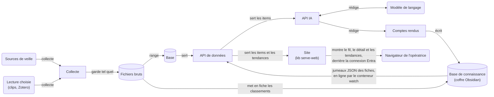
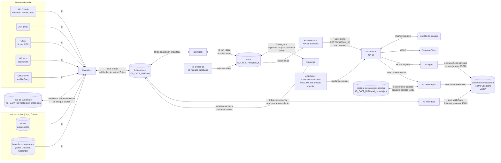
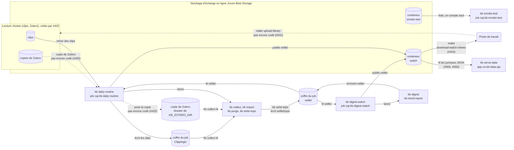
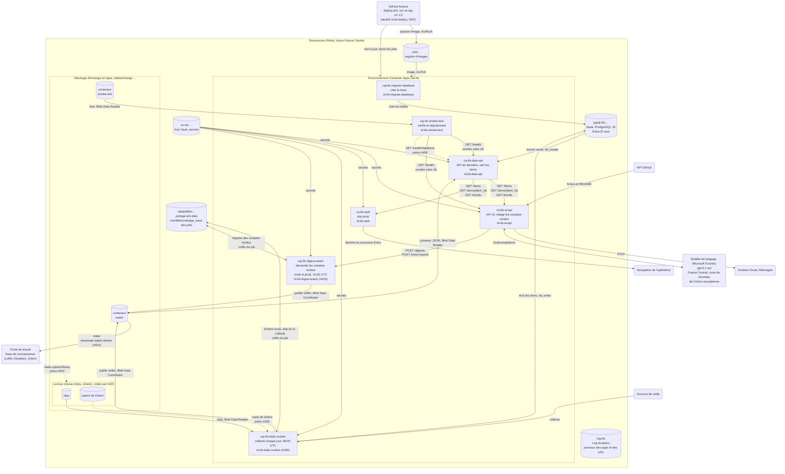

# L'architecture de l'application K-B

!!! note "Compétences de la certification"

    > Rédaction de la documentation technique.

    — C17

Cette fiche décrit l'architecture applicative de K-B: le flux des données de bout en bout, en bref puis en détail, les
couches du code, puis chaque partie, de la collecte au déploiement sur Azure. Elle est écrite d'après `main` au commit
`fd956430`. Ce qu'elle dit du passage de la production à `gpt-6.1-sol` suit la fiche du service d'IA
(#623). « Déployé » y veut dire déclaré en ligne par le Bicep d'`infra/` et par
`infra/deployment.json` à ce commit; la version qui tourne en ligne n'a pas été relue (section
[Limites](#limites)). Les chemins du code de K-B (`etl/…`, `commands/…`, `database/…`) partent de `src/k_b/`, les
autres de la racine du dépôt.

L'installation de l'environnement de développement, les dépendances et leur configuration sont dans
[la fiche de l'installation](installation.md); l'exécution des tests, dans
[la fiche des tests](tests.md). Le détail de l'API IA est dans [la fiche de l'API IA](api-ia.md),
celui du modèle de langage dans [la fiche du service d'IA](service-ia.md), et celui de la livraison sur Azure
dans [la fiche de la livraison continue](livraison-continue.md).

## Le flux en bref

K-B collecte les sources de veille (GitHub, arXiv, la CISA, l'agence américaine de cybersécurité, tldr.tech, GH
Archive) et la lecture choisie (les clips du coffre et la bibliothèque Zotero), garde ce qu'il reçoit tel quel dans des
fichiers bruts, puis les range dans la base. L'API de données sert la base à deux clients, l'API IA et le site. L'API
IA fait rédiger par le modèle de langage les comptes rendus de la veille et des tendances, que K-B écrit dans la base
de connaissance (coffre Obsidian), avec les fiches des dépôts les plus étoilés et les plus forkés, tirées directement
des fichiers bruts. En ligne, l'API de données sert aussi les jumeaux JSON des fiches des comptes rendus de veille et
des dépôts, qu'aucune page du site ne demande encore. Le site, `kb serve-web`, montre le fil de veille, le détail de chacun de ses items et les tendances de
GH Archive dans le navigateur de sa seule opératrice, derrière la connexion Microsoft Entra de Container Apps.

Le schéma suivant dit la même chose; la liste qui le suit le décrit flèche par flèche, avec ce qui est déployé et ce
qui est prévu.



Les flèches du schéma, une à une:

- Des sources de veille à la collecte (« collecte »): déployé, chaque jour, par le job `caj-kb-daily-routine`; en local,
    par `kb collect`.
- De la lecture choisie à la collecte (« collecte »): pour les clips, déployé; pour Zotero, en local seulement, la
    collecte en ligne est prévue (#425).
- De la collecte aux fichiers bruts (« garde tel quel »): déployé.
- Des fichiers bruts à la base (« range »): déployé, par `kb import`, dans le même job.
- Des fichiers bruts à la base de connaissance (« met en fiche les classements »): déployé, par `kb write-tops`, dans
    le même job.
- De la base à l'API de données (« sert »): déployé, dans l'app `ca-kb-data-api`.
- De l'API de données à l'API IA (« sert les items »): déployé.
- Entre l'API IA et le modèle de langage (« rédige »), dans les deux sens: déployé.
- De l'API IA aux comptes rendus (« rédige »): déployé, par le job `caj-kb-digest-watch`.
- Des comptes rendus à la base de connaissance (« écrit »): déployé, dans le coffre du job; le poste de travail les relit par
    `make download-watch-sheets`.
- De la base de connaissance à l'API de données (« jumeaux JSON des fiches »): déployé, en ligne seulement, pour les
    fiches des tops et des comptes rendus de veille; aucune page du site ne les demande encore (section
    [Limites](#limites)).
- De l'API de données au site (« sert les items et les tendances »): déployé, dans l'app `ca-kb-web`.
- Du site au navigateur de l'opératrice (« montre le fil, le détail et les tendances »): déployé; le site n'a
    d'adresse publique qu'une fois sa connexion en place (section [L'hébergement](#lhebergement)).

## Le flux des données, en détail

Les deux schémas de cette partie suivent le chemin du code: le premier va des sources au coffre, le second montre les
jobs en ligne et le stockage d'échange. Un rectangle est une commande `kb`, un cylindre un fichier, une base ou un
conteneur, un rectangle arrondi un service extérieur ou le poste de travail. Une flèche est une lecture, une écriture ou un appel
que fait la commande, dans le sens où vont les données: l'API IA appelle l'API de données, et les items vont de l'API
de données à l'API IA. Un trait plein est un flux que le code fait aujourd'hui. Un trait en pointillés n'est pas
encore en ligne: il est codé, sauf si son étiquette dit « pas encore codé ». Chaque schéma est suivi de la liste de
ses flèches; la section [La lecture des deux schémas](#la-lecture-des-deux-schemas) en donne le détail, avec les
renvois au code.

### Des sources au coffre

Le schéma suivant va des sources au coffre, commande par commande; la liste qui le suit le décrit flèche par flèche.



Les flèches du schéma, une à une. Toutes sont codées; « en ligne » dit si la commande tourne aussi sur Azure.

- Des cinq sources de veille, de Zotero et des clips à `kb collect` (sept flèches « lit »): en ligne, déployé dans le
    job `caj-kb-daily-routine` pour les sources de veille et les clips; pour Zotero, en local seulement, la lecture
    en ligne est prévue (#425).
- Entre l'état de la collecte et `kb collect` (« date de la dernière collecte de chaque source »), dans les deux
    sens: déployé, sur le partage `job-data`.
- Entre `kb collect` et les fichiers bruts (« écrit le brut, relit le dernier extrait Zotero »), dans les deux sens:
    déployé, sur le partage `job-data`; la relecture de l'extrait de Zotero ne sert qu'en local.
- Entre les fichiers bruts et `kb import` (« lit les pages non importées »), puis entre `kb import` et la base
    (« lit raw_data, écrit les items »), dans les deux sens: déployé dans la routine.
- De `kb purge` aux fichiers bruts, et entre la base et `kb purge` (« supprime ce qui a passé sa durée »): déployé
    dans la routine.
- De `kb create-db` et `kb migrate-database` à la base (« crée les tables »): `kb migrate-database` est déployé, dans
    le job `caj-kb-migrate-database`, que lance le déploiement; `kb create-db` sert en local.
- Entre les fichiers bruts et `kb write-tops` (« lit les classements, supprime les remplacés »), puis de
    `kb write-tops` à la base de connaissance (« écrit veille/tops/, fiches et jumeaux JSON »): déployé dans la
    routine.
- De la base à `kb serve-data` (« lecture seule »): déployé, dans l'app `ca-kb-data-api`.
- De `kb serve-data` à `kb serve-ai` (« GET /items, GET /items/{item_id}, GET /trends »): déployé.
- Entre `kb serve-ai` et le modèle de langage (« chat/completions »), dans les deux sens: déployé, dans l'app
    `ca-kb-ai-api`.
- De l'API GitHub à `kb serve-ai` (« tendances seules »): déployé.
- De `kb serve-ai` à Grafana Cloud (« OTLP », le protocole d'export d'OpenTelemetry): déployé, à l'adresse que
    donne la seconde passe du Bicep.
- De `kb serve-ai` à `kb digest` (« POST /digests ») et à `kb trend-report` (« POST /trend-reports »): déployé, dans le
    job `caj-kb-digest-watch`.
- De `kb digest` à la base de connaissance (« écrit une fiche par sujet et son jumeau JSON ») et de `kb trend-report`
    à la base de connaissance (« écrit veille/tendances/ »): déployé, dans le coffre du job.
- Entre le registre des comptes rendus et `kb trend-report` (« lit la dernière période, ajoute le compte rendu »),
    dans les deux sens: déployé, sur le partage `job-data`.

### Les jobs en ligne et le stockage d'échange

Le schéma suivant montre les jobs en ligne, le stockage d'échange et le poste de travail; la liste qui le suit le décrit flèche par
flèche.



Les flèches du schéma, une à une:

- Du conteneur `smoke-test` à `kb smoke-test` (« liste, un compte seul »): déployé, dans le job manuel
    `caj-kb-smoke-test`.
- Du poste de travail à la lecture choisie (« make upload-library », en pointillés): pas encore codé, prévu (#542).
- Des clips à `kb daily-routine` (« miroir des clips »), puis de `kb daily-routine` au dossier `Clippings/` du coffre
    du job (« écrit les clips »): déployé.
- Des copies de Zotero à `kb daily-routine` (« copie de Zotero ») et de `kb daily-routine` à la copie de Zotero du
    job (« pose la copie »), en pointillés: pas encore codé, prévu (#425).
- De `kb daily-routine` à ses étapes, et de `kb digest-watch` aux siennes (« lance »): déployé.
- Du dossier `Clippings/` aux étapes (« kb collect lit »): déployé.
- De la copie de Zotero aux étapes (« kb collect lit »), en pointillés: codé, pas encore en ligne (#425).
- Des étapes de la routine au dossier `veille/` du coffre du job (« kb write-tops écrit veille/tops/ »), et de celles
    du job des comptes rendus (« écrivent veille/ »): déployé.
- Du dossier `veille/` à `kb daily-routine` et à `kb digest-watch` (« lit veille/ »), puis de chacun au conteneur
    `watch` (« publie veille/ »): déployé.
- Du conteneur `watch` à `kb serve-data` (« lit les jumeaux JSON »): déployé.
- Du conteneur `watch` au poste de travail (« make download-watch-sheets »): codé, lancé à la main en local.

### La lecture des deux schémas

Les deux schémas se lisent ainsi, dans l'ordre des flux:

1. **Des sources au brut.** `kb collect` lit d'abord l'état de la collecte, `KB_DATA_DIR/collection_state.json`, et
    donne à chaque source la date de sa dernière collecte réussie (`etl/raw_store.py:22`, `:188`;
    `etl/extract.py:60`, `:69`). Il lance chaque source, puis écrit ce qu'elle rend tel quel dans le brut, sous
    `KB_DATA_DIR/raw/` (`commands/collect_command.py:37-59`, `etl/extract.py:129`, `:139`). Pour Zotero, il relit
    d'abord le dernier extrait du brut, et n'écrit rien si le nouveau est le même (`etl/sources/zotero.py:225`). À
    la fin, il récrit l'état, avec l'heure de la collecte pour chaque source collectée (`etl/extract.py:90`, `:94`;
    `etl/raw_store.py:219`). Les sources sont sept origines de données: l'API GitHub (releases des dépôts suivis,
    alertes de sécurité, dépôts les plus étoilés et les plus forkés), l'API arXiv, le fichier CSV de la CISA, les
    pages de tldr.tech, GH Archive sur BigQuery, la base de Zotero et le dossier `Clippings/` du coffre
    (`etl/source_kinds.py:46-95`, `etl/collected_sources.py:110-131`). Chacune est lue par un appel de son module:
    `etl/sources/github/releases.py:50`, `etl/sources/github/advisories.py:69`,
    `etl/sources/github/most_starred.py:41`, `etl/sources/github/most_forked.py:40`, `etl/sources/arxiv.py:111`,
    `etl/sources/cisa_kev.py:69`, `etl/sources/tldr.py:119`, `etl/sources/gh_archive.py:125`, `:211`,
    `etl/sources/zotero.py:275`, `etl/sources/clipping.py:103`.
2. **Du brut à l'import, puis à la base.** `kb create-db` crée la base et ses tables
    (`commands/create_db_command.py:34`); `kb migrate-database` la crée si elle n'a pas encore ses tables, et la
    laisse telle quelle sinon (`commands/migrate_database_command.py:31`). Les deux remplissent aussi la table des
    sources (`database/creation.py:61`, `:124`); sur PostgreSQL, `kb migrate-database` donne aussi leurs droits aux
    rôles (`:103`). `kb import` lit dans la base le registre des fichiers déjà importés, la table `raw_data`
    (`etl/load.py:52-55`), puis les pages du brut qui n'y sont pas (`etl/raw_reading.py:53`, `:111`, `:126`). Il
    les convertit en items, puis les écrit dans la base en une transaction (`etl/pipeline.py:51-82`,
    `etl/load.py:60-96`). Les deux classements des dépôts les plus étoilés et les plus forkés n'entrent pas dans la
    base: ils n'ont pas de lecteur (`etl/source_kinds.py:66-77`). `kb import` ne purge rien: `kb purge`, une
    commande à part, supprime du brut et de la base ce qui a passé sa durée, à compter de l'heure de son lancement,
    et du brut les catalogues remplacés; elle retire aussi du registre les fichiers disparus
    (`commands/purge_command.py:52`, `purge/all_purges.py:52-63`, `:62`, `purge/catalogs.py:33`, `purge/raw.py:34`).
3. **De la base aux deux API.** `kb serve-data` lit la base en lecture seule et sert les items et les tendances
    (`database/engine.py:58-87`, `database/reading.py:365`, `:468`, `:576`). Avec `KB_EXCHANGE_BLOB_URL` et
    `AZURE_CLIENT_ID`, posées en ligne, il lit aussi le conteneur `watch` et sert les jumeaux JSON des fiches des
    tops et des comptes rendus; sans l'une d'elles, ces routes répondent 503 `watch_unconfigured`
    (`commands/serve_data_command.py:47-60`, `data_api/watch_reading.py:1-4`, `infra/main.bicep:261-263`).
    `kb serve-ai` ne lit jamais la base: il demande les items et les tendances à l'API de données, par HTTP
    (`ai_api/connectors/data_api_client.py:266-268`, `:289`, `:308`).
4. **De l'API IA au modèle.** L'API IA envoie les items au modèle et reçoit ses textes, par le chemin
    `chat/completions` (`ai_api/connectors/llm_client.py:40`, `:438`). Pour les tendances, elle lit aussi sur l'API
    GitHub la fiche de chaque candidat et le README des dépôts choisis (`ai_api/connectors/github_client.py:173`,
    `:191`). Elle envoie ses mesures, ses traces et leurs journaux par OTLP vers Grafana Cloud
    (`ai_api/connectors/metrics_export.py:301`, `ai_api/connectors/trace_export.py:124`, `:134`).
5. **L'écriture dans le coffre.** `kb digest` envoie `POST /digests` à l'API IA, puis écrit une fiche par sujet,
    `veille/<sujet>/AAAA-MM-JJ.md`, et, à côté, son jumeau JSON (`post/ai_api_client.py:243`,
    `commands/digest_command.py:127`, `:219`; `post/digest_sheets.py:224`). Il ne tient pas de registre: il lit le
    `until` de la dernière fiche de chaque sujet et l'envoie comme début du sujet (`post/digest_sheets.py:93`,
    `:105`; `post/ai_api_client.py:214`); un sujet sans fiche prend une fenêtre de `KB_DIGEST_WINDOW_DAYS` jours, 3
    par défaut, ramenée comme tout début à 14 jours au plus (`ai_api/settings.py:36`, `core/config.py:419-421`,
    `ai_api/routers/digest_router.py:121`). Un sujet sans item reçoit une fiche qui le dit, d'où part son compte
    rendu suivant (`post/digest_sheets.py:159`). `kb trend-report` lit d'abord le registre des comptes rendus,
    `KB_DATA_DIR/trend_reports.json`, dont le dernier donne la période suivante (`post/trend_report_registry.py:26`,
    `:62`; `commands/trend_report_command.py:73`, `:134`). Il envoie `POST /trend-reports`
    (`post/trend_report_client.py:219-224`), écrit le compte rendu sous `veille/tendances/`
    (`commands/trend_report_command.py:245`), puis ajoute son entrée au registre (`:104`;
    `post/trend_report_registry.py:81-86`). `kb write-tops` lit les deux classements dans le brut, écrit leurs
    fiches sous `veille/tops/`, chacune avec son jumeau JSON, puis supprime du brut les classements remplacés, sans
    modèle ni base (`post/top_sheets.py:67`, `:80-81`, `:84`, `:105`). Seule la commande `kb` écrit dans le coffre,
    jamais une API.
6. **Le stockage d'échange en ligne.** Le Bicep déclare quatre conteneurs
    (`infra/modules/exchange-storage.bicep:66-73`, `:92-106`). `kb smoke-test` liste le premier, `smoke-test`, et
    n'écrit que le nombre de blobs de sa première page, 100 au plus (`commands/smoke_test_command.py:1-3`, `:141`,
    `core/config.py:665`). Les trois autres viennent de #420: `clippings` et `zotero`, la lecture choisie, où le poste de travail
    déposera les clips et les copies de Zotero, et `watch`, où les jobs publient `veille/`. Les deux routines
    relancent les commandes dans le même processus (`commands/job_routine.py:4-6`). `kb daily-routine` copie les
    clips dans le coffre du job, puis lance `kb collect`, `kb import`, `kb purge` et `kb write-tops`, puis publie
    `veille/`; `kb import` est sauté si `kb collect` échoue ou ne démarre pas, et `kb purge` tourne même si
    `kb import` échoue ou n'est pas lancé (`commands/daily_routine_command.py:44-75`, `:58`, `:62-64`,
    `commands/job_transfers.py:39`, `jobs/clip_mirror.py:247`). `kb digest-watch` lance `kb digest` et
    `kb trend-report`, puis publie `veille/` (`commands/digest_watch_command.py:59-81`). La publication lit
    `veille/` et ajoute au conteneur `watch` les fiches qui n'y sont pas, sans en remplacer
    (`commands/job_transfers.py:69`, `jobs/watch_publication.py:138`, `:146`). La copie de Zotero dans le job n'est
    pas encore codée: elle viendra entre le miroir des clips et `kb collect` (#425,
    `commands/daily_routine_command.py:51`). #425 la prévoit dans un dossier temporaire, que `KB_ZOTERO_DIR` nomme
    pour `kb collect`: la flèche « pose la copie » va vers ce dossier, pas vers le Zotero du poste de travail. Dans un job, le
    coffre est le dossier `KB_VAULT_DIR` du job, pas celui du poste de travail: `kb collect` y lit `Clippings/`, et lira la copie
    de Zotero dans le dossier de `KB_ZOTERO_DIR` (`etl/collected_sources.py:18-22`, `etl/sources/clipping.py:103`);
    `kb write-tops`, `kb digest` et `kb trend-report` y écrivent `veille/`. Ces deux jobs sont déclarés en ligne:
    `caj-kb-daily-routine` chaque jour à 08:00 UTC (#330), `caj-kb-digest-watch` le lundi et le jeudi à 10:00 UTC
    par défaut (#423), tous deux sur le partage `job-data`, où restent le brut, l'état de la collecte, le registre
    des comptes rendus des tendances et le coffre du job (`infra/main.bicep:379`, `:406`, `infra/deployment.json`).
    L'envoi des clips et des copies de Zotero depuis le poste de travail n'est pas encore codé: il viendra par
    `make upload-library` (#542). La relecture de `watch` par le poste de travail passe par `make download-watch-sheets` (#424,
    `commands/download_watch_sheets_command.py`), qui copie les fiches que les jobs publient. En ligne, l'API de
    données y lit les jumeaux (#559, #560), par le rôle Storage Blob Data Reader
    (`infra/modules/exchange-storage.bicep:170-174`).

Les journaux restent hors des dessins: aucune commande ne les relit, sauf la purge, qui les supprime d'après la date de
leur nom (`purge/run_records.py:38`, `:75`). Ce sont les journaux de fonctionnement, sous `KB_DATA_DIR/logs/`
(`commands/run_log.py:24`, `:28`, `:30`, `:32`), le journal d'import,
`KB_DATA_DIR/journals/import-journal-<date>.jsonl` (`etl/pipeline.py:35`, `:63-68`), et la ligne JSON que l'API IA
écrit sur sa sortie standard pour chaque appel au modèle (`ai_api/observability/metrics.py:50`). Restent hors des
dessins aussi quatre appels qui ne portent pas de donnée de la veille: `GET /health`, par lequel `kb smoke-test` vérifie
les deux API et `kb digest-watch` les réveille (`commands/smoke_test_command.py:80-81`,
`commands/digest_watch_command.py:60-64`), les sondes sans clé de `kb smoke-test` (#499), refusées en 401, 404 et
405, depuis #458 aussi `GET /health/database` de l'API de données, et la demande d'un jeton à l'identité managée (`exchange/storage.py:198`,
`database/entra.py:57`). `kb openapi` écrit le contrat des deux API dans le dépôt, `docs/api/openapi-donnees.json` et
`docs/api/openapi-ia.json` (`commands/openapi_command.py:30-32`, `:50`). Les contrôles du coffre avant une écriture
restent hors des dessins aussi: ils ne lisent que l'état d'un fichier (existence, lien, date, taille). `kb digest` et
`kb trend-report` refusent de redemander une fiche du jour déjà écrite (`commands/digest_command.py:91`,
`commands/trend_report_command.py:135`), `kb write-tops` contrôle ses dossiers avant et après l'écriture
(`post/top_sheets.py:68-69`, `:82-83`), et le miroir des clips compare la date et la taille de chaque clip du coffre à
celles de son blob (`jobs/clip_mirror.py:237-239`). Avec `KB_LLM_PROVIDER=replay`, l'API IA ne joint pas le modèle:
elle rejoue les réponses du fichier `KB_LLM_REPLAY_FILE` (`ai_api/connectors/llm_settings.py:42`,
`ai_api/connectors/llm_replay.py:70`).

## Les couches du code

K-B est écrit en Python, version 3.13 au moins (`pyproject.toml:9`). Les deux API et le site sont des applications
FastAPI (`data_api/app.py:49`, `ai_api/app.py:55`, `web/app.py:38`), servies par uvicorn
(`commands/serve_data_command.py:67`, `commands/serve_ai_command.py:98`, `commands/serve_web_command.py:41`).

Le code est rangé en trois couches (`.claude/rules/conventions.md`, règle 5): la présentation (`cli.py`, `commands/`,
les routes des deux API et les pages du site), le métier et l'ETL, l'extraction, la transformation et le chargement
des données (`etl/`), puis l'accès aux données (`database/`). Une couche n'appelle jamais celle du dessus: `database/`
n'importe que `items` et `core` (`tests/architecture/test_layers.py:28`), et `etl/` n'importe aucune des deux API
(`:200`). Une couche peut en sauter une: les routes de l'API de données lisent la base par `database/`, sans passer
par `etl/` (`data_api/routers/item_router.py:18`, `tests/architecture/test_apis.py:22`). L'API IA et le site
n'importent pas `database/` (`test_apis.py:107`, `test_layers.py:471`): ils lisent la base par l'API de données, en
HTTP. `items.py` et `core/` sont le vocabulaire commun: chaque couche peut les importer. Les tests de
`tests/architecture/` lisent les imports de chaque module et tiennent ces règles.

La liste suivante donne chaque paquet de `src/k_b/`, son rôle, puis ce que les tests lui interdisent.

- **`cli.py`**, le point d'entrée de `kb`: il lit la commande, lit l'environnement une fois, ouvre le journal, puis
    lance la commande (`cli.py:106-123`). Les tests ne lui interdisent rien.
- **`commands/`**, une commande `kb` par module (`<commande>_command.py`), et leur code commun;
    `commands/environment.py` est le seul à lire l'environnement. Les tests lui interdisent d'importer `cli`
    (`tests/architecture/test_layers.py:81`) et d'atteindre une étape de l'ETL autrement que par `etl/pipeline.py`
    (`tests/architecture/test_layers.py:172`). Hors de `commands/environment.py`, seul `etl/sources/github/api.py` lit l'environnement, toléré pour
    l'instant (`tests/architecture/test_environment.py:23`, `:162`).
- **`etl/`**, la collecte (`extract.py`) et l'import (`transform.py`, puis `load.py`); `pipeline.py` est la seule
    porte des deux parcours pour `commands/`; une source par module, dans `etl/sources/`. Les tests lui interdisent
    d'importer une API (`test_layers.py:200`), `post/` (`:232`) ou `purge/` (`:281`), et à une étape d'importer une
    autre étape (`:130`).
- **`post/`**, ce qui suit le pipeline: les clients HTTP de l'API IA, les fiches du coffre et leurs jumeaux, le
    registre des comptes rendus des tendances. Les tests lui interdisent d'importer une API (`test_layers.py:206`),
    une source ou la composition des sources (`:109`).
- **`purge/`**, les purges que lance `kb purge`. Les tests lui interdisent d'importer autre chose que `purge`,
    `core`, `items`, `database` hors de ses écrivains et de `database/writing`, `etl/raw_store.py` et
    `etl/raw_files.py` (`test_layers.py:257-265`, `:287`).
- **`jobs/`**, le code commun des jobs en ligne: ce qu'ils font du stockage d'échange (le miroir des clips, la
    publication et le téléchargement de `veille/`), l'appel de `GET /health`. Les tests lui interdisent d'importer
    autre chose que `exchange` et `core` (`test_layers.py:338`), et d'être importé par un autre paquet que
    `commands` (`:344`).
- **`exchange/`**, le client du stockage d'échange, Azure Blob Storage, par l'identité managée ou, en local, le
    compte d'`az login`: réglages, transport, erreurs nommées, téléchargement d'une version listée. Les tests lui
    interdisent d'importer autre chose que `core`, ou `core/atomic_write.py` (`test_layers.py:411`), et d'être
    importé par un autre paquet que `jobs`, `commands` et `data_api` (`:417`).
- **`database/`**, tout le SQL de la base de K-B: création, lecture, écriture (`writers/`, une sorte d'item par
    module), purge, moteurs. Les tests lui interdisent d'importer autre chose que `database`, `items` et `core`
    (`test_layers.py:28`), et, hors de `database/`, d'atteindre `database/writers` (`:45`). Seul `database/` importe
    un pilote de base, avec `etl/sources/zotero.py` pour la base de Zotero
    (`tests/architecture/test_engine_imports.py:36`).
- **`data_api/`**, l'API de données: la base et, en ligne, les jumeaux du conteneur `watch`. Les tests lui
    interdisent d'importer autre chose que `data_api`, `database`, `items`, `core` et `exchange`, ou les écrivains, la
    purge et l'écriture d'un fichier (`tests/architecture/test_apis.py:42`).
- **`web/`**, le site, rendu par le serveur avec Jinja2 (`web/rendering.py:22-26`), sans JavaScript; il lit l'API de
    données par HTTP, par la clé du client `WEB`, et ne touche pas la base. Les tests lui interdisent d'importer autre
    chose que `web`, `core` et `items`, ou `core/atomic_write.py` (`test_layers.py:489`), et d'être importé par un
    autre paquet que `commands` (`:495`).
- **`ai_api/`**, l'API IA, rangée en 16 couches internes. Les tests lui interdisent d'importer autre chose que
    `ai_api`, `items` et `core` (`test_apis.py:120`), et à chacun de ses modules d'importer sa couche ou celles du
    dessus (`:226`).
- **`items.py` et `core/`**, les types communs des items, les réglages par défaut, la citation d'une valeur au
    journal, le code commun des deux API. Les tests interdisent à `core` d'importer quoi que ce soit de K-B
    (`test_layers.py:20`).

Deux tests tiennent la liste elle-même: les modules de premier niveau de K-B
(`tests/architecture/test_packages.py:14`) et ceux d'`etl/` (`:20`); un autre veut chaque `__init__.py` vide
(`tests/architecture/test_packages.py:33`). Un module de source a la même forme partout, un bloc EXTRACT puis un bloc TRANSFORM
(`tests/architecture/test_source_modules.py:67`).

## La collecte

- **Une commande, toutes les sources.** `kb collect` lance chaque source déclarée dans `SOURCE_KINDS`, dans
    l'ordre de la table (`etl/source_kinds.py:46-95`). Zotero, les clips et GH Archive ne sont lancés que si leur
    variable est posée: `KB_ZOTERO_DIR`, `KB_VAULT_DIR` et `GOOGLE_APPLICATION_CREDENTIALS`
    (`etl/collected_sources.py:18-30`, `:110-131`). `KB_COLLECT_ONLY` choisit les sources d'une collecte (`:34`).
- **Une source en panne n'arrête pas les autres.** Chaque source écrit ses fichiers bruts, puis la collecte écrit
    la date de la dernière collecte réussie de chacune, dans `KB_DATA_DIR/collection_state.json`
    (`etl/extract.py:53-100`, `etl/raw_store.py:22`). À la collecte suivante, chaque source reçoit sa date
    (`etl/extract.py:68-70`); une source en échec garde la sienne.
- **Le brut est gardé tel que la source l'a rendu**, dans deux dossiers de `raw/`: `automated_watch/` pour ce que
    la veille collecte, `selected_library/` pour ce que l'opératrice a choisi, Zotero et les clips
    (`etl/raw_store.py:14-20`). Chaque fichier est écrit par un temporaire caché, renommé sur la cible
    (`.claude/rules/conventions.md`, règle 2).
- **Zotero n'est jamais ouvert en place**: `zotero.sqlite` est copié, avec son journal d'écriture, dans un dossier
    temporaire, puis lu (`etl/sources/zotero.py:1-6`).

Les sources, leur accès et leurs limites sont dans
[les spécifications de la collecte](https://github.com/SabineLaurent/K-B/blob/main/docs/specs-collecte.md).

## L'import et la base

- **L'import lit le brut qu'il n'a pas encore lu.** La base tient le registre des fichiers déjà importés (table
    `raw_data`, `database/schema.sql:28`). `kb import` lit les autres, les convertit en items communs, écarte les
    releases d'un dépôt hors de la liste suivie et normalise les items gardés (`etl/transform.py:1-2`).
- **Tout s'écrit en une transaction**, avec le journal d'import, `journals/import-journal-<date>.jsonl`
    (`etl/load.py:60-96`, `etl/pipeline.py:35`). Une entrée que la base refuse devient un rejet du journal, et
    l'import continue; toute autre erreur n'écrit rien (`etl/load.py:1-5`).
- **Les purges sont une commande à part, `kb purge`**, que la routine quotidienne lance après `kb import`: les
    catalogues remplacés, la base, le brut, le registre, puis les journaux (`purge/all_purges.py:1-3`, `:52-63`).
    Leurs durées sont dans le
    [registre des traitements](https://github.com/SabineLaurent/K-B/blob/main/docs/registre-traitements.md).
- **La base a deux moteurs.** Sans `KB_DATABASE_URL`, c'est le fichier SQLite `k-b.sqlite` du dossier de données;
    avec, la base PostgreSQL qu'elle nomme (`database/location.py:1-3`, `core/config.py:189`). Les deux schémas ont
    les mêmes 15 tables (`database/schema.sql`, `database/schema_postgresql.sql`); un test compare leurs structures
    (`tests/test_schema_structures.py`). `kb create-db` crée la base; en ligne, `kb migrate-database` la crée si elle
    n'a pas encore ses tables (`commands/migrate_database_command.py:1-2`).

Le modèle de la base est dans
[les spécifications du stockage](https://github.com/SabineLaurent/K-B/blob/main/docs/stockage.md).

## Les deux API

Le tableau suivant compare les deux API, propriété par propriété.

| Propriété | API de données | API IA |
|---|---|---|
| Commande | `kb serve-data` | `kb serve-ai` |
| Adresse par défaut, en local | `127.0.0.1:8000` (`core/config.py:214-215`) | `127.0.0.1:8001` (`core/config.py:307-308`) |
| Routes | `GET /items` (`data_api/routers/item_router.py:101`), `GET /items/{item_id}` (`:148`), `GET /trends` (`data_api/routers/trend_router.py:23`), et quatre routes du seul client `WEB`, que la phrase qui suit le tableau nomme | `POST /digests` (`ai_api/routers/digest_router.py:70`), `POST /trend-reports` (`ai_api/routers/trend_report_router.py:61`) |
| Sans clé | `GET /health` (`data_api/app.py:82`) | `GET /health` (`ai_api/app.py:100`) |
| Clients | chacun sa clé, `KB_DATA_API_KEY_<CLIENT>` (`core/api_keys.py:12`); l'API IA est le client `AI_DIGEST` (`ai_api/connectors/data_api_settings.py:15`), le site le client `WEB` (`core/config.py:375`) | `kb digest`, client `KB_DIGEST`, pour `POST /digests`; `kb trend-report`, client `KB_TREND_REPORT`, pour `POST /trend-reports` (`core/config.py:346-351`) |
| Lit | la base, en lecture seule (`database/engine.py:58-87`); en ligne, le conteneur `watch`, pour les routes du client `WEB` (`data_api/watch_reading.py:1-4`) | l'API de données, le modèle, l'API GitHub |
| Contrat | [le contrat OpenAPI de l'API de données](https://github.com/SabineLaurent/K-B/blob/main/docs/api/openapi-donnees.json) | [le contrat OpenAPI de l'API IA](https://github.com/SabineLaurent/K-B/blob/main/docs/api/openapi-ia.json) |

Les quatre routes de l'API de données réservées au client `WEB` (`core/config.py:376-381`) sont `GET /tops/{top}` et
`GET /tops/{top}/days` (`data_api/routers/top_router.py:40`, `:63`), `GET /digests/{subject}` et
`GET /digests/{subject}/days` (`data_api/routers/watch_digest_router.py:34`, `:47`).

Les deux API n'écrivent rien de durable, hors du journal de fonctionnement que tient leur commande
(`logs/kb-serve-data.log`, `logs/kb-serve-ai.log`, `commands/run_log.py:28`, `:30`): l'API de données ne peut pas
importer les écrivains de la base (`tests/architecture/test_apis.py:42`), et l'API IA ne peut importer ni la base ni
l'écriture d'un fichier (`:120`). Le parcours d'une demande à l'API IA, ses contrôles et ses couches sont dans
[la fiche de l'API IA](api-ia.md).

## Le coffre

Le coffre est un coffre Obsidian, le dossier de `KB_VAULT_DIR` (`etl/collected_sources.py:22`). Il est à la fois une
source et une destination:

- **une source**: `kb collect` lit les clips du dossier `Clippings/` (`etl/sources/clipping.py:55`, `:103`);
- **une destination**: trois commandes y écrivent leurs fiches, sous `veille/` (`core/config.py:541`); `kb digest`
    et `kb write-tops` écrivent à côté de chaque fiche son jumeau JSON (`core/config.py:549`).

Le tableau suivant donne, pour chacune des trois commandes, ce qu'elle écrit et d'où viennent ses données.

| Commande | Ce qu'elle écrit | D'où viennent les données |
|---|---|---|
| `kb digest` | une fiche par sujet et par jour, `veille/<sujet>/AAAA-MM-JJ.md`, et son jumeau `AAAA-MM-JJ.json` (`post/digest_sheets.py:50-55`) | la réponse de `POST /digests` (`commands/digest_command.py:112`, `:127`) |
| `kb trend-report` | un compte rendu par jour, `veille/tendances/<jour>.md` (`post/trend_report_sheets.py:152`) | la réponse de `POST /trend-reports`; la période suivante est tenue par `KB_DATA_DIR/trend_reports.json`, jamais par une relecture du coffre (`post/trend_report_registry.py:1-3`, `:26`) |
| `kb write-tops` | une fiche par classement et par jour de collecte, et son jumeau JSON, sous `veille/tops/` (`post/top_sheets.py:36`, `:139-144`) | les deux classements du brut, puis les classements remplacés sont supprimés du brut (`commands/write_tops_command.py:39-65`) |

Deux routines de job, en ligne depuis #330 et #423, relancent ces commandes: `kb daily-routine` lance
`kb write-tops`, et `kb digest-watch` lance `kb digest` et `kb trend-report` (`commands/daily_routine_command.py:65-68`,
`commands/digest_watch_command.py:65-74`). `kb daily-routine` écrit aussi dans le coffre du job les clips de la
lecture choisie, sous `Clippings/` (`commands/job_transfers.py:51-53`).

Une fiche est écrite une fois, jamais par un lien symbolique que `kb` voit (`post/vault_files.py:1-2`). Deux limites
sont acceptées: un dossier remplacé par un lien symbolique après le contrôle est suivi, et un fichier qu'un autre
programme écrit entre la liste du dossier et le renommage est remplacé (`:6-9`). Une commande qui écrit dans le coffre
refuse de démarrer si `KB_VAULT_DIR` n'est pas un dossier existant: elle ne le crée pas
(`etl/collected_sources.py:95-107`).

## L'hébergement

K-B tourne de deux façons, par le même code.

**En local**, sans conteneur: chaque commande se lance par `uv run kb …`. Les données sont dans le dossier de
`KB_DATA_DIR`: le brut, l'état de la collecte, la base SQLite, les journaux d'import, les journaux de fonctionnement
(`logs/`) et le registre des tendances. Les deux API et le site écoutent sur `127.0.0.1`, la machine seule; le site
sur le port 8002 (`core/config.py:317-318`).

**En ligne, sur Azure**, depuis l'image de K-B, dans l'environnement Azure Container Apps `cae-kb`. Le Bicep
d'`infra/` décrit chaque ressource
([le README de l'infrastructure](https://github.com/SabineLaurent/K-B/blob/main/infra/README.md), tableau des
modules); le tableau suivant donne les principales.

| Ressource | Ce qu'elle fait | Où |
|---|---|---|
| `ca-kb-data-api` | lance `kb serve-data`, sur la base PostgreSQL en ligne, ouverte par l'identité managée (`KB_DATABASE_AUTH=entra`), et sur le conteneur `watch` | `infra/main.bicep:243-278` |
| `ca-kb-ai-api` | lance `kb serve-ai`, qui lit `ca-kb-data-api` en HTTPS | `infra/main.bicep:280-317` |
| `ca-kb-web` | lance `kb serve-web`, le site privé, qui lit `ca-kb-data-api` en HTTPS. La connexion Microsoft Entra de Container Apps n'admet que l'identifiant d'objet de l'opératrice, que le code vérifie aussi à chaque requête (`KB_WEB_OPERATOR_ID`, `web/operator_check.py:45`) | `infra/main.bicep:319-357` |
| `caj-kb-smoke-test` | job manuel, lance `kb smoke-test`: `GET /health` des deux API, puis la liste du conteneur `smoke-test`; depuis #499, aussi leurs sondes sans clé; depuis #458, aussi `GET /health/database` de l'API de données | `infra/main.bicep:359-377`, `commands/smoke_test_command.py:68-81`, #499; `commands/smoke_test_command.py:112`, `:162-173`, #458 |
| `caj-kb-migrate-database` | job manuel, lance `kb migrate-database` | `infra/main.bicep:453-469` |
| `caj-kb-daily-routine` | job planifié chaque jour à 08:00 UTC, lance `kb daily-routine` | `infra/main.bicep:379-404`, `infra/modules/daily-routine-job.bicep:78` |
| `caj-kb-digest-watch` | job planifié, par défaut le lundi et le jeudi à 10:00 UTC, lance `kb digest-watch` | `infra/main.bicep:32`, `:406-431` |
| `pgsql-kb-…` | le serveur PostgreSQL 18 flexible, par Entra ID seul | `infra/main.bicep:441-449` |
| `stkbexchange…` | le stockage d'échange, Azure Blob Storage, avec les conteneurs `smoke-test`, `clippings`, `zotero` et `watch` | `infra/main.bicep:126-140`, `infra/modules/exchange-storage.bicep:66-73`, `:92-106` |
| `stkbjobfiles…` | le partage Azure Files `job-data`, que montent les deux jobs planifiés | `infra/main.bicep:143-151`, `infra/modules/job-files-storage.bicep:60` |
| `crkb…`, `kv-kb-…`, `log-kb` | le registre de l'image, le coffre des secrets, l'espace des journaux | `infra/main.bicep:75-124` |

Les deux API n'ont qu'une entrée interne, en HTTPS: elles n'ont pas d'adresse publique
(`infra/modules/api-container-app.bicep:118-125`). Le site n'a une adresse publique qu'une fois sa connexion en place,
quand `exposeWeb` l'ouvre (`infra/main.bicep:347`;
[le README de l'infrastructure](https://github.com/SabineLaurent/K-B/blob/main/infra/README.md), « Le site privé
(#571) »). Les apps et les jobs déclarés en ligne sont ceux d'`infra/deployment.json`: `ca-kb-data-api`,
`ca-kb-ai-api`, `ca-kb-web`, `caj-kb-smoke-test`, `caj-kb-migrate-database`, `caj-kb-daily-routine` et
`caj-kb-digest-watch`. Un tag de version sur `main` les met à jour
([la fiche de la livraison continue](livraison-continue.md)).

### Le déploiement sur Azure

Le schéma suivant dit où est quoi en ligne, et ce qui s'y passe. Un trait plein est déployé; un trait en pointillés est
prévu, avec son issue. Une flèche suit le sens des données, comme dans le flux en détail; trois flèches sont des appels
sans donnée de la veille: les deux « GET /health, sondes sans clé », par lesquelles le job de vérification teste les
deux API (les sondes de #499), et « met à jour, lance les jobs », par laquelle le déploiement agit sur les apps et les jobs. Une
quatrième, en pointillés, « GET /health/database », est l'appel par lequel le job de vérification demande à l'API
de données si elle lit sa base (#458). En ligne, l'appel part au premier tag qui porte ce code. Le réveil des deux API par `caj-kb-digest-watch`, un
`GET /health` à chacune avant `kb digest` puis avant `kb trend-report` (`commands/digest_watch_command.py:43-48`,
`:61`, `:67`), reste hors du dessin. Sur une app ou un job, le nœud porte
son identité managée; sur une flèche, le rôle qui la permet. La liste qui suit le schéma le décrit flèche par flèche,
puis une seconde liste donne le détail de chaque partie, avec ses renvois au code.



Les flèches du schéma, une à une:

- De GitHub Actions au registre (« pousse l'image, AcrPush ») et à l'environnement `cae-kb` (« met à jour, lance les
    jobs »): déployé.
- Du registre à l'environnement (« image, AcrPull »): déployé, pour chaque app et chaque job.
- Du Key Vault à `ca-kb-data-api`, `ca-kb-ai-api`, `ca-kb-web`, `caj-kb-daily-routine` et `caj-kb-digest-watch`
    (« secrets », cinq flèches): déployé.
- De `caj-kb-migrate-database` à la base (« crée les tables »): déployé.
- De la base à `ca-kb-data-api` (« lecture seule, kb_reader »): déployé.
- De `ca-kb-data-api` à `ca-kb-ai-api` et à `ca-kb-web` (« GET /items, GET /items/{item_id}, GET /trends »): déployé.
- De `ca-kb-web` au navigateur de l'opératrice (« derrière la connexion Entra »): déployé; l'adresse publique s'ouvre
    à la passe qui pose `exposeWeb`.
- De `ca-kb-ai-api` à Grafana Cloud (« OTLP »): déployé.
- De l'API GitHub à `ca-kb-ai-api` (« fiches et README »): déployé.
- Entre `ca-kb-ai-api` et le modèle de langage (« chat/completions »), dans les deux sens: déployé. Le Bicep de
    `main` règle l'effort de raisonnement de `gpt-6.1-sol` (`infra/main.bicep:301-304`); l'adresse et le nom du
    déploiement viennent de la seconde passe. L'état en ligne n'est pas relu ici: selon
    [la fiche du service d'IA](service-ia.md), l'API IA en ligne appelle `gpt-6.1-sol` depuis le passage
    de la production, et appelait `gpt-6-luna` avant.
- Du conteneur `smoke-test` à `caj-kb-smoke-test` (« liste, Blob Data Reader »), puis de `caj-kb-smoke-test` aux deux
    API (« GET /health, sondes sans clé »): déployé pour `GET /health`; les sondes partent au premier tag qui
    porte #499.
- De `caj-kb-smoke-test` à `ca-kb-data-api` (« GET /health/database », en pointillés): prévu (#458). En ligne, l'appel
    part au premier tag qui porte ce code.
- Du poste de travail à la lecture choisie (« make upload-library », en pointillés): prévu (#542).
- Des sources de veille à `caj-kb-daily-routine` (« collecte »): déployé.
- Du conteneur des clips à `caj-kb-daily-routine` (« clips, Blob Data Reader »): déployé.
- Du conteneur des copies de Zotero à `caj-kb-daily-routine` (« copie de Zotero », en pointillés): prévu (#425).
- De `caj-kb-daily-routine` à la base (« écrit les items, kb_writer »): déployé.
- Entre le partage `job-data` et chacun des deux jobs planifiés, dans les deux sens: déployé.
- De `ca-kb-ai-api` à `caj-kb-digest-watch` (« POST /digests, POST /trend-reports »): déployé.
- De chacun des deux jobs planifiés au conteneur `watch` (« publie veille/, Blob Data Contributor »): déployé.
- Du conteneur `watch` à `ca-kb-data-api` (« jumeaux JSON, Blob Data Reader »): déployé.
- Du conteneur `watch` au poste de travail (« make download-watch-sheets »): codé, lancé à la main en local, par le compte Entra
    de l'opératrice.

Le détail de chaque partie:

- **Les apps et les jobs** tournent dans l'environnement `cae-kb`
    (`infra/modules/container-apps-environment.bicep:7-8`), depuis la même image, tirée du registre par le rôle
    AcrPull (`infra/main.bicep:103-110`, `infra/modules/container-registry.bicep:42-53`,
    `infra/modules/migrate-database-job.bicep:35-44`). Les deux API n'ont qu'une entrée interne
    (`infra/modules/api-container-app.bicep:118-125`); l'API IA joint l'API de données par son nom interne, en HTTPS
    (`infra/main.bicep:305`). Les journaux des conteneurs vont dans `log-kb`
    (`infra/modules/container-apps-environment.bicep:50-68`).
- **Les secrets** (clés des API, clé du modèle, jetons GitHub, clé BigQuery, en-tête OTLP, secret client de la
    connexion du site) sont dans le Key Vault; les deux API, le site et les deux jobs planifiés en lisent, chacun les
    siens, par le rôle Key Vault Secrets User, un rôle par secret (`infra/main.bicep:170-231`,
    `infra/modules/key-vault-secret-access.bicep:28-38`): la routine, son jeton GitHub et la clé BigQuery (#330); le
    job des comptes rendus, les clés des clients `KB_DIGEST` et `KB_TREND_REPORT` de l'API IA (#423); le site, la clé
    de son client `WEB` et le secret client de sa connexion (#571).
- **La base** est un serveur PostgreSQL 18 flexible, ouvert par Entra ID seul
    (`infra/modules/postgresql-server.bicep:17-31`). `id-kb-data-api` y lit par le rôle `kb_reader`, et
    `id-kb-migrate-database` possède les tables; la collecte quotidienne écrit par le rôle `kb_writer`, sous
    `id-kb-daily-routine` (#330, `infra/postgresql/grant-roles.sql:6-8`, `:31-58`).
- **Le stockage d'échange** a le conteneur `smoke-test`, que `id-kb-smoke-test` lit par le rôle Storage Blob Data
    Reader, et les conteneurs `clippings`, `zotero` et `watch` (#420, `infra/modules/exchange-storage.bicep:67`,
    `:98`). Un rôle par identité et par conteneur (`:149-206`): `id-kb-daily-routine` lit `clippings` et `zotero`
    (Storage Blob Data Reader) et écrit `watch` (Storage Blob Data Contributor); `id-kb-digest-watch` écrit `watch`;
    `id-kb-data-api` lit `watch`; le compte Entra de l'opératrice écrit `clippings` et `zotero`, et lit `watch`. Un
    second compte, `stkbjobfiles`, porte le partage `job-data`, que les deux jobs planifiés montent sur
    `/var/lib/knowledge_base` (`infra/modules/job-files-storage.bicep:60`, `infra/main.bicep:69`,
    `infra/modules/daily-routine-job.bicep:119`, `infra/modules/digest-watch-job.bicep:107`).
- **Le déploiement**: un tag `vX.Y.Z` sur `main` lance `deploy.yml`, qui se connecte par OIDC (OpenID Connect) sous
    `id-kb-deploy`, pousse l'image, lance `caj-kb-migrate-database`, met à jour les apps et les jobs, puis lance
    `caj-kb-smoke-test` (`.github/workflows/deploy.yml:7-11`, `:97-133`, `:161-209`). `id-kb-deploy` a les rôles
    AcrPush et Reader sur le registre, Container Apps Contributor sur chaque app et Container Apps Jobs Contributor
    sur chaque job d'`infra/deployment.json`, et aucun rôle direct sur le Key Vault, le stockage ni les données
    (`infra/modules/deploy-access.bicep:1-3`, `:17-22`, `:29-39`, `:57-91`). Le registre des traitements consigne le
    risque accepté: ces rôles Contributor permettent de lire en clair les secrets des apps et des jobs
    (`docs/registre-traitements.md:202`).
- **L'opératrice**, par son compte Entra, applique le Bicep à la main (`infra/main.bicep:1`,
    [le README de l'infrastructure](https://github.com/SabineLaurent/K-B/blob/main/infra/README.md)); elle a le rôle
    Key Vault Secrets Officer, pour poser les secrets (`infra/modules/key-vault.bicep:33-41`, `infra/main.bicep:122`),
    et elle est l'administratrice Entra du serveur PostgreSQL (`infra/modules/postgresql-server.bicep:53-61`,
    `infra/main.bicep:446-447`). Le budget `budget-kb` envoie ses alertes par e-mail
    (`infra/modules/budget.bicep:1`, `:27-58`).
- **Hors du Bicep**: le modèle `gpt-6.1-sol` est déployé à la main dans Microsoft Foundry (anciennement Azure AI
    Foundry), en France Central, en zone de données de l'Union européenne; `gpt-6-luna`, le modèle d'avant, y reste
    déployé, et l'API IA en ligne l'a appelé jusqu'au passage de la production à `gpt-6.1-sol`, selon
    [la fiche du service d'IA](service-ia.md); ce que l'app en ligne appelle n'est pas relu ici. Les mesures et les traces vont à Grafana Cloud, pile
    `prod-eu-west-2`, en Allemagne (`docs/registre-traitements.md:123`, `:128`). Le Bicep n'en porte que les
    paramètres, les secrets et l'effort de raisonnement de `gpt-6.1-sol` (`infra/main.bicep:22-29`, `:301-304`).
- **Prévu**: l'envoi depuis le poste de travail viendra avec #542 (la relecture de `watch` est codée par #424), la copie de
    Zotero avec #425.

## Limites

- **« Déployé » veut dire déclaré en ligne, pas relu en ligne.** La fiche lit le Bicep et `infra/deployment.json` de
    `fd956430`; la version que le dernier tag a mise en ligne, et l'état des ressources, n'ont pas été relus.
- **Les comptes rendus laissent un trou, le retard de collecte.** Depuis #565, chacun part du `until` de la fiche
    précédente de son sujet, par la date de la source: plus rien ne manque d'un compte rendu au suivant. Un item daté
    avant le `until` d'un compte rendu mais collecté après lui n'entre dans aucun, comme les éditions de tldr.tech et
    les entrées du catalogue KEV de la CISA (<span lang="en">Known Exploited Vulnerabilities</span>) du lundi et du
    jeudi, datées de minuit et collectées le lendemain. Il attend la lecture par date d'arrivée dans K-B, prévue pour
    plus tard
    ([le README de l'infrastructure](https://github.com/SabineLaurent/K-B/blob/main/infra/README.md), « Les comptes
    rendus en ligne (#423) »).
- **Rien ne tient deux exécutions à l'écart**, sauf une consigne: les heures de départ à la main du
    [README de l'infrastructure](https://github.com/SabineLaurent/K-B/blob/main/infra/README.md), « La règle des
    heures ». Le verrou de #426 tiendra deux exécutions de la routine à l'écart, pas le job des comptes rendus, qui
    ne touche pas la base.
- **Zotero n'est pas collecté en ligne**: la copie de la bibliothèque dans un job est à venir, entre le miroir des
    clips et `kb collect` (#425, `commands/daily_routine_command.py:51`).
- **Le site ne montre ni les comptes rendus ni les tops**: il montre le fil de veille, le détail d'un item, les
    tendances, `/sources` et `/accessibilite` (`web/pages.py:63`, `:120`, `:141`, `:181`, `:186`), et ne demande à
    l'API de données que `GET /items`, `GET /items/{item_id}` et `GET /trends` (`web/data_api_client.py:1-3`).
    L'API de données sert déjà les jumeaux des fiches des tops et des comptes rendus à son client `WEB`, mais aucune
    page ne les lit. Les comptes rendus se lisent dans Obsidian, et K-B se lance dans le terminal.

## Vérifier cette fiche

Depuis la racine du dépôt, au commit `fd956430` (`git switch --detach fd956430`):

```sh
# Les couches et les imports de chaque paquet: 279 tests au commit fd956430.
uv run pytest tests/architecture/
# Les commandes de kb.
uv run kb --help
# Les sources, dans l'ordre de la collecte.
grep -n "SourceKind(" src/k_b/etl/source_kinds.py
# Les routes des deux API.
grep -nE "@router\.(get|post)|APIRouter\(" src/k_b/data_api/routers/*.py src/k_b/ai_api/routers/*.py
# Les pages du site.
grep -n "@router.get" src/k_b/web/pages.py
# Les 15 tables de chaque schéma.
grep -c "^CREATE TABLE" src/k_b/database/schema.sql src/k_b/database/schema_postgresql.sql
# Les apps et les jobs déclarés en ligne, puis les quatre conteneurs du stockage d'échange et leurs rôles.
cat infra/deployment.json
grep -n "name: 'smoke-test'" infra/modules/exchange-storage.bicep
sed -n '92,96p;149,190p' infra/modules/exchange-storage.bicep
# Les étapes des deux jobs planifiés, puis leur heure de départ.
grep -n "RoutineStep(" -A1 src/k_b/commands/daily_routine_command.py src/k_b/commands/digest_watch_command.py
grep -n "cronExpression\|CronExpression string" infra/main.bicep infra/modules/daily-routine-job.bicep infra/modules/digest-watch-job.bicep
```

Un `fichier:ligne` se relit sans changer de commit: `git show fd956430:<chemin> | sed -n '<début>,<fin>p'`, avec
`src/k_b/` devant un chemin du code de K-B.
