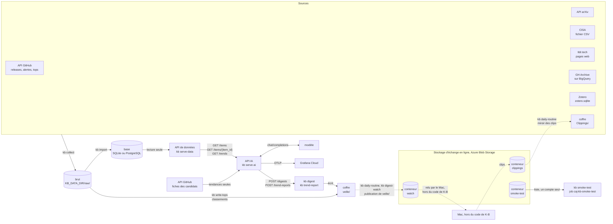

# L'architecture de l'application K-B

« Rédaction de la documentation technique. » — C17

Cette fiche décrit l'architecture applicative de K-B en entier: le flux des données de bout en bout, les couches du
code, puis chaque partie, de la collecte à l'hébergement. Elle est écrite d'après le code de `main` au commit
`1c414e9` (2026-11-09), dont `src/` et `infra/` sont ceux du commit `cbada1e`. Les chemins du code de K-B
(`etl/…`, `commands/…`, `database/…`) partent de `src/k_b/`, les autres de la racine du dépôt.

L'installation de l'environnement de développement, les dépendances et leur configuration sont dans
[la fiche de l'installation](installation_pour_docu.md); l'exécution des tests, dans
[la fiche des tests](tests_pour_docu.md). Le détail de l'API IA est dans [sa fiche](api_ia_pour_docu.md), et celui
de la livraison sur Azure dans [la fiche de la livraison continue](livraison_continue_pour_docu.md).

## Le flux des données

Les flèches suivent les données, pas les appels: l'API IA appelle l'API de données, et les items vont de l'API de
données à l'API IA. Un trait plein est un flux que le code fait aujourd'hui. Un trait en pointillés est codé, mais
pas encore en ligne.



Le diagramme se lit ainsi, dans l'ordre des flux:

1. **Des sources au brut.** `kb collect` lance chaque source, puis écrit ce qu'elle rend tel quel dans le brut,
   sous `KB_DATA_DIR/raw/` (`commands/collect_command.py:37-53`, `etl/extract.py:53-94`). Les sources sont sept
   origines de données: l'API GitHub (releases des dépôts suivis, alertes de sécurité, dépôts les plus étoilés et
   les plus forkés), l'API arXiv, le fichier CSV de la CISA, les pages de tldr.tech, GH Archive sur BigQuery, la
   base de Zotero et le dossier `Clippings/` du coffre (`etl/source_kinds.py:46-95`,
   `etl/collected_sources.py:110-131`).
2. **Du brut à l'import, puis à la base.** `kb import` lit les fichiers du brut qui ne sont pas encore importés,
   les convertit en items, puis les écrit dans la base en une transaction, avec le journal d'import
   (`etl/pipeline.py:51-82`). Les deux classements des dépôts les plus étoilés et les plus forkés n'entrent pas dans
   la base: ils n'ont pas de lecteur (`etl/source_kinds.py:66-77`).
3. **De la base aux deux API.** L'API de données lit la base en lecture seule et sert les items et les tendances
   (`database/engine.py:58-87`). L'API IA ne lit jamais la base: elle demande les items à l'API de données, par
   HTTP (`ai_api/connectors/data_api_client.py:266-268`, `:289`, `:308`).
4. **De l'API IA au modèle.** L'API IA envoie les items au modèle et reçoit ses textes, par le chemin
   `chat/completions` (`ai_api/connectors/llm_client.py:40`). Pour les tendances, elle lit aussi sur l'API GitHub
   la fiche de chaque candidat et le README des dépôts choisis. Elle envoie ses mesures et ses traces en
   OpenTelemetry (OTLP) vers Grafana Cloud.
5. **L'écriture dans le coffre.** `kb digest` et `kb trend-report` reçoivent la réponse de l'API IA, puis écrivent
   les fiches dans le coffre, sous `veille/`. `kb write-tops` écrit les fiches des deux classements, qu'il lit dans
   le brut, sans modèle ni base. Seule la commande `kb` écrit dans le coffre, jamais une API.
6. **Le stockage d'échange en ligne.** Aujourd'hui, seul le conteneur `smoke-test` existe en ligne
   (`infra/modules/exchange-storage.bicep:39-46`): `kb smoke-test` le liste et n'écrit qu'un nombre de blobs
   (`commands/smoke_test_command.py:152`). Les conteneurs `clippings` et `watch` sont codés, mais pas encore créés
   (#420): `kb daily-routine` copiera les clips du conteneur `clippings` dans le coffre du job, et `kb daily-routine`
   et `kb digest-watch` publieront `veille/` dans le conteneur `watch` (`commands/job_transfers.py:38`, `:68`).
   Ces deux jobs ne sont pas déclarés en ligne (`infra/deployment.json`). L'envoi des clips depuis le Mac, et la
   relecture de `watch` par le Mac, ne sont pas dans le code de K-B (note du 2026-11-06,
   [`docs/journaling/2026-11-06-enchainer-les-etapes-des-jobs.md`](../docs/journaling/2026-11-06-enchainer-les-etapes-des-jobs.md)).

## Les couches du code

Le code de K-B est rangé en trois couches (`.claude/rules/conventions.md`, règle 5): la présentation (`cli.py`,
`commands/` et les routes des deux API), le métier et l'ETL (`etl/`), l'accès aux données (`database/`). Une couche
n'appelle que celle du dessous. `items.py` et `core/` sont le vocabulaire commun: chaque couche peut les importer.
Les tests de `tests/architecture/` lisent les imports de chaque module et tiennent ces règles.

| Paquet | Rôle | Ce que les tests lui interdisent |
|---|---|---|
| `cli.py` | le point d'entrée de `kb`: lit la commande, lit l'environnement une fois, ouvre le journal, lance la commande (`cli.py:97-115`) | — |
| `commands/` | une commande `kb` par module (`<commande>_command.py`); `commands/environment.py` est le seul à lire l'environnement | importer `cli` (`tests/architecture/test_layers.py:81`); atteindre une étape de l'ETL autrement que par `etl/pipeline.py` (`:172`). Hors de `commands/environment.py`, seul `etl/sources/github/api.py` lit l'environnement, toléré pour l'instant (`tests/architecture/test_environment.py:23`, `:162`) |
| `etl/` | la collecte (`extract.py`) et l'import (`transform.py`, puis `load.py`); `pipeline.py` est la seule porte des deux parcours pour `commands/`; une source par module, dans `etl/sources/` | importer une API (`test_layers.py:200`), `post/` (`:232`) ou `purge/` (`:281`); qu'une étape importe une autre étape (`:130`) |
| `post/` | ce qui suit le pipeline: les clients HTTP de l'API IA, les fiches du coffre, le registre des comptes rendus des tendances | importer une API (`test_layers.py:206`), une source ou la composition des sources (`:109`) |
| `purge/` | les purges que `kb import` lance après son import | importer autre chose que `purge`, `core`, `items`, `database` hors de ses écrivains, `etl/raw_store.py` et `etl/raw_files.py` (`test_layers.py:257-265`, `:287`) |
| `jobs/` | le code commun des jobs en ligne: le stockage d'échange par l'identité managée, le miroir des clips, la publication de `veille/`, `GET /health` | importer autre chose que `core` (`test_layers.py:337`); être importé par un autre paquet que `commands` (`:343`) |
| `database/` | tout le SQL de la base de K-B: création, lecture, écriture (`writers/`, une sorte d'item par module), purge, moteurs | importer autre chose que `database`, `items` et `core` (`test_layers.py:28`); hors de `database/`, atteindre `database/writers` (`:45`). Seul `database/` importe un pilote de base, avec `etl/sources/zotero.py` pour la base de Zotero (`tests/architecture/test_engine_imports.py:36`) |
| `data_api/` | l'API de données | importer autre chose que `data_api`, `database`, `items` et `core`, ou les écrivains, la purge et l'écriture d'un fichier (`tests/architecture/test_apis.py:42`) |
| `ai_api/` | l'API IA, rangée en 16 couches internes | importer autre chose que `ai_api`, `items` et `core` (`test_apis.py:118`); importer sa couche ou celles du dessus (`:223`) |
| `items.py`, `core/` | les types communs des items, les réglages par défaut, la citation d'une valeur au journal, le code commun des deux API | `core` n'importe rien de K-B (`test_layers.py:20`) |

Deux tests tiennent la liste elle-même: chaque module de K-B est rangé (`tests/architecture/test_packages.py:14`), et
chaque `__init__.py` est vide (`:33`). Un module de source a la même forme partout, un bloc EXTRACT puis un bloc
TRANSFORM (`tests/architecture/test_source_modules.py:67`).

## La collecte

- **Une commande, toutes les sources.** `kb collect` lance chaque source déclarée dans `SOURCE_KINDS`, dans
  l'ordre de la table (`etl/source_kinds.py:46-95`). Zotero, les clips et GH Archive ne sont lancés que si leur
  variable est posée: `KB_ZOTERO_DIR`, `KB_VAULT_DIR` et `GOOGLE_APPLICATION_CREDENTIALS`
  (`etl/collected_sources.py:18-30`, `:110-131`). `KB_COLLECT_ONLY` choisit les sources d'une collecte (`:34`).
- **Une source en panne n'arrête pas les autres.** Chaque source écrit ses fichiers bruts, puis la collecte écrit
  la date de la dernière collecte réussie de chacune, dans `KB_DATA_DIR/collection_state.json`
  (`etl/extract.py:53-94`, `etl/raw_store.py:22`). À la collecte suivante, chaque source reçoit sa date
  (`etl/extract.py:68-70`); une source en échec garde la sienne.
- **Le brut est gardé tel que la source l'a rendu**, dans deux dossiers de `raw/`: `automated_watch/` pour ce que
  la veille collecte, `selected_library/` pour ce que Sabine a choisi, Zotero et les clips
  (`etl/raw_store.py:14-20`). Chaque fichier est écrit par un temporaire caché, renommé sur la cible
  (`.claude/rules/conventions.md`, règle 2).
- **Zotero n'est jamais ouvert en place**: `zotero.sqlite` est copié, avec son journal d'écriture, dans un dossier
  temporaire, puis lu (`etl/sources/zotero.py:1-6`).

Les sources, leur accès et leurs limites sont dans [`docs/specs-collecte.md`](../docs/specs-collecte.md).

## L'import et la base

- **L'import lit le brut qu'il n'a pas encore lu.** La base tient le registre des fichiers déjà importés (table
  `raw_data`, `database/schema.sql:28`). `kb import` lit les autres, les convertit en items communs, écarte les
  releases d'un dépôt hors de la liste suivie et normalise les items gardés (`etl/transform.py:1-2`).
- **Tout s'écrit en une transaction**, avec le journal d'import, `journals/import-journal-<date>.jsonl`
  (`etl/load.py:60-96`, `etl/pipeline.py:35`). Une entrée que la base refuse devient un rejet du journal, et
  l'import continue; toute autre erreur n'écrit rien (`etl/load.py:1-5`).
- **Les purges suivent l'import**: les catalogues remplacés, la base, le brut, le registre, puis les journaux
  (`purge/after_import.py:1-3`, `:43-52`). Leurs durées sont dans le
  [registre des traitements](../docs/registre-traitements.md).
- **La base a deux moteurs.** Sans `KB_DATABASE_URL`, c'est le fichier SQLite `k-b.sqlite` du dossier de données;
  avec, la base PostgreSQL qu'elle nomme (`database/location.py:1-3`, `core/config.py:182`). Les deux schémas ont
  les mêmes 15 tables (`database/schema.sql`, `database/schema_postgresql.sql`); un test compare leurs structures
  (`tests/test_schema_structures.py`). `kb create-db` crée la base; en ligne, `kb migrate-database` la crée si elle
  n'a pas encore ses tables (`commands/migrate_database_command.py:1-2`).

Le modèle de la base est dans [`docs/stockage.md`](../docs/stockage.md).

## Les deux API

| | API de données | API IA |
|---|---|---|
| Commande | `kb serve-data` | `kb serve-ai` |
| Adresse par défaut, sur le Mac | `127.0.0.1:8000` (`core/config.py:207-208`) | `127.0.0.1:8001` (`core/config.py:283-284`) |
| Routes | `GET /items` (`data_api/routers/item_router.py:95`), `GET /items/{item_id}` (`:126`), `GET /trends` (`data_api/routers/trend_router.py:23`) | `POST /digests` (`ai_api/routers/digest_router.py:46`), `POST /trend-reports` (`ai_api/routers/trend_report_router.py:61`) |
| Sans clé | `GET /health` (`data_api/app.py:75`) | `GET /health` (`ai_api/app.py:100`) |
| Clients | chacun sa clé, `KB_DATA_API_KEY_<CLIENT>` (`core/api_keys.py:12`); l'API IA est le client `AI_DIGEST` (`ai_api/connectors/data_api_settings.py:15`) | `kb digest`, client `KB_DIGEST`, pour `POST /digests`; `kb trend-report`, client `KB_TREND_REPORT`, pour `POST /trend-reports` (`core/config.py:300-305`) |
| Lit | la base, en lecture seule (`database/engine.py:58-87`) | l'API de données, le modèle, l'API GitHub |
| Contrat | [`docs/api/openapi-donnees.json`](../docs/api/openapi-donnees.json) | [`docs/api/openapi-ia.json`](../docs/api/openapi-ia.json) |

Les deux API n'écrivent rien de durable: l'API de données ne peut pas importer les écrivains de la base
(`tests/architecture/test_apis.py:42`), et l'API IA ne peut importer ni la base ni l'écriture d'un fichier (`:118`).
Le parcours d'une demande à l'API IA, ses contrôles et ses couches sont dans [sa fiche](api_ia_pour_docu.md).

## Le coffre

Le coffre est un coffre Obsidian, le dossier de `KB_VAULT_DIR` (`etl/collected_sources.py:22`). Il est à la fois une
source et une destination:

- **une source**: `kb collect` lit les clips du dossier `Clippings/` (`etl/sources/clipping.py:55`, `:103`);
- **une destination**: trois commandes y écrivent, sous `veille/` (`core/config.py:445`):

| Commande | Ce qu'elle écrit | D'où viennent les données |
|---|---|---|
| `kb digest` | une fiche par sujet et par jour, `veille/<sujet>/AAAA-MM-JJ.md` (`post/digest_sheets.py:40`) | la réponse de `POST /digests` (`commands/digest_command.py:88`, `:96`) |
| `kb trend-report` | un compte rendu par jour, `veille/tendances/<jour>.md` (`post/trend_report_sheets.py:138`) | la réponse de `POST /trend-reports`; la période suivante est tenue par `KB_DATA_DIR/trend_reports.json`, jamais par une relecture du coffre (`post/trend_report_registry.py:1-3`, `:26`) |
| `kb write-tops` | une fiche par classement et par jour de collecte, sous `veille/tops/` (`post/top_sheets.py:31`) | les deux classements du brut, puis les classements remplacés sont supprimés du brut (`commands/write_tops_command.py:39-70`) |

Une fiche est écrite une fois, jamais par un lien symbolique (`post/vault_files.py:1-2`). Une commande qui écrit dans
le coffre refuse de démarrer si `KB_VAULT_DIR` n'est pas un dossier existant: elle ne le crée pas
(`etl/collected_sources.py:95-107`).

## L'hébergement

K-B tourne de deux façons, par le même code.

**Sur le Mac**, sans conteneur: chaque commande se lance par `uv run kb …`. Les données sont dans le dossier de
`KB_DATA_DIR`: le brut, l'état de la collecte, la base SQLite, les journaux d'import, les journaux de fonctionnement
(`logs/`) et le registre des tendances. Les deux API écoutent sur `127.0.0.1`, la machine seule.

**En ligne, sur Azure**, depuis l'image de K-B, dans l'environnement Azure Container Apps `cae-kb`. Le Bicep
d'`infra/` décrit chaque ressource ([`infra/README.md`](../infra/README.md), tableau des modules):

| Ressource | Ce qu'elle fait | Où |
|---|---|---|
| `ca-kb-data-api` | lance `kb serve-data`, sur la base PostgreSQL en ligne, ouverte par l'identité managée (`KB_DATABASE_AUTH=entra`) | `infra/main.bicep:165-199` |
| `ca-kb-ai-api` | lance `kb serve-ai`, qui lit `ca-kb-data-api` en HTTPS | `infra/main.bicep:200-235` |
| `caj-kb-smoke-test` | job manuel, lance `kb smoke-test`: `GET /health` des deux API, puis la liste du conteneur `smoke-test` | `infra/main.bicep:237`, `commands/smoke_test_command.py:68-81` |
| `caj-kb-migrate-database` | job manuel, lance `kb migrate-database` | `infra/main.bicep:277` |
| `pgsql-kb-…` | le serveur PostgreSQL 18 flexible, par Entra ID seul | `infra/main.bicep:265` |
| `stkbexchange…` | le stockage d'échange, Azure Blob Storage, avec le seul conteneur `smoke-test` | `infra/main.bicep:106`, `infra/modules/exchange-storage.bicep:39-46` |
| `crkb…`, `kv-kb-…`, `log-kb` | le registre de l'image, le coffre des secrets, l'espace des journaux | `infra/main.bicep:58-104` |

Les deux API n'ont qu'une entrée interne, en HTTPS: elles n'ont pas d'adresse publique
(`infra/modules/api-container-app.bicep:74-81`). Les apps et les jobs déclarés en ligne sont ceux
d'`infra/deployment.json`: `ca-kb-data-api`, `ca-kb-ai-api`, `caj-kb-smoke-test` et `caj-kb-migrate-database`. Un
tag de version sur `main` les met à jour ([la fiche de la livraison continue](livraison_continue_pour_docu.md)).

## Limites

- **En ligne, rien ne collecte, n'importe ni n'écrit de fiche.** `kb daily-routine` et `kb digest-watch` sont codés
  (`commands/daily_routine_command.py:43-69`, `commands/digest_watch_command.py:59-81`), mais leurs jobs ne sont pas
  dans `infra/deployment.json`, et les conteneurs `clippings` et `watch` ne sont pas créés (#420).
- **Zotero n'est pas collecté en ligne**: la copie de la bibliothèque dans un job est à venir, entre le miroir des
  clips et `kb collect` (#425, `commands/daily_routine_command.py:50`).
- **L'interface web n'existe pas encore**: la fiche décrit `main`, où K-B se lit dans Obsidian et se lance dans le
  terminal.

## Vérifier cette fiche

Depuis la racine du dépôt, au commit `1c414e9` (`git switch --detach 1c414e9`):

```sh
# src/ et infra/ inchangés depuis cbada1e: aucune ligne attendue.
git diff --stat cbada1e 1c414e9 -- src/ infra/
# Les couches et les imports de chaque paquet.
uv run pytest tests/architecture/
# Les commandes de kb.
uv run kb --help
# Les sources, dans l'ordre de la collecte.
grep -n "SourceKind(" src/k_b/etl/source_kinds.py
# Les routes des deux API.
grep -nE "@router\.(get|post)|APIRouter\(" src/k_b/data_api/routers/*.py src/k_b/ai_api/routers/*.py
# Les 15 tables de chaque schéma.
grep -c "^CREATE TABLE" src/k_b/database/schema.sql src/k_b/database/schema_postgresql.sql
# Les apps et les jobs déclarés en ligne, puis le seul conteneur du stockage d'échange.
cat infra/deployment.json
grep -n -A2 "containers@" infra/modules/exchange-storage.bicep
# Les étapes des deux jobs codés, pas encore en ligne.
grep -n "RoutineStep(" -A1 src/k_b/commands/daily_routine_command.py src/k_b/commands/digest_watch_command.py
```

Un `fichier:ligne` se relit sans changer de commit: `git show 1c414e9:<chemin> | sed -n '<début>,<fin>p'`, avec
`src/k_b/` devant un chemin du code de K-B.
