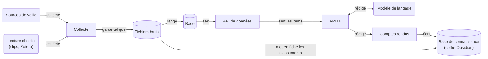
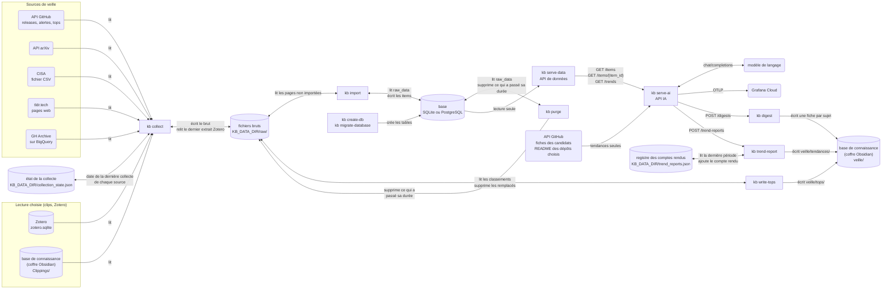
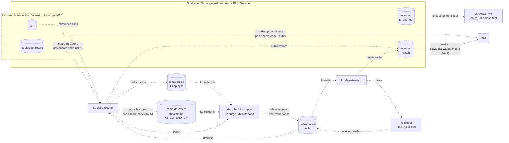
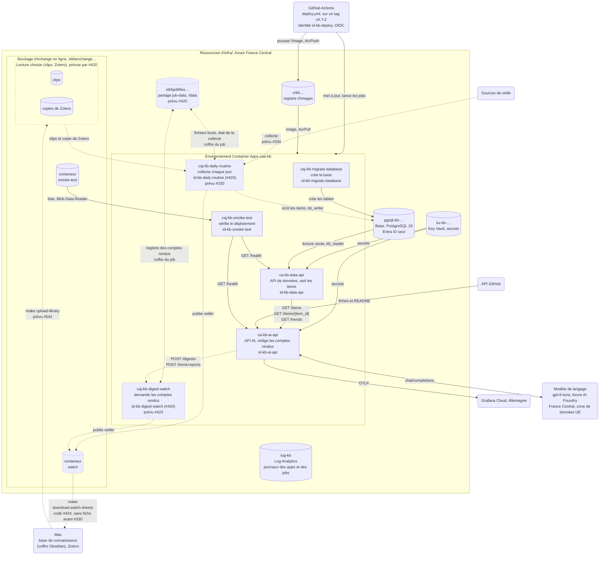

# L'architecture de l'application K-B

« Rédaction de la documentation technique. » — C17

Cette fiche décrit l'architecture applicative de K-B en entier: le flux des données de bout en bout, en bref puis en
détail, les couches du code, puis chaque partie, de la collecte au déploiement sur Azure. Elle est écrite d'après le
code de `main` au commit `0292266` (2026-11-09), dont `infra/` est celui du commit `cbada1e`, et la purge, sortie
de `kb import` par #540, d'après le code de sa PR. Les chemins du
code de K-B (`etl/…`, `commands/…`, `database/…`) partent de `src/k_b/`, les autres de la racine du dépôt.

L'installation de l'environnement de développement, les dépendances et leur configuration sont dans
[la fiche de l'installation](installation_pour_docu.md); l'exécution des tests, dans
[la fiche des tests](tests_pour_docu.md). Le détail de l'API IA est dans [sa fiche](api_ia_pour_docu.md), et celui
de la livraison sur Azure dans [la fiche de la livraison continue](livraison_continue_pour_docu.md).

## Le flux en bref



K-B collecte les sources de veille (GitHub, arXiv, la CISA, tldr.tech, GH Archive) et la lecture choisie (les clips du
coffre et la bibliothèque Zotero), garde ce qu'il reçoit tel quel dans des fichiers bruts, puis les range dans la base,
que l'API de données sert à l'API IA, qui fait rédiger par le modèle de langage les comptes rendus de la veille et des
tendances, que K-B écrit dans la base de connaissance (coffre Obsidian), avec les fiches des dépôts les plus étoilés et
les plus forkés, tirées directement des fichiers bruts.

## Le flux des données, en détail

Les deux schémas suivants suivent le chemin du code: le premier va des sources au coffre, le second montre les jobs
en ligne et le stockage d'échange. Un rectangle est une commande `kb`, un cylindre un fichier, une base ou un
conteneur, un rectangle arrondi un service extérieur ou le Mac. Une flèche est une lecture, une écriture ou un appel
que fait la commande, dans le sens où vont les données: l'API IA appelle l'API de données, et les items vont de l'API
de données à l'API IA. Un trait plein est un flux que le code fait aujourd'hui. Un trait en pointillés n'est pas
encore en ligne: il est codé, sauf si son étiquette dit « pas encore codé ». Un conteneur ou un groupe bordé de
pointillés n'est pas encore créé.

### Des sources au coffre



### Les jobs en ligne et le stockage d'échange



Les deux schémas se lisent ainsi, dans l'ordre des flux:

1. **Des sources au brut.** `kb collect` lit d'abord l'état de la collecte, `KB_DATA_DIR/collection_state.json`, et
   donne à chaque source la date de sa dernière collecte réussie (`etl/raw_store.py:22`, `:189`;
   `etl/extract.py:60`, `:69`). Il lance chaque source, puis écrit ce qu'elle rend tel quel dans le brut, sous
   `KB_DATA_DIR/raw/` (`commands/collect_command.py:37-59`, `etl/extract.py:129`, `:139`). Pour Zotero, il relit
   d'abord le dernier extrait du brut, et n'écrit rien si le nouveau est le même (`etl/sources/zotero.py:225`). À
   la fin, il récrit l'état, avec l'heure de la collecte pour chaque source collectée (`etl/extract.py:90`, `:94`;
   `etl/raw_store.py:220`). Les sources sont sept origines de données: l'API GitHub (releases des dépôts suivis,
   alertes de sécurité, dépôts les plus étoilés et les plus forkés), l'API arXiv, le fichier CSV de la CISA, les
   pages de tldr.tech, GH Archive sur BigQuery, la base de Zotero et le dossier `Clippings/` du coffre
   (`etl/source_kinds.py:46-95`, `etl/collected_sources.py:110-131`). Chacune est lue par un appel de son module:
   `etl/sources/github/releases.py:50`, `etl/sources/github/advisories.py:69`,
   `etl/sources/github/most_starred.py:38`, `etl/sources/github/most_forked.py:41`, `etl/sources/arxiv.py:111`,
   `etl/sources/cisa_kev.py:69`, `etl/sources/tldr.py:119`, `etl/sources/gh_archive.py:125`, `:211`,
   `etl/sources/zotero.py:275`, `etl/sources/clipping.py:103`.
2. **Du brut à l'import, puis à la base.** `kb create-db` crée la base et ses tables
   (`commands/create_db_command.py:34`); `kb migrate-database` la crée si elle n'a pas encore ses tables, et la
   laisse telle quelle sinon (`commands/migrate_database_command.py:31`). Les deux remplissent aussi la table des
   sources (`database/creation.py:61`, `:124`); sur PostgreSQL, `kb migrate-database` donne aussi leurs droits aux
   rôles (`:103`). `kb import` lit dans la base le registre
   des fichiers déjà importés, la table `raw_data` (`etl/load.py:52-55`), puis les pages du brut qui n'y sont pas
   (`etl/raw_reading.py:53`, `:111`, `:126`). Il les convertit en items, puis les écrit dans la base en une transaction
   (`etl/pipeline.py:51-82`, `etl/load.py:60-96`). Les deux classements des dépôts les plus étoilés et les plus
   forkés n'entrent pas dans la base: ils n'ont pas de lecteur (`etl/source_kinds.py:66-77`). `kb import` ne purge
   rien: `kb purge`, une commande à part, supprime du brut et de la base ce qui a passé sa durée, à compter de l'heure
   de son lancement, et du brut les catalogues remplacés; elle retire aussi du registre les fichiers disparus
   (`commands/purge_command.py:52`, `purge/all_purges.py:52-63`, `:62`, `purge/catalogs.py:33`, `purge/raw.py:34`).
3. **De la base aux deux API.** `kb serve-data` lit la base en lecture seule et sert les items et les tendances
   (`database/engine.py:58-87`, `database/reading.py:339`, `:433`, `:553`). `kb serve-ai` ne lit jamais la base:
   il demande les items et les tendances à l'API de données, par HTTP
   (`ai_api/connectors/data_api_client.py:266-268`, `:289`, `:308`).
4. **De l'API IA au modèle.** L'API IA envoie les items au modèle et reçoit ses textes, par le chemin
   `chat/completions` (`ai_api/connectors/llm_client.py:40`, `:436`). Pour les tendances, elle lit aussi sur l'API
   GitHub la fiche de chaque candidat et le README des dépôts choisis (`ai_api/connectors/github_client.py:173`,
   `:191`). Elle envoie ses mesures, ses traces et leurs journaux en OpenTelemetry (OTLP) vers Grafana Cloud
   (`ai_api/connectors/metrics_export.py:301`, `ai_api/connectors/trace_export.py:124`, `:134`).
5. **L'écriture dans le coffre.** `kb digest` envoie `POST /digests` à l'API IA, puis écrit une fiche par sujet,
   `veille/<sujet>/AAAA-MM-JJ.md` (`post/ai_api_client.py:226`, `commands/digest_command.py:118`). Il ne tient pas
   de registre: l'API IA prend une fenêtre de `KB_DIGEST_WINDOW_DAYS` jours, 3 par défaut
   (`ai_api/settings.py:36`, `core/config.py:329-330`). `kb trend-report` lit d'abord le registre des comptes rendus,
   `KB_DATA_DIR/trend_reports.json`, dont le dernier donne la période suivante (`post/trend_report_registry.py:26`,
   `:62`; `commands/trend_report_command.py:73`, `:134`). Il envoie `POST /trend-reports`
   (`post/trend_report_client.py:219-224`), écrit le compte rendu sous `veille/tendances/`
   (`commands/trend_report_command.py:245`), puis ajoute son entrée au registre (`:104`;
   `post/trend_report_registry.py:81-86`). `kb write-tops` lit les deux classements dans le brut, écrit leurs
   fiches sous `veille/tops/`, puis supprime du brut les classements remplacés, sans modèle ni base
   (`post/top_sheets.py:58`, `:70`, `:73`, `:92`). Seule la commande `kb` écrit dans le coffre, jamais une API.
6. **Le stockage d'échange en ligne.** Aujourd'hui, seul le conteneur `smoke-test` existe en ligne
   (`infra/modules/exchange-storage.bicep:39-46`): `kb smoke-test` le liste et n'écrit que le nombre de blobs de sa
   première page, 100 au plus (`commands/smoke_test_command.py:1-3`, `:141`, `core/config.py:552`). #420 prévoit le
   reste, que rien ne crée encore: la lecture choisie, où le Mac déposera les clips et les copies de Zotero, et le
   conteneur `watch`, où les jobs publieront `veille/`. Les deux routines relancent les commandes dans le même processus
   (`commands/job_routine.py:4-6`). `kb daily-routine` copie les clips dans le coffre du job, puis lance `kb collect`,
   `kb import`, `kb purge` et `kb write-tops`, puis publie `veille/`; `kb import` est sauté si `kb collect` échoue ou
   ne démarre pas, et `kb purge` tourne même si `kb import` échoue ou n'est pas lancé
   (`commands/daily_routine_command.py:44-75`, `:58`,
   `:62-64`, `commands/job_transfers.py:39`, `jobs/clip_mirror.py:241`).
   `kb digest-watch` lance `kb digest` et `kb trend-report`, puis publie `veille/`
   (`commands/digest_watch_command.py:59-81`). La publication lit `veille/` et ajoute au conteneur `watch` les fiches
   qui n'y sont pas, sans en remplacer (`commands/job_transfers.py:69`, `jobs/watch_publication.py:138`, `:146`). La
   copie de Zotero dans le job n'est pas encore codée: elle viendra entre le miroir des clips et `kb collect` (#425,
   `commands/daily_routine_command.py:50`). #425 la prévoit dans un dossier temporaire, que `KB_ZOTERO_DIR` nomme pour
   `kb collect`: la flèche « pose la copie » va vers ce dossier, pas vers le Zotero du Mac. Dans un job, le coffre est
   le dossier `KB_VAULT_DIR` du job, pas celui du Mac: `kb collect` y lit `Clippings/`, et lira la copie de Zotero dans
   le dossier de `KB_ZOTERO_DIR` (`etl/collected_sources.py:18-22`, `etl/sources/clipping.py:103`); `kb write-tops`,
   `kb digest` et `kb trend-report` y écrivent `veille/`. Ces deux jobs ne sont déclarés en ligne ni dans
   `infra/deployment.json`, ni dans `infra/main.bicep`. L'envoi des clips et des copies de Zotero depuis le Mac n'est pas encore
   codé: il viendra par `make upload-library` (#542). La relecture de `watch` par le Mac passe par
   `make download-watch-sheets` (#424, `commands/download_watch_sheets_command.py`), qui ne trouve aucune fiche tant
   que les jobs ne publient pas.

Les journaux restent hors du dessin: aucune commande ne les relit, sauf la purge, qui les supprime d'après la date de
leur nom (`purge/run_records.py:38`, `:75`). Ce sont les journaux de fonctionnement, sous `KB_DATA_DIR/logs/`
(`commands/run_log.py:23`, `:27`, `:29`), le journal d'import, `KB_DATA_DIR/journals/import-journal-<date>.jsonl`
(`etl/pipeline.py:35`, `:63-68`), et la ligne JSON que l'API IA écrit sur sa sortie standard pour chaque appel au modèle
(`ai_api/observability/metrics.py:50`). Restent hors du dessin aussi deux appels qui ne portent pas de donnée de la
veille: `GET /health`, par lequel `kb smoke-test` vérifie les deux API et `kb digest-watch` les réveille
(`commands/smoke_test_command.py:80-81`, `commands/digest_watch_command.py:60-64`), et la demande d'un jeton à
l'identité managée (`exchange/storage.py:173`, `database/entra.py:57`). `kb openapi` écrit le contrat des deux API
dans le dépôt, `docs/api/openapi-donnees.json` et `docs/api/openapi-ia.json` (`commands/openapi_command.py:30-32`,
`:50`). Les contrôles du coffre avant une écriture restent hors du dessin aussi: ils ne lisent que l'état d'un fichier
(existence, lien, date, taille). `kb digest` et `kb trend-report` refusent de redemander une fiche du jour déjà écrite
(`commands/digest_command.py:70`, `commands/trend_report_command.py:135`), `kb write-tops` contrôle ses dossiers avant
et après l'écriture (`post/top_sheets.py:59-60`, `:71-72`), et le miroir des clips compare la date et la taille de
chaque clip du coffre à celles de son blob (`jobs/clip_mirror.py:231-233`). Avec `KB_LLM_PROVIDER=replay`, l'API IA ne
joint pas le modèle: elle rejoue les réponses du fichier `KB_LLM_REPLAY_FILE` (`ai_api/connectors/llm_settings.py:29`,
`ai_api/connectors/llm_replay.py:70`).

## Les couches du code

Le code de K-B est rangé en trois couches (`.claude/rules/conventions.md`, règle 5): la présentation (`cli.py`,
`commands/` et les routes des deux API), le métier et l'ETL (`etl/`), l'accès aux données (`database/`). Une couche
n'appelle que celle du dessous. `items.py` et `core/` sont le vocabulaire commun: chaque couche peut les importer.
Les tests de `tests/architecture/` lisent les imports de chaque module et tiennent ces règles.

| Paquet | Rôle | Ce que les tests lui interdisent |
|---|---|---|
| `cli.py` | le point d'entrée de `kb`: lit la commande, lit l'environnement une fois, ouvre le journal, lance la commande (`cli.py:97-115`) | — |
| `commands/` | une commande `kb` par module (`<commande>_command.py`), et leur code commun; `commands/environment.py` est le seul à lire l'environnement | importer `cli` (`tests/architecture/test_layers.py:81`); atteindre une étape de l'ETL autrement que par `etl/pipeline.py` (`:172`). Hors de `commands/environment.py`, seul `etl/sources/github/api.py` lit l'environnement, toléré pour l'instant (`tests/architecture/test_environment.py:23`, `:162`) |
| `etl/` | la collecte (`extract.py`) et l'import (`transform.py`, puis `load.py`); `pipeline.py` est la seule porte des deux parcours pour `commands/`; une source par module, dans `etl/sources/` | importer une API (`test_layers.py:200`), `post/` (`:232`) ou `purge/` (`:281`); qu'une étape importe une autre étape (`:130`) |
| `post/` | ce qui suit le pipeline: les clients HTTP de l'API IA, les fiches du coffre, le registre des comptes rendus des tendances | importer une API (`test_layers.py:206`), une source ou la composition des sources (`:109`) |
| `purge/` | les purges que lance `kb purge` | importer autre chose que `purge`, `core`, `items`, `database` hors de ses écrivains et de `database/writing`, `etl/raw_store.py` et `etl/raw_files.py` (`test_layers.py:257-265`, `:287`) |
| `jobs/` | le code commun des jobs en ligne: ce qu'ils font du stockage d'échange (le miroir des clips, la publication et le téléchargement de `veille/`), l'appel de `GET /health` | importer autre chose que `exchange` et `core` (`test_layers.py:338`); être importé par un autre paquet que `commands` (`:344`) |
| `exchange/` | le client du stockage d'échange, Azure Blob Storage, par l'identité managée ou, sur le Mac, le compte d'`az login`: réglages, transport, erreurs nommées, téléchargement d'une version listée | importer autre chose que `core`, ou `core/atomic_write.py` (`test_layers.py:411`); être importé par un autre paquet que `jobs`, `commands` et `data_api` (`:417`) |
| `database/` | tout le SQL de la base de K-B: création, lecture, écriture (`writers/`, une sorte d'item par module), purge, moteurs | importer autre chose que `database`, `items` et `core` (`test_layers.py:28`); hors de `database/`, atteindre `database/writers` (`:45`). Seul `database/` importe un pilote de base, avec `etl/sources/zotero.py` pour la base de Zotero (`tests/architecture/test_engine_imports.py:36`) |
| `data_api/` | l'API de données | importer autre chose que `data_api`, `database`, `items`, `core` et `exchange`, ou les écrivains, la purge et l'écriture d'un fichier (`tests/architecture/test_apis.py:42`) |
| `ai_api/` | l'API IA, rangée en 16 couches internes | importer autre chose que `ai_api`, `items` et `core` (`test_apis.py:120`); importer sa couche ou celles du dessus (`:226`) |
| `items.py`, `core/` | les types communs des items, les réglages par défaut, la citation d'une valeur au journal, le code commun des deux API | `core` n'importe rien de K-B (`test_layers.py:20`) |

Deux tests tiennent la liste elle-même: les modules de premier niveau de K-B
(`tests/architecture/test_packages.py:14`) et ceux d'`etl/` (`:20`); un autre veut chaque `__init__.py` vide
(`:33`). Un module de source a la même forme partout, un bloc EXTRACT puis un bloc TRANSFORM
(`tests/architecture/test_source_modules.py:67`).

## La collecte

- **Une commande, toutes les sources.** `kb collect` lance chaque source déclarée dans `SOURCE_KINDS`, dans
  l'ordre de la table (`etl/source_kinds.py:46-95`). Zotero, les clips et GH Archive ne sont lancés que si leur
  variable est posée: `KB_ZOTERO_DIR`, `KB_VAULT_DIR` et `GOOGLE_APPLICATION_CREDENTIALS`
  (`etl/collected_sources.py:18-30`, `:110-131`). `KB_COLLECT_ONLY` choisit les sources d'une collecte (`:34`).
- **Une source en panne n'arrête pas les autres.** Chaque source écrit ses fichiers bruts, puis la collecte écrit
  la date de la dernière collecte réussie de chacune, dans `KB_DATA_DIR/collection_state.json`
  (`etl/extract.py:53-100`, `etl/raw_store.py:22`). À la collecte suivante, chaque source reçoit sa date
  (`etl/extract.py:68-70`); une source en échec garde la sienne.
- **Le brut est gardé tel que la source l'a rendu**, dans deux dossiers de `raw/`: `automated_watch/` pour ce que
  la veille collecte, `selected_library/` pour ce que Sabine a choisi, Zotero et les clips
  (`etl/raw_store.py:14-20`). Chaque fichier est écrit par un temporaire caché, renommé sur la cible
  (`.claude/rules/conventions.md`, règle 2).
- **Zotero n'est jamais ouvert en place**: `zotero.sqlite` est copié, avec son journal d'écriture, dans un dossier
  temporaire, puis lu (`etl/sources/zotero.py:1-6`).

Les sources, leur accès et leurs limites sont dans [`docs/specs-collecte.md`](../docs/specs-collecte.md).

## L'import et la base

- **L'import lit le brut qu'il n'a pas encore lu.** La base tient le registre des fichiers déjà importés (table
  `raw_data`, `database/schema.sql:28`). `kb import` lit les autres, les convertit en items communs, écarte les
  releases d'un dépôt hors de la liste suivie et normalise les items gardés (`etl/transform.py:1-2`).
- **Tout s'écrit en une transaction**, avec le journal d'import, `journals/import-journal-<date>.jsonl`
  (`etl/load.py:60-96`, `etl/pipeline.py:35`). Une entrée que la base refuse devient un rejet du journal, et
  l'import continue; toute autre erreur n'écrit rien (`etl/load.py:1-5`).
- **Les purges sont une commande à part, `kb purge`**, que la routine quotidienne lance après `kb import`: les
  catalogues remplacés, la base, le brut, le registre, puis les journaux (`purge/all_purges.py:1-3`, `:52-63`). Leurs
  durées sont dans le
  [registre des traitements](../docs/registre-traitements.md).
- **La base a deux moteurs.** Sans `KB_DATABASE_URL`, c'est le fichier SQLite `k-b.sqlite` du dossier de données;
  avec, la base PostgreSQL qu'elle nomme (`database/location.py:1-3`, `core/config.py:182`). Les deux schémas ont
  les mêmes 15 tables (`database/schema.sql`, `database/schema_postgresql.sql`); un test compare leurs structures
  (`tests/test_schema_structures.py`). `kb create-db` crée la base; en ligne, `kb migrate-database` la crée si elle
  n'a pas encore ses tables (`commands/migrate_database_command.py:1-2`).

Le modèle de la base est dans [`docs/stockage.md`](../docs/stockage.md).

## Les deux API

| | API de données | API IA |
|---|---|---|
| Commande | `kb serve-data` | `kb serve-ai` |
| Adresse par défaut, sur le Mac | `127.0.0.1:8000` (`core/config.py:207-208`) | `127.0.0.1:8001` (`core/config.py:283-284`) |
| Routes | `GET /items` (`data_api/routers/item_router.py:96`), `GET /items/{item_id}` (`:127`), `GET /trends` (`data_api/routers/trend_router.py:23`) | `POST /digests` (`ai_api/routers/digest_router.py:46`), `POST /trend-reports` (`ai_api/routers/trend_report_router.py:61`) |
| Sans clé | `GET /health` (`data_api/app.py:75`) | `GET /health` (`ai_api/app.py:100`) |
| Clients | chacun sa clé, `KB_DATA_API_KEY_<CLIENT>` (`core/api_keys.py:12`); l'API IA est le client `AI_DIGEST` (`ai_api/connectors/data_api_settings.py:15`) | `kb digest`, client `KB_DIGEST`, pour `POST /digests`; `kb trend-report`, client `KB_TREND_REPORT`, pour `POST /trend-reports` (`core/config.py:300-305`) |
| Lit | la base, en lecture seule (`database/engine.py:58-87`) | l'API de données, le modèle, l'API GitHub |
| Contrat | [`docs/api/openapi-donnees.json`](../docs/api/openapi-donnees.json) | [`docs/api/openapi-ia.json`](../docs/api/openapi-ia.json) |

Les deux API n'écrivent rien de durable, hors du journal de fonctionnement que tient leur commande
(`logs/kb-serve-data.log`, `logs/kb-serve-ai.log`, `commands/run_log.py:27`, `:29`): l'API de données ne peut pas
importer les écrivains de la base (`tests/architecture/test_apis.py:42`), et l'API IA ne peut importer ni la base ni
l'écriture d'un fichier (`:118`).
Le parcours d'une demande à l'API IA, ses contrôles et ses couches sont dans [sa fiche](api_ia_pour_docu.md).

## Le coffre

Le coffre est un coffre Obsidian, le dossier de `KB_VAULT_DIR` (`etl/collected_sources.py:22`). Il est à la fois une
source et une destination:

- **une source**: `kb collect` lit les clips du dossier `Clippings/` (`etl/sources/clipping.py:55`, `:103`);
- **une destination**: trois commandes y écrivent leurs fiches, sous `veille/` (`core/config.py:445`):

| Commande | Ce qu'elle écrit | D'où viennent les données |
|---|---|---|
| `kb digest` | une fiche par sujet et par jour, `veille/<sujet>/AAAA-MM-JJ.md` (`post/digest_sheets.py:43-44`) | la réponse de `POST /digests` (`commands/digest_command.py:88`, `:96`) |
| `kb trend-report` | un compte rendu par jour, `veille/tendances/<jour>.md` (`post/trend_report_sheets.py:152`) | la réponse de `POST /trend-reports`; la période suivante est tenue par `KB_DATA_DIR/trend_reports.json`, jamais par une relecture du coffre (`post/trend_report_registry.py:1-3`, `:26`) |
| `kb write-tops` | une fiche par classement et par jour de collecte, sous `veille/tops/` (`post/top_sheets.py:31`) | les deux classements du brut, puis les classements remplacés sont supprimés du brut (`commands/write_tops_command.py:39-70`) |

Deux routines de job, codées mais pas encore en ligne, relancent ces commandes: `kb daily-routine` lance
`kb write-tops`, et `kb digest-watch` lance `kb digest` et `kb trend-report` (`commands/daily_routine_command.py:59-62`,
`commands/digest_watch_command.py:65-74`). `kb daily-routine` écrit aussi dans le coffre du job les clips de la
lecture choisie, sous `Clippings/` (`commands/job_transfers.py:51-53`).

Une fiche est écrite une fois, jamais par un lien symbolique que `kb` voit (`post/vault_files.py:1-2`); une fiche
ou un lien apparus entre le contrôle et le renommage sont remplacés ou suivis, une limite acceptée (`:4-5`). Une
commande qui écrit dans le coffre refuse de démarrer si `KB_VAULT_DIR` n'est pas un dossier existant: elle ne le
crée pas (`etl/collected_sources.py:95-107`).

## L'hébergement

K-B tourne de deux façons, par le même code.

**Sur le Mac**, sans conteneur: chaque commande se lance par `uv run kb …`. Les données sont dans le dossier de
`KB_DATA_DIR`: le brut, l'état de la collecte, la base SQLite, les journaux d'import, les journaux de fonctionnement
(`logs/`) et le registre des tendances. Les deux API écoutent sur `127.0.0.1`, la machine seule.

**En ligne, sur Azure**, depuis l'image de K-B, dans l'environnement Azure Container Apps `cae-kb`. Le Bicep
d'`infra/` décrit chaque ressource ([`infra/README.md`](../infra/README.md), tableau des modules); voici les
principales:

| Ressource | Ce qu'elle fait | Où |
|---|---|---|
| `ca-kb-data-api` | lance `kb serve-data`, sur la base PostgreSQL en ligne, ouverte par l'identité managée (`KB_DATABASE_AUTH=entra`) | `infra/main.bicep:165-199` |
| `ca-kb-ai-api` | lance `kb serve-ai`, qui lit `ca-kb-data-api` en HTTPS | `infra/main.bicep:200-235` |
| `caj-kb-smoke-test` | job manuel, lance `kb smoke-test`: `GET /health` des deux API, puis la liste du conteneur `smoke-test` | `infra/main.bicep:237`, `commands/smoke_test_command.py:68-81` |
| `caj-kb-migrate-database` | job manuel, lance `kb migrate-database` | `infra/main.bicep:277` |
| `pgsql-kb-…` | le serveur PostgreSQL 18 flexible, par Entra ID seul | `infra/main.bicep:265` |
| `stkbexchange…` | le stockage d'échange, Azure Blob Storage, avec le seul conteneur `smoke-test` | `infra/main.bicep:106`, `infra/modules/exchange-storage.bicep:39-46` |
| `crkb…`, `kv-kb-…`, `log-kb` | le registre de l'image, le coffre des secrets, l'espace des journaux | `infra/main.bicep:58-104` |

Les deux API n'ont qu'une entrée interne, en HTTPS: elles n'ont pas d'adresse publique
(`infra/modules/api-container-app.bicep:74-81`). Les apps et les jobs déclarés en ligne sont ceux
d'`infra/deployment.json`: `ca-kb-data-api`, `ca-kb-ai-api`, `caj-kb-smoke-test` et `caj-kb-migrate-database`. Un
tag de version sur `main` les met à jour ([la fiche de la livraison continue](livraison_continue_pour_docu.md)).

### Le déploiement sur Azure



Le schéma dit où est quoi en ligne, et ce qui s'y passe. Un trait plein est déployé; un trait ou un bord en pointillés
est prévu, avec son issue. Une flèche suit le sens des données, comme dans le flux en détail; trois flèches sont des
appels sans donnée de la veille: les deux `GET /health`, par lesquels le job de vérification teste les deux API, et
« met à jour, lance les jobs », par laquelle le déploiement agit sur les apps et les jobs. Sur une app ou un job, le
nœud porte son identité managée; sur une flèche, le rôle qui la permet.

- **Les apps et les jobs** tournent dans l'environnement `cae-kb`
  (`infra/modules/container-apps-environment.bicep:7-8`), depuis la même image, tirée du registre par le rôle AcrPull
  (`infra/main.bicep:86-90`, `infra/modules/container-registry.bicep:42-53`,
  `infra/modules/migrate-database-job.bicep:35-44`). Les deux API n'ont qu'une entrée interne
  (`infra/modules/api-container-app.bicep:74-81`); l'API IA joint l'API de données par son nom interne, en HTTPS
  (`infra/main.bicep:223`). Les journaux des conteneurs vont dans `log-kb`
  (`infra/modules/container-apps-environment.bicep:45-63`).
- **Les secrets** (clés des API, clé du modèle, jeton GitHub, en-tête OTLP) sont dans le Key Vault; seules les deux API
  en lisent, chacune les siens, par le rôle Key Vault Secrets User, un rôle par secret (`infra/main.bicep:133-153`,
  `infra/modules/key-vault-secret-access.bicep:28-38`).
- **La base** est un serveur PostgreSQL 18 flexible, ouvert par Entra ID seul
  (`infra/modules/postgresql-server.bicep:17-31`). `id-kb-data-api` y lit par le rôle `kb_reader`, et
  `id-kb-migrate-database` possède les tables; la collecte quotidienne écrira par le rôle `kb_writer` (#330,
  `infra/postgresql/grant-roles.sql:6-8`, `:31-58`).
- **Le stockage d'échange** n'a que le conteneur `smoke-test`, que `id-kb-smoke-test` lit par le rôle Storage Blob Data
  Reader (`infra/modules/exchange-storage.bicep:40-61`). #420 prévoit les conteneurs `clippings`, `zotero` et `watch`,
  et un second compte, `stkbjobfiles`, dont le partage `job-data` sera monté sur `/data` des jobs. Il prévoit aussi
  leurs rôles, un par conteneur: `id-kb-daily-routine` lit `clippings` et `zotero` (Storage Blob Data Reader) et écrit
  `watch` (Storage Blob Data Contributor); `id-kb-digest-watch` écrit `watch`; le compte Entra de l'opératrice écrit
  `clippings` et `zotero`, et lit `watch`.
- **Le déploiement**: un tag `vX.Y.Z` sur `main` lance `deploy.yml`, qui se connecte par OIDC sous `id-kb-deploy`,
  pousse l'image, lance `caj-kb-migrate-database`, met à jour les apps et les jobs, puis lance `caj-kb-smoke-test`
  (`.github/workflows/deploy.yml:7-11`, `:97-133`, `:161-209`). `id-kb-deploy` a les rôles AcrPush et Reader sur le
  registre, Container Apps Contributor sur chaque app et Container Apps Jobs Contributor sur chaque job
  d'`infra/deployment.json`, et aucun rôle direct sur le Key Vault, le stockage ni les données
  (`infra/modules/deploy-access.bicep:1-4`, `:13-18`, `:25-35`, `:53-87`). Le registre des traitements consigne le
  risque accepté: ces rôles Contributor permettent de lire en clair les secrets des apps et des jobs
  (`docs/registre-traitements.md:196`).
- **L'opératrice**, par son compte Entra, applique le Bicep à la main (`infra/main.bicep:1-3`,
  [`infra/README.md`](../infra/README.md)); elle a le rôle Key Vault Secrets Officer, pour poser les secrets
  (`infra/modules/key-vault.bicep:33-41`, `infra/main.bicep:102`), et elle est l'administratrice Entra du serveur
  PostgreSQL (`infra/modules/postgresql-server.bicep:53-61`, `infra/main.bicep:270-271`). Le budget `budget-kb` envoie
  ses alertes par e-mail (`infra/modules/budget.bicep:1`, `:26-57`).
- **Hors du Bicep**: le modèle `gpt-6-luna` est déployé sur Azure AI Foundry, en France Central, en zone de données UE
  (`docs/registre-traitements.md:85`, `:88`); les mesures et les traces vont à Grafana Cloud, pile `prod-eu-west-2`, en
  Allemagne (`docs/registre-traitements.md:123`, `:128`). Le Bicep n'en porte que les paramètres et les secrets
  (`infra/main.bicep:21-28`).
- **Prévu**: `caj-kb-daily-routine` (#330) et `caj-kb-digest-watch` (#423) ne sont pas déclarés
  (`infra/deployment.json`); l'envoi depuis le Mac viendra avec #542 (la relecture de `watch` est codée par #424), la copie de
  Zotero avec #425.

## Limites

- **En ligne, rien ne collecte, n'importe ni n'écrit de fiche.** `kb daily-routine` et `kb digest-watch` sont codés
  (`commands/daily_routine_command.py:43-69`, `commands/digest_watch_command.py:59-81`), mais leurs jobs ne sont pas
  dans `infra/deployment.json`, et ni la lecture choisie ni le conteneur `watch` ne sont créés (#420).
- **Zotero n'est pas collecté en ligne**: la copie de la bibliothèque dans un job est à venir, entre le miroir des
  clips et `kb collect` (#425, `commands/daily_routine_command.py:50`).
- **L'interface web n'existe pas encore**: la fiche décrit `main`, où K-B se lit dans Obsidian et se lance dans le
  terminal.

## Vérifier cette fiche

Depuis la racine du dépôt, au commit `0292266` (`git switch --detach 0292266`):

```sh
# infra/ inchangé depuis cbada1e: aucune ligne attendue.
git diff --stat cbada1e 0292266 -- infra/
# Les couches et les imports de chaque paquet.
uv run pytest tests/architecture/
# Les commandes de kb.
uv run kb --help
# Les sources, dans l'ordre de la collecte.
grep -n "SourceKind(" src/k_b/etl/source_kinds.py
# Les routes des deux API.
grep -nE "@router\.(get|post)|APIRouter\(" src/k_b/data_api/routers/*.py src/k_b/ai_api/routers/*.py
# Les 15 tables de chaque schéma.
grep -c "^CREATE TABLE" src/k_b/database/schema.sql src/k_b/database/schema_postgresql.sql
# Les apps et les jobs déclarés en ligne, puis le seul conteneur du stockage d'échange.
cat infra/deployment.json
grep -n -A2 "containers@" infra/modules/exchange-storage.bicep
# Les étapes des deux jobs codés, pas encore en ligne.
grep -n "RoutineStep(" -A1 src/k_b/commands/daily_routine_command.py src/k_b/commands/digest_watch_command.py
```

Un `fichier:ligne` se relit sans changer de commit: `git show 0292266:<chemin> | sed -n '<début>,<fin>p'`, avec
`src/k_b/` devant un chemin du code de K-B.
