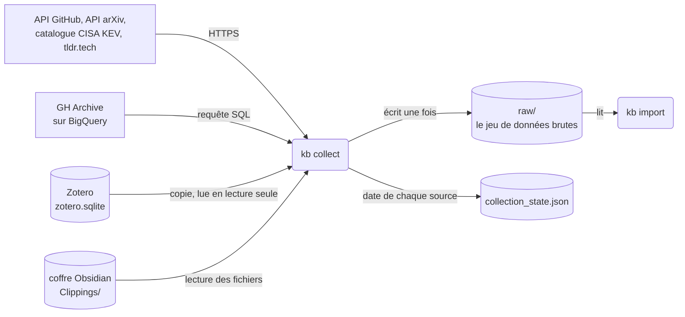

# La collecte des données de K-B

!!! note "Compétences de la certification"

    > Les spécifications techniques précisent: les technologies et outils, les services externes, les exigences de
    > programmation (langages), l'accessibilité (disponibilité, accès).

    — C1

    > Le périmètre des spécifications techniques est complet: il couvre l'ensemble des moyens techniques à mettre en
    > œuvre pour l'extraction et l'agrégation des données en un jeu de données brutes final.

    — C1

Cette fiche donne les spécifications techniques de la collecte de K-B: son périmètre, des sept sources au jeu de
données brutes, les technologies et les outils qui la font, les services externes qu'elle interroge, les exigences de
programmation que tient son code, la disponibilité et l'accès de chaque source, puis le jeu de données brutes
lui-même. Le déroulé de `kb collect`, pas à pas, avec son logigramme et ses codes de sortie, est dans
[la fiche de l'import et de la base, « La commande qui précède l'import: `kb collect` »](donnees.md#la-commande-qui-precede-limport-kb-collect);
le détail de chaque source est dans
[les spécifications de la collecte](https://github.com/SabineLaurent/K-B/blob/main/docs/specs-collecte.md). Elle est
écrite d'après le code de `main` au commit `39cb5eb9`, ses renvois à `commands/run_log.py` d'après le code de la demande
de fusion de #458. Les chemins du code de K-B (`etl/…`, `core/…`,
`commands/…`, `post/…`, `purge/…`) partent de `src/k_b/`, les autres de la racine du dépôt.

## Le périmètre

La collecte va des sources au jeu de données brutes: `kb collect` interroge chaque source, puis écrit ce qu'elle a
rendu sous `raw/`, dans le dossier de données `KB_DATA_DIR`, et la date de sa dernière collecte réussie dans
`collection_state.json` (`etl/pipeline.py:45-48`, `etl/raw_store.py:13-22`). C'est la commande par défaut de `kb`
(`cli.py:286`).

Les sept sources sont écrites dans la base à sa création (`database/seed_sources.sql:5-11`). L'une d'elles, CISA KEV,
est le catalogue des vulnérabilités exploitées (<span lang="en">Known Exploited Vulnerabilities</span>) de l'agence
américaine de cybersécurité (<span lang="en">Cybersecurity and Infrastructure Security Agency</span>). Le tableau suivant donne,
pour chacune, son type et son mode d'acquisition tels que la base les nomme, et les sources de `kb collect` qui la
lisent, chacune nommée par son dossier de `raw/`.

| Source | Type | Mode | Sources de `kb collect` |
|---|---|---|---|
| API GitHub | service web (`web_service`) | veille (`watch`) | `github_releases_<dépôt>`, une par dépôt suivi, quatre en tout (`core/config.py:58-71`); `github_advisories_pip` et `github_advisories_npm`; `github_most_starred` et `github_most_forked` |
| API arXiv | service web (`web_service`) | veille (`watch`) | `arxiv_cscr_x_csai` |
| Catalogue CISA KEV | fichier (`file`) | veille (`watch`) | `cisa_kev` |
| Obsidian Web Clipper | fichier (`file`) | bibliothèque (`library`) | `clipping` |
| tldr.tech | <span lang="en">scraping</span> (`scraping`) | veille (`watch`) | `tldr_ai`, `tldr_infosec`, `tldr_dev`, `tldr_tech` (`core/config.py:32`) |
| Zotero | base de données (`database`) | bibliothèque (`library`) | `zotero` |
| GH Archive sur BigQuery | <span lang="en">big data</span> (`big_data`) | veille (`watch`) | `gh_archive` |

Les
quatorze premières sources de collecte sont déclarées une fois, dans `SOURCE_KINDS` (`etl/source_kinds.py:46-95`);
Zotero, les clips et GH Archive s'y ajoutent quand leur variable est posée, `KB_ZOTERO_DIR`, `KB_VAULT_DIR` et
`GOOGLE_APPLICATION_CREDENTIALS` (`etl/collected_sources.py:18-30`, `:110-131`). `KB_COLLECT_ONLY` choisit les
sources d'une collecte (`etl/collected_sources.py:31-34`).

Le schéma suivant montre ce que lit `kb collect` et ce qu'il écrit. Le paragraphe « Texte équivalent du schéma » qui
le suit le décrit flèche par flèche.



Texte équivalent du schéma. `kb collect` lit quatre services web en HTTPS: l'API GitHub, l'API arXiv, le catalogue
CISA KEV et les pages de tldr.tech. Il lit GH Archive par une requête SQL sur BigQuery, la base SQLite de Zotero par
une copie ouverte en lecture seule, et les clips dans le dossier `Clippings/` du coffre Obsidian. Il écrit le brut de
chaque source une seule fois dans `raw/`, puis la date de chaque source réussie dans `collection_state.json`.
`kb import` lit ensuite `raw/`.

**La frontière avec l'import.** La collecte s'arrête au brut: le module de la collecte, `etl/extract.py`, n'importe
de l'ETL (extraction, transformation, chargement) que le magasin du brut, le format des noms de collection et le
contrat des sources (`etl/extract.py:12-20`), et un test refuse qu'une étape de l'ETL en importe une autre
(`tests/architecture/test_layers.py:130`). Les deux classements GitHub n'ont pas de lecteur: ils n'entrent pas dans
la base, et `kb write-tops` les lit dans le brut (`etl/source_kinds.py:66-77`).

**Le jeu de données brutes final et son agrégation.** Le jeu de données brutes final est `raw/`: les sept sources y
sont rangées dans une seule arborescence, sous un seul nommage daté, avec un seul état de collecte
([Le jeu de données brutes](#le-jeu-de-donnees-brutes)). `kb import` l'agrège ensuite en un seul jeu d'items, par
trois étapes: la lecture de chaque fichier brut pas encore importé par le lecteur de sa source (`etl/raw_reading.py`,
`etl/transform.py:1-2`), la normalisation de chaque item dans un seul modèle, quelle que soit sa source
(`etl/normalize.py:1`, `items.py`), puis l'écriture dans la base, en une transaction, où la clé naturelle de chaque
sorte écarte les doublons (`etl/load.py:1-2`, par exemple `database/writers/paper_writer.py:16`). Le détail est dans
[L'agrégation, l'import et la base](donnees.md).

**En ligne**, `kb collect` est une étape de `kb daily-routine`, après le miroir des clips
(`commands/daily_routine_command.py:44-54`), que le job `caj-kb-daily-routine` lance chaque jour à 08:00 UTC
(`infra/modules/daily-routine-job.bicep:77-81`). Son dossier de données est le partage Azure Files `job-data`
(section [Le jeu de données brutes](#le-jeu-de-donnees-brutes)).

## Les technologies et outils

### Le langage et l'environnement

- **Python 3.13**: `.python-version` donne `3.13`, et `pyproject.toml` demande `requires-python = ">=3.13"`
    (`pyproject.toml:9`). L'image qui tourne en ligne part de `python:3.13-slim-trixie` (`Dockerfile:10`, `:27`).
- **uv** installe Python, K-B et ses dépendances aux versions de `uv.lock`; l'intégration continue (CI) et l'image
    prennent uv 0.13.6 (`.github/workflows/ci.yml:34`, `Dockerfile:7`). L'installation est dans
    [L'installation et l'environnement de développement](installation.md).
- **La commande `kb`**: le point d'entrée `kb = "k_b.cli:main"` (`pyproject.toml:49-50`); `kb collect` lance
    `run_collect` (`commands/collect_command.py:37-59`). Le Makefile la lance par `make collect` (`Makefile:12-13`).

### Les bibliothèques

Le tableau suivant donne chaque bibliothèque dont se sert la collecte, sa version dans `uv.lock`, son rôle et le code
qui l'appelle. La liste de toutes les dépendances de K-B est dans
[L'installation et l'environnement de développement, « Les dépendances »](installation.md#les-dependances).

| Bibliothèque | Version (`uv.lock`) | Rôle dans la collecte | Où |
|---|---|---|---|
| `httpx2` | 2.13.1 | le client HTTP de chaque téléchargement (GitHub, arXiv, CISA KEV, tldr.tech), qui ne lit ni proxy ni certificat de l'environnement et ne suit seul aucune redirection | `core/outbound.py:65-80`, `etl/http_download.py:71-90` |
| `defusedxml` | 0.7.1 | lit le flux Atom d'arXiv et refuse toute déclaration d'entité | `etl/sources/arxiv.py:164-179` |
| `beautifulsoup4`, avec `soupsieve` | 4.15.0, 4.0.1 | lit chaque page de tldr.tech avant de la garder, pour refuser une page qui n'est pas l'édition du jour | `etl/sources/tldr.py:154-165`, `:213-220` |
| `google-cloud-bigquery` | 3.46.1 | le client BigQuery: l'état de la table du jour, le `dry_run`, puis la requête plafonnée | `etl/sources/gh_archive.py:114-146`, `:183-262` |
| `pydantic` | 2.13.5 | valide le résultat de GH Archive et chaque document de l'extrait de Zotero avant de les garder | `etl/sources/gh_archive.py:295-311`, `etl/sources/zotero.py:411-417` |
| `pyyaml` | 6.0.3 | lit l'en-tête YAML d'un clip par `BaseLoader`, qui ne construit que du texte, des listes et des dictionnaires | `etl/sources/clipping.py:281-298` |
| `sqlite3` | bibliothèque standard | ouvre la copie de la base de Zotero en lecture seule et lance la requête d'extraction | `etl/sources/zotero.py:289-308` |
| `csv` | bibliothèque standard | lit le catalogue CISA KEV avant de le garder | `etl/sources/cisa_kev.py:108-122` |
| `json` | bibliothèque standard | lit les réponses de GitHub; écrit l'extrait de Zotero, le résultat de GH Archive et l'état de la collecte | `etl/sources/github/releases.py:118`, `etl/sources/zotero.py:222-224`, `etl/sources/gh_archive.py:265-277`, `etl/raw_store.py:219-230` |
| `hashlib` | bibliothèque standard | nomme la copie d'un clip par le SHA-256 du nom de son fichier | `etl/sources/clipping.py:210-212` |

## Les services externes

Le tableau suivant donne, pour chaque source, son protocole et son format, son authentification, et le débit ou le
quota qui la borne.

| Source | Protocole et format | Authentification | Débit ou quota |
|---|---|---|---|
| API GitHub | API REST en HTTPS, réponses JSON: `GET /repos/{owner}/{repo}/releases`, `GET /advisories`, `GET /search/repositories` (`etl/sources/github/releases.py:50-52`, `etl/sources/github/advisories.py:58-69`, `etl/sources/github/most_starred.py:35-41`), sur `https://api.github.com/`, version d'API `2026-03-10` (`core/github_api.py:3-4`, `etl/sources/github/api.py:48-55`) | jeton `KB_GITHUB_TOKEN`, dans l'en-tête `Authorization: Bearer`; sans lui, la requête part sans jeton (`etl/sources/github/api.py:46-59`) | 5 000 requêtes par heure avec le jeton, 60 sans; la recherche a son propre quota, 30 requêtes par minute (`commands/collect_command.py:29-34`, `docs/specs-collecte.md:185-186`) |
| API arXiv | HTTPS, flux Atom (XML), `https://export.arxiv.org/api/query` (`etl/sources/arxiv.py:49`, `:102-111`) | aucune | une requête toutes les 3 s, une connexion à la fois (`docs/specs-collecte.md:291-292`); K-B en envoie une par collecte |
| Catalogue CISA KEV | HTTPS, fichier CSV, `https://www.cisa.gov/sites/default/files/csv/known_exploited_vulnerabilities.csv`, en requête conditionnelle `If-Modified-Since` (`etl/sources/cisa_kev.py:41-48`, `:63-75`) | aucune | aucun quota publié (`docs/specs-collecte.md:339`); une requête par collecte |
| tldr.tech | HTTPS, une page HTML par édition et par jour, `https://tldr.tech/<édition>/<AAAA-MM-JJ>` (`etl/sources/tldr.py:35`, `:116`) | aucune | aucun quota publié; K-B lit une page à la fois, avec une pause de 2 s avant chaque page (`core/config.py:33-35`, `etl/sources/tldr.py:113-115`) |
| Zotero | fichier SQLite local, `zotero.sqlite` et son journal `zotero.sqlite-wal`, lus par une requête SQL (`etl/sources/zotero.py:59-61`, `:78-163`) | aucune: un dossier de la machine, `KB_ZOTERO_DIR` | aucun |
| Obsidian Web Clipper | fichiers Markdown à en-tête YAML du dossier `Clippings/` du coffre (`etl/sources/clipping.py:54-56`) | aucune: un dossier de la machine, `KB_VAULT_DIR` | aucun; un clip fait 1 000 000 octets au plus (`items.py:421`, `etl/sources/clipping.py:237-243`) |
| GH Archive sur BigQuery | requête SQL de BigQuery sur les tables publiques `githubarchive.day.AAAAMMJJ`, par le client `google-cloud-bigquery` (`etl/sources/gh_archive.py:45-88`) | compte de service, dont la clé est le fichier que nomme `GOOGLE_APPLICATION_CREDENTIALS` (`etl/collected_sources.py:23-24`, `etl/sources/gh_archive.py:144-146`) | projet sans facturation: 1 Tio lu par mois, une requête au-delà refusée, jamais facturée (`docs/bigquery.md:3-6`); chaque requête plafonnée à 650 Mo par fenêtre, 2 Go au plus (`etl/sources/gh_archive.py:41-42`, `:149-151`) |

### Les règles communes des téléchargements

GitHub, arXiv, CISA KEV et tldr.tech passent par une seule fonction, `download` (`etl/http_download.py:36-68`):

- **Un délai** de 30 s pour chaque opération réseau, la connexion ou chaque lecture (`core/config.py:127-129`,
    `etl/http_download.py:79`).
- **Les redirections** sont suivies par K-B, 10 au plus, en `GET`; chacune est contrôlée sur l'URL que le client
    demandera, avant d'être demandée, et refusée hors du préfixe attendu (`core/config.py:130-132`,
    `etl/http_download.py:93-135`).
- **Une taille maximale** par source, sur le corps décompressé: 5 Mio pour une réponse de GitHub, 6 Mio pour arXiv,
    10 Mio pour le catalogue CISA KEV, 1 Mio pour une page de tldr.tech (`etl/sources/github/api.py:18`,
    `etl/sources/arxiv.py:51`, `etl/sources/cisa_kev.py:45`, `etl/sources/tldr.py:37`, `etl/http_download.py:147-156`).
- **Un seul nouvel essai** après un 429, un 5xx, un 403 qui porte un `Retry-After` ou un échec de connexion: il
    attend le `Retry-After`, jamais moins de 3 s; sans lui, 5 s, et 60 s pour un 429 de GitHub. Un délai dépassé, un
    `Retry-After` de plus de 60 s ou un quota épuisé ne sont pas réessayés (`etl/http_retry.py:19-58`,
    `etl/sources/github/api.py:19-21`).
- **Une pause de GitHub**: après un quota épuisé ou un `Retry-After` de plus de 60 s, les sources GitHub suivantes
    n'envoient aucune requête avant la fin de la pause, et échouent (`etl/sources/github/api.py:22-45`, `:62-66`,
    `etl/http_retry.py:61-76`).
- **Un nom**: K-B se présente à chaque site par un `User-Agent` fixe, qui donne l'adresse d'une page GitHub
    (`core/user_agent.py:1-5`, `etl/http_download.py:138-144`).

## Les exigences de programmation

### Le langage, le typage et le style

- **Python seul**: tout le code de la collecte est en Python 3.13, sous `src/k_b/etl/`.
- **Le typage strict**: la CI lance `uv run mypy --strict` sur `src` (`.github/workflows/ci.yml:52-61`,
    `pyproject.toml:73-74`). Le lecteur d'une source est typé par son entrée, pour que mypy refuse le convertisseur
    d'une autre source (`etl/source_contract.py:96-105`).
- **ruff**: la CI lance `uv run ruff check` et `uv run ruff format --check` (`.github/workflows/ci.yml:49-50`), avec
    les règles de tri des imports, de sécurité (`S`), de nommage (`N`), de simplicité (`SIM`), de complexité (`C90`)
    et de docstrings (`D100`, `D102`, `D103`) (`pyproject.toml:52-58`). Chaque module, méthode et fonction publics du
    pipeline, de la ligne de commande à l'écriture en base, a sa docstring (`pyproject.toml:53-55`, `:64-71`).
- **Les tests**: la CI lance la suite entière, sous un plancher de couverture de 96 % (`.github/workflows/ci.yml:38`,
    `pyproject.toml:84-87`), puis, à part, les tests des données, dont `tests/etl` (`.github/workflows/ci.yml:100-109`).

### Un module par source, construit d'une seule façon

Une source donne son nom, l'extension de ses fichiers, son dossier de `raw/` et une méthode `fetch`, qui reçoit la
date de sa dernière collecte et rend un contenu, des pages par nom, ou rien (`etl/source_contract.py:12-25`). Chaque
source a son module sous `etl/sources/`; les sources GitHub sont sous `etl/sources/github/`, avec leur client commun,
`api.py`, qui n'est pas une source (`tests/architecture/test_source_modules.py:11-19`). Chaque module se lit dans le
même ordre, tenu par cinq tests (`tests/architecture/test_source_modules.py:66-128`):

1. son identité, `FOLDER_PREFIX`, avant le bandeau `# === EXTRACT ===`;
2. sous `# === EXTRACT ===`, la seule classe `…Source`, avec `fetch` et ce qui lui sert;
3. sous `# === TRANSFORM ===`, la lecture (`read_…`, `parse_…`), puis la conversion en item (`convert_…`), puis le
    lecteur, `READER` ou `TREND_READER`.

### Une entrée invalide devient un rejet nommé

- **À la collecte, une source lit sa page comme l'import la lira**, avant de la garder (par exemple
    `etl/sources/cisa_kev.py:76-78`, `etl/sources/arxiv.py:84-86`, `etl/sources/github/releases.py:53-56`).
- **Pour le contenu de sa page, une source n'échoue que par un refus**, `PageRefusedError` (`etl/source_contract.py:33-35`): une page
    illisible, des entrées toutes invalides, `all_items_invalid` (`:79-86`), ou un catalogue d'état sans entrée,
    `empty_catalog` (`:89-93`), pour CISA KEV et Zotero (`etl/sources/cisa_kev.py:77`,
    `etl/sources/zotero.py:215`). Un classement refuse sa page entière: un dépôt retiré décalerait les rangs
    (`etl/sources/github/most_starred.py:63-78`, `etl/sources/gh_archive.py:308-311`).
- **Une entrée invalide parmi des valides entre dans le brut**; à l'import, elle devient un rejet, écrit au journal
    d'import par un seul chemin, `reject` (`etl/rejections.py:11-14`).
- **Chaque échec propre à une source est un état nommé**: `not_the_edition_of_the_day` (`etl/sources/tldr.py:39`),
    `clip_too_large` et `clippings_folder_missing` (`etl/sources/clipping.py:66-74`), `DayTableNotClosedError`,
    `DryRunOverLimitError` et `DryRunVolumeUnknownError` (`etl/sources/gh_archive.py:91-100`),
    `ZoteroCopyInconsistentError`, `ZoteroChangedDuringCopyError` et `ZoteroQueryFailedError`
    (`etl/sources/zotero.py:168-179`).

### Le brut s'écrit une fois, atomiquement

Un fichier brut s'écrit par `write_new_raw_file`, qui appelle `write_file_atomically` sans remplacement
(`etl/raw_store.py:182-185`). Cette fonction, la seule qui écrit un fichier de K-B (`core/atomic_write.py:1`):

1. crée un temporaire caché, `.<nom>.tmp`, dans le dossier de la cible, seulement s'il est absent, lisible et
    modifiable par son seul propriétaire (`core/atomic_write.py:75-92`); un temporaire déjà là est la réservation
    d'une autre écriture, et l'écriture échoue (`TemporaryFileFoundError`, `:20-26`);
2. y écrit le contenu et le vide sur le disque (`fsync`) (`:44-48`);
3. cherche la cible dans la liste du dossier: présente, elle n'est jamais remplacée (`FileExistsError`, `:50-51`,
    `:95-100`);
4. renomme le temporaire sur la cible, puis vide sur le disque le dossier et chaque dossier créé
    (`:52`, `:64-72`);
5. supprime le temporaire sur toute exception, Ctrl-C compris (`:53-63`).

Avant la première écriture, la collecte contrôle le nom de la source, l'extension et le nom de chaque page: un nom
refusé n'écrit rien (`etl/extract.py:118-122`, `:133-137`). Un nom caché, commençant par `.`, n'est jamais lu par
l'import (`etl/raw_store.py:120-132`).

### Les journaux

- **Chaque ligne est datée en UTC**, à la seconde, avec sa zone: `<date> <niveau> <module>: <message>`, au format
    `%Y-%m-%dT%H:%M:%SZ` (`commands/run_log.py:37`, `:98-100`, `core/dates.py:7`). Le journal va sur la sortie
    d'erreur et dans `<KB_DATA_DIR>/logs/kb.log`, tourné chaque jour à minuit UTC (`commands/run_log.py:74-97`).
- **Une valeur observée est citée par `quote_value`**, échappée (retours à la ligne et caractères de contrôle) et
    coupée à 100 caractères (`core/quoting.py:9-19`); le message d'échec d'une source et ses notes, à 300
    (`etl/extract.py:35-38`, `:103-109`).
- **Chaque source journalise son départ, puis ce qu'elle a écrit ou son échec** (`etl/extract.py:66`, `:75-89`). Un
    échec prévu, une erreur de la source ou du réseau, tient sur sa ligne, sans trace; tout autre garde sa trace
    Python (`etl/extract.py:27-34`, `:79`).
- **Aucun secret**: du jeton GitHub, la collecte ne lit que sa présence (`commands/collect_command.py:81-94`), et le
    journal de Zotero ne donne que des nombres (`etl/sources/zotero.py:217-221`).

### L'arrêt sur SIGTERM et les codes de sortie nommés

- **Des codes nommés**: `ExitCode` (`commands/exit_codes.py:7-85`). `kb collect` sort en 0, 1 ou 4 selon ses
    sources et son état (`commands/collect_command.py:115-124`), en 2 s'il ne démarre pas (`:45-46`, `:54-56`), en 143 sur SIGTERM et en 130 sur Ctrl-C
    (`cli.py:249-260`). Le sens de chaque code est dans
    [la fiche de l'import et de la base](donnees.md#la-commande-qui-precede-limport-kb-collect).
- **L'arrêt sur SIGTERM**: le signal devient `StoppedBySigtermError`, qui défait le travail en cours comme toute
    exception; un second SIGTERM est ignoré (`commands/sigterm.py:13-17`, `:39-65`). Un fichier brut déjà écrit
    reste.

### Les réglages et les entrées

- **Les réglages se lisent dans l'environnement**, une fois au démarrage (`commands/environment.py:20-26`), et la
    commande les reçoit en paramètre (`commands/collect_command.py:37`). Le client de l'API GitHub lit le jeton
    (`etl/sources/github/api.py:46`), et le client BigQuery sa clé (`etl/sources/gh_archive.py:144-146`).
- **Une réponse est une entrée non fiable**: elle est bornée en taille, refusée si elle vient d'une redirection hors
    de l'adresse attendue (section [Les règles communes des téléchargements](#les-regles-communes-des-telechargements)),
    et lue par un analyseur qui n'exécute rien: `defusedxml` pour arXiv, `BaseLoader` pour un clip
    (`etl/sources/arxiv.py:164-179`, `etl/sources/clipping.py:294-297`).

## L'accessibilité des sources

### La disponibilité

**Une collecte par jour.** En ligne, le job `caj-kb-daily-routine` part chaque jour à 08:00 UTC, avec un nouvel essai
au plus, l'ensemble borné à une heure (`infra/modules/daily-routine-job.bicep:77-86`). En local, la collecte se lance par `kb collect`.

**Une collecte incrémentale.** La collecte lit d'abord `collection_state.json`, puis donne à chaque source la date de
sa dernière collecte réussie (`etl/extract.py:60`, `:68-70`). Une source qui n'a rien de nouveau n'écrit rien
(`etl/extract.py:123-125`). Une source réussie reçoit la date de cette collecte, l'instant de son début, le même pour
toutes (`etl/extract.py:90`, `commands/collect_command.py:53`).

Le tableau suivant donne, pour chaque source, ce que lit une collecte, ce que lit la première, et ce que devient un
jour manqué.

| Source | Ce que lit une collecte | La première collecte | Un jour manqué |
|---|---|---|---|
| tldr.tech | chaque jour, du jour de la dernière collecte, relu, à aujourd'hui en UTC (`etl/sources/tldr.py:173-185`) | les 7 jours précédents et aujourd'hui (`core/config.py:37`) | rattrapé jour par jour |
| arXiv | les papiers soumis depuis 7 jours avant la dernière collecte (`etl/sources/arxiv.py:66-74`, `core/config.py:26`) | les papiers soumis depuis le 2026-05-01 (`core/config.py:29`) | rattrapé dans la même page (paragraphe qui suit le tableau) |
| CISA KEV | le catalogue entier, s'il a changé depuis la dernière collecte; une réponse 304 n'écrit rien (`etl/sources/cisa_kev.py:58-79`) | le catalogue entier | chaque catalogue est complet |
| GitHub, <span lang="en">releases</span> | la première page de 100 <span lang="en">releases</span> de chaque dépôt; rien n'est écrit si aucune n'est plus récente que la dernière collecte (`etl/sources/github/releases.py:33`, `:48-73`) | la première page | rattrapé dans les 100 dernières <span lang="en">releases</span>; au-delà, un avertissement au journal (`:74-86`) |
| GitHub, alertes | les alertes relues par GitHub, mises à jour depuis la veille de la dernière collecte, 100 par écosystème, puis comparées à leur date de revue (`etl/sources/github/advisories.py:50-83`) | la première page de 100 | rattrapé dans la page de 100; au-delà, un avertissement au journal (`:84-97`) |
| GitHub, classements | un instantané du top 100, à chaque collecte (`etl/sources/github/most_starred.py:33-43`, `core/config.py:74`) | un instantané | chaque instantané est celui de sa collecte |
| Zotero | toute la bibliothèque, écrite seulement si l'extrait diffère, octet pour octet, du dernier (`etl/sources/zotero.py:201-228`) | toute la bibliothèque | chaque extrait est complet |
| Clips | chaque clip écrit ou changé depuis 60 s avant la dernière collecte, et depuis plus de 60 s (`etl/sources/clipping.py:95-128`, `core/config.py:162`) | tous les clips | rattrapé: le clip a changé depuis la dernière collecte réussie |
| GH Archive | chaque fenêtre de 3 jours due, la plus récente finissant la veille, en une seule requête (`etl/sources/gh_archive.py:159-180`, `core/config.py:85`) | 6 fenêtres (`core/config.py:99-101`) | 15 fenêtres au plus, les plus récentes (`core/config.py:88`) |

**arXiv.** La collecte d'arXiv demande toute sa fenêtre en une seule page, de 2 000 papiers au plus
(`etl/sources/arxiv.py:53`, `:107`). Elle collecte tout ou rien: si arXiv annonce plus de papiers que la page n'en
rend, la source refuse la page, n'écrit rien et garde sa date de dernière collecte (`:77-81`, test
`test_a_page_that_does_not_hold_every_result_is_refused`). Au rythme mesuré (551 papiers du 2026-05-01 au
2026-10-21, `docs/2026-10-21-collecte-reelle.md:179`), il faudrait plus d'un an et demi sans collecte pour atteindre
2 000 papiers.

**Quand une source échoue**, son erreur est notée au journal, sa date reste, et les sources suivantes sont lancées
(`etl/extract.py:71-81`): la collecte suivante lui redemande la même fenêtre. GH Archive ne lit une fenêtre que si la
table de son dernier jour est close, modifiée après la fin de ce jour; sinon la source échoue, et la collecte
suivante reprend (`etl/sources/gh_archive.py:183-194`). Si l'état ne s'écrit pas, `kb collect` sort en 1, et la
collecte suivante repart des mêmes dates (`commands/collect_command.py:115-124`).

### L'accès

Chaque secret de la collecte vient d'une variable d'environnement. En ligne, le jeton GitHub de la collecte et la clé
BigQuery sont des secrets d'Azure Key Vault, que le job lit par son identité: le jeton en variable, la clé en
fichier, monté dans `/mnt/secrets`, hors du partage où le job garde ses données (`infra/main.bicep:211-216`,
`infra/modules/daily-routine-job.bicep:27-29`, `:48-52`, `:137-147`). Ce jeton est distinct de celui de l'API IA
(`infra/main.bicep:206`, `:211-215`).

- **API GitHub.** Le jeton `KB_GITHUB_TOKEN` est un jeton <span lang="en">fine-grained</span> limité aux dépôts
    publics, sans aucune permission
    ([les jetons GitHub de K-B](https://github.com/SabineLaurent/K-B/blob/main/docs/jeton-github.md),
    `docs/jeton-github.md:30-32`). Il part dans la première requête seule, vers `https://api.github.com/`, jamais
    vers une redirection (`etl/sources/github/api.py:48-59`, `etl/http_download.py:118-123`). Les conditions de
    GitHub valent pour toute sa collecte, GH Archive compris: K-B la lit par l'API, que régit
    la section H des conditions d'utilisation de GitHub, et non la règle sur le <span lang="en">scraping</span> de
    ses règles d'usage acceptable (§ 7) (`docs/specs-collecte.md:187-192`).
- **API arXiv.** Sans authentification. Les conditions d'utilisation de l'API, <span lang="en">« Terms of Use for
    arXiv APIs »</span>, demandent une requête toutes les 3 s au plus (`docs/specs-collecte.md:291-292`, `:1099`):
    K-B envoie une requête par collecte, et son nouvel essai attend au moins 3 s (`etl/sources/arxiv.py:102-111`,
    `etl/http_retry.py:23-25`).
- **Catalogue CISA KEV.** Sans authentification: un fichier public, téléchargé une fois par collecte, seulement
    s'il a changé, et refusé s'il est servi hors de `https://www.cisa.gov/` (`etl/sources/cisa_kev.py:47`,
    `:63-75`).
- **tldr.tech.** Sans authentification. Son `robots.txt` autorise tout, sauf les pages d'abonnement et de compte,
    que K-B ne lit pas (`docs/specs-collecte.md:602-604`, `:1104`). K-B ne lit
    que la page d'une édition et d'un jour, et toute redirection est contrôlée (`etl/sources/tldr.py:116-119`).
- **Zotero.** La base n'est jamais ouverte en place: `zotero.sqlite` est copié avec son journal dans un dossier
    temporaire, la copie est vérifiée par `PRAGMA integrity_check`, ouverte en lecture seule (`mode=ro`), lue, puis
    supprimée, après un succès, une erreur ou un Ctrl-C (`etl/sources/zotero.py:1-5`, `:201-213`, `:268-325`).
- **Clips.** K-B ne change jamais un clip (`etl/sources/clipping.py:1-4`). Il ne lit que les fichiers `.md` visibles
    et ordinaires de `Clippings/`, sans ses sous-dossiers ni un lien symbolique, et n'en suit aucun à l'ouverture
    (`O_NOFOLLOW`) (`etl/sources/clipping.py:158-172`, `:225-234`). En ligne, les clips arrivent dans le coffre du
    job par le miroir du conteneur `clippings`, avant `kb collect` (`commands/job_transfers.py:39-66`).
- **GH Archive sur BigQuery.** Le compte de service `k-b-collecte` n'a que le rôle d'utilisateur de job BigQuery
    (`roles/bigquery.jobUser`), dans le projet `k-b-bigquery`, sans compte de facturation
    ([le bac à sable BigQuery de K-B](https://github.com/SabineLaurent/K-B/blob/main/docs/bigquery.md),
    `docs/bigquery.md:9-21`). La requête ne lit que quatre colonnes des événements, jamais l'acteur
    (`etl/sources/gh_archive.py:49-63`). K-B lit les étoiles et les <span lang="en">forks</span> des dépôts dans
    GH Archive, sur BigQuery, sans l'identité des personnes qui les donnent. Ces comptes sont traités comme un
    échantillon: le compte rendu des tendances en tire des rangs, jamais un nombre d'étoiles gagnées, et l'écrit dans
    son texte (`post/trend_report_sheets.py:110-114`); la page des tendances du site, qui montre les comptes, les dit
    tirés de cet échantillon (`web/templates/trends.html:7`, `:27`). Mesure du 2026-10-29: sur trois dépôts, les
    étoiles d'une fenêtre de trois jours dans GH Archive font 1,0 à 1,8 % de celles que GitHub compte pour la même
    fenêtre; les <span lang="en">forks</span>, 0,8 à 1,3 %, jusqu'à 4,2 % (`docs/specs-collecte.md:711-723`).

## Le jeu de données brutes

### L'arborescence

Le jeu de données brutes est le dossier `raw/` du dossier de données. Il a deux dossiers: `automated_watch/`, ce que
la veille collecte, et `selected_library/`, ce que l'utilisatrice a choisi, Zotero et les clips; une source n'écrit
que dans l'un d'eux (`etl/raw_store.py:13-21`, `etl/extract.py:118-119`). Chaque source y a son dossier. Une
collection est un fichier nommé par l'instant de la collecte, en UTC, `AAAA-MM-JJTHHMMSSZ`, ou un dossier de ce nom
avec un fichier par page (`etl/raw_files.py:10`, `etl/extract.py:126-142`). Le tableau suivant donne, pour chaque
dossier de source, la forme d'une collection et ce qu'elle contient.

| Dossier | Une collection | Ce qu'elle contient |
|---|---|---|
| `raw/automated_watch/cisa_kev/` | `<instant>.csv` | le catalogue, tel que servi |
| `raw/automated_watch/github_releases_<dépôt>/` | `<instant>.json` | la première page de <span lang="en">releases</span> du dépôt |
| `raw/automated_watch/github_advisories_pip/`, `raw/automated_watch/github_advisories_npm/` | `<instant>.json` | la page d'alertes des paquets suivis de l'écosystème |
| `raw/automated_watch/github_most_starred/`, `raw/automated_watch/github_most_forked/` | `<instant>.json` | la réponse de la recherche: le top 100 |
| `raw/automated_watch/arxiv_cscr_x_csai/` | `<instant>.xml` | le flux Atom de la fenêtre |
| `raw/automated_watch/tldr_<édition>/` | un dossier `<instant>/`, une page `<AAAA-MM-JJ>.html` par jour (`etl/sources/tldr.py:106`) | la page de l'édition du jour, telle que servie |
| `raw/automated_watch/gh_archive/` | `<instant>.json` | les fenêtres demandées (`window_ends`) et les lignes du classement (`rows`) (`etl/sources/gh_archive.py:265-277`) |
| `raw/selected_library/zotero/` | `<instant>.json` | le résultat de la requête d'extraction, en JSON (`etl/sources/zotero.py:222-224`) |
| `raw/selected_library/clipping/` | un dossier `<instant>/`, une page par clip, nommée par les 16 premiers caractères hexadécimaux du SHA-256 du nom de son fichier (`etl/sources/clipping.py:57-60`, `:210-212`) | le clip, copié tel quel |

**Ce que garde le brut.** Ce que la source a rendu, sans conversion: la collecte n'écrit que les octets que rend
`fetch` (`etl/extract.py:123-142`). Le filtre se fait à la lecture, sauf là où la requête choisit déjà: les
catégories et les mots-clés d'arXiv (`etl/sources/arxiv.py:90-99`, `core/config.py:12-21`), les paquets suivis
des alertes GitHub (`etl/sources/github/advisories.py:58-64`), le critère de recherche des deux classements
(`core/config.py:77`, `:80`), les comptes par dépôt de GH Archive (`etl/sources/gh_archive.py:55-88`) et les
champs lus de Zotero (`etl/sources/zotero.py:73-163`).

### L'état de la collecte

`collection_state.json`, à la racine du dossier de données et hors de `raw/`, est un objet JSON qui donne, pour
chaque source, la date de sa dernière collecte réussie, en ISO 8601 avec sa zone (`etl/raw_store.py:22`,
`:219-230`). Il s'écrit en entier, atomiquement, après la dernière source (`etl/extract.py:93-99`). Absent, chaque
source fait sa première collecte; illisible ou invalide, `kb collect` sort en 2 sans rien collecter
(`etl/raw_store.py:188-216`, `commands/collect_command.py:54-56`).

### La durée

Un fichier brut est gardé 6 mois après sa collecte (`RAW_RETENTION_MONTHS`, `core/config.py:149-155`), puis
supprimé par `kb purge` (`purge/raw.py:17-48`), qui suit `kb import` dans la routine quotidienne
(`commands/daily_routine_command.py:55-64`). Deux règles s'y ajoutent:

- d'un catalogue d'état, CISA KEV ou Zotero, le brut ne garde que le dernier fichier importé, et ceux pas encore importés, quel que soit son âge
    (`commands/purge_command.py:30-41`, `purge/catalogs.py:13-35`, `purge/raw.py:28-30`);
- d'un classement GitHub, le brut ne garde que le dernier relevé lisible, une fois ses fiches écrites par
    `kb write-tops` (`post/top_sheets.py:58-85`).

Les procédures de tri et leur fréquence sont dans [Les données personnelles dans K-B](donnees-personnelles.md).

### En ligne

En ligne, le brut et l'état sont sur le partage Azure Files `job-data`, monté sur `/var/lib/knowledge_base`, le
dossier de données du job (`infra/main.bicep:69-72`, `:414-416`, `infra/modules/daily-routine-job.bicep:116-136`),
lisible par le seul utilisateur de l'image: dossiers en `0700`, fichiers en `0600` (`:133-135`). Ils y restent d'une
exécution à l'autre (`infra/modules/daily-routine-job.bicep:1-4`). Le stockage d'échange, Azure Blob Storage, ne
porte pas le brut: il porte ce qui entre dans le job et ce qui en sort, les clips du conteneur `clippings` et les
fiches de `veille/` publiées dans le conteneur `watch` (`commands/job_transfers.py:1-2`,
[L'architecture, « Les jobs en ligne et le stockage d'échange »](architecture.md#les-jobs-en-ligne-et-le-stockage-dechange)).

## Vérifier cette fiche

Depuis la racine du dépôt, au commit `39cb5eb9`:

```bash
# Les sept sources de la base: 7.
grep -c "^    ('" src/k_b/database/seed_sources.sql
# Les 14 sources déclarées dans SOURCE_KINDS, puis les trois qu'ajoute leur variable: 14, puis 3 lignes.
uv run python -c "from k_b.etl.source_kinds import SOURCE_KINDS; print(sum(len(k.sources) for k in SOURCE_KINDS))"
grep -n "sources.append" src/k_b/etl/collected_sources.py
# Python 3.13, puis les versions des bibliothèques de la collecte dans uv.lock: 3.13, puis sept paquets.
cat .python-version
grep -A1 -E '^name = "(httpx2|defusedxml|beautifulsoup4|soupsieve|google-cloud-bigquery|pydantic|pyyaml)"$' uv.lock
# Le typage strict et ruff dans la CI: 3 lignes.
grep -n "mypy --strict\|ruff check\|ruff format --check" .github/workflows/ci.yml
# Chaque module de source: identité, EXTRACT puis TRANSFORM: 50 passed.
uv run pytest tests/architecture/test_source_modules.py -q
# Une source en panne n'arrête pas les autres et garde sa date; rien de nouveau, rien d'écrit: 5 passed.
uv run pytest tests/etl/test_extract.py -q -k "broken_source or only_successful or receives_its_last or all_invalid or nothing_new"
# Le brut écrit une fois, jamais remplacé; un état invalide refusé: 6 passed, puis 7 passed.
uv run pytest tests/test_atomic_write.py -q -k "once or another_run"
uv run pytest tests/etl/test_raw_store.py -q -k "overwrite or another_run or invalid_collection_state"
# Les journaux datés en UTC; l'échec prévu sans trace, l'imprévu avec; les valeurs échappées: 3 passed, puis 10 passed.
uv run pytest tests/commands/test_run_log.py -q -k log_line
uv run pytest tests/etl/test_extract.py -q -k "failure_is_logged or quoted_escaped"
# kb collect sur SIGTERM: 143, l'état gardé: 2 passed.
uv run pytest tests/commands/test_sigterm.py -q -k collect
# arXiv refuse une page qui ne tient pas tous les résultats; la page de 2 000: 1 passed, puis les lignes 53 et 107.
uv run pytest tests/etl/sources/test_arxiv.py -q -k does_not_hold_every_result
grep -n "PAPERS_PER_PAGE" src/k_b/etl/sources/arxiv.py
# GH Archive: la requête ne lit jamais l'acteur; le plafond de 650 Mo par fenêtre, 2 Go au plus: 10 passed.
uv run pytest tests/etl/sources/test_gh_archive.py -q -k "actor or cap"
# Le jeton GitHub n'est jamais transmis à une redirection: 2 passed.
uv run pytest tests/etl/sources/test_github_api.py -q -k token
# Zotero: l'original intact, la copie lue en lecture seule, puis supprimée: 4 passed.
uv run pytest tests/etl/sources/test_zotero.py -q -k "original or read_only or temporary_copy"
# Le brut gardé 6 mois; un catalogue d'état garde son dernier brut: la ligne 155, puis 3 passed.
grep -n "^RAW_RETENTION_MONTHS" src/k_b/core/config.py
uv run pytest tests/purge/test_purge_raw.py -q -k "six_months or state_catalogs"
# En ligne: l'heure du job, son dossier de données, la clé BigQuery en fichier: les lignes 50, 78, 119 et 123, puis la ligne 72.
grep -n "cronExpression\|mountPath\|GOOGLE_APPLICATION_CREDENTIALS" infra/modules/daily-routine-job.bicep
grep -n "^var dataDir" infra/main.bicep
```

Un `fichier:ligne` se relit sans changer de commit: `git show 39cb5eb9:<chemin> | sed -n '<début>,<fin>p'`, avec
`src/k_b/` devant un chemin du code de K-B.
