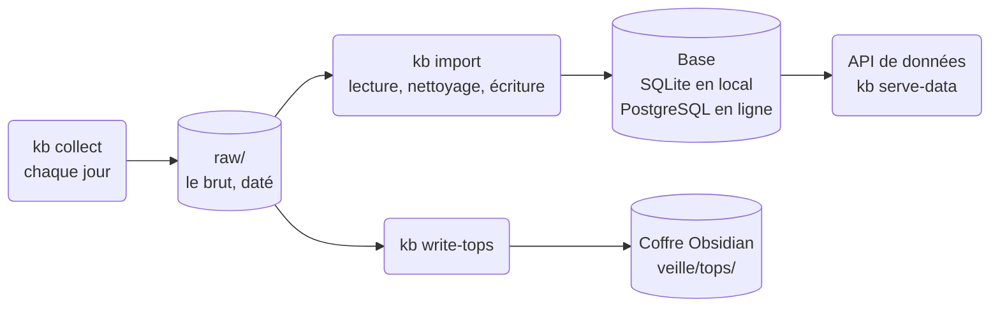
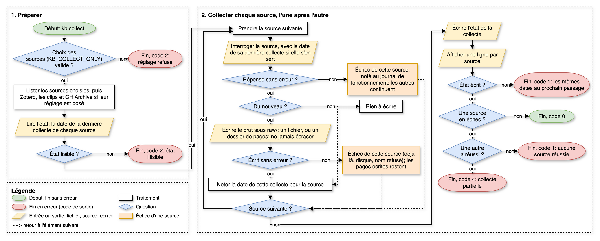
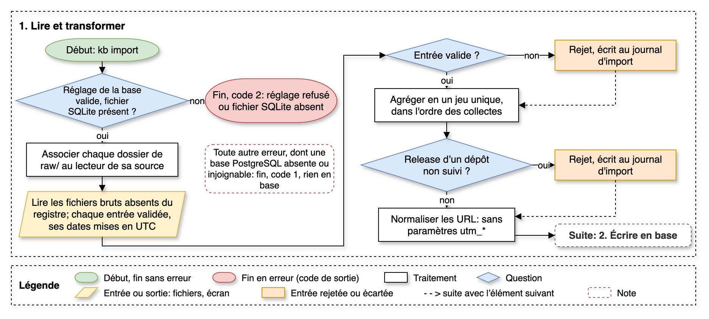
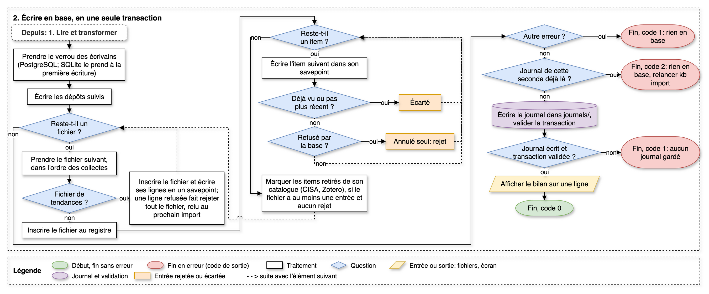
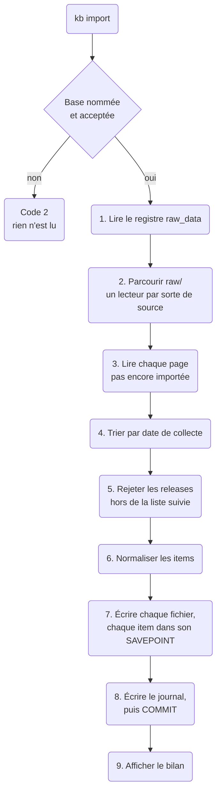

# L'agrégation, l'import et la base de K-B

!!! note "Compétences de la certification"

    > Documentation des scripts.

    — C3

    > Documentation de la procédure d'installation du système de gestion de base de données.

    — C4

    > Documentation du script d'import.

    — C4

    > Rédaction de la documentation technique d'accès à la base de données adaptée aux environnements techniques du
    > projet.

    — C5

Cette fiche dit ce qu'il faut pour lancer les scripts de la base, comment installer la base en local et en ligne,
ce que font la collecte qui précède l'import (`kb collect`) et le script d'agrégation et d'import (`kb import`), pas à
pas, chacun avec son logigramme, comment l'import nettoie et homogénéise les données, la commande qui le suit
(`kb write-tops`), puis comment lire la base sans l'API. Elle est écrite d'après le code de `main` au commit `94e3f4e`
(2026-11-11); la collecte et les logigrammes, d'après le commit `36c1e02` (2026-11-21). Les chemins du code de K-B (`etl/…`, `database/…`) partent de
`src/k_b/`, les autres de la racine du dépôt. [Utiliser K-B](utilisation.md) donne chaque commande de `kb` en bref;
cette fiche détaille celles de la base.

## Deux usages, deux moteurs

K-B a deux usages: en local, sur un poste de travail, sans déploiement, avec SQLite
([En local: SQLite, sans serveur](#en-local-sqlite-sans-serveur)); en ligne, déployé sur Azure, avec PostgreSQL
([En ligne: PostgreSQL sur Azure](#en-ligne-postgresql-sur-azure)). En local, un PostgreSQL sert aussi à essayer la
branche en ligne ([En local: PostgreSQL, pour essayer la branche en ligne](#en-local-postgresql-pour-essayer-la-branche-en-ligne)).
La variable `KB_DATABASE_URL` choisit le moteur: absente, la base est le fichier `<KB_DATA_DIR>/k-b.sqlite`; posée,
c'est l'URL `postgresql://` ou `postgres://` d'une base PostgreSQL ([Réglages](#reglages), `database/location.py:106-135`).

### Pourquoi deux systèmes de gestion de base de données

- **En local, SQLite**: une utilisatrice, un seul écrivain, le pipeline, et quelques milliers d'items par an; aucun
    serveur à installer, et, en mode WAL (<span lang="en">write-ahead logging</span>), l'API lit pendant que le
    pipeline écrit ([journal des décisions](https://github.com/SabineLaurent/K-B/blob/main/docs/ADR/journal-decisions-projet.md), 2026-10-02, « Base des items »).
- **En ligne, PostgreSQL**: les API et les jobs tournent chacun dans son conteneur (`infra/main.bicep:270`, `:307`,
    `:386`, `:406`, `:433`, `:480`). SQLite y demanderait un fichier sur un partage Azure Files monté: la documentation
    de Container Apps ne dit rien des verrous de SQLite sur un partage SMB (<span lang="en">Server Message
    Block</span>), et des sources de la communauté le jugent peu fiable; un conteneur Blob, lui, ne se monte pas
    dans Container Apps ([journal des décisions](https://github.com/SabineLaurent/K-B/blob/main/docs/ADR/journal-decisions-projet.md), 2026-11-06, « Base: PostgreSQL en ligne, par un adaptateur
    maison (#417) »). PostgreSQL donne aussi à chaque identité son rôle, l'API de données en lecture seule, et une
    connexion sans mot de passe, par Entra (même journal, « Base en ligne: trois rôles, posés par l'administratrice
    (#421) » et « Base en ligne: Entra seul, un jeton à chaque connexion (#421) »).

## Vue d'ensemble

L'agrégation lit le brut de sept sources, collecté dans des formats différents, en un seul modèle d'item, puis
l'écrit dans une base qui écarte les doublons. Les sept sources sont écrites dans la base à sa création
(`database/seed_sources.sql:5-12`): API GitHub, API arXiv, catalogue CISA KEV (<span lang="en">Known Exploited
Vulnerabilities</span>, de la <span lang="en">Cybersecurity and Infrastructure Security Agency</span> américaine),
Obsidian Web Clipper, tldr.tech, Zotero, GH Archive sur BigQuery.

Le schéma suivant montre le chemin des données, de la collecte à la base et au coffre. Le paragraphe qui le suit,
« Texte équivalent du schéma », le décrit en texte, flèche par flèche.



Texte équivalent du schéma. `kb collect`, chaque jour, écrit le brut daté de chaque source dans `raw/`, sous le
dossier de données. `kb import` lit le brut pas encore importé, le nettoie et écrit les items dans la base: un
fichier SQLite en local, PostgreSQL en ligne. L'API de données, lancée par `kb serve-data`, lit la base.
`kb write-tops` ne lit pas la base: il lit dans `raw/` les classements des dépôts les plus étoilés et les plus
forkés, et écrit leurs fiches dans le coffre Obsidian, sous `veille/tops/`.

## Ce qu'il faut pour lancer les scripts

### Langage et outils

- **Python 3.13 ou plus récent**: `requires-python = ">=3.13"` (`pyproject.toml`).
- **uv**, qui installe Python, K-B et ses dépendances ([la fiche de l'installation](installation_pour_docu.md)).
- **La commande `kb`**: le point d'entrée `kb = "k_b.cli:main"` (`pyproject.toml`, `[project.scripts]`). `create-db`,
    `migrate-database`, `import`, `purge`, `write-tops` et `daily-routine` en sont des sous-commandes, que lance la
    table `RUN_BY_COMMAND` (`cli.py:95-103`).

```sh
git clone https://github.com/SabineLaurent/K-B.git
cd K-B
uv sync
```

### Dépendances

`kb` charge toutes ses commandes au démarrage (`cli.py:12-52`), et `kb import` déclare toutes les sources
(`etl/source_kinds.py:11-29`), dont le client BigQuery de GH Archive (`etl/sources/gh_archive.py:14`). Chaque
dépendance du `pyproject.toml` doit donc être installée, même celles que l'import n'appelle pas: `uv sync` les
installe toutes. Celles dont se sert l'import, avec la version que fixe `uv.lock` au commit `94e3f4e`:

| Bibliothèque | Version (`uv.lock`) | Ce qu'elle fait dans l'import | Où |
|---|---|---|---|
| `sqlite3` | bibliothèque standard de Python | ouvre la base SQLite | `database/engine.py:36-40` |
| `csv`, `json` | bibliothèque standard | lisent le catalogue CISA KEV (CSV), les réponses de GitHub et l'extrait Zotero (JSON) | `etl/sources/cisa_kev.py:122`, `etl/sources/github/releases.py:118`, `etl/sources/github/advisories.py:127`, `etl/sources/zotero.py:403` |
| `pydantic` | 2.13.5 | valide chaque entrée en item, et chaque résultat de GH Archive | `items.py:399-460`, `etl/sources/gh_archive.py:308-311` |
| `pyyaml` | 6.0.3 | lit le <span lang="en">frontmatter</span> d'un clip, par `BaseLoader`, qui ne construit que du texte, des listes et des dictionnaires | `etl/sources/clipping.py:294-297` |
| `defusedxml` | 0.7.1 | lit le flux Atom d'arXiv | `etl/sources/arxiv.py:10`, `etl/sources/arxiv.py:170` |
| `beautifulsoup4` | 4.15.0 | lit la page HTML d'une édition de tldr.tech | `etl/sources/tldr.py:220` |
| `psycopg[binary]`, `psycopg-pool` | 3.3.8, 3.3.3 | ouvrent une base PostgreSQL | `database/postgresql.py:12-15` |

Le `pyproject.toml` ne donne que des bornes basses (`pydantic>=2.13.5`…); `uv sync --locked` installe les versions
de `uv.lock` sans le mettre à jour.

### Réglages

| Variable | Obligatoire | Rôle | Où elle est lue |
|---|---|---|---|
| `KB_DATA_DIR` | oui | le dossier des données: `raw/`, la base SQLite `k-b.sqlite`, `journals/` | `commands/environment.py:14`, `etl/raw_store.py:14`, `core/config.py:189`, `core/config.py:180` |
| `KB_DATABASE_URL` | non | une URL `postgresql://` ou `postgres://`; sans elle, la base est le fichier SQLite | `database/location.py:106-135` |
| `KB_DATABASE_AUTH` | non | `libpq` par défaut; `entra` en ligne, avec `AZURE_CLIENT_ID` | `database/location.py:12`, `database/location.py:138-155`, `core/config.py:197` |
| `KB_VAULT_DIR` | pour `kb write-tops` | le dossier du coffre Obsidian | `etl/collected_sources.py:95` |

Une valeur refusée n'est jamais citée: elle peut porter un mot de passe (`database/location.py:109-110`). La
commande sort en 2, sans rien lire, quand:

- `KB_DATABASE_URL` ne commence ni par `postgresql://` ni par `postgres://`, vide comprise
    (`database/location.py:124-128`);
- une variable que libpq lirait en plus de l'URL est posée, comme `PGHOST` (`database/location.py:129-134`);
- `KB_DATABASE_AUTH` n'est ni `libpq` ni `entra` (`database/location.py:121-122`, `database/location.py:146-147`);
- `KB_DATABASE_AUTH=entra` est posée sans `KB_DATABASE_URL` (`database/location.py:116-120`), sans `AZURE_CLIENT_ID`,
    ou avec un `AZURE_CLIENT_ID` qui n'est pas un GUID (`database/location.py:148-154`);
- libpq ne lit pas l'URL, ou, sous `KB_DATABASE_AUTH=entra`, l'URL porte un mot de passe ou ne pose pas
    `sslmode=verify-full`: le refus vient à la première connexion, avant toute lecture
    (`database/postgresql.py:161-192`, `database/location.py:92-99`, `commands/import_command.py:51-53`).

## Installer le système de gestion de base de données

### En local: SQLite, sans serveur

Rien à installer: le module `sqlite3` de Python ouvre le fichier (`database/engine.py:36-40`). La base est
`<KB_DATA_DIR>/k-b.sqlite` (`core/config.py:189`, `database/location.py:123`).

```sh
mkdir -p ~/.knowledge_base
KB_DATA_DIR=~/.knowledge_base uv run kb create-db
```

`kb create-db` (`database/creation.py:47-69`):

1. refuse un fichier qui existe déjà, sans le toucher (`database/creation.py:50-51`);
2. passe la base en mode WAL (<span lang="en">write-ahead logging</span>), gardé dans le fichier, pour que l'API
    lise pendant que le pipeline écrit (`database/creation.py:55-56`);
3. crée les tables (`database/schema.sql`) puis les sept sources (`database/seed_sources.sql`)
    (`database/creation.py:57-62`);
4. sur toute erreur, Ctrl-C compris, supprime le fichier et ses `-wal` et `-shm`: une base à moitié créée aurait
    l'air valide (`database/creation.py:48-49`, `database/creation.py:65-69`).

Chaque connexion active les clés étrangères, que SQLite ignore sinon (`database/engine.py:36-40`). La commande
affiche `database created: <chemin>` (`commands/create_db_command.py:53`). Essayé le 2026-11-11 sur un dossier neuf:
code 0, puis code 2 au second lancement (`… already exists`).

Le tableau suivant donne les codes de sortie de `kb create-db`.

| Code | Sens | Où |
|---|---|---|
| 0 | la base est créée | `commands/create_db_command.py:53-54` |
| 1 | la création a échoué (erreur du moteur, du disque) | `commands/create_db_command.py:43-52` |
| 2 | rien n'est fait: réglage refusé (une URL que libpq ne lit pas comprise), la base existe déjà, ou la base PostgreSQL n'est pas en UTF8 et en collation C | `commands/create_db_command.py:29-42` |
| 130 | Ctrl-C: aucun fichier de base ne reste, sauf si un second Ctrl-C coupe sa suppression | `commands/exit_codes.py:63-72` |

### En local: PostgreSQL, pour essayer la branche en ligne

Facultatif. Le dépôt nomme un PostgreSQL de Homebrew pour les tests sur PostgreSQL ([la fiche des tests](tests_pour_docu.md), « Pour les tests marqués `postgresql` »
PostgreSQL »), sans décrire son installation: c'est une limite de cette fiche. K-B ne crée pas la base PostgreSQL,
seulement ses tables. Elle se crée à la main, en UTF8 et en collation C, comme la base en ligne
(`infra/postgresql/create-principals.sql:19`):

```sql
CREATE DATABASE kb TEMPLATE template0 ENCODING 'UTF8' LC_COLLATE 'C' LC_CTYPE 'C';
```

```sh
KB_DATA_DIR=~/.knowledge_base KB_DATABASE_URL=postgresql://<rôle>@127.0.0.1:5432/kb uv run kb create-db
```

Pourquoi UTF8 et C: en `SQL_ASCII`, psycopg lirait des octets et `length()` compterait des octets; en collation C,
le texte se trie et se compare octet par octet, comme dans SQLite (`database/creation.py:22-24`). `kb create-db`
refuse une autre base (`database/creation.py:127-145`) et une base qui a déjà sa table `source`
(`database/creation.py:72-83`, `database/creation.py:112-116`). Il écrit `database/schema_postgresql.sql` et
`database/seed_sources.sql` dans une seule transaction (`database/creation.py:119-124`): une erreur laisse la base
vide.

### En ligne: PostgreSQL sur Azure

L'installation se fait en quatre temps, par Sabine, à la main (`infra/README.md`, « Appliquer » et « La base
PostgreSQL (#421) »). Cette fiche n'en a lancé aucune commande.

1. **Le serveur**, créé par le Bicep (`infra/modules/postgresql-server.bicep`): PostgreSQL 18 (ligne 25), offre
    `Standard_B1ms` (ligne 21), 32 Gio (ligne 34), sauvegardes gardées 7 jours (ligne 39), connexion par Microsoft
    Entra seule, mot de passe coupé (lignes 28-29).
2. **La base `kb` et les rôles**, créés une fois en SQL par l'administratrice Entra du serveur:
    `infra/postgresql/create-principals.sql`, `create-daily-routine-principal.sql`, puis `grant-roles.sql`
    (`infra/README.md`, « Créer les rôles et la base »).
3. **Le schéma**: le job `caj-kb-migrate-database` lance `kb migrate-database`. Sur une base sans ses tables, il
    écrit le schéma, les sources et les droits des rôles (`database/grants_postgresql.sql`) dans une transaction, et
    affiche `database created: …`; sur une base qui les a, il ne fait rien et affiche
    `database unchanged: … already has its tables` (`database/creation.py:86-109`,
    `commands/migrate_database_command.py:45-48`). Ce n'est pas une migration: K-B n'en a pas.
4. **La connexion**: avec `KB_DATABASE_AUTH=entra`, un jeton de l'identité managée d'`AZURE_CLIENT_ID` sert de mot
    de passe (`database/location.py:13-14`, `database/entra.py:1-2`). Une connexion directe, celle de `kb import`,
    demande le sien; un pool, celui de l'API de données, garde le sien et en demande un nouveau avant qu'il expire
    (`database/postgresql.py:198-200`, `database/entra.py:42-43`).
    K-B refuse alors une URL qui porte un mot de passe, ou qui ne pose pas `sslmode=verify-full`
    (`database/postgresql.py:178-192`).

Le tableau suivant donne les rôles PostgreSQL de la base en ligne, et leurs droits.

| Rôle PostgreSQL | Pour | Droits |
|---|---|---|
| `id-kb-migrate-database` | le job `caj-kb-migrate-database` | propriétaire des tables |
| `kb_reader` | l'API de données (`id-kb-data-api`, membre du rôle) | lecture (`SELECT`) |
| `kb_writer` | la routine quotidienne (son identité, membre du rôle) | lecture et écriture (`SELECT`, `INSERT`, `UPDATE`, `DELETE`) |

Source du tableau: `infra/README.md`, « La base PostgreSQL (#421) »; les rôles dans
`infra/postgresql/grant-roles.sql:7-8` et `infra/postgresql/create-daily-routine-principal.sql:8`; leurs droits dans
`database/grants_postgresql.sql:6-7`.

## La commande qui précède l'import: `kb collect`

### La lancer

En local:

```sh
KB_DATA_DIR=~/.knowledge_base uv run kb collect
```

`KB_COLLECT_ONLY` choisit les sources d'une collecte; Zotero, les clips et GH Archive ne tournent que si leur variable
est posée ([la fiche de l'installation](installation_pour_docu.md), « Les variables d'environnement »). En ligne, `kb collect` est une étape de `kb daily-routine`, et `kb import`
ne la suit pas si elle sort en 1 ou en 2 (`commands/daily_routine_command.py:52-59`).

### La collecte, pas à pas

Le logigramme de `kb collect` en donne la vue d'ensemble: la préparation, puis chaque source, l'une après l'autre. La
liste numérotée et le tableau des codes de sortie de cette section en donnent le détail, case par case. Les renvois
visent le commit `36c1e02`.



[Le logigramme de `kb collect` en taille réelle (image de 2 673 × 1 075 pixels)](images/logigramme-collecte_20261121.png)

1. **Le choix des sources.** `KB_COLLECT_ONLY` est lue d'abord (`commands/collect_command.py:42-46`). Une valeur ou
    une entrée vide, un nom qui n'est pas un dossier de source, ou une source choisie sans sa variable: la commande
    sort en 2, et rien n'est collecté (`etl/collected_sources.py:64-86`).
2. **La liste des sources.** Les sources choisies, dans l'ordre de `SOURCE_KINDS`, puis Zotero, les clips et
    GH Archive, chacun si sa variable est posée: `KB_ZOTERO_DIR`, `KB_VAULT_DIR`, `GOOGLE_APPLICATION_CREDENTIALS`
    (`etl/collected_sources.py:110-131`). Sans `KB_GITHUB_TOKEN`, si les releases ou les alertes GitHub sont
    collectées, le journal de fonctionnement dit que l'API GitHub accorde 60 requêtes par heure au lieu de 5 000
    (`commands/collect_command.py:29-34`, `commands/collect_command.py:81-94`).
3. **L'état.** `collection_state.json` donne la date de la dernière collecte réussie de chaque source. Absent, ou sans
    la source, la source fait sa première collecte, d'une étendue propre à chacune: sept jours pour tldr.tech, depuis
    le 2026-05-01 pour arXiv (`etl/extract.py:69`, `core/config.py:29`, `core/config.py:37`). Illisible, la
    commande sort en 2, et rien n'est collecté (`etl/raw_store.py:188-216`, `commands/collect_command.py:54-56`).
4. **Chaque source, l'une après l'autre** (`etl/extract.py:63-91`). Le nom de la source et l'extension de ses
    fichiers sont contrôlés, puis la source est interrogée, avec la date de sa dernière collecte si elle s'en sert
    (`etl/extract.py:118-123`): Zotero et les deux classements GitHub ne s'en servent pas, et sont relus à chaque
    collecte (`etl/sources/zotero.py:205-206`, `etl/sources/github/most_starred.py:34`,
    `etl/sources/github/most_forked.py:33`). Sans rien de
    nouveau, rien n'est écrit (`etl/extract.py:124-125`). Sinon, le brut est écrit sous `raw/`: un fichier nommé par
    l'instant de la collecte, ou un dossier de ce nom avec un fichier par page (`etl/extract.py:126-142`). Chaque
    nom de page est contrôlé avant la première écriture: un nom refusé n'écrit rien (`etl/extract.py:133-137`).
    Aucun fichier n'est écrasé: un fichier déjà là, ou le temporaire d'une autre écriture, en cours ou interrompue,
    fait échouer la source (`etl/raw_store.py:182-185`, `core/atomic_write.py:20-22`, `core/atomic_write.py:50-51`,
    `core/atomic_write.py:83-87`, `core/atomic_write.py:95-100`).
5. **L'échec d'une source.** Une erreur de la source ou de l'écriture est notée au journal de fonctionnement, avec
    sa trace si elle n'est pas prévue. La source garde sa date, les pages déjà écrites restent, et les autres sources
    continuent (`etl/extract.py:71-81`).
6. **La date.** Une source réussie, même sans rien de nouveau, reçoit la date de cette collecte: l'instant du début
    de la collecte, le même pour toutes (`etl/extract.py:90`, `commands/collect_command.py:53`).
7. **L'état écrit, puis le résultat.** L'état est écrit après la dernière source (`etl/extract.py:93-99`,
    `etl/raw_store.py:219-230`). La commande affiche une ligne par source lancée, une par source sautée, et une pour
    l'état s'il n'est pas écrit (`commands/collect_command.py:62-78`).

Le tableau suivant donne les codes de sortie de `kb collect`.

| Code | Sens | Où |
|---|---|---|
| 0 | chaque source lancée a réussi | `commands/collect_command.py:115-124`, `commands/exit_codes.py:88-93` |
| 1 | aucune source n'a réussi; ou l'état n'est pas écrit, et la collecte suivante repart des mêmes dates. Pour toute commande de `kb`, une exception que la commande ne traite pas: `kb` la journalise avec sa trace | `commands/collect_command.py:115-124`, `cli.py:261-265` |
| 2 | `KB_COLLECT_ONLY` refusée, ou état illisible: rien n'est collecté. Pour toute commande de `kb`, `KB_DATA_DIR` ou `KB_LOG_TO_FILE` refusée, le fichier du journal de fonctionnement qui ne s'ouvre pas, ou la ligne de commande refusée: rien n'est lancé | `commands/collect_command.py:42-46`, `commands/collect_command.py:54-56`, `cli.py:113-117`, `cli.py:126-134`, `cli.py:232-240`, `commands/exit_codes.py:33-39` |
| 4 | collecte partielle: une source au moins a échoué, une autre au moins a réussi; l'état est écrit | `commands/exit_codes.py:48-57`, `commands/exit_codes.py:88-93` |
| 143, 130 | SIGTERM, SIGINT (Ctrl-C): la collecte s'arrête, et les fichiers bruts déjà écrits restent. Reçu avant l'écriture de l'état, l'état n'est pas écrit: chaque source garde sa date d'avant la commande, et la collecte suivante repart des mêmes dates; reçu après, l'état est écrit | `cli.py:252-260`, `etl/extract.py:71`, `etl/extract.py:93-94`, `commands/collect_command.py:57-59`, `commands/exit_codes.py:63-85` |

## Le script d'agrégation et d'import: `kb import`

### Le lancer

En local, après une collecte:

```sh
KB_DATA_DIR=~/.knowledge_base uv run kb import
```

Sur une base PostgreSQL, `KB_DATABASE_URL` en plus. En ligne, `kb import` est une étape de `kb daily-routine`
(`commands/daily_routine_command.py:55-59`), que le job `caj-kb-daily-routine` lance chaque jour à 08:00 UTC
(`infra/modules/daily-routine-job.bicep:78`).

La commande journalise `import started`, `import finished in <durée>` et le nom de son journal
(`commands/import_command.py:39`, `commands/import_command.py:60`, `commands/import_command.py:63`), puis affiche son
bilan sur une ligne (`commands/import_command.py:77-84`). Essayé le 2026-11-11 sur une base neuve, sans brut:

```text
import: 0 raw read, 0 written, 0 trend rows, 0 left out, 0 rejected, 0 withdrawn
```

Le tableau suivant dit ce que compte chaque nombre du bilan.

| Compte | Ce qu'il compte |
|---|---|
| `raw read` | les fichiers bruts ouverts, ceux des tendances compris (`etl/load.py:43-44`) |
| `written` | les items écrits, nouveaux ou mis à jour |
| `trend rows` | les lignes écrites dans la table `trend` (GH Archive), à part des items (`etl/load.py:46-47`) |
| `left out` | les items et les fenêtres de classement écartés par la base, doublons compris (`etl/load.py:40-41`) |
| `rejected` | les rejets, détaillés au journal d'import |
| `withdrawn` | les lignes que leur catalogue ne liste plus (CISA KEV, Zotero) |

### L'enchaînement, pas à pas

Les deux logigrammes de `kb import` en donnent la vue d'ensemble: lire et transformer, puis écrire en base, en une
seule transaction. La liste numérotée de cette section, « Ce que l'import refuse, et ce qu'il garde » et le tableau
des codes de sortie en donnent le détail, dont des cas propres au texte, par exemple la page illisible, relue au
prochain import (étape 3), les classements GitHub, jamais importés (étape 2), et la fenêtre de tendances déjà en base,
écartée (étape 7). Les logigrammes suivent le commit `36c1e02`.



[La partie 1 du logigramme de `kb import` en taille réelle (image de 1 873 × 843 pixels)](images/logigramme-import-lire_20261121.png)



[La partie 2 du logigramme de `kb import` en taille réelle (image de 2 701 × 1 119 pixels)](images/logigramme-import-ecrire_20261121.png)

Le schéma suivant montre les étapes de `kb import`. Le paragraphe et la liste numérotée qui le suivent le décrivent
en texte, étape par étape.



Texte équivalent du schéma: le paragraphe et la liste numérotée qui suivent. Le parcours est `import_raw_files`
(`etl/pipeline.py:51-82`), la seule porte de l'import pour les commandes (`etl/pipeline.py:26-32`).

**Avant la première étape, la base et l'instant.** `kb import` lit l'emplacement de la base
(`commands/import_command.py:34-37`): un réglage refusé sort en 2, rien n'est lu. Il prend l'instant de l'import, en
UTC, à la seconde (`commands/import_command.py:38`), qui nomme son journal:
`journals/import-journal-<AAAA-MM-JJTHHMMSSZ>.jsonl` (`etl/pipeline.py:34-35`, `etl/pipeline.py:63-69`).

1. **Le registre.** `read_imported_paths` vérifie que la base existe, puis lit les chemins des fichiers bruts déjà
    importés, la table `raw_data` (`etl/load.py:50-57`, `database/schema.sql:28-35`). Un fichier SQLite absent sort
    en 2 (`database/location.py:167-171`, `commands/import_command.py:45-47`). Une base PostgreSQL répond d'elle-même
    à la première requête: absente, injoignable ou sans ses tables, elle répond par une erreur, et la commande sort
    en 1 (`database/location.py:167-169`, `commands/import_command.py:54-56`).
2. **Le parcours de `raw/`.** `list_collections` parcourt `raw/automated_watch/` puis `raw/selected_library/`
    (`etl/raw_store.py:16-21`), chaque dossier de source dans l'ordre des noms (`etl/raw_reading.py:45-81`). La sorte
    d'un dossier se retrouve par son nom, égal au préfixe de la sorte ou qui commence par ce préfixe suivi de `_`
    (`etl/source_contract.py:140-149`), parmi les sortes déclarées une seule fois (`etl/source_kinds.py:46-95`).
    Un dossier sans sorte est journalisé et sauté (`etl/raw_reading.py:57-63`); les deux classements GitHub n'ont
    pas de lecteur et sont sautés (`etl/raw_reading.py:75-80`); GH Archive a un lecteur de tendances
    (`etl/raw_reading.py:71-74`). Une entrée cachée (nom qui commence par `.`, reste d'une écriture interrompue)
    n'est jamais lue (`etl/raw_reading.py:190-193`).
3. **La lecture.** Une collection est un fichier, ou un dossier de pages, nommé par sa date de collecte; un nom qui
    n'est pas une date fait rejeter la collection (`etl/raw_reading.py:92-106`). Chaque page absente du registre est
    lue entière (`etl/raw_reading.py:107-113`): le lecteur de la sorte en tire les entrées, puis convertit chaque
    entrée en item, ses dates mises en UTC
    ([Les règles de nettoyage, écrites une fois dans le modèle](#les-regles-de-nettoyage-ecrites-une-fois-dans-le-modele))
    (`etl/raw_reading.py:116-152`). Une page illisible est rejetée et pas inscrite: le prochain
    import la relit (`etl/raw_reading.py:125-132`). Une entrée que le lecteur refuse est rejetée seule, avec le motif
    qu'il écrit (`etl/raw_reading.py:134-136`); une entrée que la conversion en item refuse est rejetée seule, son
    motif sans aucune valeur (`without_values`, `etl/raw_reading.py:139-148`). Un fichier de tendances est lu
    entier, ou rejeté entier (`etl/raw_reading.py:155-173`).
4. **L'ordre.** Les fichiers d'items sont triés par date de collecte; à la même date, les pages gardent leur ordre
    (`etl/transform.py:64-65`).
5. **Les releases hors liste.** Une release d'un dépôt que K-B ne suit pas est rejetée, la casse du nom ignorée; son
    fichier reste, pour être inscrit au registre (`etl/transform.py:71-96`, `etl/transform.py:99-105`). La liste
    suivie est `GITHUB_TRACKED_REPOSITORIES` (`core/config.py:58`).
6. **La normalisation.** L'URL de chaque item perd ses paramètres `utm_*` et ses `&` en trop
    ([Les règles de nettoyage, écrites une fois dans le modèle](#les-regles-de-nettoyage-ecrites-une-fois-dans-le-modele)),
    puis l'item est validé de nouveau (`etl/transform.py:108-118`, `etl/normalize.py:10-16`).
7. **L'écriture**, dans une seule transaction (`etl/load.py:60-96`). Le verrou des écrivains est pris d'abord
    (`etl/load.py:76`): sur PostgreSQL, `pg_advisory_xact_lock` (`database/postgresql.py:48`); SQLite tient son
    propre verrou d'écriture (`database/engine.py:43-47`). Deux imports écrivent donc l'un après l'autre. Puis la
    liste des dépôts suivis (`etl/load.py:77`), puis les fichiers dans l'ordre des collectes, items et tendances
    mêlés (`etl/load.py:99-114`, `etl/load.py:169-181`). Un fichier d'items est inscrit au registre, puis chacun de
    ses items est écrit dans son `SAVEPOINT`: un item déjà vu, ou pas plus récent que celui de la base, est écarté
    et écrit au journal d'import (`database/writers/discard.py:8-10`, `etl/import_journal.py:47-78`). Puis son
    catalogue (CISA KEV, Zotero) marque retiré ce qu'il ne liste plus, si le fichier a au moins une entrée et aucun
    rejet (`etl/file_writing.py:46-68`, `etl/file_writing.py:94-102`, `etl/withdrawals.py:24`,
    `etl/withdrawals.py:41`). Un fichier de tendances est inscrit et écrit dans un seul `SAVEPOINT`; une fenêtre
    déjà en base est écartée et écrite au journal d'import (`etl/file_writing.py:71-91`).
8. **Le journal, puis la validation.** Si le journal de cette seconde existe déjà, l'import s'arrête et sa
    transaction est annulée: tout a été lu et écrit, rien n'est gardé, code 2, et `kb import` est à relancer
    (`etl/load.py:127-129`, `etl/load.py:163-166`, `etl/load.py:80-86`, `commands/import_command.py:48-50`). Sinon le
    journal est écrit, puis la base valide (`COMMIT`) (`etl/load.py:130-138`). Toute autre erreur (moteur,
    disque) arrête l'import sans garder de journal, et la commande sort en 1 (`etl/load.py:139-146`,
    `commands/import_command.py:54-59`). L'import tient en une seule transaction, l'inscription des fichiers au
    registre comprise: le prochain import relit chaque fichier que la base n'a pas inscrit (`etl/load.py:76-79`,
    `etl/raw_reading.py:107-113`).
9. **Le bilan**, affiché entre deux lignes vides (`commands/import_command.py:64`,
    `commands/import_command.py:68-74`).

### Ce que l'import refuse, et ce qu'il garde

- **Une entrée que la base refuse** pour ses propres valeurs (`CHECK`, `UNIQUE`, `NOT NULL`…) est annulée seule
    (`ROLLBACK TO SAVEPOINT entry`) et devient un rejet; l'import continue (`database/savepoint.py:20-40`,
    `etl/file_writing.py:105-118`). Un fichier de tendances dont la base refuse une ligne est rejeté entier, et pas
    inscrit (`etl/file_writing.py:75-86`).
- **Toute autre erreur** (moteur, disque) arrête l'import sans garder de journal, et la commande sort en 1
    (`etl/load.py:80-86`, `etl/load.py:139-146`, `commands/import_command.py:54-59`). L'import tient en une seule
    transaction, l'inscription des fichiers au registre comprise: le prochain import relit chaque fichier que la base
    n'a pas inscrit (`etl/load.py:76-79`, `etl/raw_reading.py:107-113`).
- **Une interruption** (Ctrl-C, SIGTERM) reçue avant la validation n'écrit rien; reçue après, elle garde l'import et
    son journal, et le journal de fonctionnement le dit (`import committed, journal kept`). Sur PostgreSQL, une
    interruption pendant la validation laisse son issue inconnue: le journal est gardé, avec la ligne
    `import commit interrupted, outcome unknown` (`etl/load.py:139-160`).
- **Le journal d'import**: une ligne JSON par rejet (`imported_at`, `kind` à `rejection`, `raw_file_path`,
    `reason`), puis par item écarté et par fenêtre de classement écartée (`imported_at`, `kind` à `discard`, `rule`,
    `source_code`, `source_item_id`, `raw_file_path`, et la date comparée, dans `compared_with_collected_at` ou
    `compared_with_revised_at` selon la règle) (`etl/import_journal.py:15-25`, `etl/import_journal.py:47-78`). Il est
    écrit par `write_file_atomically` (`etl/import_journal.py:82-85`), qui le remplace par un temporaire de
    `tempfile`: un fichier en mode `0600`, lisible par sa seule propriétaire (`core/atomic_write.py:16`,
    `core/atomic_write.py:79-82`). Observé en `0600` le 2026-11-11.

Le tableau suivant donne les codes de sortie de `kb import`.

| Code | Sens | Où |
|---|---|---|
| 0 | l'import a réussi | `commands/import_command.py:60-65` |
| 1 | l'import a échoué: il s'arrête sans garder de journal, et le prochain import relit chaque fichier que la base n'a pas inscrit; une base PostgreSQL absente ou injoignable en fait partie. Pour toute commande de `kb`, une exception que la commande ne traite pas: `kb` la journalise avec sa trace | `commands/import_command.py:54-59`, `cli.py:261-265` |
| 2 | réglage de la base refusé ou fichier SQLite absent: rien n'est lu; journal de cette seconde déjà là: tout est lu, rien n'est gardé. Pour toute commande de `kb`, `KB_DATA_DIR` ou `KB_LOG_TO_FILE` refusée, le fichier du journal de fonctionnement qui ne s'ouvre pas, ou la ligne de commande refusée: rien n'est lancé | `commands/import_command.py:34-37`, `commands/import_command.py:45-53`, `cli.py:113-117`, `cli.py:126-134`, `cli.py:232-240`, `commands/exit_codes.py:33-39` |
| 143, 130 | SIGTERM, SIGINT (Ctrl-C): reçu avant la validation, rien n'est gardé; reçu après, l'import et son journal sont gardés; reçu pendant, sur PostgreSQL, l'issue de l'import est inconnue et son journal est gardé. Un second Ctrl-C peut couper l'annulation, SIGTERM ignore un second signal | `etl/load.py:80-86`, `etl/load.py:139-160`, `commands/exit_codes.py:63-85` |

## Le nettoyage et l'homogénéisation des formats

### Cinq formats de brut, un seul modèle d'item

| Source | Dossier de `raw/` (préfixe) | Format du brut | Ce qu'il en sort | Lecture |
|---|---|---|---|---|
| CISA KEV | `automated_watch/cisa_kev` | CSV, marque d'ordre des octets retirée | une vulnérabilité par ligne | `etl/sources/cisa_kev.py:121-122` |
| GitHub, releases | `automated_watch/github_releases` | JSON | une release | `etl/sources/github/releases.py:118` |
| GitHub, alertes | `automated_watch/github_advisories` | JSON | une alerte | `etl/sources/github/advisories.py:127` |
| arXiv | `automated_watch/arxiv_cscr_x_csai` | flux Atom (XML) | un papier | `etl/sources/arxiv.py:170` |
| tldr.tech | `automated_watch/tldr` | page HTML | un article | `etl/sources/tldr.py:220` |
| Zotero | `selected_library/zotero` | JSON (extrait de la bibliothèque) | une entrée et ses surlignages | `etl/sources/zotero.py:403` |
| Web Clipper | `selected_library/clipping` | Markdown à <span lang="en">frontmatter</span> YAML, marque d'ordre des octets ignorée | un clip | `etl/sources/clipping.py:286`, `etl/sources/clipping.py:297` |
| GH Archive | `automated_watch/gh_archive` | JSON | des lignes de tendance (table `trend`), pas des items | `etl/sources/gh_archive.py:308-311` |

Huit sortes de source (`SourceKind`), en cinq formats: CSV, JSON, Atom, HTML, Markdown à
<span lang="en">frontmatter</span> YAML. Les classements GitHub (`github_most_starred`, `github_most_forked`) n'entrent pas dans la base: leur sorte n'a pas de
lecteur (`etl/source_kinds.py:66-77`), et `kb write-tops` les lit.

### Les règles de nettoyage, écrites une fois dans le modèle

Chaque lecteur rend un `Item` (`items.py:399-460`), le même pour toutes les sources. Le modèle est strict: une date
donnée en texte est refusée, pas devinée, et un champ inconnu aussi (`items.py:402-405`). Une entrée qui enfreint une
règle est rejetée, avec son champ et le type d'erreur, sans sa valeur (étape 3 de
[L'enchaînement, pas à pas](#lenchainement-pas-a-pas)).

- **Dates, toutes en UTC, avec leur fuseau.** Le type `UtcDatetime` refuse une date sans fuseau et la convertit en
    UTC (`items.py:245`, `items.py:149-155`). La conversion a lieu quand le lecteur construit l'item, pas à la
    normalisation (`etl/normalize.py:11`). Une source qui ne donne qu'un jour l'écrit à minuit UTC
    (`items.py:158-161`): la date d'ajout de CISA KEV (`etl/sources/cisa_kev.py:198`), le jour d'une édition de
    tldr.tech (`etl/sources/tldr.py:306`), les jours `created` et `published` d'un clip
    (`etl/sources/clipping.py:386-389`).
- **Texte sans NUL ni surrogate isolé**: SQLite arrête un `GLOB` et un `length()` à un NUL, et `sqlite3` n'écrit pas
    un surrogate isolé (`items.py:114-124`, `items.py:180-182`).
- **Longueurs maximales**, par sorte d'item et par champ (`items.py:314-344`), tenues aussi par un `CHECK` de la
    colonne; un test garde les deux égales (`items.py:310-312`).
- **Une sorte, une source, ses champs**: un item vient de la source de sa sorte (`check_source`,
    `items.py:463-467`), remplit les champs obligatoires de sa sorte (`REQUIRED_FIELDS_BY_KIND`, `items.py:251`), et
    aucun champ propre à une autre sorte (`FIELDS_OF_ONE_KIND`, `items.py:283-291`, `items.py:485`).
- **Identifiants à leur forme**: CVE (<span lang="en">Common Vulnerabilities and Exposures</span>, l'identifiant public d'une vulnérabilité), nom de dépôt,
    édition de tldr.tech, identifiant arXiv, clé Zotero (`items.py:194-203`); l'identifiant d'une alerte (GHSA,
    <span lang="en">GitHub Security Advisory</span>), d'une release (entier positif, sans zéro en tête) et d'une
    entrée Zotero dans sa source (`SOURCE_ITEM_ID_BY_KIND`, `items.py:295-303`, `items.py:516`). **Entiers** tenus sur
    64 bits (`items.py:247`).
- **URL** en `https`; `http` n'est permis que pour une entrée Zotero et un clip, qui gardent l'URL d'où la page a
    été enregistrée (`items.py:293-294`, `items.py:504-512`). Une URL que `urlsplit` refuse, ou sans hôte, est refusée
    (`items.py:101-111`). L'URL est gardée comme la source l'a donnée (`items.py:183-192`), puis la normalisation
    retire ses paramètres `utm_*`, en minuscules seulement (`UTM_x` reste), les `&` en trop (`a=1&&b=2` devient
    `a=1&b=2`) et un `?` resté vide; elle garde les autres paramètres tels quels et dans leur ordre, un `x=` sans
    valeur compris (`etl/normalize.py:7`, `etl/normalize.py:19-27`; essayé le 2026-11-11). L'item normalisé est validé
    de nouveau; une erreur à cette étape arrête tout l'import (`etl/transform.py:108-112`, `etl/normalize.py:15-16`).
- **Tags d'un clip**: sans espaces autour, sans le `#` initial, en minuscules (`items.py:127-130`), chacun une fois,
    rangés par nom, sans le tag vide ni le tag `clippings` que pose le gabarit du Web Clipper
    (`etl/sources/clipping.py:271`, `etl/sources/clipping.py:353-356`).

### Le nettoyage propre à une source

Chaque lecteur fait aussi un nettoyage que le modèle ne connaît pas:

- **tldr.tech**: les morceaux du texte d'un élément séparés d'une espace, les blancs ramenés à une seule
    (`etl/sources/tldr.py:278-281`); un `&amp;` qui reste dans un lien une fois la page lue devient `&`
    (`etl/sources/tldr.py:303-305`).
- **arXiv**: l'identifiant, le nom de chaque auteur et chaque champ de texte obligatoire sont débarrassés de leurs
    blancs autour; un champ obligatoire vide fait refuser l'entrée (`etl/sources/arxiv.py:185`,
    `etl/sources/arxiv.py:192-196`, `etl/sources/arxiv.py:215-219`). L'URL d'un papier est construite vers sa page
    d'arXiv, à partir de son identifiant (`etl/sources/arxiv.py:211`).
- **CISA KEV**: l'URL d'une vulnérabilité est construite vers sa page de la NVD (<span lang="en">National
    Vulnerability Database</span>), à partir de son CVE (`etl/sources/cisa_kev.py:196`).
- **Web Clipper**: la clé d'un clip est son URL normalisée, sans ses paramètres `utm_*` ni ses `&` en trop
    (`etl/sources/clipping.py:381-382`).

### Les doublons, écartés par la base

Les items arrivent dans l'ordre des collectes. La base ne trouve que le doublon exact, le même identifiant dans sa
source (`etl/file_writing.py:4-5`). Ce qu'elle fait d'un item déjà vu dépend de la nature de sa source, et vit dans
l'écrivain de sa sorte (`database/writers/`): une clause SQL le plus souvent, une comparaison en Python pour un clip
(`database/writers/clip_writer.py:110-115`). Les retraits d'un catalogue se décident en Python: un catalogue qui a un
rejet ne retire rien (`etl/withdrawals.py:24`, `etl/withdrawals.py:41`).

Le tableau suivant donne, par nature de source, ce que la base fait d'un item déjà vu.

| Nature de la source | Sources | Item déjà vu | Clause SQL |
|---|---|---|---|
| flux de nouveautés | releases, alertes GitHub, articles de tldr.tech | la première version vue est gardée | `INSERT … WHERE NOT EXISTS` (`database/writers/release_writer.py:17-21`, `database/writers/advisory_writer.py:12-16`, `database/writers/newsletter_article_writer.py:11-18`) |
| flux de nouveautés, par fenêtre | classements GH Archive (table `trend`) | le premier classement vu d'une fenêtre est gardé entier | `WHERE NOT EXISTS … ON CONFLICT … DO NOTHING` (`database/writers/trend_writer.py:20-32`) |
| flux avec révisions | arXiv | remplacé si sa révision est plus récente | `ON CONFLICT (arxiv_id) DO UPDATE … WHERE` (`database/writers/paper_writer.py:13-25`) |
| catalogue d'état | CISA KEV | remplacé si son catalogue est collecté après le dernier importé, et que son contenu diffère ou qu'il était retiré (`database/writers/vulnerability_writer.py:37-38`); une ligne absente est marquée retirée | `ON CONFLICT (cve_id) DO UPDATE … WHERE` (`database/writers/vulnerability_writer.py:18-45`), `etl/withdrawals.py:12` |
| catalogue d'état, à deux niveaux | Zotero: l'entrée et chacun de ses surlignages | la même règle, pour l'entrée et pour chaque surlignage (`database/writers/zotero_entry_writer.py:39-40`, `database/writers/zotero_entry_writer.py:59-60`) | `ON CONFLICT (zotero_key) DO UPDATE … WHERE` (`database/writers/zotero_entry_writer.py:24-46`, `database/writers/zotero_entry_writer.py:49-65`), `etl/withdrawals.py:35` |
| `.md` importé, par URL | clips du Web Clipper | réécrit en partie si son contenu a changé | `INSERT … WHERE NOT EXISTS` (`database/writers/clip_writer.py:14-18`), puis comparaison en Python |

Le détail de chaque règle, ses dates comparées et ses limites sont dans `docs/specs-collecte.md`, « Du brut au jeu
d'items ».

## La commande qui suit l'import: `kb write-tops`

```sh
KB_DATA_DIR=~/.knowledge_base KB_VAULT_DIR=<coffre> uv run kb write-tops
```

`kb write-tops` écrit, pour le top des dépôts les plus étoilés et celui des plus forkés, une fiche Markdown par jour
de collecte encore dans le brut, dans `veille/tops/` du coffre (`post/top_sheets.py:31`). Il ne lit pas la base,
seulement les classements de `raw/` (`commands/write_tops_command.py:39`, `post/top_sheets.py:58`,
`post/top_sheets.py:65`). Pour chaque
top, dans l'ordre (`post/top_sheets.py:49-81`):

1. il liste une fois les relevés du top;
2. il refuse un dossier ou une fiche du coffre qui serait un lien symbolique;
3. il écrit la fiche de chaque jour qui n'en a pas: une fiche qui existe n'est jamais réécrite;
4. il refuse de nouveau un dossier du coffre qui serait un lien symbolique, puis une fiche manquante ou qui n'est
    pas un fichier ordinaire: son relevé serait supprimé sans fiche (`post/top_sheets.py:71-72`,
    `post/top_sheets.py:129-139`);
5. il supprime du brut les relevés lisibles plus anciens que le dernier relevé lisible. Un relevé illisible est
    gardé.

Un top qui échoue n'arrête pas l'autre (`commands/write_tops_command.py:46-62`). Sans `KB_VAULT_DIR`, rien n'est lu
ni supprimé, et la commande sort en 2 (`commands/write_tops_command.py:29-35`). Elle sort en 0 si chaque top a réussi
ou n'a aucun relevé, en 1 si aucun n'a abouti, en 4 si l'un a échoué et l'un a abouti, ce que peut faire un seul
top: il écrit ses fiches et garde un relevé illisible (`commands/write_tops_command.py:57-60`,
`commands/write_tops_command.py:73`, `commands/exit_codes.py:88-93`).

**Toute la chaîne.** En local, chaque étape garde son propre code de sortie et tourne même si la précédente a
échoué en partie ([Utiliser K-B](utilisation.md#toute-la-chaine-en-local)):

```sh
export KB_DATA_DIR=~/.knowledge_base KB_VAULT_DIR=<coffre>
uv run --env-file .env kb collect; uv run --env-file .env kb import; uv run --env-file .env kb purge
uv run --env-file .env kb write-tops
```

En ligne, `kb daily-routine` enchaîne ses étapes dans le même processus: le miroir des clips vers le coffre,
`kb collect`, `kb import`, qui ne tourne pas si `kb collect` sort en 1 ou en 2, `kb purge`, lancé même si l'import
échoue, `kb write-tops`, puis la publication de `veille/` (`commands/daily_routine_command.py:44-75`). Elle ne
démarre pas sans les réglages du stockage d'échange ni `KB_VAULT_DIR` (`commands/daily_routine_command.py:93-105`).
`kb import` ne purge rien: la purge du brut et de la base est `kb purge`.

## Lire la base sans l'API

### En local: SQLite

La base s'ouvre en lecture seule par le module `sqlite3` de Python, comme l'API de données l'ouvre (`mode=ro`,
`database/engine.py:106-119`):

```sh
uv run python - ~/.knowledge_base/k-b.sqlite <<'EOF'
import sqlite3
import sys
from pathlib import Path

base = sqlite3.connect(Path(sys.argv[1]).absolute().as_uri() + "?mode=ro", uri=True)
for row in base.execute("SELECT kind, count(*) FROM item GROUP BY kind"):
    print(*row)
EOF
```

Essayé le 2026-11-11 (Python 3.13.13 de uv, SQLite 3.50.4) sur une base neuve: la même forme lit les sept sources
(`SELECT source_code, label FROM source ORDER BY id`), et une écriture est refusée
(`sqlite3.OperationalError: attempt to write a readonly database`).

**Limite observée.** La commande `sqlite3 -readonly ~/.knowledge_base/k-b.sqlite "…"`, échoue sur une base
au repos, sans ses fichiers `-wal` et `-shm`, comme après `kb create-db` ou `kb import`:
`Error: in prepare, unable to open database file (14)`, avec le `sqlite3` de macOS (`/usr/bin/sqlite3`, 3.51.0).
Elle réussit une fois qu'une lecture par Python a laissé `-wal` et `-shm` à côté de la base, jusqu'au `kb import`
suivant.

Les tables sont celles de `database/schema.sql`: `source` (ligne 16), `raw_data`, le registre de l'import (ligne 28),
`item` (ligne 42), puis les sous-types et les tables de référence (`publication`, `highlight`, `trend`,
`vulnerability`, `tracked_repository`, `release`, `advisory`, `newsletter_article`, `zotero_entry`, `clip`, `tag`,
`item_has_tag`, lignes 56 à 336). Le modèle est décrit dans `docs/stockage.md`.

### Sur un PostgreSQL local

La base se lit par `psql`, avec l'URL que lit `kb` (`KB_DATABASE_URL`). Commande non essayée pour cette fiche:

```sh
psql "postgresql://<rôle>@127.0.0.1:5432/kb" -c "SELECT kind, count(*) FROM item GROUP BY kind"
```

L'API de données lit chaque transaction en `REPEATABLE READ READ ONLY` (`database/postgresql.py:274-279`); `psql`
n'a pas cette garde, et le rôle de l'URL peut écrire.

### En ligne: PostgreSQL sur Azure

Aucune lecture en ligne n'a été faite pour cette fiche. Ce qui suit reprend `infra/README.md`, « Ouvrir une
administration » et « Vérifier les trois critères de #421 », sans l'avoir essayé.

- **Pas d'accès direct.** Le serveur n'accepte que les connexions Entra (mot de passe coupé,
    `infra/modules/postgresql-server.bicep:28-29`), et son pare-feu ne laisse entrer que les services Azure, tant
    qu'aucune administration n'est ouverte (`infra/README.md`, « Fermer l'administration »).
- **L'administration**, depuis le poste de travail: l'adresse publique du poste de travail est ouverte le temps de l'administration, le jeton
    d'accès Entra sert de mot de passe à `psql`, et chaque `psql` passe par la fonction `admin_psql`. L'administratrice
    ne lit dans `kb` que les catalogues, jamais une table du job (`infra/README.md`, « Ouvrir une administration »):
    cette voie ne lit donc pas les données.
- **Les données**, par l'identité de l'API de données, en lecture seule: un shell dans le conteneur
    (`az containerapp exec -g "$RG" -n ca-kb-data-api --command sh`), puis un court script Python qui ouvre la base par
    `connect_database` (`infra/README.md`, « Vérifier les trois critères de #421 », critère 3).
- **Limite**: le dépôt ne décrit aucun rôle de lecture pour une personne. En dehors de ces deux voies, la base en
    ligne se lit par l'API de données.

## Limites

- **Pas de migration.** Un changement de schéma passe par une base neuve (`kb create-db`) et un nouvel import, qui ne
    retrouve que ce que le brut garde encore, 6 mois au plus (`docs/stockage.md`, « Faire évoluer le schéma »). En
    ligne, `kb migrate-database` ne pose le schéma que sur une base vide.
- **Doublons**: seul le doublon exact est écarté; un même contenu sous un autre identifiant entre deux fois
    (`etl/file_writing.py:4-5`).
- **Une page illisible** est rejetée à chaque import, tant que son brut ou son lecteur n'est pas corrigé
    (`etl/raw_reading.py:122-132`).
- **La version de SQLite** est celle du Python installé par uv; K-B ne la fixe pas.
- **Non décrits ici**: l'installation de PostgreSQL en local; les commandes d'accès en ligne, reprises sans avoir
    été essayées.
