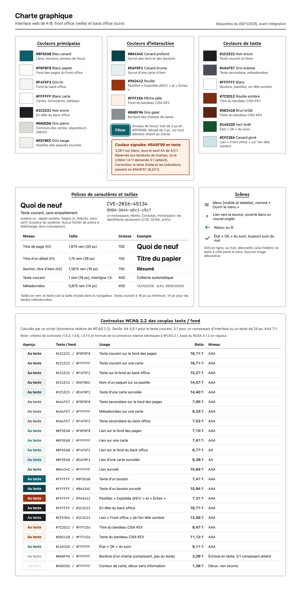
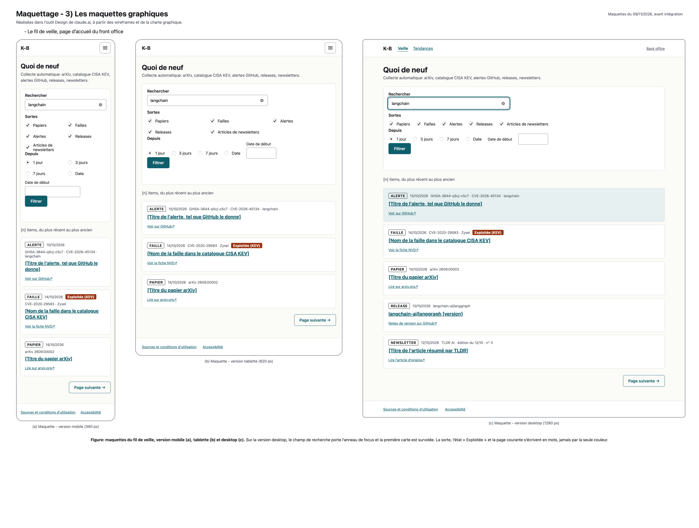
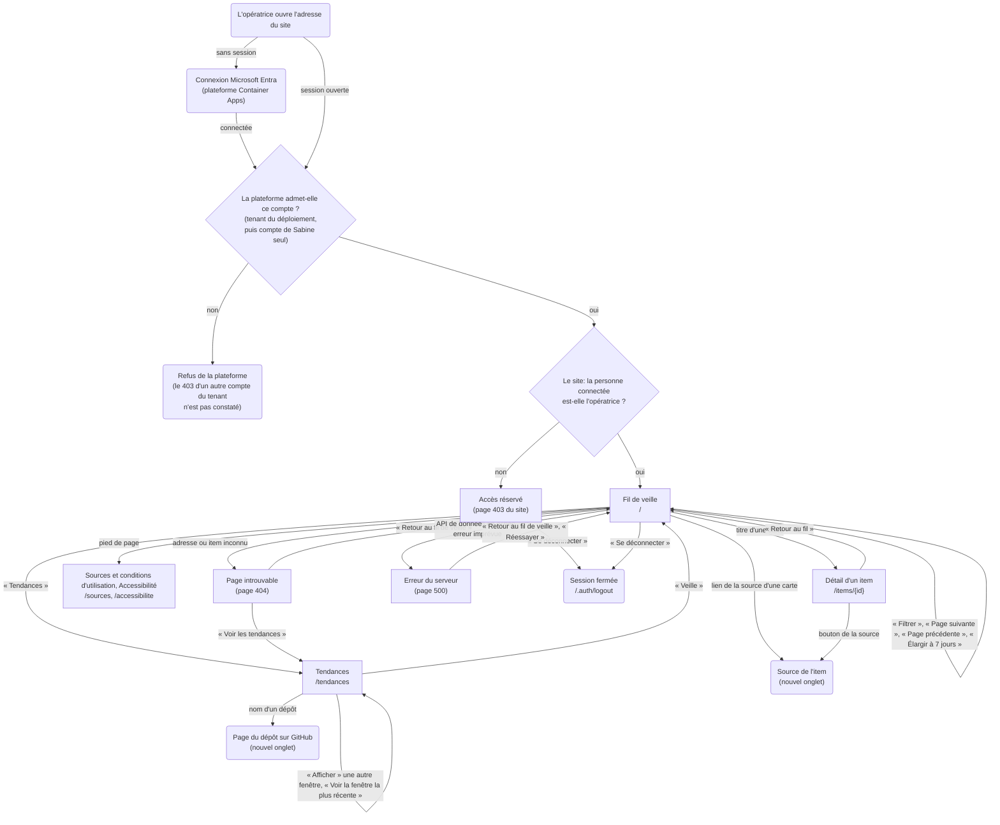

# Les maquettes du site et le parcours de l'opératrice

!!! note "Compétences de la certification"

    > La modélisation des parcours utilisateurs respecte un formalisme: schéma fonctionnel, wireframes, etc.

    — C14

    > Les interfaces sont intégrées et respectent les maquettes.

    — C17

Cette fiche montre deux planches des maquettes du site, validées par Sabine le 09/11/2026: la charte graphique et les
maquettes du fil de veille. Chacune vient en image, suivie de sa description textuelle, qui en donne tout le contenu.
Les descriptions sont tirées des fichiers source des planches, pas lues sur l'image: les textes, les codes de couleur et
les mesures sont ceux des maquettes. La fiche donne ensuite le parcours de l'opératrice sur le site, en schéma
fonctionnel, d'après le code de `main` au commit `ffc0942` (2026-11-14). Les chemins du code de K-B (`web/…`) partent
de `src/k_b/`, les autres de la racine du dépôt.

Les sigles de la fiche: CISA KEV, le catalogue des failles exploitées (Known Exploited Vulnerabilities)
de l'agence américaine de cybersécurité (Cybersecurity and Infrastructure Security Agency); CVE, le
catalogue public des failles et de leurs identifiants (Common Vulnerabilities and Exposures); GHSA, une
alerte de sécurité de GitHub (GitHub Security Advisory); NVD, la base nationale des failles des
États-Unis (National Vulnerability Database); WCAG, les règles pour l'accessibilité des contenus web
(Web Content Accessibility Guidelines); RGAA, le référentiel général d'amélioration de l'accessibilité,
le référentiel français.

Les maquettes ont été réalisées dans l'outil Design de claude.ai, à partir des wireframes et de la charte. Le site
intégré s'en écarte sur des points décidés, que `docs/site-web.md` et le journal des décisions
(`docs/ADR/journal-decisions-projet.md`, entrées « Site » du 11/11 au 14/11) écrivent avec leur raison. Par exemple,
la navigation reste visible à toutes les largeurs, sans le menu replié des maquettes mobile et tablette (D2 de #564),
et « Se déconnecter » est à la fin de l'en-tête (#587).

## La charte graphique

**Description de la planche.** En tête, « Charte graphique », puis « Interface web de K-B: front office (veille) et
back office (suivi) », et à droite « Maquettes du 09/11/2026, avant intégration ». La planche range la charte en six
encadrés: trois colonnes de couleurs, puis les polices et les icônes, puis les contrastes. Chaque couleur y est montrée
par un aplat, suivi de son code, de son nom et de son usage. Le titre de chaque encadré, souligné, est écrit dans une
police manuscrite, Shantell Sans: c'est la police des titres de la planche, pas une police du site.

### Couleurs principales

| Code | Nom | Usage |
|---|---|---|
| `#0F5E6B` | Bleu canard | Liens, boutons, anneau de focus |
| `#FBFBF8` | Blanc papier | Fond des pages du front office |
| `#F4F5F2` | Gris lin | Fond du back office |
| `#FFFFFF` | Blanc carte | Cartes, formulaires, tableaux |
| `#1C1E21` | Noir encre | En-tête du back office |
| `#DADCD6` | Gris pierre | Contours des cartes, séparateurs (décor) |
| `#EEF0EC` | Gris sauge | Pastilles des paquets touchés |

### Couleurs d'interaction

| Code | Nom | Usage |
|---|---|---|
| `#0A434C` | Canard profond | Survol des liens et des boutons |
| `#E6F0F1` | Canard brume | Survol d'une carte d'item |
| `#9A3412` | Rouille | Pastilles « Exploitée (KEV) » et « Échec » |
| `#FFF1E6` | Pêche pâle | Fond du bandeau CISA KEV |
| `#8A8F96` | Gris galet | Bordure des champs de saisie |

Sous ces couleurs, un bouton « Filtrer » porte l'anneau de focus, avec sa légende: « Anneau de focus: trait de 3 px
en #0F5E6B, décalé de 2 px, sur tout élément atteint au clavier ». Un encadré bordé de rouille, sur fond pêche pâle,
signale une couleur. Son titre, en gras et en rouille sombre (`#7C2D12`): « Couleur signalée: #8A8F96 en texte ». Son
texte, en 14 px et en brun brûlé (`#5B2410`): « 3,26:1 sur blanc, sous le seuil AA de 4,5:1. Réservée aux bordures de
champs, où le critère 1.4.11 demande 3:1 (atteint). Correction: le texte d'aide et les indications passent en #4A4F57
(8,24:1). »

### Couleurs de texte

| Code | Nom | Usage |
|---|---|---|
| `#1C1E21` | Noir encre | Texte courant et titres |
| `#4A4F57` | Gris ardoise | Texte secondaire, métadonnées |
| `#FFFFFF` | Blanc | Boutons, pastilles, en-tête sombre |
| `#7C2D12` | Rouille sombre | Titre du bandeau CISA KEV |
| `#5B2410` | Brun brûlé | Texte du bandeau CISA KEV |
| `#14532D` | Vert forêt | État « OK » du suivi |
| `#CFE3E6` | Canard givré | Lien « Front office » sur l'en-tête sombre |

### Polices de caractères et tailles

Deux polices, chacune montrée par ses exemples, puis nommée en 14 px et en gris ardoise:

- « Quoi de neuf » en 30 px gras, puis « Texte courant, sans empattement » en 16 px: system-ui, -apple-system, Segoe UI,
  Roboto, sans-serif, la police du système. « Aucun fichier de police à télécharger (éco-conception). »
- « CVE-2026-45134 » en 20 px et « GHSA-3644-q5cj-c5c7 » en 16 px, en chasse fixe: ui-monospace, Menlo, Consolas,
  monospace, « les identifiants seulement (CVE, GHSA, arXiv) ».

Le tableau suivant donne les cinq niveaux de texte, du titre de page aux métadonnées.

| Niveau | Taille | Graisse | Exemple |
|---|---|---|---|
| Titre de page (h1) | 1,875 rem (30 px) | 700 | Quoi de neuf |
| Titre d'un détail (h1) | 1,75 rem (28 px) | 700 | Titre du papier |
| Section, titre d'item (h2) | 1,1875 rem (19 px) | 700 | Résumé |
| Texte courant | 1 rem (16 px), interligne 1,5 | 400 | Collecte automatique |
| Métadonnées | 0,875 rem (14 px) | 400 | 14/10/2026 · arXiv 2609.00002 |

Sur la planche, chaque exemple de la colonne « Exemple » est écrit à sa taille et à sa graisse, celui des métadonnées
en gris ardoise.

Sous le tableau: « Tailles en rem: le texte suit la taille choisie dans le navigateur. Texte courant à 16 px au
minimum, 14 px pour les seules métadonnées. »

### Icônes

Quatre icônes au trait, chacune suivie de son sens:

- trois traits horizontaux, en noir encre: « Menu (mobile et tablette), nommé « Ouvrir le menu » »;
- une flèche oblique vers le haut et la droite, en bleu canard: « Lien vers la source, ouverte dans un nouvel onglet »;
- une flèche vers la gauche, en bleu canard: « Retour au fil »;
- une coche, en vert forêt: « État « OK » du suivi, toujours suivi du mot ».

Sous elles: « SVG en ligne, au trait, décoratifs (aria-hidden): le texte à côté porte le sens. Aucune image
décorative. »

### Contrastes WCAG 2.2 des couples texte / fond

« Calculés par un script (luminance relative de WCAG 2.2). Seuils: AA 4,5:1 pour le texte courant, 3:1 pour un
composant d'interface ou un texte de 24 px; AAA 7:1. » Puis, en 14 px: « Note: critères de contraste (1.4.3, 1.4.6,
1.4.11) et formule de la luminance relative identiques à WCAG 2.1, base du RGAA 4.1.2 en vigueur. » Sur la planche,
chaque ligne montre aussi un aperçu, « Aa texte » écrit dans le couple de couleurs. Le tableau suivant donne les 23
couples.

| Texte / fond | Usage | Ratio | Niveau |
|---|---|---|---|
| `#1C1E21` / `#FBFBF8` | Texte courant sur le fond des pages | 16,11:1 | AAA |
| `#1C1E21` / `#FFFFFF` | Texte courant sur une carte | 16,71:1 | AAA |
| `#1C1E21` / `#F4F5F2` | Texte sur le fond du back office | 15,27:1 | AAA |
| `#1C1E21` / `#EEF0EC` | Nom d'un paquet sur sa pastille | 14,57:1 | AAA |
| `#1C1E21` / `#E6F0F1` | Texte d'une carte survolée | 14,40:1 | AAA |
| `#4A4F57` / `#FBFBF8` | Texte secondaire sur le fond des pages | 7,95:1 | AAA |
| `#4A4F57` / `#FFFFFF` | Métadonnées sur une carte | 8,24:1 | AAA |
| `#4A4F57` / `#F4F5F2` | Texte secondaire du back office | 7,53:1 | AAA |
| `#0F5E6B` / `#FBFBF8` | Lien sur le fond des pages | 7,15:1 | AAA |
| `#0F5E6B` / `#FFFFFF` | Lien sur une carte | 7,41:1 | AAA |
| `#0F5E6B` / `#F4F5F2` | Lien sur le fond du back office | 6,77:1 | AA |
| `#0F5E6B` / `#E6F0F1` | Lien d'une carte survolée | 6,39:1 | AA |
| `#0A434C` / `#FFFFFF` | Lien survolé | 10,94:1 | AAA |
| `#FFFFFF` / `#0F5E6B` | Texte d'un bouton | 7,41:1 | AAA |
| `#FFFFFF` / `#0A434C` | Texte d'un bouton survolé | 10,94:1 | AAA |
| `#FFFFFF` / `#9A3412` | Pastilles « Exploitée (KEV) » et « Échec » | 7,31:1 | AAA |
| `#FFFFFF` / `#1C1E21` | En-tête du back office | 16,71:1 | AAA |
| `#CFE3E6` / `#1C1E21` | Lien « Front office » de l'en-tête sombre | 12,56:1 | AAA |
| `#7C2D12` / `#FFF1E6` | Titre du bandeau CISA KEV | 8,47:1 | AAA |
| `#5B2410` / `#FFF1E6` | Texte du bandeau CISA KEV | 11,13:1 | AAA |
| `#14532D` / `#FFFFFF` | État « OK » du suivi | 9,11:1 | AAA |
| `#8A8F96` / `#FFFFFF` | Bordure d'un champ (composant, pas du texte) | 3,26:1 | Échoue en texte; 3:1 composant atteint |
| `#DADCD6` / `#FFFFFF` | Contour de carte, décor sans information | 1,38:1 | Décor, non soumis |

Les couleurs du site suivent cette charte: `web/static/site.css` les déclare, et
`tests/web/test_stylesheet.py` recalcule les contrastes des couples qu'il utilise.

## Les maquettes du fil de veille

**Description de la planche.** En tête, « Maquettage - 3) Les maquettes graphiques », puis « Réalisées dans l'outil
Design de claude.ai, à partir des wireframes et de la charte graphique. » et « - Le fil de veille, page d'accueil du
front office »; à droite, « Maquettes du 09/11/2026, avant intégration ». Trois écrans du fil, côte à côte, chacun
dans un cadre gris et avec sa légende: « (a) Maquette - version mobile (390 px) », « (b) Maquette - version tablette
(820 px) » et « (c) Maquette - version desktop (1280 px) ».

### Ce que montrent les trois écrans

De haut en bas, sur le fond blanc papier:

1. **L'en-tête**, sur fond blanc. À gauche, « K-B », qui mène au fil. En mobile et en tablette, à droite, un bouton
   carré de 44 px à trois traits, nommé « Ouvrir le menu ». En desktop, pas de bouton de menu: juste après « K-B », les liens « Veille » et
   « Tendances », en bleu canard et soulignés, « Veille », la page courante, en gras et soulignée plus bas; à droite,
   « Back office », en 14 px, en gris ardoise et souligné.
2. **Le titre**, « Quoi de neuf » (26 px en mobile, 28 en tablette, 30 en desktop), et sous lui « Collecte
   automatique: arXiv, catalogue CISA KEV, alertes GitHub, releases, newsletters. »
3. **Le formulaire des filtres**, sur une carte blanche bordée:
    - « Rechercher », un champ de recherche qui contient « langchain », avec à son bout la petite icône ronde qui
      l'efface, dessinée par le navigateur. En desktop, il porte l'anneau de focus. Le code de la maquette le limite à
      200 caractères (`maxlength`), ce que l'image ne montre pas;
    - « Sortes », cinq cases toutes cochées: « Papiers », « Failles », « Alertes », « Releases », « Articles de
      newsletters »;
    - « Depuis », quatre boutons radio: « 1 jour » (choisi), « 3 jours », « 7 jours », « Date », puis le champ « Date de
      début », vide;
    - le bouton « Filtrer », en blanc sur bleu canard.
4. **La ligne des résultats**: « [n] items, du plus récent au plus ancien ».
5. **Les cartes des items**, sur fond blanc, bordées de gris pierre. Chaque carte commence par une ligne en 14 px: la
   sorte en capitales, encadrée d'un trait noir, la date, les identifiants, et pour la faille la pastille « Exploitée
   (KEV) », en blanc sur rouille. Viennent ensuite le titre de l'item, un lien, puis le lien vers la source, suivi
   d'une flèche « ↗ ».
6. **La pagination**: « Page suivante → », un bouton bordé de bleu canard, à droite.
7. **Le pied de page**: « Sources et conditions d'utilisation » et « Accessibilité ».

Les cartes de la maquette (les titres entre crochets sont des emplacements):

| Sorte | Date | Identifiants | Titre | Lien vers la source |
|---|---|---|---|---|
| Alerte | 15/10/2026 | GHSA-3644-q5cj-c5c7 · CVE-2026-45134 · langchain | [Titre de l'alerte, tel que GitHub le donne] | Voir sur GitHub |
| Faille, « Exploitée (KEV) » | 14/10/2026 | CVE-2020-29583 · Zyxel | [Nom de la faille dans le catalogue CISA KEV] | Voir la fiche NVD |
| Papier | 14/10/2026 | arXiv 2609.00002 | [Titre du papier arXiv] | Lire sur arxiv.org |
| Release | 13/10/2026 | langchain-ai/langgraph | langchain-ai/langgraph [version] | Notes de version sur GitHub |
| Newsletter | 12/10/2026 | TLDR AI · édition du 12/10 · n° 3 | [Titre de l'article résumé par TLDR] | Lire l'article d'origine |

### Ce qui change d'une largeur à l'autre

| Élément | Mobile (390 px) | Tablette (820 px) | Desktop (1280 px) |
|---|---|---|---|
| Navigation | « K-B » et le bouton du menu | « K-B » et le bouton du menu | « K-B », « Veille », « Tendances », « Back office » |
| Champ « Rechercher » | pleine largeur | 480 px au plus | 480 px au plus |
| Sortes | deux colonnes | trois colonnes | une ligne |
| Depuis | deux colonnes, « Date de début » dessous | une ligne, « Date de début » à droite | une ligne, avec « Date de début » |
| Libellé « Date de début » | au-dessus de son champ | au-dessus de son champ | à gauche de son champ |
| Titre d'une carte | 18 px | 19 px | 19 px |
| Ligne d'une carte | la pastille après la date, les identifiants sur leur propre ligne | les identifiants, puis la pastille, sur une ligne | comme la tablette |
| Cartes | les trois premières | les trois premières | les cinq; la première est survolée, sur fond canard brume (`#E6F0F1`) |
| Contenu | pleine largeur | pleine largeur | 1120 px au plus, centré |

Sous les trois écrans, la légende de la planche: « Figure: maquettes du fil de veille, version mobile (a), tablette (b)
et desktop (c). Sur la version desktop, le champ de recherche porte l'anneau de focus et la première carte est survolée.
La sorte, l'état « Exploitée » et la page courante s'écrivent en mots, jamais par la seule couleur. »

## Le parcours de l'opératrice

Le site est privé: seule l'opératrice, Sabine, y entre. La plateforme Azure Container Apps demande la connexion
Microsoft Entra, puis le site vérifie, à chaque requête, que la personne connectée est l'opératrice
(`web/operator_check.py`). Le schéma suit ses écrans et les liens qui les relient, d'après les routes de
`web/pages.py` et les gabarits de `web/templates/`. Un rectangle est un écran du site; un rectangle arrondi, le point
de départ, la plateforme ou un écran hors du site; un losange, une vérification. Chaque flèche porte, entre guillemets,
le libellé exact du lien ou du bouton (« Retour au fil »), ou, sans guillemets, l'action ou l'événement qui mène d'un
écran à l'autre (titre d'une carte). Le texte qui suit le schéma, « Description du schéma », le décrit en entier.

**Description du schéma.** L'opératrice ouvre l'adresse du site. Sans session, la plateforme l'envoie à la connexion
Microsoft Entra. La plateforme n'admet que les comptes du tenant du déploiement (`openIdIssuer`), et parmi eux le seul
compte de Sabine (`allowedPrincipals`, `infra/modules/api-container-app.bicep:216-226`): elle refuse tout autre compte.
Limite: le 403 que la plateforme rend à un autre compte du tenant n'est pas constaté, faute d'un second compte pour
l'essayer (`infra/README.md:1530-1531`). Parade: le site vérifie lui-même, à chaque requête, que la personne connectée
est l'opératrice (`web/operator_check.py`), le second verrou. Sinon, il répond la page « Accès réservé » (403), dont le
seul bouton, « Se déconnecter », ferme la session. Sur cette page, « K-B », « Veille » et les liens du pied repassent
par la même vérification, et rendent de nouveau la page 403. Si la personne est l'opératrice, elle arrive sur le fil
de veille.

Depuis le fil, « Filtrer », « Page suivante », « Page précédente » et « Élargir à 7 jours » (quand le fil est vide sur
1 ou 3 jours) rechargent le fil. Le titre d'une carte mène au détail de l'item, d'où « Retour au fil » ramène au fil.
Le lien de la source, sur une carte comme sur le détail, ouvre la source dans un nouvel onglet. « Tendances », dans
l'en-tête, mène aux tendances. « Afficher » y montre une autre fenêtre, et « Voir la fenêtre la plus récente », quand
la fenêtre demandée n'a pas de tendances, la plus récente. Le nom d'un dépôt ouvre sa page GitHub dans un nouvel
onglet; « Veille » ramène au fil. Le pied de chaque page mène aux sources et à l'accessibilité.

Une adresse ou un item inconnus donnent la page 404, qui propose « Retour au fil de veille » et « Voir les tendances ».
Un échec de l'API de données, ou toute erreur imprévue du site, donne la page 500. Elle propose « Retour au fil de
veille », et « Réessayer », qui recharge l'adresse qui a échoué. Si le gabarit de la page 500 échoue lui aussi, une
page de repli, sans en-tête, ne propose que « Retour au fil de veille ».

Sur chaque page sauf la 403, « Se déconnecter », à la fin de l'en-tête, ferme la session (`/.auth/logout`, servi par
la plateforme); la page 403 le porte en bouton, et la page de repli ne le porte pas. Quand le contrôle du site est
coupé (`KB_WEB_AUTH=off`, sur le Mac seulement), aucune page ne le porte. Pour la lisibilité, le schéma ne trace les
pages d'erreur, les pages « Sources » et « Accessibilité » et la déconnexion que depuis le fil: la page 500 n'y vient
que du fil, et « Réessayer » y ramène donc au fil. « K-B » et « Veille », sur chaque page, ramènent au fil.

Les écrans à venir ne sont pas dans ce schéma, qui ne montre que le site construit. Parmi eux, la planche
« Arborescence de l'application » du canevas du 09/11/2026 montre le back office prévu; les comptes rendus de veille,
le top 10 et le rapport de tendances n'ont pas encore de maquette.
