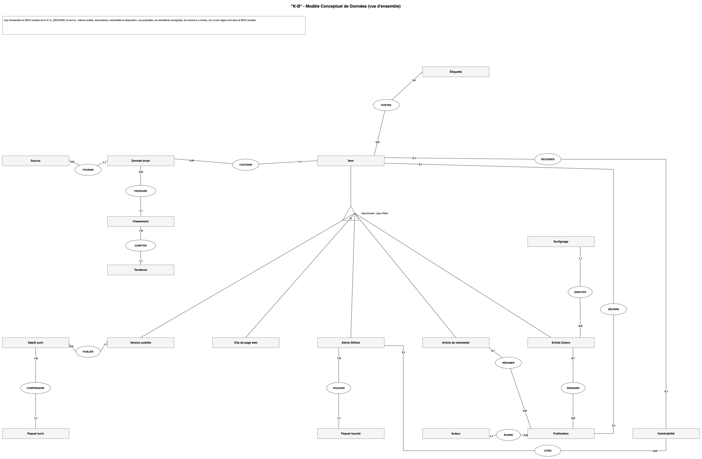
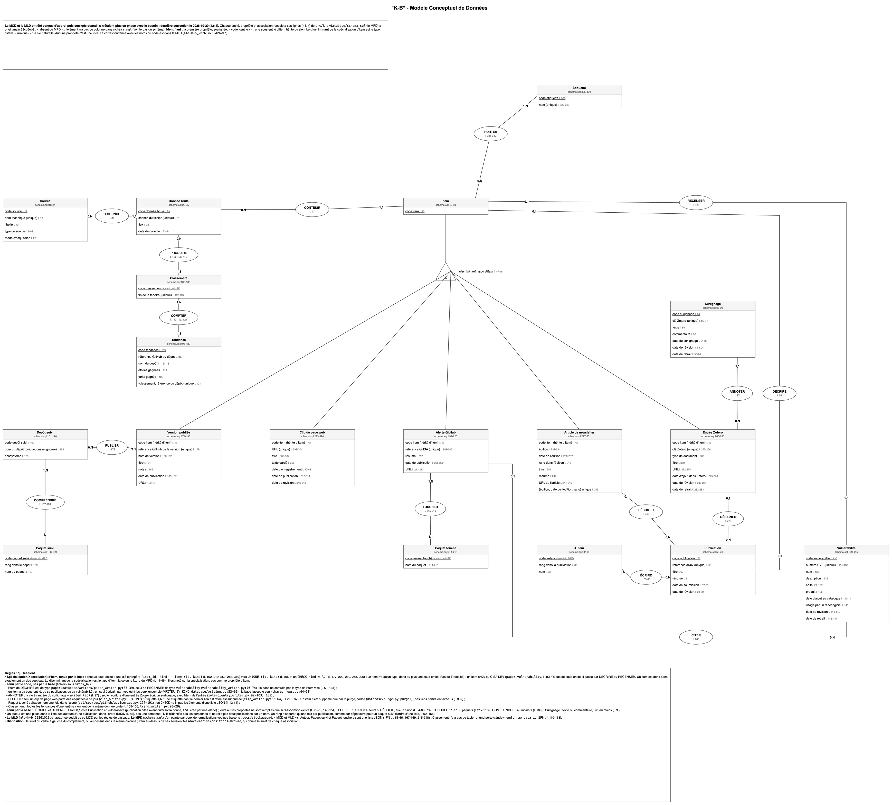
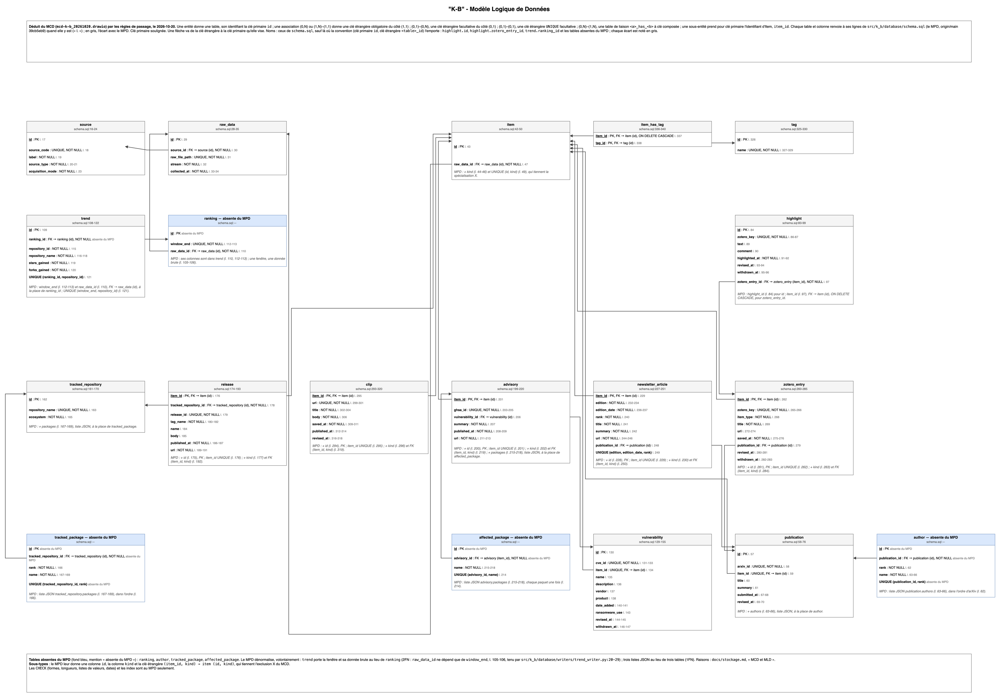

# Le modèle de données de K-B

!!! note "Compétences de la certification"

    > Les modélisations des données respectent la méthode et le formalisme Merise.

    — C4

Cette fiche dit comment le modèle de données de K-B suit la méthode Merise, du modèle conceptuel des données (MCD)
au modèle logique des données (MLD), puis aux deux modèles physiques des données (MPD), un par système de gestion de
base de données (SGBD). Elle décrit chaque schéma, entité par entité et relation par relation, et le rapproche des
deux scripts SQL de la base. Elle est écrite d'après le code de `main` au commit `39cb5eb9` (2026-11-22). Les chemins
du code de K-B (`database/…`, `core/…`) partent de `src/k_b/`, les autres de la racine du dépôt.

## La méthode

### Trois niveaux de modèle

Merise sépare trois niveaux, chacun déduit du précédent. Le tableau suivant donne, pour chaque niveau, ce qu'il décrit
et le fichier qui le porte dans K-B.

| Niveau | Ce qu'il décrit | Fichier |
|---|---|---|
| MCD | les entités, leurs propriétés et leurs identifiants, les associations et leurs cardinalités, sans rien qui dépende d'un SGBD | `docs/merise/mcd-k-b_20261020.drawio`, et sa vue d'ensemble, `docs/merise/mcd-k-b_20261020_vue-ensemble.drawio` |
| MLD | les relations (les tables), leurs colonnes, leurs clés primaires et étrangères, déduites du MCD par les règles de passage | `docs/merise/mld-k-b_20261020.drawio` |
| MPD | les tables d'un SGBD donné, leurs types, leurs contraintes et leurs index, en SQL | `database/schema.sql` pour SQLite, en local; `database/schema_postgresql.sql` pour PostgreSQL, en ligne |

Le MCD et le MLD sont dessinés avec draw.io depuis la décision du 2026-10-08, qui remplace des schémas Mermaid:
draw.io dessine la notation de Merise, qu'un `flowchart` Mermaid ne faisait qu'imiter
([le journal des décisions](https://github.com/SabineLaurent/K-B/blob/main/docs/ADR/journal-decisions-projet.md),
2026-10-08, « Schémas »). Le MPD est le script SQL: `database/schema.sql` est la référence, que
`database/schema_postgresql.sql` suit table par table (`database/schema_postgresql.sql:3-5`).

### Concevoir, puis corriger

Le MCD et le MLD ont été conçus d'abord, puis corrigés quand ils n'étaient plus en phase avec le besoin. Leur dernière
correction date du 2026-10-20 (#211), comme le dit le cartouche du MCD et
[la spécification de stockage](https://github.com/SabineLaurent/K-B/blob/main/docs/stockage.md), « MCD et MLD ». Le
dossier `docs/merise/` garde aussi la version du 2026-10-12 (`mcd-k-b_20261012.drawio`, `mld-k-b_20261012.drawio`):
elle portait déjà, marquées « prévu », des entités que le code n'avait pas encore, l'article de newsletter (#57) et la
tendance (#142, #143).

### Les fichiers des schémas

Le tableau suivant donne les fichiers de `docs/merise/` qui portent le modèle du 2026-10-20. Chaque fichier draw.io a
son image SVG (<span lang="en">Scalable Vector Graphics</span>), du même nom.

| Fichier | Ce qu'il contient |
|---|---|
| [`mcd-k-b_20261020.drawio`](https://github.com/SabineLaurent/K-B/blob/main/docs/merise/mcd-k-b_20261020.drawio) | le MCD complet: entités, propriétés, identifiants, associations, cardinalités, renvois à `database/schema.sql` et règles |
| [`mcd-k-b_20261020_vue-ensemble.drawio`](https://github.com/SabineLaurent/K-B/blob/main/docs/merise/mcd-k-b_20261020_vue-ensemble.drawio) | la vue d'ensemble du MCD: les mêmes entités, associations, cardinalités et disposition, sans les propriétés |
| [`mld-k-b_20261020.drawio`](https://github.com/SabineLaurent/K-B/blob/main/docs/merise/mld-k-b_20261020.drawio) | le MLD: les relations, leurs colonnes, leurs clés, et l'écart de chacune au MPD |
| [`positions-mcd.md`](https://github.com/SabineLaurent/K-B/blob/main/docs/merise/positions-mcd.md) | la règle de disposition du MCD, et la lecture de chaque association depuis son sujet et depuis son complément |

Chaque entité, propriété et association du MCD, et chaque relation et colonne du MLD, porte le renvoi « l. » à ses
lignes de `database/schema.sql` au commit `39cb5eb9`, que nomment leurs cartouches.

### Le formalisme

Le tableau suivant donne chaque élément de la notation Merise et la façon dont les schémas de K-B l'écrivent.

| Élément | Notation dans les schémas de K-B |
|---|---|
| Entité | un rectangle, titré de son nom, puis une propriété par ligne |
| Identifiant | la première propriété, soulignée, « code » suivi du nom de l'entité (« code source »); une sous-entité porte l'identifiant hérité d'Item |
| Clé naturelle | la mention « (unique) » après la propriété, ou après le groupe de propriétés qui la forme |
| Association | une ellipse nommée par un verbe à l'infinitif, en capitales (FOURNIR, CONTENIR); aucune association ne porte de propriété |
| Cardinalité | un couple minimum, maximum sur chaque patte (0,1 ou 1,1 ou 0,N ou 1,N), lu depuis l'entité voisine |
| Spécialisation | un triangle marqué X (exclusion), relié à l'entité générique et à ses sous-entités, avec son discriminant |
| Relation du MLD | un rectangle titré du nom de la table, une colonne par ligne |
| Clé primaire du MLD | soulignée, marquée PK (<span lang="en">primary key</span>) |
| Clé étrangère du MLD | marquée FK (<span lang="en">foreign key</span>), avec la table et la colonne visées, et une flèche de la clé étrangère à la clé primaire qu'elle vise |

Aucune propriété du MCD n'est une liste: une liste y devient une entité (Auteur, Paquet suivi, Paquet touché). La
disposition suit une règle écrite: le sujet de chaque verbe précède son complément dans le sens de lecture, et Item
précède ses sous-entités ([les positions du MCD](https://github.com/SabineLaurent/K-B/blob/main/docs/merise/positions-mcd.md)).

## Le MCD

### La vue d'ensemble

Le schéma suivant est la vue d'ensemble du MCD. La liste et le tableau qui le suivent le décrivent en texte, entité par
entité et association par association.



[Le MCD de K-B, vue d'ensemble, en taille réelle (image de 3 474 × 2 271 pixels)](images/mcd-k-b_20261020_vue-ensemble.png)

La vue d'ensemble montre les 18 entités par leur seul nom, les 15 associations, leurs cardinalités, et la
spécialisation d'Item. Les entités sont:

- **la provenance**: Source, Donnée brute;
- **l'item et ses cinq sous-entités**: Item, Version publiée, Clip de page web, Alerte GitHub, Article de newsletter,
    Entrée Zotero;
- **les deux références**, vers lesquelles pointent les items: Publication, Vulnérabilité;
- **ce qui précise une entité**: Surlignage, Étiquette, Auteur, Dépôt suivi, Paquet suivi, Paquet touché;
- **les classements de GH Archive**: Classement, Tendance.

Le tableau suivant donne chaque association, son sujet et son complément avec leur cardinalité, et sa lecture dans les
deux sens ([les positions du MCD](https://github.com/SabineLaurent/K-B/blob/main/docs/merise/positions-mcd.md)).

| Association | Sujet | Complément | Lecture |
|---|---|---|---|
| FOURNIR | Source (0,N) | Donnée brute (1,1) | une source fournit 0 à N données brutes; une donnée brute est fournie par une seule source |
| CONTENIR | Donnée brute (0,N) | Item (1,1) | une donnée brute contient 0 à N items; un item est contenu dans une seule donnée brute |
| PRODUIRE | Donnée brute (0,N) | Classement (1,1) | une donnée brute produit 0 à N classements; un classement est produit par une seule donnée brute |
| COMPTER | Classement (1,N) | Tendance (1,1) | un classement compte 1 à N tendances; une tendance est comptée dans un seul classement |
| DÉCRIRE | Item (0,1) | Publication (0,1) | un item décrit 0 ou 1 publication; une publication est décrite par 0 ou 1 item |
| RECENSER | Item (0,1) | Vulnérabilité (0,1) | un item recense 0 ou 1 vulnérabilité; une vulnérabilité est recensée par 0 ou 1 item |
| CITER | Alerte GitHub (0,1) | Vulnérabilité (0,N) | une alerte GitHub cite 0 ou 1 vulnérabilité; une vulnérabilité est citée par 0 à N alertes GitHub |
| RÉSUMER | Article de newsletter (0,1) | Publication (0,N) | un article de newsletter résume 0 ou 1 publication; une publication est résumée par 0 à N articles |
| DÉSIGNER | Entrée Zotero (0,1) | Publication (0,N) | une entrée Zotero désigne 0 ou 1 publication; une publication est désignée par 0 à N entrées Zotero |
| PUBLIER | Dépôt suivi (0,N) | Version publiée (1,1) | un dépôt suivi publie 0 à N versions; une version est publiée par un seul dépôt suivi |
| ANNOTER | Surlignage (1,1) | Entrée Zotero (0,N) | un surlignage annote une seule entrée Zotero; une entrée Zotero est annotée par 0 à N surlignages |
| PORTER | Item (0,N) | Étiquette (1,N) | un item porte 0 à N étiquettes; une étiquette est portée par 1 à N items |
| ÉCRIRE | Auteur (1,1) | Publication (0,N) | un auteur écrit une seule publication; une publication est écrite par 0 à N auteurs |
| COMPRENDRE | Dépôt suivi (1,N) | Paquet suivi (1,1) | un dépôt suivi comprend 1 à N paquets suivis; un paquet suivi est compris dans un seul dépôt suivi |
| TOUCHER | Alerte GitHub (1,N) | Paquet touché (1,1) | une alerte GitHub touche 1 à N paquets; un paquet touché l'est par une seule alerte GitHub |

La spécialisation relie Item, l'entité générique, à ses cinq sous-entités par un triangle marqué X, avec pour
discriminant le type d'item ([L'héritage de l'item et de ses sous-types](#lheritage-de-litem-et-de-ses-sous-types)).

### Les entités, leurs identifiants et leurs propriétés

Le schéma suivant est le MCD complet. Le tableau qui le suit en donne chaque entité, son identifiant et ses
propriétés. Ses associations et leurs cardinalités sont celles de [La vue d'ensemble](#la-vue-densemble); ses règles
sont décrites dans [L'héritage de l'item et de ses sous-types](#lheritage-de-litem-et-de-ses-sous-types) et
[Les règles que la base tient](#les-regles-que-la-base-tient).



[Le MCD complet de K-B en taille réelle (image de 3 474 × 3 131 pixels)](images/mcd-k-b_20261020.png)

Le tableau suivant donne les 18 entités du MCD, leur identifiant, leurs autres propriétés, et ce qui les porte dans le
MPD, avec ses lignes de `database/schema.sql`.

| Entité | Identifiant | Autres propriétés | Dans le MPD (lignes de `database/schema.sql`) |
|---|---|---|---|
| Source | code source | nom technique (unique), libellé, type de source, mode d'acquisition | la table `source`, 16-24 |
| Donnée brute | code donnée brute | chemin du fichier (unique), flux, date de collecte | la table `raw_data`, 28-35 |
| Item | code item | aucune: ce que dit un item est dans sa sous-entité ou dans sa référence; son type est le discriminant de la spécialisation | la table `item`, 42-50 |
| Version publiée | code item, hérité d'Item | référence GitHub de la version (unique), nom de version, titre, notes, date de publication, URL | la table `release`, 174-193 |
| Clip de page web | code item, hérité d'Item | URL (unique), titre, texte gardé, date d'enregistrement, date de publication, date de révision | la table `clip`, 293-320 |
| Alerte GitHub | code item, hérité d'Item | référence GHSA, pour <span lang="en">GitHub Security Advisory</span> (unique), résumé, date de publication, URL | la table `advisory`, 199-220 |
| Article de newsletter | code item, hérité d'Item | édition, date de l'édition, rang dans l'édition, titre, résumé, URL de l'article; l'édition, sa date et le rang sont uniques ensemble | la table `newsletter_article`, 227-251 |
| Entrée Zotero | code item, hérité d'Item | clé Zotero (unique), type de document, titre, URL, date d'ajout dans Zotero, date de révision, date de retrait | la table `zotero_entry`, 260-285 |
| Publication | code publication | référence arXiv (unique), titre, résumé, date de soumission, date de révision | la table `publication`, 56-76 |
| Vulnérabilité | code vulnérabilité | numéro CVE, pour <span lang="en">Common Vulnerabilities and Exposures</span>, l'identifiant public d'une vulnérabilité (unique), nom, description, éditeur, produit, date d'ajout au catalogue, usage par un rançongiciel, date de révision, date de retrait | la table `vulnerability`, 129-155 |
| Surlignage | code surlignage | clé Zotero (unique), texte, commentaire, date du surlignage, date de révision, date de retrait | la table `highlight`, 83-99 |
| Étiquette | code étiquette | nom (unique) | la table `tag`, 325-330 |
| Dépôt suivi | code dépôt suivi | nom du dépôt (unique, casse ignorée), écosystème | la table `tracked_repository`, 161-170 |
| Paquet suivi | code paquet suivi | rang dans le dépôt, nom du paquet | la liste JSON `tracked_repository.packages`, 166-169 |
| Paquet touché | code paquet touché | nom du paquet | la liste JSON `advisory.packages`, 214-218 |
| Auteur | code auteur | rang dans la publication, nom | la liste JSON `publication.authors`, 62-66 |
| Classement | code classement | fin de la fenêtre (unique) | les colonnes `raw_data_id` et `window_end` de `trend`, 110-113 |
| Tendance | code tendance | référence GitHub du dépôt, nom du dépôt, étoiles gagnées, <span lang="en">forks</span> gagnés; le classement et la référence du dépôt sont uniques ensemble | la table `trend`, 108-122 |

Les cinq sous-entités ne portent que leurs propriétés propres: leur identifiant est celui d'Item. Chaque association
porte, sous son nom, le renvoi aux lignes de `database/schema.sql` qui la tiennent: une clé étrangère, ou la colonne qui
remplace une entité absente du MPD. Les identifiants de Classement, Paquet suivi, Paquet touché et Auteur sont marqués
« absent du MPD »
([Ce que le MPD écrit autrement que le MLD](#ce-que-le-mpd-ecrit-autrement-que-le-mld)).

### L'héritage de l'item et de ses sous-types

Merise écrit l'héritage par une spécialisation. Dans le MCD de K-B, Item est l'entité générique; Version publiée, Clip
de page web, Alerte GitHub, Article de newsletter et Entrée Zotero sont ses sous-entités. Elles sont reliées à Item par
un triangle marqué X, et le cartouche du MCD en donne les règles:

- **l'exclusion (X)**: un item est au plus l'une des cinq sous-entités;
- **pas de totalité (T)**: un item peut n'être aucune d'elles. Un item d'arXiv ou de CISA KEV (le catalogue
    <span lang="en">Known Exploited Vulnerabilities</span> de la <span lang="en">Cybersecurity and Infrastructure
    Security Agency</span>) n'a pas de sous-entité: il est relié à sa référence par DÉCRIRE ou RECENSER. Un item est donc
    dans exactement un des sept cas, les sept valeurs de son type (`database/schema.sql:44-46`);
- **le discriminant** est le type d'item, noté sur la spécialisation et non comme propriété d'Item. C'est la colonne
    `kind` du MPD;
- **l'identifiant hérité**: chaque sous-entité porte « code item (hérité d'Item) ».

Le passage au MLD donne à chaque sous-type pour clé primaire l'identifiant d'Item, `item_id`, qui est aussi sa clé
étrangère vers `item` ([Les règles de passage](#les-regles-de-passage)). Le MPD tient l'exclusion par trois
contraintes:

1. `item` porte `kind`, limité aux sept types, et la contrainte `UNIQUE (id, kind)` (`database/schema.sql:44-46`,
    `:49`);
2. chaque sous-type porte `kind`, `NOT NULL`, fixé à sa sorte par un `CHECK` (`:177`, `:202`, `:230`, `:263`, `:296`),
    et `item_id`, `NOT NULL UNIQUE` (`:176`, `:201`, `:229`, `:262`, `:295`);
3. chaque sous-type vise `item` par la clé étrangère composée `(item_id, kind)` (`:192`, `:219`, `:250`, `:284`,
    `:319`).

Un item a donc un seul type, et au plus une ligne de sous-type, celle de son type. Un sous-type qui viserait un item
d'une autre sorte, ou qui porterait une autre sorte que la sienne, ou aucune, est refusé: neuf tests de
`tests/test_schema.py` le prouvent, dont `test_a_release_pointing_to_an_item_of_another_kind_is_refused`.

### Les règles que la base tient

Le cartouche du MCD écrit les règles que la base tient en plus des cardinalités:

- **DÉCRIRE et RECENSER sont 0,1 du côté de Publication et de Vulnérabilité**: une publication existe dès qu'une source
    la cite, avant qu'arXiv la donne, et un numéro CVE dès qu'une alerte GitHub le cite. Leurs autres propriétés ne sont
    remplies que si l'association existe (`database/schema.sql:71-75`, `:148-154`);
- **ÉCRIRE**: une publication décrite par un item d'arXiv a de 1 à 1 000 auteurs, une autre n'en a aucun (`:63-66`,
    `:73`);
- **TOUCHER**: une alerte GitHub touche de 1 à 100 paquets (`:215-218`);
- **COMPRENDRE**: un dépôt suivi comprend un paquet au moins (`:167-169`);
- **Surlignage**: un surlignage a un texte ou un commentaire, l'un au moins (`:98`).

Un auteur est une place dans la liste des auteurs d'une publication, dans l'ordre d'arXiv, pas une personne: K-B
n'identifie pas les personnes et ne relie pas deux publications par un nom (`database/schema.sql:62`). Un rang
n'apparaît qu'une fois par publication, comme un rang de paquet suivi par dépôt suivi: c'est l'ordre d'une liste.

## Le MLD

### Les règles de passage

Le MLD est déduit du MCD par les règles de passage, que son cartouche écrit:

1. une entité donne une relation, et son identifiant la clé primaire `id`;
2. une association (0,N) ou (1,N) d'un côté et (1,1) de l'autre donne une clé étrangère obligatoire du côté (1,1):
    `raw_data.source_id` pour FOURNIR;
3. une association (0,1) d'un côté et (0,N) de l'autre donne une clé étrangère facultative du côté (0,1):
    `advisory.vulnerability_id` pour CITER;
4. une association (0,1) des deux côtés donne une clé étrangère facultative et unique: `publication.item_id` pour
    DÉCRIRE, `vulnerability.item_id` pour RECENSER;
5. une association (0,N) d'un côté et (1,N) de l'autre donne une relation de liaison à clé composée, nommée
    `<a>_has_<b>`: PORTER, entre Item et Étiquette, devient `item_has_tag`, de clé (`item_id`, `tag_id`);
6. une sous-entité prend pour clé primaire l'identifiant d'Item, `item_id`, qui est aussi sa clé étrangère vers
    `item`.

Les noms des colonnes sont ceux de `database/schema.sql`, sauf là où la convention du MLD l'emporte (clé primaire
`id`, clé étrangère `<table>_id`): `highlight.id`, `highlight.zotero_entry_id`, `trend.ranking_id`, et les colonnes des
relations absentes du MPD. Les clés naturelles du MCD deviennent des contraintes `UNIQUE`, comme
`source.source_code`, `raw_data.raw_file_path` ou le triplet (`edition`, `edition_date`, `rank`) de
`newsletter_article`. Les `CHECK` et les index ne sont écrits qu'au MPD.

### Les relations

Le schéma suivant est le MLD. Le tableau qui le suit en donne chaque relation, sa clé primaire et ses clés étrangères.



[Le MLD de K-B en taille réelle (image de 3 384 × 2 357 pixels)](images/mld-k-b_20261020.png)

Le MLD compte 19 relations et 21 clés étrangères. Quinze relations sont des tables du MPD. Quatre, `ranking`,
`author`, `tracked_package` et `affected_package`, sont marquées « absente du MPD »: le MPD les écrit autrement, par une
décision du 2026-10-20
([Ce que le MPD écrit autrement que le MLD](#ce-que-le-mpd-ecrit-autrement-que-le-mld)). Chaque écart d'une relation
au MPD est écrit dans la relation, sur une ligne qui commence par « MPD ».

Le tableau suivant donne chaque relation du MLD, sa clé primaire, ses clés étrangères avec l'association qu'elles
traduisent, et ce qui la porte dans le MPD, avec ses lignes de `database/schema.sql`.

| Relation | Clé primaire | Clés étrangères | Dans le MPD (lignes de `database/schema.sql`) |
|---|---|---|---|
| `source` | `id` | aucune | la table `source`, 16-24 |
| `raw_data` | `id` | `source_id` → `source`, obligatoire (FOURNIR) | la table `raw_data`, 28-35 |
| `item` | `id` | `raw_data_id` → `raw_data`, obligatoire (CONTENIR) | la table `item`, 42-50, avec `kind` et `UNIQUE (id, kind)` |
| `release` | `item_id` | `item_id` → `item` (spécialisation); `tracked_repository_id` → `tracked_repository`, obligatoire (PUBLIER) | la table `release`, 174-193 |
| `clip` | `item_id` | `item_id` → `item` (spécialisation) | la table `clip`, 293-320 |
| `advisory` | `item_id` | `item_id` → `item` (spécialisation); `vulnerability_id` → `vulnerability`, facultative (CITER) | la table `advisory`, 199-220 |
| `newsletter_article` | `item_id` | `item_id` → `item` (spécialisation); `publication_id` → `publication`, facultative (RÉSUMER) | la table `newsletter_article`, 227-251 |
| `zotero_entry` | `item_id` | `item_id` → `item` (spécialisation); `publication_id` → `publication`, facultative (DÉSIGNER) | la table `zotero_entry`, 260-285 |
| `publication` | `id` | `item_id` → `item`, facultative et unique (DÉCRIRE) | la table `publication`, 56-76 |
| `vulnerability` | `id` | `item_id` → `item`, facultative et unique (RECENSER) | la table `vulnerability`, 129-155 |
| `highlight` | `id` | `zotero_entry_id` → `zotero_entry` (`item_id`), obligatoire (ANNOTER) | la table `highlight`, 83-99 |
| `tag` | `id` | aucune | la table `tag`, 325-330 |
| `item_has_tag` | (`item_id`, `tag_id`) | `item_id` → `item`; `tag_id` → `tag` (PORTER) | la table `item_has_tag`, 336-340 |
| `tracked_repository` | `id` | aucune | la table `tracked_repository`, 161-170 |
| `tracked_package` | `id` | `tracked_repository_id` → `tracked_repository`, obligatoire (COMPRENDRE) | absente: la liste JSON `tracked_repository.packages`, 166-169 |
| `affected_package` | `id` | `advisory_id` → `advisory` (`item_id`), obligatoire (TOUCHER) | absente: la liste JSON `advisory.packages`, 214-218 |
| `author` | `id` | `publication_id` → `publication`, obligatoire (ÉCRIRE) | absente: la liste JSON `publication.authors`, 62-66 |
| `ranking` | `id` | `raw_data_id` → `raw_data`, obligatoire (PRODUIRE) | absente: les colonnes `raw_data_id` et `window_end` de `trend`, 110-113 |
| `trend` | `id` | `ranking_id` → `ranking`, obligatoire (COMPTER) | la table `trend`, 108-122 |

## Du MLD aux deux MPD

### Deux scripts pour un modèle

- `database/schema.sql` crée les tables pour SQLite, la base en local. Il est la référence:
    `database/schema_postgresql.sql`, pour PostgreSQL 17 ou plus récent, la base en ligne, le suit table par table,
    colonne par colonne, chaque `CHECK` traduit (`database/schema_postgresql.sql:1-5`).
- `database/seed_sources.sql` écrit ensuite les sept sources, données de référence. Il se rejoue sans risque: une source
    déjà là est laissée telle quelle (`database/seed_sources.sql:1-12`).
- `kb create-db` les exécute dans cet ordre. En SQLite, `schema.sql` puis `seed_sources.sql`
    (`database/creation.py:47-62`); en PostgreSQL, `schema_postgresql.sql` puis `seed_sources.sql`, dans une seule
    transaction (`database/creation.py:72-83`, `:119-124`). En ligne, `kb migrate-database` y ajoute les droits des
    rôles, `database/grants_postgresql.sql` (`database/creation.py:86-109`).

Les deux scripts créent les mêmes 15 tables, dans le même ordre, avec 17 clés étrangères chacun, dont les cinq clés
composées `(item_id, kind)` des sous-types.

### Ce que le MPD écrit autrement que le MLD

Le MPD s'écarte du MLD par deux dénormalisations voulues, décidées le 2026-10-20, et par la forme de deux contraintes
([la spécification de stockage](https://github.com/SabineLaurent/K-B/blob/main/docs/stockage.md), « MCD et MLD »,
`docs/stockage.md:340-364`). Chaque écart est écrit dans le MLD, sur la relation qu'il touche.

1. **Le classement dans `trend`**, hors de la deuxième forme normale (2FN). Au MLD, `ranking` garde une fenêtre et la
    donnée brute qui l'a apportée, et `trend` une ligne par dépôt de la fenêtre. Au MPD, `trend` porte seule
    `window_end` et `raw_data_id` (`database/schema.sql:110-113`): `raw_data_id` ne dépend que de `window_end`, une
    partie de la clé naturelle (`window_end`, `repository_id`) (`:121`). Un classement n'a pas d'autre attribut que sa
    donnée brute. La règle « une fenêtre, une donnée brute » (`:103-106`) est tenue par l'écriture: une ligne n'est
    écrite que si aucune autre donnée brute n'a apporté sa fenêtre (`database/writers/trend_writer.py:20-32`).
2. **Trois listes JSON**, hors de la première forme normale (1FN). Au MLD, `author`, `tracked_package` et
    `affected_package` ont une ligne par élément. Au MPD, ce sont trois colonnes de texte, `publication.authors`,
    `tracked_repository.packages` et `advisory.packages` (`database/schema.sql:63-66`, `:167-169`, `:215-218`). Une
    liste n'est jamais cherchée ni filtrée en base: elle s'écrit entière, avec sa ligne. Les paquets suivis sont une
    copie de la liste du code, `GITHUB_TRACKED_REPOSITORIES` (`core/config.py:58`), réécrite entière à chaque import
    (`database/writers/release_writer.py:24-30`). Un `CHECK` tient la forme de chaque liste, un tableau JSON non vide,
    et le nombre maximal des auteurs et des paquets touchés, 1 000 et 100. Les auteurs et les paquets touchés en liste
    viennent des décisions du 2026-10-07 et du 2026-10-08
    ([le journal des décisions](https://github.com/SabineLaurent/K-B/blob/main/docs/ADR/journal-decisions-projet.md),
    « Modèle de la base »).
3. **Les sous-types.** Au MPD, chacun a sa propre clé primaire `id`, garde `item_id` comme colonne unique, et ajoute
    `kind` et la clé étrangère composée `(item_id, kind)` vers `item (id, kind)`: elles tiennent l'exclusion X
    ([L'héritage de l'item et de ses sous-types](#lheritage-de-litem-et-de-ses-sous-types)).
4. **Le surlignage.** Au MPD, sa clé primaire s'appelle `highlight_id`, et sa clé étrangère, `item_id`, vise
    `item (id)` (`database/schema.sql:84`, `:97`). Au MLD, elles s'appellent `id` et `zotero_entry_id`, et la clé
    étrangère vise `zotero_entry (item_id)`.

Les surlignages d'un item et ses liens à ses étiquettes partent avec lui: `highlight.item_id` et `item_has_tag.item_id` portent
`ON DELETE CASCADE` (`database/schema.sql:97`, `:337`), et le MLD le marque sur les deux.

### Les types

Le tableau suivant donne le type de chaque sorte de donnée dans les deux scripts.

| Donnée | SQLite (`database/schema.sql`) | PostgreSQL (`database/schema_postgresql.sql`) |
|---|---|---|
| identifiant technique | `INTEGER PRIMARY KEY` (`:17`) | `bigint GENERATED BY DEFAULT AS IDENTITY PRIMARY KEY` (`:41`), qui accepte comme SQLite un `id` donné |
| entier | `INTEGER` | `bigint` |
| texte | `TEXT` | `text` |
| date | `TEXT`, avec un `CHECK` qui compare la valeur à `strftime('%Y-%m-%dT%H:%M:%SZ', …)` (`:33-34`) | le domaine `utc_date` (`:31-33`); pour `trend.window_end`, le domaine `utc_day`, à minuit UTC (`:36-38`) |
| date d'un clip | `TEXT`, avec un `CHECK` de sa longueur et de la place du `T` et du `Z` (`:309-318`) | le même `CHECK` (`:250-258`) |
| liste JSON | `TEXT`, avec `json_valid`, `json_type` et `json_array_length` (`:63-66`) | `text`, avec `IS JSON ARRAY`, puis `json_array_length` dans un `CASE` (`:77-80`) |
| nom d'un dépôt suivi | `TEXT COLLATE NOCASE`, unique sans tenir compte de la casse (`:163`) | `citext`, dans une base en collation C (`:145`) |
| typage | `STRICT` sur chacune des 15 tables | strict par défaut |

Le domaine `utc_date` tient la forme `AAAA-MM-JJTHH:MM:SSZ`, l'heure de 00 à 23 et un jour qui existe
(`database/schema_postgresql.sql:27-33`). Les dates et les listes restent du texte en PostgreSQL: psycopg rendrait des
dates et des listes Python, et une ligne lue sur PostgreSQL différerait de la même ligne lue sur SQLite. Le SQL de K-B
compare les dates en texte, ce qui reste juste pour des dates UTC d'une seule forme
([la spécification de stockage](https://github.com/SabineLaurent/K-B/blob/main/docs/stockage.md), « Ce qui est propre
à SQLite »).

### Les contraintes

Les deux scripts portent les mêmes contraintes, chaque `CHECK` traduit d'un moteur à l'autre:

- **les clés**: une clé primaire par table; la clé naturelle de chaque chose en `UNIQUE` (`source_code`,
    `raw_file_path`, `arxiv_id`, `cve_id`, `release_id`, `ghsa_id`, `zotero_key`, l'URL d'un clip, le nom d'un dépôt
    suivi, le nom d'une étiquette, le triplet d'un article, le couple d'une tendance); 17 clés étrangères;
- **les listes fermées**: `source_type`, `acquisition_mode`, `kind`, `ransomware_use`, `ecosystem`
    (`database/schema.sql:21`, `:23`, `:45-46`, `:143`, `:165`);
- **les formes**: un numéro CVE, une référence GHSA, un nom de dépôt `propriétaire/nom`, une URL en `https://` (ou en
    `http://` pour une entrée Zotero et un clip), une clé Zotero de 8 caractères `0-9A-Z`, une édition en lettres
    minuscules. SQLite les écrit par `GLOB`, PostgreSQL par une expression régulière `~`, ancrée par `^`
    (`database/schema.sql:132`, `database/schema_postgresql.sql:122`);
- **les dates**: la forme `AAAA-MM-JJTHH:MM:SSZ`, en UTC, et un jour qui existe;
- **les longueurs maximales**: un `CHECK (length(colonne) <= n)` par texte qu'une source écrit. La même valeur est tenue
    par l'item à la lecture du brut (`MAX_LENGTH_BY_KIND`, `items.py`), et un test garde les deux égales
    (`test_each_maximum_length_of_the_items_is_the_check_of_its_column`);
- **les références**: les colonnes que donne la source qui fait foi (arXiv, CISA KEV) sont remplies si et seulement si
    `item_id` l'est (`database/schema.sql:71-75`, `:148-154`);
- **les valeurs**: un surlignage a un texte ou un commentaire (`:98`); dans `trend`, `window_end` à minuit UTC,
    `repository_id` positif, des étoiles et des <span lang="en">forks</span> gagnés positifs ou nuls (`:113`, `:115`, `:119-120`); le rang d'un
    article part de 1 (`:240`).

Chaque `CHECK` de `database/schema.sql` a sa valeur refusée dans `tests/test_schema.py`: un `CHECK` ajouté sans elle
fait échouer la suite (`test_each_check_of_the_schema_has_its_refused_value`).

### Les index

Les deux scripts créent les mêmes neuf index, sur les clés étrangères que SQLite n'indexe pas d'office:
`raw_data.source_id`, `item.raw_data_id`, `highlight.item_id`, `trend.raw_data_id`, `release.tracked_repository_id`,
`advisory.vulnerability_id`, `newsletter_article.publication_id`, `zotero_entry.publication_id` et
`item_has_tag.tag_id` (`database/schema.sql:37`, `:52`, `:101`, `:124`, `:195`, `:222`, `:253`, `:287`, `:342`).
`item_has_tag.item_id` est en tête de sa clé primaire, et chaque contrainte `UNIQUE` crée son propre index.

PostgreSQL tient l'unicité de l'URL d'un clip par un index unique sur `md5(url)`, à la place de la contrainte `UNIQUE`
de SQLite (`database/schema_postgresql.sql:262`): une entrée d'index <span lang="en">B-tree</span> tient environ
2 700 octets, et une URL de 2 000 caractères peut en faire 8 000 en UTF-8 (`:236-238`).

### La comparaison des deux structures

`tests/test_schema_structures.py` crée les tables dans une base PostgreSQL par la fonction de `kb create-db`
(`create_database`), lit la structure de chaque table dans le catalogue de PostgreSQL et dans les `PRAGMA` de SQLite,
puis compare, table par table: les colonnes dans le même ordre, leurs `NOT NULL`, la clé primaire, les contraintes
`UNIQUE`, les clés étrangères avec leur `ON DELETE`, et les index (`tests/test_schema_structures.py:1-3`, `:157-167`).
La seule différence voulue est écrite dans `WANTED_DIFFERENCES`: l'unicité de l'URL d'un clip, sur `url` en SQLite et
sur `md5(url)` en PostgreSQL (`:16-18`). Le test vérifie qu'elle est là avant de la mettre à part (`:147-154`).

Le test est marqué `postgresql`. `uv run pytest` l'écarte (`tests/conftest.py:57`, `:125-137`); il tourne avec un
serveur PostgreSQL, par `KB_TEST_POSTGRESQL_URL=<URL d'un serveur> uv run pytest -m postgresql`. Dans l'intégration
continue (CI), le job `tests-postgresql` le lance sur PostgreSQL 18.6, avec les autres tests marqués `postgresql`
(`.github/workflows/ci.yml:66-93`), dont ceux de `tests/test_schema_postgresql.py`: les lignes valides de
`tests/test_schema.py` y sont acceptées, chacune de ses valeurs refusées y est refusée, et chaque longueur maximale y est
le `CHECK` de sa colonne. Côté SQLite, `tests/test_schema.py` et `tests/test_database.py` tournent à chaque
`uv run pytest`, et une connexion y vérifie les clés étrangères (`test_a_connection_checks_the_foreign_keys`).

### L'installation de la base

L'installation des deux SGBD, et la création de la base par `kb create-db` puis, en ligne, par
`kb migrate-database`, sont décrites dans
[L'agrégation, l'import et la base](import_et_base_pour_docu.md#installer-le-systeme-de-gestion-de-base-de-donnees),
section « Installer le système de gestion de base de données ».

## Vérifier cette fiche

Depuis la racine du dépôt:

```bash
# Le MCD: 18 entités, 15 associations, une spécialisation; sa vue d'ensemble: 18 entités, 15 associations.
# Attendu: 18, 15, 1, puis 18, 15.
grep -o 'style="swimlane' docs/merise/mcd-k-b_20261020.drawio | wc -l
grep -o 'style="ellipse' docs/merise/mcd-k-b_20261020.drawio | wc -l
grep -o 'style="triangle' docs/merise/mcd-k-b_20261020.drawio | wc -l
grep -o 'style="rounded=0' docs/merise/mcd-k-b_20261020_vue-ensemble.drawio | wc -l
grep -o 'style="ellipse' docs/merise/mcd-k-b_20261020_vue-ensemble.drawio | wc -l
# Le MLD: 19 relations, 21 clés étrangères, 4 relations absentes du MPD.
# Attendu: 19, 21, puis ranking, tracked_package, affected_package et author.
grep -o 'style="swimlane' docs/merise/mld-k-b_20261020.drawio | wc -l
grep -o 'edge="1"' docs/merise/mld-k-b_20261020.drawio | wc -l
grep -oE '[a-z_]+ — absente du MPD' docs/merise/mld-k-b_20261020.drawio
# Les renvois des deux schémas visent schema.sql au commit 39cb5eb9. Attendu: 1 pour chaque fichier.
grep -c "origin/main 39cb5eb9" docs/merise/mcd-k-b_20261020.drawio docs/merise/mld-k-b_20261020.drawio
# Les deux MPD ont les mêmes 15 tables, dans le même ordre. Attendu: 15 et 15, puis aucune ligne de diff.
grep -c "^CREATE TABLE" src/k_b/database/schema.sql src/k_b/database/schema_postgresql.sql
diff <(grep -oE "^CREATE TABLE [a-z_]+" src/k_b/database/schema.sql) <(grep -oE "^CREATE TABLE [a-z_]+" src/k_b/database/schema_postgresql.sql)
# 17 clés étrangères par script, dont les 5 clés composées des sous-types. Attendu: 17 et 17, puis 5 et 5.
grep -c "REFERENCES" src/k_b/database/schema.sql src/k_b/database/schema_postgresql.sql
grep -c "FOREIGN KEY (item_id, kind) REFERENCES item (id, kind)" src/k_b/database/schema.sql src/k_b/database/schema_postgresql.sql
# 9 index par script, plus l'index unique de md5(url) en PostgreSQL. Attendu: 9 et 9, puis la ligne 262.
grep -c "^CREATE INDEX" src/k_b/database/schema.sql src/k_b/database/schema_postgresql.sql
grep -n "^CREATE UNIQUE INDEX" src/k_b/database/schema.sql src/k_b/database/schema_postgresql.sql
# STRICT sur les 15 tables SQLite, aucun en PostgreSQL, puis les deux domaines de date.
# Attendu: 15, 0, puis les lignes 31 et 36.
grep -c ") STRICT;" src/k_b/database/schema.sql
grep -c "STRICT" src/k_b/database/schema_postgresql.sql
grep -n "^CREATE DOMAIN" src/k_b/database/schema_postgresql.sql
# Les tests du schéma SQLite (CHECK, longueurs, sous-types, clés étrangères). Attendu: 231 passed.
uv run pytest tests/test_schema.py tests/test_database.py -q
# L'exclusion des sous-types. Attendu: 9 passed, 218 deselected.
uv run pytest tests/test_schema.py -q -k "another_kind or kind_is_not or without_kind"
# La comparaison des structures et le schéma PostgreSQL, marqués postgresql.
# Attendu: 1 test collected, puis 114 tests collected.
uv run pytest tests/test_schema_structures.py --collect-only -q -m postgresql
uv run pytest tests/test_schema_postgresql.py --collect-only -q -m postgresql
# La seule différence voulue entre les deux structures. Attendu: la clé ("clip", "unique").
grep -n -A2 "^WANTED_DIFFERENCES" tests/test_schema_structures.py
```

Un `fichier:ligne` se relit sans changer de commit: `git show 39cb5eb9:<chemin> | sed -n '<début>,<fin>p'`, avec
`src/k_b/` devant un chemin du code de K-B.
