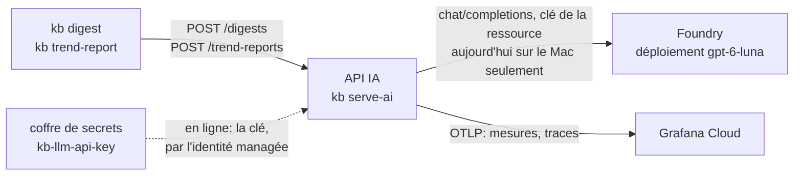

# Le service d'IA de K-B: le déploiement du modèle gpt-6-luna

« Rédaction de la documentation. » — C8

Cette fiche documente le service d'IA de K-B: le déploiement du modèle `gpt-6-luna` dans Microsoft Foundry
(anciennement Azure AI Foundry), fait à la main dans le portail, hors du code de K-B. Elle dit qui y accède,
comment il s'installe et se teste, de quoi il dépend, et quelles données il reçoit. L'API IA, qui l'appelle, a sa
propre fiche, [la fiche de l'API IA](api_ia_pour_docu.md). Le code cité est celui de `main` au commit `cad8328`
(2026-11-10). Ce qui est hors du code a été lu avec `az`, en lecture seule, le 2026-11-09 entre 23:41 et 23:55 UTC,
puis essayé par deux appels le 2026-11-10 vers 00:03 UTC (« Relire l'état », « Le test »). Les chemins du code de
K-B (`ai_api/…`, `core/…`) partent de `src/k_b/`, les autres de la racine du dépôt.

## Ce qu'est le service

Le service est une ressource Foundry, en France Central (`francecentral`), dans un groupe de ressources de
l'abonnement. La fiche ne les nomme pas: les commandes les notent `<ressource Foundry>` et `<groupe de ressources>`
(« Relire l'état »). C'est le seul compte Cognitive Services du groupe, la famille de ressources Azure dont fait
partie une ressource Foundry (`az cognitiveservices account list`, lu le 2026-11-09 à 23:54 UTC). Elle est sur
l'abonnement Azure de l'organisme de formation de l'opératrice, qui la lui fournit pour son projet de certification:
le client de Microsoft est l'organisme ([registre des traitements](../docs/registre-traitements.md), « Fondement de
la sous-traitance »).

La ressource porte deux déploiements (`az cognitiveservices account deployment list`, lu le 2026-11-09 à 23:41 et
23:42 UTC):

| Déploiement | Version | Type | Capacité | Mise à jour de la version | Filtre de contenu | Appelé par K-B |
|---|---|---|---|---|---|---|
| `gpt-6-luna` | 2026-09-22 | `DataZoneStandard` | 140 | `NoAutoUpgrade`: version figée | `Microsoft.DefaultV2` | oui, par l'API IA |
| `DeepSeek-V4-Flash` | 2026-04-23 | `DataZoneStandard` | 20 | `OnceNewDefaultVersionAvailable`: la version suit celle que Microsoft met par défaut | `Microsoft.DefaultV2` | non |

- **La capacité** se lit dans les en-têtes des réponses: pour `gpt-6-luna`, 140 000 jetons et 140 requêtes par
  minute (`x-ratelimit-limit-tokens`, `x-ratelimit-limit-requests`); pour `DeepSeek-V4-Flash`, 20 000 jetons et
  20 requêtes par minute (essai du 2026-10-17,
  [note du branchement](../docs/journaling/2026-10-17-brancher-gpt-6-luna-sur-foundry.md), « Preuve »).
- **`DeepSeek-V4-Flash`** a été essayé comme candidat juge le 2026-10-17, pour le seul mode strict, sur des données
  fabriquées (même note, « Choix
  faits et options écartées »). Aucun fichier du code, de l'infrastructure, des tests ni de la configuration ne le
  nomme; seuls la documentation et le journal ADR le citent. La commande suivante ne renvoie rien:
  `git grep -niE deepseek cad8328 -- src infra tests observability Makefile .github '*.example' Dockerfile pyproject.toml`.
  Le code n'a qu'une variable de modèle, `KB_LLM_MODEL` (`ai_api/connectors/llm_settings.py:26`), et aucune variable
  de juge.
- **L'ancien déploiement**: un premier déploiement de `gpt-6-luna`, en Global Standard (`GlobalStandard`), a été
  écarté le 2026-10-17 au profit de celui-ci (registre, « Région »). Ce premier déploiement, en Global Standard,
  n'est plus dans le groupe (relevé du 2026-11-09): le groupe ne compte plus que ce compte Cognitive Services, et
  aucun déploiement Global Standard.

### Le type de déploiement: la zone de données de l'Union européenne

`DataZoneStandard` est le type « Zone de données standard »: le prix est à la consommation (par jeton), et le
traitement reste dans une zone de données que Microsoft définit. Pour une ressource en France, c'est la zone de
l'Union européenne. Ce que dit Microsoft Learn (page « Understanding deployment types in Microsoft Foundry Models »,
`ms.date` 2026-08-06, relue le 2026-11-09):

- « The EU Data Zone follows the Azure EU Data Boundary, which can include European Free Trade Association (EFTA)
  countries and regions such as Norway and Switzerland in addition to EU member states. » La zone de l'Union
  peut donc compter, en plus des États membres, des pays de l'AELE comme la Norvège ou la Suisse.
- « Microsoft can add regions to either data zone without prior notice »: la zone peut s'étendre à d'autres
  régions sans préavis.
- « Data stored at rest remains in the designated Azure geography »: les données au repos restent dans la
  géographie de la ressource.

La page « Data, privacy, and security for Foundry Models sold by Azure in Microsoft Foundry » (`ms.date`
2026-05-18, relue le 2026-11-09) le dit autrement: « prompts and responses may be processed in that or any other
European Union Member Nation ». Les deux pages de Microsoft ne nomment donc pas le même périmètre (« Limites »).

Le type a été choisi le 2026-10-17 pour une règle du projet: le lieu du traitement est choisi et écrit, en zone de
l'Union quand le fournisseur l'offre (`.claude/rules/conformite.md`, « RGPD: sous-traitance et transferts »). Le
type Global Standard, écarté, peut traiter les données dans toute région Azure.

### La version figée

`NoAutoUpgrade` fige la version 2026-09-22: le modèle ne change pas sans qu'on le décide, et les mesures du
2026-10-17 restent comparables. La page « Foundry Models lifecycle and support policy » (`ms.date` 2026-07-24,
relue le 2026-11-09) dit ce qui se passe au retrait de la version, de deux façons (« Limites »): sa foire aux
questions dit que, avec `NoAutoUpgrade`, le déploiement « stops working at retirement », et son tableau « Lifecycle
stages » qu'une version retirée rend `410 Gone` à toute requête; sa section « Automatic upgrades » s'ouvre sur
« For Global Standard, Data Zone Standard, and Standard deployment types, Microsoft manages automatic upgrades when
a model version is retired », sans exception pour `NoAutoUpgrade`. La date de retrait lue le 2026-10-17 par
l'API des modèles est le 2028-03-11 (`deprecation.inference`, note du branchement, « Preuve »): c'est celle du
modèle de base, pas celle du type de déploiement. Microsoft prévient au moins 60 jours avant, par courriel aux
propriétaires de l'abonnement qui ont un déploiement actif (« Sent to subscription owners with active
deployments »), et dans Azure Service Health (même page).

### Le filtre de contenu `DefaultV2`

`Microsoft.DefaultV2` est le jeu de garde-fous par défaut de Foundry. Pour un modèle de texte, il filtre la haine,
la violence, le contenu sexuel et l'automutilation dans la demande et dans la réponse, à partir du niveau de
gravité moyen; il détecte les attaques par la consigne (*jailbreak*) dans la demande, et le texte ou le code
protégés dans la réponse (« Default safety policies in Microsoft Foundry », `ms.date` 2026-10-08, relue le
2026-11-09). Une demande bloquée rend un 400 `content_filter`; une réponse filtrée se termine par `finish_reason`
`content_filter`. Le client de K-B lit l'un et l'autre `llm_content_filtered`, sans nouvelle tentative
(`ai_api/connectors/llm_client.py:485-489`, `:556-557`). Sur les 20 réponses de l'essai du 2026-10-17, aucun filtre
ne s'est déclenché.

## La gestion des accès

Deux portes donnent accès au service: le plan de gestion d'Azure (voir, modifier ou supprimer la ressource et ses
déploiements, lire ses clés), tenu par les rôles Azure; et l'appel du modèle, par une clé de la ressource ou par un
jeton Microsoft Entra ID.

### Les rôles de l'opératrice

Relevés le 2026-11-09 (`az role assignment list`). Sur la ressource, les rôles sont hérités du groupe. Chaque
définition est celle de Microsoft Learn, relue le 2026-11-09 (pages « Azure built-in roles », catégories General,
Privileged, AI + Machine Learning et Security, `ms.date` 2026-07-01).

| Rôle | Portée | Définition de Microsoft | Ce qu'il permet sur le service |
|---|---|---|---|
| Reader | l'abonnement | « View all resources, but does not allow you to make any changes. » | voir la ressource et ses déploiements |
| Owner | le groupe de ressources | « Grants full access to manage all resources, including the ability to assign roles in Azure RBAC. » | tout gérer, attribuer des rôles, lire les clés (action `*`) |
| Contributor | le groupe | « Grants full access to manage all resources, but does not allow you to assign roles in Azure RBAC […] » | tout gérer sauf les rôles, déployer un modèle, lire les clés (action `*`) |
| Foundry User | le groupe | « Grants reader access to Foundry projects, reader access to Foundry accounts, and data actions for an Foundry project. » | lire la ressource, lire les clés (`Microsoft.CognitiveServices/accounts/listkeys/action`), appeler le modèle par Entra ID (actions de données `Microsoft.CognitiveServices/*`) |
| Key Vault Contributor | le groupe | « Manage key vaults, but does not allow you to assign roles in Azure RBAC, and does not allow you to access secrets, keys, or certificates. » | rien sur le service; gérer le coffre de secrets (Key Vault) de K-B sans en lire les secrets |
| Key Vault Secrets Officer | le groupe, et le coffre de secrets de K-B | « Perform any action on the secrets of a key vault, except manage permissions. » | poser et lire le secret `kb-llm-api-key`, la clé du service |

L'opératrice a donc plus que le nécessaire pour l'usage courant: appeler le modèle demande la clé ou Foundry User,
et Owner, Contributor et Foundry User suffisent chacun à lire la clé. D'autres qu'elle peuvent en faire autant: tout
titulaire d'Owner ou de Contributor sur l'abonnement ou le groupe peut lire les clés et modifier le déploiement; un
titulaire de Foundry User, lire les clés; un administrateur général de l'annuaire de l'organisme, se donner cet
accès (registre, « Destinataires possibles chez l'organisme »). Seuls les rôles de l'opératrice ont été relevés.

### La clé de K-B

K-B appelle le modèle par la clé de la ressource, envoyée dans l'en-tête `Authorization: Bearer`
(`ai_api/connectors/llm_client.py:214`). L'API IA la lit dans la variable `KB_LLM_API_KEY`
(`ai_api/connectors/llm_settings.py:27`, `:105`). L'authentification par clé est active sur la ressource
(`disableLocalAuth` vaut `False`, lecture du 2026-11-09 à 23:54 UTC). Microsoft Learn le rappelle: « If you use
key-based authentication instead, the key grants full access without role restrictions » (« Role-based access
control for Microsoft Foundry », `ms.date` 2026-09-16, relue le 2026-11-09). Qui a la clé appelle donc les deux
déploiements, quels que soient ses rôles.

Où vit la clé:

- **Sur le Mac**: dans le `.env` de l'opératrice, ignoré par git, que `uv run --env-file .env` passe au processus;
  `kb` ne le lit jamais lui-même (`.claude/rules/poc.md`, règle 2).
- **En ligne**: dans le secret `kb-llm-api-key` du coffre de secrets de K-B, posé à la main, collé sans écho
  (`infra/README.md`, « 4. Poser les secrets »). Parmi les identités de K-B, seule celle de l'app `ca-kb-ai-api` le
  lit (`infra/main.bicep:159`, `:162-171`), par le rôle Key Vault Secrets User sur ce seul secret
  (`infra/modules/key-vault-secret-access.bicep:1-9`, `:28-38`). Container Apps le donne au conteneur comme variable
  d'environnement, par une référence au coffre de secrets (Key Vault)
  (`infra/modules/api-container-app.bicep:52-57`, `:89-93`, `:115`). La
  clé n'est ni dans l'image ni dans le code.

Changer la clé: une clé régénérée dans le portail (ressource, « Clés et point de terminaison ») se reporte dans
le `.env` et dans le secret `kb-llm-api-key`, par la procédure « Pour refaire un seul secret » d'`infra/README.md`,
qui redémarre `ca-kb-ai-api`. Cette procédure n'a pas été essayée pour cette clé.

L'accès réseau public de la ressource est activé (`publicNetworkAccess` vaut `Enabled`, même lecture). Ses règles
réseau (`networkAcls`), qui pourraient le restreindre à des adresses, n'ont pas été lues.

## L'installation

### Le déploiement, à la main

Fait dans le portail Foundry le 2026-10-17 (journal ADR, « Modèle des fiches: gpt-6-luna sur l'abonnement de
l'organisme de formation »; registre, « Région »). Pour le refaire, sur une ressource Foundry d'une région de
l'Union:

1. Ouvrir la ressource dans le portail Foundry, **Déployer un modèle**, choisir `gpt-6-luna`.
2. **Type de déploiement**: « Zone de données standard ». Le portail affiche alors « Votre déploiement dans
   francecentral traitera les données dans la zone de données EUR ».
3. **Version du modèle**: 2026-09-22. **Mise à jour des versions**: « Refuser les mises à niveau automatiques »
   (`NoAutoUpgrade`).
4. **Limite de jetons par minute**: 140 000.
5. **Garde-fous**: `DefaultV2`, le jeu par défaut.
6. Nom du déploiement: `gpt-6-luna`. C'est la valeur de `KB_LLM_MODEL`.

Aujourd'hui, la version est en disponibilité générale (`generally-available`, lu le 2026-10-17), et un nouveau
déploiement est permis. Une fois la version au stade « Deprecated », 12 mois après sa sortie, ce déploiement ne se
refera que sur un abonnement qui l'a déjà déployée (« "Existing customer" is determined at the subscription level
[…] A new subscription under the same tenant doesn't inherit access. », page « Foundry Models lifecycle and
support policy »).

### Le branchement de K-B

L'API IA ne connaît du service que des réglages; aucune branche du code n'est propre à Azure
([architecture de l'API IA](../docs/architecture-api-ia.md), « Vue d'ensemble »).

| Réglage | Valeur pour ce service | Sur le Mac (`.env`, `.env.example:89-100`) | En ligne (`infra/main.bicep`) |
|---|---|---|---|
| `KB_LLM_PROVIDER` | `openai_compatible` | à poser | fixé (`:218`) |
| `KB_LLM_BASE_URL` | `https://<sous-domaine>.openai.azure.com/openai/v1` | à poser | paramètre `llmBaseUrl` de la passe 2 (`:21-22`, `:219`) |
| `KB_LLM_MODEL` | `gpt-6-luna` | à poser | paramètre `llmModel` de la passe 2 (`:24-25`, `:220`) |
| `KB_LLM_API_KEY` | la clé de la ressource | à poser | le secret `kb-llm-api-key` (`:141`) |
| `KB_LLM_REASONING_EFFORT` | `none` | déjà `none` dans `.env.example` (`:100`) | fixé (`:222`) |

- `KB_LLM_REASONING_EFFORT=none` fait envoyer `reasoning_effort: "none"` au lieu de `temperature: 0`
  (`ai_api/connectors/llm_client.py:417-420`): `gpt-6-luna` refuse `temperature: 0` seul par un 400
  `unsupported_value` (essai du 2026-10-17).
- La passe 2, ses paramètres et le secret: `infra/README.md`, « 4. Poser les secrets » et « 5. Seconde passe ».
- Le dépôt ne fixe pas la valeur de `KB_LLM_MODEL`: elle vient du `.env` sur le Mac et du paramètre `llmModel` en
  ligne. Aucun fichier du code, de l'infrastructure, des tests ni de la configuration ne nomme `DeepSeek-V4-Flash`
  (« Ce qu'est le service »).

### Relire l'état

Trois des quatre lectures de cette fiche, en lecture seule; celle des rôles (`az role assignment list`) n'est pas
reprise. Aucune n'affiche de clé. En `-o table`, `az` ne montre aucune colonne nommée `type` (ni `id`, ni
`etag`): la colonne `type` des deux commandes en tableau n'apparaît donc pas dans leur sortie. Le groupe et la
ressource sont deux variables, à remplir d'abord.

```sh
RG=<groupe de ressources>
RESOURCE=<ressource Foundry>
# Les déploiements, leur nom et leur version (2026-11-09, 23:41 UTC).
az cognitiveservices account deployment list -g "$RG" -n "$RESOURCE" \
  --query "[].{nom:name, type:sku.name, version:properties.model.version}" -o table
# Leurs réglages (23:42 UTC), dont le type (sku.name) que la commande précédente ne montre pas.
az cognitiveservices account deployment list -g "$RG" -n "$RESOURCE" \
  --query "[].{nom:name, sku:sku, maj:properties.versionUpgradeOption, filtre:properties.raiPolicyName}" -o json
# La ressource: région, accès public, authentification par clé, stockage de la surveillance des abus (23:54 UTC).
az cognitiveservices account list -g "$RG" --query "[].{nom:name, region:location, type:kind, sous_domaine:properties.customSubDomainName, acces_public:properties.publicNetworkAccess, cle_coupee:properties.disableLocalAuth, journal_abus:join(',', properties.capabilities[?name=='ContentLogging'].value)}" -o table
```

## Le test

### Ce qui a été essayé

- **Le 2026-10-17**, sur `gpt-6-luna` (note du branchement, « Preuve »): l'API des modèles rend
  `gpt-6-luna-2026-09-22`, `generally-available`; un appel avec la clé en `Authorization: Bearer` rend 200 et le
  `model` `gpt-6-luna-2026-09-22`; 6 classements, 5 rédactions et 3 jugements d'une veille réelle passent, avec le
  schéma strict de K-B; aucun cache n'est écrit (`cache_write_tokens` vaut 0 sur 20 réponses).
- **Le 2026-10-28**, par `kb serve-ai` dans le bac à sable, l'environnement d'essai que nomme
  `KB_DEPLOYMENT_ENVIRONMENT=sandbox`, distinct de la production (`.env.example:135-138`): une demande de fiches,
  10 requêtes au modèle, 200 en 56,8 s
  ([note du contenu des appels](../docs/journaling/2026-10-28-contenu-des-appels-au-modele.md), « Essai réel »).
- **Le 2026-11-10**, par les deux commandes ci-dessous, lancées à la main: avec la clé, vers 00:03 UTC, le
  déploiement répond `gpt-6-luna-2026-09-22 stop`; sans clé, à 00:03 UTC, il refuse: `HTTP 401`, avec le code
  `"401"` et le message « Access denied due to invalid subscription key or wrong API endpoint […] ».

### Refaire le test

Chaque commande se lance depuis la racine du dépôt, dans un terminal où le `.env` n'est pas exporté.
`uv run --env-file .env` passe tout le `.env` à `sh` et à `curl`, et non la seule clé. La clé n'est lue que dans la
variable `KB_LLM_API_KEY`: elle n'est ni tapée, ni affichée, ni écrite dans l'historique du shell. `printf`, une
commande interne du shell, la passe à `curl` par l'entrée standard (`-H @-`), et non sur la ligne de commande, que
voient les autres processus.

1. **L'appel sans clé est refusé**:

   ```sh
   curl -sS -w '\nHTTP %{http_code}\n' -X POST "https://<sous-domaine>.openai.azure.com/openai/v1/chat/completions" \
     -H 'Content-Type: application/json' \
     -d '{"model":"gpt-6-luna","messages":[{"role":"user","content":"ping"}],"max_completion_tokens":16}'
   ```

   Attendu: `HTTP 401`. Le corps de la réponse ne contient aucun secret.

2. **L'appel avec la clé répond, avec la version figée**, réglé comme K-B l'envoie (`reasoning_effort` et cache
   coupé):

   ```sh
   uv run --env-file .env sh -c 'printf "Authorization: Bearer %s\n" "$KB_LLM_API_KEY" | curl -sS -H @- \
     -H "Content-Type: application/json" \
     -d "{\"model\":\"$KB_LLM_MODEL\",\"messages\":[{\"role\":\"user\",\"content\":\"ping\"}],\"max_completion_tokens\":16,\"reasoning_effort\":\"none\",\"prompt_cache_options\":{\"mode\":\"explicit\"}}" \
     "$KB_LLM_BASE_URL/chat/completions"' \
     | python3 -c 'import json, sys; d = json.load(sys.stdin); print(d.get("model"), d["choices"][0]["finish_reason"] if "choices" in d else d.get("error"))'
   ```

   Attendu: `gpt-6-luna-2026-09-22`, puis `stop` ou `length`. La commande n'affiche ni la clé ni la réponse du
   modèle. Lancée le 2026-11-10 vers 00:03 UTC, avec le `.env` du dépôt: `gpt-6-luna-2026-09-22 stop`.

3. **La chaîne de K-B**: `kb serve-data` et `kb serve-ai` ([README](../README.md), « Lancer l'API » et « Lancer
   l'API IA »), puis `kb digest` (même README, « Écrire les comptes rendus de veille dans le coffre », le coffre
   Obsidian). Elle envoie une veille réelle au modèle, et coûte ses jetons.

Les tests du dépôt (`uv run pytest`, la CI) n'appellent jamais le service: le client du modèle y est servi par un
rejeu ou un transport simulé. Ils vérifient le corps de la requête que K-B envoie: le cache coupé
(`tests/ai_api/test_llm_client.py:204`,
`test_the_request_is_a_chat_completion_with_a_strict_json_schema_written_as_a_dict`) et `reasoning_effort`
(`:235`, `test_a_reasoning_model_gets_reasoning_effort_none_and_no_temperature`).

## Les dépendances et les interconnexions



- **Un seul appelant**: l'API IA, par le format d'appel Chat Completions d'OpenAI, sur le chemin
  `chat/completions` (`ai_api/connectors/llm_client.py:40`). Elle n'appelle que lui, sans `store`: aucune des
  fonctions qui gardent des échanges chez Microsoft (Responses API, Assistants, Stored completions) (registre,
  « Usage par le fournisseur »). Ses clients sont `kb digest` et `kb trend-report` (la fiche de l'API IA). Le
  script d'enregistrement du jeu de référence, `tests/ai_api/digests_reference.py`, lancé à la main, passe lui
  aussi par l'API IA, dans le même processus.
- **En ligne, le modèle n'est pas encore appelé.** L'app `ca-kb-ai-api` est réglée pour joindre le déploiement
  (`infra/main.bicep:218-253`), mais rien ne lui demande de fiche: les jobs déployés sont `caj-kb-smoke-test` et
  `caj-kb-migrate-database` (`infra/deployment.json`). Le premier n'appelle de l'API IA que `GET /health`, qui
  répond sans appeler le modèle (`core/api_health.py:12-13`). Le job qui lancerait `kb digest` en ligne n'est pas
  déclaré dans `infra/` ([architecture de l'API IA](../docs/architecture-api-ia.md), « En ligne, sur Azure
  Container Apps »).
- **Le coffre de secrets**, en ligne: il porte la clé; l'identité managée de l'API IA la lit (« La clé de K-B »).
- **Grafana Cloud** reçoit les mesures de chaque appel au modèle, et, sous réglage, son contenu (« Les données
  envoyées au modèle »). Le monitorage du modèle a sa fiche, [la fiche du monitorage](monitoring_pour_docu.md).
- **Le quota** de 140 000 jetons par minute est partagé: un compte rendu des tendances et un `kb digest` lancés
  dans la même minute le consomment ensemble (journal ADR, « Tendances: le choix du modèle et ses contrôles
  (#368) »).
- **Ce dont dépend le service lui-même**:
  - l'abonnement de l'organisme: accès, quota, facturation. La durée de cet accès n'est pas connue (journal ADR,
    « Modèle des fiches: gpt-6-luna sur l'abonnement de l'organisme de formation »);
  - le contrat de Microsoft avec l'organisme (registre, « Fondement de la sous-traitance »);
  - la date de retrait de la version. Le courriel d'avant retrait va aux propriétaires de l'abonnement:
    l'opératrice, Reader de l'abonnement, ne le reçoit pas (même entrée du journal ADR).

## Les données envoyées au modèle

### Ce qui part

L'API IA envoie au modèle une consigne, une constante du code, et un message utilisateur qui porte les publications
de la veille (`.claude/rules/poc.md`, règle 8). Le détail est au registre, sections « Envoi des items au modèle des
fiches » et « Envoi des dépôts au modèle du compte rendu des tendances »:

- **Pour les fiches de veille**, une liste blanche de champs par sorte de publication (`FIELDS_BY_KIND`,
  `ai_api/watch_items.py:40-92`), plus `item_id` et `kind` pour chacune:
  - un papier: `title`, `summary`;
  - une vulnérabilité: `cve_id`, `title`, `description`, `vendor`, `product`, `ransomware_use`;
  - une release: `repository_name`, `tag_name`, `title`, `body`;
  - un avis de sécurité: `ghsa_id`, `cve_id`, `title`, `cve_listed_in_cisa_kev`, `packages`;
  - un article de lettre d'information: `edition`, `title`, `summary`.

  Jamais l'auteur ni l'URL. Toute URL devient `[url]` (`ai_api/watch_items.py:28`), et chaque `@login` des notes
  d'une release devient `@user` (`:33`, `:94`). Au classement, chaque publication n'envoie que `item_id`, `kind`,
  `title` et, sauf un avis de sécurité, son texte long (résumé, description ou notes), coupé à 500 caractères
  (`ai_api/stages/classification.py:71-77`, `:289-304`, `core/config.py:368`); à la rédaction, chaque texte est
  coupé à 2 000
  caractères (`core/config.py:357`).
- **Pour le compte rendu des tendances**, des champs de chaque dépôt candidat (nom, description, topics, langage),
  puis le README nettoyé des dépôts choisis, coupé à 4 000 caractères (registre).
- **Rien de la bibliothèque de lecture**: ni entrée Zotero ni clip (registre, « Envoi des items au modèle des
  fiches »).

**Données personnelles qui partent** (registre): le login du propriétaire d'un dépôt dans `owner/repo`, quand c'est
une personne; une adresse mail écrite dans les notes d'une release; un nom écrit en texte libre.

### Ce que Microsoft en garde

- **Le modèle ne garde rien et n'apprend rien**: « The models are stateless: no prompts or completions are stored
  in the model. Additionally, prompts and completions are not used to train, retrain, or improve the base models. »
  (« Data, privacy, and security for Foundry Models sold by Azure in Microsoft Foundry », relue le 2026-11-09).
- **Le cache de la consigne est coupé**: à chaque requête, K-B envoie `prompt_cache_options: {"mode": "explicit"}`
  sans point d'arrêt, qui n'écrit aucun cache (`ai_api/connectors/llm_client.py:41`, `:414`). Vérifié une fois, le
  2026-10-17: `cache_write_tokens` vaut 0 sur 20 réponses. Le client ne suit pas ce champ en production.
- **La surveillance des abus garde les demandes signalées.** Une demande et sa réponse que la classification signale,
  ou qui font partie d'un usage potentiellement abusif, peuvent être stockées pour une revue humaine; la revue
  automatique, elle, ne stocke rien. Elles le sont dans la géographie de la ressource, séparées par ressource. Les
  relecteurs sont des employés de Microsoft situés dans l'Espace économique européen, pour un déploiement dans
  l'Espace économique européen. Aucune des deux pages de Microsoft ne publie de durée de conservation (« Data,
  privacy, and security for Foundry Models sold by Azure in Microsoft Foundry », section « Preventing abuse »,
  `ms.date` 2026-05-18; « Foundry Models sold by Azure abuse monitoring », `ms.date` 2026-05-13; relues le
  2026-11-09). Une demande signalée porte les publications de son lot, donc parfois des données personnelles.
- **Cette surveillance est modifiable**, sur demande du titulaire de l'abonnement, l'organisme, s'il remplit les
  critères d'accès limité de Microsoft (« modified abuse monitoring », page « Foundry Models sold by Azure abuse
  monitoring »). Sur la ressource de K-B, elle ne l'est pas: la capacité `ContentLogging` de la ressource est
  absente (lecture du 2026-11-09 à 23:54 UTC). Or « The value of "false" for the "ContentLogging" attribute appears
  only if data storage for abuse monitoring is turned off. Otherwise, this property will not appear » (« Data,
  privacy, and security for Foundry Models sold by Azure in Microsoft Foundry », section « How can a customer
  verify if data storage for abuse monitoring is off? »).
- **Ce qui relève de l'organisme**: s'il active la protection des services d'IA de Microsoft Defender for Cloud,
  les demandes et les réponses sont gardées 30 jours chez Microsoft; ses politiques sur les journaux de diagnostic
  ne sont pas connues. K-B n'active aucune de ces fonctions (registre, « Destinataires possibles chez
  l'organisme »).

### Une copie possible vers Grafana Cloud

Le réglage `KB_TRACE_CONTENT` de l'API IA peut envoyer le contenu d'un appel au modèle (la consigne, les champs
envoyés et la sortie du modèle) à Grafana Cloud, avec les traces. C'est un flux de données personnelles, inscrit au
registre (« Envoi des mesures à Grafana Cloud »).

- **Par défaut, rien ne part**: sans la variable, le réglage vaut `none` (`ai_api/connectors/metrics_export.py:158`).
- **En production**, il est fixé à `none` (`infra/main.bicep:235`), et `all` y est refusé au démarrage
  (`ai_api/connectors/metrics_export.py:186-187`).
- **Dans le bac à sable**, aucun fichier du dépôt ne le pose (`.env.example:140-145`, `.env.e2e_test.example`), et
  `make sandbox-alerts` tourne sur le rejeu, sans le modèle et sans traces (`tests/e2e/test_sandbox_alerts.py`).
- **À la main**, `KB_TRACE_CONTENT=all` peut être posé pour un essai hors production. Le contenu des appels part
  alors dans Grafana Cloud, qui le garde 14 jours (registre, « Envoi des mesures à Grafana Cloud », « Durée de
  conservation »). Un essai l'a posé le 2026-10-28, avec 10 requêtes à `gpt-6-luna` (note du contenu des appels,
  « Essai réel »). Depuis la réponse de Grafana Labs du 2026-10-29, le réglage reste à `none`: ce qu'elle change
  au DPA est à décider (#163; registre, même section, « Contrat »).

## Limites

- **La clé ouvre tout.** L'authentification par clé est active: qui a la clé appelle les deux déploiements, sans
  rôle. L'accès réseau public est activé, et ses règles réseau n'ont pas été lues. Un jeton Entra ID, par
  l'identité managée de l'API IA et le rôle Foundry User sur la ressource, n'est pas codé.
- **Le déploiement est hors du code.** Une modification faite dans le portail (type, version, filtre) n'est vue par
  aucun test de K-B; seule une lecture comme celles de « Relire l'état » la montre.
- **`DeepSeek-V4-Flash` reste déployé**, avec une version qui suit celle de Microsoft. K-B ne l'appelle pas; la clé
  le permet.
- **Deux pages de Microsoft ne disent pas le même périmètre** de la zone de données de l'Union: « that or any other
  European Union Member Nation » (« Data, privacy, and security »), ou la limite des données de l'Union, qui peut
  compter des pays de l'AELE (« Understanding deployment types »).
- **Deux sections de la même page de Microsoft ne disent pas la même chose du retrait**: avec `NoAutoUpgrade`, le
  déploiement cesse de répondre (foire aux questions), ou il est mis à niveau d'office (« Automatic upgrades »,
  sans exception pour `NoAutoUpgrade`).
- **La durée de conservation de la surveillance des abus** n'est pas publiée par Microsoft.
- **Le premier déploiement**, en Global Standard, n'a été cherché que dans le groupe de ressources du service.
- **La date de retrait** lue le 2026-10-17 est celle du modèle de base; celle du type `DataZoneStandard` n'a pas été
  lue. Le courriel d'avant retrait ne va pas à l'opératrice, et la durée de l'accès de l'organisme n'est pas
  connue.
- **Les métriques du déploiement dans Azure Monitor** n'ont pas été consultées; le suivi du modèle passe par les
  mesures que l'API IA envoie à Grafana Cloud.

## Sources

Pages de Microsoft Learn, relues le 2026-11-09 (en UTC):

- Understanding deployment types in Microsoft Foundry Models, `ms.date` 2026-08-06:
  https://learn.microsoft.com/en-us/azure/foundry/foundry-models/concepts/deployment-types
- Data, privacy, and security for Foundry Models sold by Azure in Microsoft Foundry, `ms.date` 2026-05-18:
  https://learn.microsoft.com/en-us/azure/foundry/responsible-ai/openai/data-privacy
- Foundry Models sold by Azure abuse monitoring, `ms.date` 2026-05-13:
  https://learn.microsoft.com/en-us/azure/foundry/openai/concepts/abuse-monitoring
- Foundry Models lifecycle and support policy, `ms.date` 2026-07-24:
  https://learn.microsoft.com/en-us/azure/foundry/openai/concepts/model-retirements
- Default safety policies in Microsoft Foundry, `ms.date` 2026-10-08:
  https://learn.microsoft.com/en-us/azure/foundry/guardrails/default-safety-policies
- Role-based access control for Microsoft Foundry, `ms.date` 2026-09-16:
  https://learn.microsoft.com/en-us/azure/foundry/concepts/rbac-foundry
- Azure built-in roles, `ms.date` 2026-07-01: General (Reader), Privileged (Owner, Contributor), AI + Machine
  Learning (Foundry User), Security (Key Vault Contributor, Key Vault Secrets Officer):
  https://learn.microsoft.com/en-us/azure/role-based-access-control/built-in-roles/general,
  https://learn.microsoft.com/en-us/azure/role-based-access-control/built-in-roles/privileged,
  https://learn.microsoft.com/en-us/azure/role-based-access-control/built-in-roles/ai-machine-learning,
  https://learn.microsoft.com/en-us/azure/role-based-access-control/built-in-roles/security

Lectures par `az`, en lecture seule, le 2026-11-09 (UTC): la liste des déploiements (23:41:29), leurs réglages
(23:42:29), les rôles de l'opératrice (`az role assignment list`), la ressource (23:54:30); puis, le 2026-11-10 vers
00:03 UTC, l'appel avec la clé et l'appel sans clé (« Le test »).

Dans le dépôt: [la note du branchement de gpt-6-luna](../docs/journaling/2026-10-17-brancher-gpt-6-luna-sur-foundry.md)
(2026-10-17), [la note du contenu des appels](../docs/journaling/2026-10-28-contenu-des-appels-au-modele.md)
(2026-10-28), [le registre des traitements](../docs/registre-traitements.md),
[l'architecture de l'API IA](../docs/architecture-api-ia.md), le journal ADR (`docs/ADR/journal-decisions-projet.md`),
`infra/README.md`, et le [README](../README.md), « Lancer l'API IA ».
