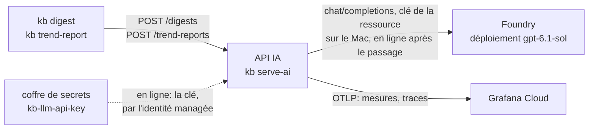

# Le service d'IA de K-B: le déploiement du modèle gpt-6.1-sol

> Rédaction de la documentation.

— C8

Cette fiche documente le service d'intelligence artificielle (IA) de K-B. Ce service est le déploiement d'un modèle
de langage, `gpt-6.1-sol`, dans Microsoft Foundry. Microsoft Foundry, anciennement Azure AI Foundry, est la
plateforme de Microsoft qui héberge des modèles d'IA et les rend appelables par Internet. Mettre un modèle à
disposition dans Foundry s'appelle un déploiement. Le déploiement de `gpt-6.1-sol` a été fait à la main, dans le
portail web de Foundry. Le code de K-B ne le décrit donc pas.

La fiche dit qui accède au service, comment l'installer et le tester, de quoi il dépend, et quelles données il
reçoit. Le programme de K-B qui appelle ce service est l'API IA. Cette API a sa propre fiche,
[la fiche de l'API IA](api_ia_pour_docu.md).

Les faits propres à K-B et à son service viennent de cinq sources. Les pages de Microsoft et les documents du
dépôt de code sont listés à la fin, dans « Sources ».

- Le code de K-B, dans sa version du 2026-11-18.
- Trois lectures de l'état d'Azure, faites le 2026-11-18 avec `az`, l'outil d'Azure en ligne de commande, en lecture
    seule. Elles portent sur la ressource, ses déploiements et les rôles de l'opératrice (« Relire l'état »).
- Des captures d'écran du portail Foundry, du 2026-11-17. Elles montrent le catalogue des modèles et le formulaire
    de déploiement de `gpt-6.1-sol`, avec son type, sa limite de jetons par minute et sa zone de données.
- L'essai de bout en bout du 2026-11-17 (« Le test »).
- Une lecture plus ancienne, du 2026-11-09, citée seulement pour le modèle `DeepSeek-V4-Flash`.

Les sources de chaque fait tiré du dépôt, avec leurs fichiers et leurs lignes, sont regroupées à la fin, dans
« Vérifier cette fiche ».

## Ce qu'est le service

Le service est une ressource Foundry. Dans Azure, une ressource est un élément que l'on crée, que l'on règle et que
l'on paie. Cette ressource est située dans la région France Central, que `az` nomme `francecentral` (lu le
2026-11-18). Elle appartient à un groupe de ressources, c'est-à-dire un dossier d'Azure qui regroupe des ressources.
Elle porte aussi un projet Foundry, l'espace de travail du portail. La fiche ne nomme ni la ressource ni le groupe.
Ses commandes les écrivent donc `<ressource Foundry>` et `<groupe de ressources>` (« Relire l'état »).

La ressource porte deux déploiements, d'après la lecture du 2026-11-18. Cette lecture ne montre pas leur type, parce
que `az` ne l'affiche pas dans un tableau. Le type de `gpt-6.1-sol` vient donc de la capture de son déploiement, du
2026-11-17. La production désigne ici K-B en ligne, sur Azure. Son passage de `gpt-6-luna` à `gpt-6.1-sol` demande
des réglages posés à la main (« Le branchement de K-B »).

Le tableau suivant décrit les deux déploiements.

| Déploiement | Version | Type | Capacité | Mise à jour de la version | Filtre de contenu | Qui l'appelle |
|---|---|---|---|---|---|---|
| `gpt-6.1-sol` | 2026-09-29 | `DataZoneStandard` | 250 | `NoAutoUpgrade`: version figée | `Microsoft.DefaultV2` | l'API IA, sur le Mac depuis le 2026-11-17, et en ligne après le passage de la production |
| `gpt-6-luna` | 2026-09-22 | non relu | 140 | `NoAutoUpgrade`: version figée | `Microsoft.DefaultV2` | l'API IA en ligne, jusqu'au passage de la production à `gpt-6.1-sol` |

Les sections suivantes expliquent le type, la version figée et le filtre de contenu. Trois points complètent le
tableau.

- **La capacité** se compte en milliers de jetons par minute. Un jeton est un morceau de mot. Le modèle lit et
    écrit des jetons, et Microsoft les facture. Le portail a fixé 250 000 jetons par minute pour `gpt-6.1-sol`
    (capture du 2026-11-17). Son nombre de requêtes par minute n'a pas été lu. Pour `gpt-6-luna`, les en-têtes des
    réponses donnaient 140 000 jetons et 140 requêtes par minute, lors de l'essai du 2026-10-17. Ces en-têtes sont
    `x-ratelimit-limit-tokens` et `x-ratelimit-limit-requests`.
- **Le choix de `gpt-6.1-sol`** vient du banc d'essai des modèles du 2026-11-16. Ce banc préconise `gpt-6.1-sol`,
    réglé à l'effort de raisonnement `low`. L'effort de raisonnement dit combien le modèle réfléchit avant de
    répondre. La valeur `low` est la plus faible que ce modèle accepte.
- **`DeepSeek-V4-Flash`** a été essayé le 2026-10-17 comme candidat juge, c'est-à-dire pour vérifier les affirmations
    des fiches. Une lecture du 2026-11-09 listait ce modèle, mais la ressource lue ce jour-là n'est pas établie. La
    lecture du 2026-11-18 ne le liste pas sur cette ressource.

### Le type de déploiement: la zone de données de l'Union européenne

Le type d'un déploiement fixe son mode de paiement et le lieu où le modèle traite les données. `DataZoneStandard` est
le type « Zone de données standard ». Son prix se paie à la consommation, c'est-à-dire par jeton. Le traitement
reste dans une zone de données que Microsoft définit. Pour une ressource en France, cette zone est celle de l'Union
européenne. Le portail l'a écrit au déploiement de `gpt-6.1-sol`, sur la capture du 2026-11-17: <q>Votre
déploiement dans francecentral traitera les données dans la zone de données EUR</q>.

Microsoft Learn, le site de documentation de Microsoft, précise cette zone en trois points, dans la page
« <span lang="en">Understanding deployment types in Microsoft Foundry Models</span> ».

- <q lang="en">The EU Data Zone follows the Azure EU Data Boundary, which can include European Free Trade Association (EFTA)
    countries and regions such as Norway and Switzerland in addition to EU member states.</q> La zone de l'Union
    peut donc compter, en plus des États membres, des pays de l'Association européenne de libre-échange (AELE), comme
    la Norvège ou la Suisse.
- <q lang="en">Microsoft can add regions to either data zone without prior notice</q>. La zone peut donc s'étendre à
    d'autres régions sans préavis.
- <q lang="en">Data stored at rest remains in the designated Azure geography</q>. Les données stockées restent donc
    dans la géographie de la ressource.

Une autre page de Microsoft, « <span lang="en">Data, privacy, and security for Foundry Models sold by Azure in
Microsoft Foundry</span> », le dit autrement: <q lang="en">prompts and responses may be processed in that or any other
European Union Member Nation</q>. Les deux pages ne nomment donc pas le même périmètre (« Limites »).

Ce type a été choisi le 2026-10-17 pour `gpt-6-luna`, puis gardé pour `gpt-6.1-sol`. Ce choix suit une règle du
projet: le lieu du traitement est choisi et écrit, et c'est la zone de l'Union quand le fournisseur l'offre. Cette
règle applique le règlement général sur la protection des données (RGPD), pour la sous-traitance et les transferts
de données. Le type « <span lang="en">Global Standard</span> » a été écarté, parce qu'il peut traiter les données dans toute région Azure.

### La version figée

Le réglage « Refuser les mises à niveau automatiques des versions de modèle », que `az` nomme `NoAutoUpgrade`, fige
la version 2026-09-29 de `gpt-6.1-sol`. Le modèle ne change donc pas sans qu'on le décide. Les mesures de l'essai du
2026-11-17 restent ainsi comparables.

Une version de modèle finit par être retirée par Microsoft. La page « <span lang="en">Foundry Models lifecycle and
support policy</span> » dit de deux façons ce qui se passe alors (« Limites »).

- Sa foire aux questions dit qu'avec `NoAutoUpgrade`, le déploiement <q lang="en">stops working at retirement</q>,
    c'est-à-dire qu'il cesse de fonctionner au retrait. Son tableau « <span lang="en">Lifecycle stages</span> » le
    confirme: une version retirée rend l'erreur `410 Gone` à toute requête.
- Sa section « <span lang="en">Automatic upgrades</span> » s'ouvre au contraire sur <q lang="en">For Global Standard,
    Data Zone Standard, and Standard deployment types, Microsoft manages automatic upgrades when a model version is
    retired</q>. Elle ne fait pas d'exception pour `NoAutoUpgrade`.

La date de retrait de `gpt-6.1-sol` n'a pas été lue (« Limites »). L'abonnement Azure est le compte qui paie les
ressources. D'après la même page, Microsoft prévient par courriel au moins 60 jours avant un retrait. Ce courriel va
aux propriétaires de l'abonnement qui ont un déploiement actif: <q lang="en">Sent to subscription owners with active
deployments</q>. L'avis paraît aussi dans Azure Service Health, le service d'Azure qui publie ses avis.

### Le filtre de contenu `DefaultV2`

Un filtre de contenu est un ensemble de garde-fous qui bloque une demande ou une réponse jugée dangereuse. `DefaultV2`
est le jeu de garde-fous par défaut de Foundry, que `az` nomme `Microsoft.DefaultV2`. La page
« <span lang="en">Default safety policies in Microsoft Foundry</span> » en décrit l'effet sur un modèle de texte.

- Dans la demande et dans la réponse, il filtre la haine, la violence, le contenu sexuel et l'automutilation, à
    partir du niveau de gravité moyen.
- Dans la demande, il détecte les attaques par la consigne (*<span lang="en">jailbreak</span>*), qui tentent de faire
    sortir le modèle de ses instructions.
- Dans la réponse, il détecte le texte ou le code protégés.

Une demande bloquée reçoit l'erreur 400 `content_filter`. Une réponse filtrée se termine par `finish_reason`
`content_filter`. Dans les deux cas, le client du modèle, dans l'API IA, classe l'appel en `llm_content_filtered`. Ce
client ne fait alors pas de nouvelle tentative. Sur les 18 requêtes de l'essai du 2026-11-17, aucun filtre ne s'est
déclenché.

## La gestion des accès

Deux portes donnent accès au service.

- **Le plan de gestion d'Azure** permet de voir, de modifier ou de supprimer la ressource et ses déploiements, et
    de lire ses clés. Les rôles Azure tiennent cette porte. Un rôle Azure est un ensemble de droits, donné à un
    compte, d'une personne ou d'un programme, sur un abonnement, un groupe ou une ressource.
- **L'appel du modèle** se fait avec une clé de la ressource, ou avec un jeton d'accès de Microsoft Entra ID. Une
    clé est une longue chaîne secrète qui sert de mot de passe. Microsoft Entra ID est le service d'identité de
    Microsoft, qui tient les comptes d'une organisation. Un jeton d'accès est une preuve d'identité temporaire que ce
    service délivre, à ne pas confondre avec les jetons de texte.

### Les rôles de l'opératrice

L'opératrice est la personne qui installe et fait tourner K-B. Ses rôles ont été lus le 2026-11-18. Ils portent sur
deux endroits. Le premier est le groupe de ressources du service, et la ressource hérite des rôles de ce groupe. Le
second est le coffre de secrets de K-B. Ce coffre, un Azure Key Vault, garde les mots de passe et les clés en ligne.

Le tableau suivant ne donne que les rôles qui portent sur le service et sur sa clé. Chaque définition est celle de
Microsoft Learn, recopiée des pages « <span lang="en">Azure built-in roles</span> ».

| Rôle | Portée | Définition de Microsoft | Ce qu'il permet sur le service |
|---|---|---|---|
| Owner (Propriétaire) | le groupe de ressources | <q lang="en">Grants full access to manage all resources, including the ability to assign roles in Azure RBAC.</q> | tout gérer, attribuer des rôles, lire les clés (action `*`) |
| Contributor (Contributeur) | le groupe | <q lang="en">Grants full access to manage all resources, but does not allow you to assign roles in Azure RBAC […]</q> | tout gérer sauf les rôles, déployer un modèle, lire les clés (action `*`) |
| Foundry User | le groupe | <q lang="en">Grants reader access to Foundry projects, reader access to Foundry accounts, and data actions for an Foundry project.</q> | lire la ressource, lire les clés (`Microsoft.CognitiveServices/accounts/listkeys/action`), appeler le modèle par Entra ID (actions de données `Microsoft.CognitiveServices/*`) |
| Key Vault Secrets Officer | le groupe, et le coffre de secrets de K-B | <q lang="en">Perform any action on the secrets of a key vault, except manage permissions.</q> | poser et lire le secret `kb-llm-api-key`, la clé du service (« La clé de K-B ») |

L'opératrice a donc plus de droits que l'usage courant n'en demande. Appeler le modèle ne demande que la clé, ou le
rôle Foundry User. Chacun des rôles Owner, Contributor et Foundry User suffit à lui seul pour lire la clé.

D'autres personnes que l'opératrice peuvent avoir ces accès.

- Tout titulaire d'Owner ou de Contributor, sur l'abonnement ou sur le groupe, peut lire les clés et modifier les
    déploiements.
- Un titulaire de Foundry User peut lire les clés.
- Un administrateur général de l'annuaire Microsoft Entra ID peut se donner ces accès.

Seuls les rôles de l'opératrice sont listés ici.

### La clé de K-B

L'API IA appelle le modèle avec la clé de la ressource. Elle envoie cette clé dans l'en-tête HTTP
`Authorization: Bearer`, une ligne d'information qui accompagne la requête. Elle la lit dans la variable d'environnement `KB_LLM_API_KEY`. Une variable d'environnement
est un réglage que le système passe à un programme à son démarrage.

L'authentification par clé est active sur la ressource. Le réglage `disableLocalAuth` vaut en effet `False`, d'après
la lecture du 2026-11-18. L'essai du 2026-11-17 a d'ailleurs appelé `gpt-6.1-sol` par la clé. La page
« <span lang="en">Role-based access control for Microsoft Foundry</span> » de Microsoft Learn le rappelle:
<q lang="en">If you use key-based authentication instead, the key grants full access without role restrictions</q>.
Qui a la clé peut donc appeler les deux déploiements, quels que soient ses rôles.

La clé est gardée à deux endroits.

- **Sur le Mac**, la clé est dans le fichier `.env` de l'opératrice. Ce fichier de réglages est exclu du dépôt de
    code. La commande `uv run --env-file .env` le passe au processus. Aucune commande `kb` ne lit ce fichier
    elle-même.
- **En ligne**, la clé est le secret `kb-llm-api-key` du coffre de secrets de K-B. Ce secret a été posé à la main,
    collé sans s'afficher à l'écran, selon l'étape « 4. Poser les secrets » du README de l'infrastructure. Parmi les
    identités managées de K-B, seule celle de l'app `ca-kb-ai-api` lit ce secret. Une identité managée est un compte
    qu'Azure donne à un programme, pour qu'il accède à d'autres ressources sans mot de passe. L'app `ca-kb-ai-api`
    est l'API IA en ligne, qu'Azure Container Apps fait tourner dans un conteneur. Un conteneur est un programme emballé avec
    tout ce dont il a besoin, et il démarre d'une image. L'identité de l'app a le rôle Key Vault Secrets User sur ce
    seul secret. Container Apps donne la clé au conteneur comme variable d'environnement, par une référence au
    coffre. La clé n'est donc ni dans l'image ni dans le code.

Changer la clé, par exemple si elle a fuité, se fait en trois étapes.

1. Régénérer la clé dans le portail: ouvrir la ressource, puis « Clés et point de terminaison ».
2. Reporter la nouvelle clé dans le `.env` du Mac.
3. Reporter la nouvelle clé dans le secret `kb-llm-api-key`, par la procédure « Pour refaire un seul secret » du
    README de l'infrastructure. Cette procédure redémarre `ca-kb-ai-api`.

La procédure « Pour refaire un seul secret » n'a pas été essayée pour cette clé.

L'accès réseau public de la ressource est activé: le réglage `publicNetworkAccess` vaut `Enabled`, d'après la même
lecture du 2026-11-18. Les règles réseau de la ressource, `networkAcls`, pourraient restreindre cet accès à
certaines adresses. Elles n'ont pas été lues.

## L'installation

### Le déploiement, à la main

Le déploiement a été fait le 2026-11-17 dans le portail Foundry, dans le projet Foundry de la ressource (captures
du 2026-11-17). Pour le refaire, il faut une ressource Foundry dans une région de l'Union. Les étapes sont les
suivantes.

1. Ouvrir le projet dans le portail Foundry, puis **Catalogue**, puis **Modèles**. Choisir `gpt-6.1-sol`, puis
    **Déployer**.
2. **Nom du déploiement**: `gpt-6.1-sol`. C'est la valeur de `KB_LLM_MODEL`.
3. **Type de déploiement**: « Zone de données standard ». Le portail affiche alors <q>Votre déploiement dans
    francecentral traitera les données dans la zone de données EUR</q>.
4. **Paramètres de version du modèle**: version 2026-09-29. **Stratégie de mise à jour des versions de modèle**:
    « Refuser les mises à niveau automatiques des versions de modèle » (`NoAutoUpgrade`).
5. **Limite de débit des jetons par minute**: 250 000.
6. **Garde-fous**: `DefaultV2`, le jeu par défaut. Puis **Déployer**.

Le 2026-11-17, le catalogue montre `gpt-6.1-sol` en « Disponibilité générale ». Un nouveau déploiement est alors
permis. Cette version passera au stade « <span lang="en">Deprecated</span> » 12 mois après sa sortie. Dès ce stade,
ce déploiement ne pourra se refaire que sur un abonnement qui a déjà déployé cette version. La page
« <span lang="en">Foundry Models lifecycle and support policy</span> » le dit ainsi: <q lang="en">"Existing customer"
is determined at the subscription level […] A new subscription under the same tenant doesn't inherit access.</q>

### Le branchement de K-B

L'API IA ne connaît du service que des réglages. Aucune partie de son code n'est propre à Azure. L'installation en
ligne de K-B est décrite dans un fichier Bicep, le langage d'Azure qui décrit une infrastructure. Ce fichier
s'applique en deux passes. La seconde passe, ou passe 2, pose entre autres l'adresse et le nom du modèle.

Le tableau suivant donne les réglages du modèle, leur valeur pour ce service, et l'endroit où chacun est posé, sur le
Mac et en ligne.

| Réglage | Valeur pour ce service | Sur le Mac, dans le `.env` | En ligne |
|---|---|---|---|
| `KB_LLM_PROVIDER` | `openai_compatible` | à poser | fixé dans le fichier Bicep |
| `KB_LLM_BASE_URL` | `https://<sous-domaine>.openai.azure.com/openai/v1` | à poser | paramètre `llmBaseUrl` de la passe 2 |
| `KB_LLM_MODEL` | `gpt-6.1-sol` | à poser | paramètre `llmModel` de la passe 2 |
| `KB_LLM_API_KEY` | la clé de la ressource | à poser | le secret `kb-llm-api-key` |
| `KB_LLM_REASONING_EFFORT` | `low` | à poser, car le fichier d'exemple du `.env` porte `none`, la valeur de `gpt-6-luna` | fixé dans le fichier Bicep |
| `KB_LLM_SEND_PROMPT_CACHE_OPTIONS` | non posée, elle vaut alors `true` | non posée, en commentaire dans le fichier d'exemple du `.env` | non posée |

Ces réglages appellent quatre remarques.

- **L'effort de raisonnement.** Avec `KB_LLM_REASONING_EFFORT=low`, l'API IA envoie `reasoning_effort: "low"` au
    modèle, au lieu de `temperature: 0`. `gpt-6.1-sol` refuse les valeurs `none` et `minimal`, et demande `low`. La
    commande `kb serve-ai`, qui lance l'API IA, n'accepte que `none`, `minimal` et `low`.
- **Le cache de la consigne.** La consigne est le texte d'instructions que l'API IA envoie au modèle avec chaque
    demande. Le cache de la consigne est une copie que le fournisseur peut garder du début d'une demande, pour
    traiter plus vite la suivante. `KB_LLM_SEND_PROMPT_CACHE_OPTIONS` n'est pas posée, et vaut donc `true`. Chaque
    requête porte alors le champ `prompt_cache_options`, qui coupe ce cache (« Ce que Microsoft en garde »).
    L'essai du 2026-11-17 montre que `gpt-6.1-sol` accepte ce champ, car aucune requête n'y a été refusée. Si la
    variable vaut `false`, `kb serve-ai` refuse de démarrer en production.
- **La passe 2.** Ses paramètres et le secret sont décrits dans le README de l'infrastructure, aux étapes « 4. Poser
    les secrets » et « 5. Seconde passe ». Le passage de la production à `gpt-6.1-sol` demande l'effort `low` en
    ligne, déjà fixé dans le fichier Bicep. Il demande aussi l'adresse (`llmBaseUrl`), le nom (`llmModel`) et la
    clé (`kb-llm-api-key`) de ce déploiement, posés à la main à la passe 2.
- **Le nom du modèle.** Le dépôt de code ne fixe pas la valeur de `KB_LLM_MODEL`. Cette valeur vient du `.env` sur
    le Mac, et du paramètre `llmModel` en ligne.

### Relire l'état

Les trois lectures du 2026-11-18 sont faites en lecture seule, et aucune n'affiche de clé. Dans son format tableau
(`-o table`), `az` ne montre aucune colonne nommée `type`, ni `id`, ni `etag`. Le type des déploiements n'apparaît
donc pas dans la sortie de la première lecture. Une portée est l'endroit où un rôle s'applique: un abonnement, un
groupe ou une ressource. La dernière lecture affiche des portées complètes, avec l'identifiant de l'abonnement et les
noms des groupes. La fiche n'en garde que le rôle et le type de portée. Avant de lancer les commandes, remplir les
deux variables du groupe et de la ressource.

```sh
RG=<groupe de ressources>
RESOURCE=<ressource Foundry>
# Les déploiements: nom, type, capacité, version, mise à jour de la version, filtre de contenu.
az cognitiveservices account deployment list -g "$RG" -n "$RESOURCE" \
  --query "[].{nom:name, type:sku.name, capacite:sku.capacity, version:properties.model.version, maj:properties.versionUpgradeOption, filtre:properties.raiPolicyName}" -o table
# La ressource: région, accès public, authentification par clé (sortie du 2026-11-18: francecentral, Enabled, False).
az cognitiveservices account show -g "$RG" -n "$RESOURCE" \
  --query "{region:location, acces_public:properties.publicNetworkAccess, cle_coupee:properties.disableLocalAuth}" -o table
# Les rôles du compte connecté, et leur portée.
az role assignment list --assignee "$(az ad signed-in-user show --query id -o tsv)" --all \
  --query "[].{role:roleDefinitionName, portee:scope}" -o table
```

## Le test

### Ce qui a été essayé

Le service a été essayé sur deux modèles, `gpt-6.1-sol` puis, avant lui, `gpt-6-luna`. Quelques termes servent
dans cette section.

- Une fiche se fait en plusieurs appels au modèle. Le classement range chaque publication dans un sujet, ou dans
    aucun. La rédaction écrit la fiche d'un sujet. Le jugement vérifie les affirmations d'une fiche.
- Grafana Cloud est le service en ligne qui reçoit et affiche les mesures de K-B.
- Le bac à sable est un environnement d'essai, séparé de la production.
- Le coffre de notes est le dossier d'Obsidian, une application de notes, où `kb` écrit les fiches.

**Le 2026-11-17, sur `gpt-6.1-sol`**, `kb serve-ai` a tourné sur le Mac, avec la version `f1eac19c` du code. L'effort
de raisonnement était `low` (`KB_LLM_REASONING_EFFORT=low`). Les mesures partaient vers Grafana Cloud, dans le bac à
sable (`KB_DEPLOYMENT_ENVIRONMENT=sandbox`). Aucune fiche n'a été écrite dans le coffre de notes pendant l'essai. La
ligne de démarrage de `kb serve-ai` disait `LLM provider openai_compatible, model gpt-6.1-sol` et
`LLM reasoning effort low, prompt_cache_options sent`. L'essai a donné les résultats suivants.

- **Une demande de comptes rendus de veille** (`POST /digests`) portait sur 14 jours et 300 items, le plafond. Un
    item est une publication collectée par la veille. La réponse est arrivée avec le code 200, en 200,0 s, soit
    l'échéance de la demande. Elle contenait 4 fiches sur 9. Les 5 autres sujets ont fini en `llm_timeout`. Un appel
    a été coupé par l'échéance, et les quatre suivants n'ont jamais été faits. Le modèle a reçu 12 requêtes, chacune
    en une seule tentative. Parmi elles, 11 ont abouti (`ok`, avec `finish_reason: stop`) et 1 a fini en
    `llm_timeout`. Ces requêtes ont compté 74 383 jetons en entrée et 9 733 en sortie, dont 914 de raisonnement. Le
    temps passé dans le modèle a été de 199,5 s. Les quatre rédactions abouties ont pris de 23 à 31 s chacune.
- **Un compte rendu des tendances** (`POST /trend-reports`), le premier, portait sur quatre fenêtres de temps. Ce
    compte rendu présente des dépôts de code en tendance. La réponse est arrivée avec le code 200, en 56,0 s. Elle
    retenait 5 dépôts, avec 20 textes, dont aucun n'a été retiré. Le modèle a reçu 6 requêtes, toutes `ok` en une
    tentative. Elles ont compté 14 021 jetons en entrée et 1 281 en sortie, dont 170 de raisonnement.
- **Aucune des 18 requêtes** n'a fini en `llm_content_filtered` ni en `llm_truncated`.
- **Une condition de l'essai.** TLS est le chiffrement des connexions web. OpenSSL est la bibliothèque qui le réalise
    pour le Python de K-B. ML-KEM est un procédé récent d'échange de clés dans TLS. Sur le Mac, `kb serve-ai` a
    tourné avec un réglage d'OpenSSL qui retire de TLS l'échange de clés ML-KEM. Sans ce réglage, aucune requête
    n'atteignait le modèle (« Limites »).

**Sur `gpt-6-luna`**, le modèle de K-B avant `gpt-6.1-sol`, trois essais ont eu lieu.

- **Le 2026-10-17**, un appel avec la clé a rendu le code 200 et le `model` `gpt-6-luna-2026-09-22`. Sur une veille
    réelle, 6 appels de classement, 5 de rédaction et 3 de jugement ont passé, avec le schéma strict de K-B. Ce schéma est le format
    de réponse que l'API IA impose au modèle. Aucun cache n'a été écrit: `cache_write_tokens` valait 0 sur 20
    réponses.
- **Le 2026-10-28**, `kb serve-ai` a tourné dans le bac à sable. Une demande de fiches sur 3 jours a fait 10 requêtes
    au modèle. La réponse est arrivée avec le code 200, en 56,8 s.
- **Le 2026-11-10**, vers 00:03 UTC, les deux commandes de [Refaire le test](#refaire-le-test) ont été lancées.
    Avec la clé, le déploiement a répondu `gpt-6-luna-2026-09-22 stop`. Sans clé, le déploiement a refusé l'appel:
    `HTTP 401`, avec le code `"401"` et le message <q lang="en">Access denied due to invalid subscription key or wrong
    API endpoint […]</q>.

### Refaire le test

Chaque commande se lance depuis la racine du dépôt de code, dans un terminal où le `.env` n'est pas exporté. La
commande `uv run --env-file .env` passe tout le `.env` à `sh` et à `curl`, et non la seule clé. La clé n'est lue que
dans la variable `KB_LLM_API_KEY`. Elle n'est donc ni tapée, ni affichée, ni écrite dans l'historique du shell,
l'interpréteur de commandes du terminal. `printf`, une commande interne du shell, passe la clé à `curl` par l'entrée
standard (`-H @-`), le canal par lequel un programme reçoit des données d'un autre. La clé ne passe donc pas sur la
ligne de commande, que les autres processus, c'est-à-dire les programmes en cours sur la machine, peuvent voir.

1. **L'appel sans clé est refusé**:

    ```sh
    curl -sS -w '\nHTTP %{http_code}\n' -X POST "https://<sous-domaine>.openai.azure.com/openai/v1/chat/completions" \
      -H 'Content-Type: application/json' \
      -d '{"model":"gpt-6.1-sol","messages":[{"role":"user","content":"ping"}],"max_completion_tokens":16}'
    ```

    Attendu: `HTTP 401`. Le corps de la réponse ne contient aucun secret.

2. **L'appel avec la clé répond, avec la version figée.** La commande règle l'appel comme l'API IA l'envoie, avec
    `reasoning_effort` et le cache coupé:

    ```sh
    uv run --env-file .env sh -c 'printf "Authorization: Bearer %s\n" "$KB_LLM_API_KEY" | curl -sS -H @- \
      -H "Content-Type: application/json" \
      -d "{\"model\":\"$KB_LLM_MODEL\",\"messages\":[{\"role\":\"user\",\"content\":\"ping\"}],\"max_completion_tokens\":16,\"reasoning_effort\":\"$KB_LLM_REASONING_EFFORT\",\"prompt_cache_options\":{\"mode\":\"explicit\"}}" \
      "$KB_LLM_BASE_URL/chat/completions"' \
      | python3 -c 'import json, sys; d = json.load(sys.stdin); print(d.get("model"), d["choices"][0]["finish_reason"] if "choices" in d else d.get("error"))'
    ```

    Attendu: le nom du modèle avec sa version, puis `stop` ou `length`. La commande n'affiche ni la clé ni la réponse
    du modèle. Elle n'a pas été relancée sur `gpt-6.1-sol` (« Limites »).

3. **La chaîne de K-B.** Lancer `kb serve-data` et `kb serve-ai`, selon les sections « Lancer l'API » et « Lancer
    l'API IA » du [README](https://github.com/SabineLaurent/K-B/blob/main/README.md). Puis lancer `kb digest`, selon
    la section « Écrire les comptes rendus de veille dans le coffre » du même README. Ce coffre est le coffre de notes
    Obsidian. La chaîne envoie une veille réelle au modèle, et coûte donc ses jetons.

Les tests automatiques du dépôt n'appellent jamais le service. Ils se lancent par `uv run pytest`, et l'intégration
continue (CI) les relance sur GitHub. Dans ces tests, le client du modèle reçoit ses réponses d'un rejeu, c'est-à-dire
de réponses enregistrées, ou d'un transport simulé, une fausse connexion réseau écrite pour les tests. Ces tests vérifient le corps de la requête que
l'API IA envoie: le cache coupé, l'effort de raisonnement, et le refus en production du cache non coupé.

## Les dépendances et les interconnexions

Le schéma suivant montre qui appelle le service et ce dont l'appel dépend. La liste qui le suit le décrit en
texte, élément par élément.



- **Un seul appelant.** Seule l'API IA appelle le service. Elle utilise le format d'appel
    <span lang="en">Chat Completions</span> d'OpenAI, sur le chemin `chat/completions`. Elle n'appelle que ce chemin,
    sans le champ `store`. Elle n'utilise ainsi aucune des fonctions qui gardent des échanges chez Microsoft (<span lang="en">Responses API, Assistants, Stored
    completions</span>). Les clients de l'API IA sont `kb digest` et `kb trend-report`, décrits dans la fiche de
    l'API IA. Le jeu de référence est un ensemble de sorties du modèle, enregistrées pour être rejouées par les tests.
    Le script qui l'enregistre, lancé à la main, passe lui aussi par l'API IA, dans le même processus.
- **En ligne, le modèle est appelé depuis le 2026-11-11.** L'app `ca-kb-ai-api` est réglée pour joindre le
    déploiement que nomment ses paramètres `llmBaseUrl` et `llmModel`. Ce déploiement est `gpt-6-luna`, jusqu'au
    passage à `gpt-6.1-sol` (« Le branchement de K-B »). Un job est un programme qu'Azure lance à heure fixe ou à la
    main, et qui s'arrête une fois son travail fait. Le job `caj-kb-digest-watch` lance `kb digest`, puis
    `kb trend-report`, par défaut le lundi et le jeudi à 10:00 UTC. Lancé à la main le 2026-11-11, ce job a donné les
    premiers points de la production dans Grafana Cloud, vers 16:00 UTC. Lancé par son horaire le 2026-11-12, de
    10:00:00 à 10:02:44 UTC, ce job a appelé le modèle. Les autres jobs n'appellent pas le modèle. Ainsi, le job de
    vérification `caj-kb-smoke-test` n'appelle de l'API IA que `GET /health`, et l'API IA y répond sans le modèle.
- **Le coffre de secrets**, en ligne, porte la clé. L'identité managée de l'API IA la lit (« La clé de K-B »).
- **Grafana Cloud** reçoit les mesures de chaque appel au modèle. Il les reçoit par OTLP, le protocole d'export
    d'OpenTelemetry, un standard ouvert de mesure des programmes. Sous un réglage, Grafana Cloud reçoit aussi le
    contenu de l'appel (« Les données envoyées au modèle »). Le monitorage du modèle a sa propre fiche,
    [la fiche du monitorage](monitoring_pour_docu.md).
- **Le quota** de 250 000 jetons par minute est partagé. Un compte rendu des tendances et un `kb digest` lancés dans
    la même minute le consomment donc ensemble.
- **Ce dont dépend le service lui-même** tient en trois points.
    - L'abonnement Azure de la ressource, avec son accès, son quota et sa facturation.
    - Le contrat de Microsoft avec le titulaire de cet abonnement.
    - La date de retrait de la version. Le courriel d'avant retrait va aux propriétaires de l'abonnement.

## Les données envoyées au modèle

### Ce qui part

L'API IA envoie au modèle une consigne et un message utilisateur. La consigne est une constante du code. Le message
utilisateur porte les publications de la veille. Le registre des traitements est la liste des traitements de données
personnelles que le RGPD impose de tenir. Il donne le détail des envois dans deux sections, « Envoi des items au
modèle des fiches » et « Envoi des dépôts au modèle du compte rendu des tendances ».

- **Pour les fiches de veille**, l'API IA envoie une liste blanche de champs par sorte de publication. Une liste
    blanche nomme les seuls champs permis. Pour chaque publication, l'API IA envoie aussi `item_id` et `kind`.
    - Un papier, c'est-à-dire un article de recherche: `title`, `summary`.
    - Une vulnérabilité: `cve_id`, `title`, `description`, `vendor`, `product`, `ransomware_use`.
    - Une <span lang="en">release</span>, c'est-à-dire une version publiée d'un logiciel: `repository_name`, `tag_name`, `title`, `body`.
    - Un avis de sécurité: `ghsa_id`, `cve_id`, `title`, `cve_listed_in_cisa_kev`, `packages`.
    - Un article de lettre d'information: `edition`, `title`, `summary`.

    L'auteur et l'URL ne partent jamais. Toute URL devient `[url]`. Chaque `@login` des notes d'une release devient
    `@user`. Au classement, le modèle ne reçoit de chaque publication que `item_id`, `kind`, `title` et son texte long. Ce texte long est le résumé, la
    description ou les notes, coupé à 500 caractères. Pour un avis de sécurité, aucun texte long ne part. À la rédaction,
    chaque texte est coupé à 2 000 caractères.

- **Pour le compte rendu des tendances**, l'API IA envoie d'abord quelques champs de chaque dépôt candidat: son nom,
    sa description, ses sujets (<span lang="en">topics</span>) et son langage. Elle envoie ensuite le README nettoyé des dépôts choisis, coupé à
    4 000 caractères (registre).

- **Rien de la bibliothèque de lecture ne part**, ni entrée Zotero ni clip. Zotero est le gestionnaire de références
    de l'opératrice. Un clip est une page web gardée dans le coffre de notes.

Des données personnelles partent pourtant, d'après le registre.

- Le login du propriétaire d'un dépôt, dans `owner/repo`, quand ce propriétaire est une personne.
- Une adresse mail écrite dans les notes d'une release.
- Un nom écrit en texte libre.

### Ce que Microsoft en garde

- **Le modèle ne garde rien et n'apprend rien.** La page « <span lang="en">Data, privacy, and security for Foundry
    Models sold by Azure in Microsoft Foundry</span> » le dit: <q lang="en">The models are stateless: no prompts or
    completions are stored in the model. Additionally, prompts and completions are not used to train, retrain, or
    improve the base models.</q>
- **Le cache de la consigne est coupé.** À chaque requête, l'API IA envoie
    `prompt_cache_options: {"mode": "explicit"}`, sans point d'arrêt. Un point d'arrêt marque la fin de la partie de
    la demande à garder en cache. Sans point d'arrêt, ce réglage n'écrit donc aucun cache. La coupure a été vérifiée une fois, sur
    `gpt-6-luna`, le 2026-10-17: `cache_write_tokens` valait 0 sur 20 réponses. Sur `gpt-6.1-sol`, elle n'a pas été
    relevée, parce que le client du modèle ne suit pas ce champ.
- **La surveillance des abus garde les demandes signalées.** Microsoft surveille les abus, c'est-à-dire les usages
    contraires à ses règles. Une demande et sa réponse peuvent être stockées pour une revue humaine dans deux cas.
    Soit la classification de Microsoft les signale, soit elles font partie d'un usage potentiellement abusif. La
    revue automatique, elle, ne stocke rien. Les demandes stockées le sont dans la géographie de la ressource,
    séparées par ressource. Pour un déploiement dans l'Espace économique européen, les relecteurs sont des employés
    de Microsoft situés dans l'Espace économique européen. Aucune des deux pages de Microsoft sur le sujet ne publie
    de durée de conservation. Ces pages sont « <span lang="en">Data, privacy, and security for Foundry Models sold by
    Azure in Microsoft Foundry</span> », section « <span lang="en">Preventing abuse</span> », et
    « <span lang="en">Foundry Models sold by Azure abuse monitoring</span> ». Une demande signalée porte les
    publications de son lot. Elle contient donc parfois des données personnelles.
- **Cette surveillance est modifiable**, sur demande du titulaire de l'abonnement, s'il remplit les critères d'accès
    limité de Microsoft. La page « <span lang="en">Foundry Models sold by Azure abuse monitoring</span> » appelle
    cela <span lang="en">modified abuse monitoring</span>. Sur la ressource de K-B, la capacité `ContentLogging` dirait
    si le stockage de la surveillance est coupé. Cette capacité n'a pas été relue (« Limites »). La page
    « <span lang="en">Data, privacy, and security for Foundry Models sold by Azure in Microsoft Foundry</span> »
    l'explique ainsi, dans sa section « <span lang="en">How can a customer verify if data storage for abuse
    monitoring is off?</span> »: <q lang="en">The value of "false" for the "ContentLogging" attribute appears only if
    data storage for abuse monitoring is turned off. Otherwise, this property will not appear</q>.
- **D'autres fonctions relèvent du titulaire de l'abonnement.** S'il active la protection des services d'IA de
    Microsoft Defender for Cloud, les demandes et les réponses sont gardées 30 jours chez Microsoft. Ses politiques
    sur les journaux de diagnostic ne sont pas connues. Aucune de ces fonctions n'est activée par l'installation de
    K-B, d'après le registre des traitements.

### Une copie possible vers Grafana Cloud

Le réglage `KB_TRACE_CONTENT` de l'API IA peut envoyer le contenu d'un appel au modèle à Grafana Cloud, avec les
traces. Une trace est le relevé des étapes d'une demande, avec leur durée. Le contenu envoyé comprend la consigne,
les champs envoyés et la sortie du modèle. Cet envoi est un flux de données personnelles, inscrit au registre, dans
la section « Envoi des mesures à Grafana Cloud ».

- **Par défaut, rien ne part.** Sans la variable, le réglage vaut `none`.
- **En production**, le réglage est fixé à `none`, et la valeur `all` y est refusée au démarrage.
- **Dans le bac à sable**, aucun fichier du dépôt ne pose ce réglage. La commande `make sandbox-alerts` tourne sur le
    rejeu, sans le modèle et sans traces. L'essai du 2026-11-17 a gardé le réglage à `none`, et sa ligne de
    démarrage disait `model content none`.
- **À la main**, `KB_TRACE_CONTENT=all` peut être posé pour un essai hors production. Le contenu des appels part
    alors dans Grafana Cloud, qui le garde 14 jours. Un essai l'a posé le 2026-10-28, avec 10 requêtes à
    `gpt-6-luna`. Grafana Labs a répondu le 2026-10-29. Ce que sa réponse change au contrat de sous-traitance (DPA,
    <span lang="en">Data Processing Agreement</span>) est encore à décider. Depuis cette réponse, le réglage reste
    donc à `none`.

## Limites

- **La clé ouvre tout.** L'authentification par clé est active. Qui a la clé appelle donc les deux déploiements,
    sans rôle. L'accès réseau public est activé, et ses règles réseau n'ont pas été lues. L'appel par un jeton
    d'accès Entra ID n'est pas codé. Ce jeton passerait par l'identité managée de l'API IA et par le rôle Foundry
    User sur la ressource.
- **Le déploiement est hors du code.** Aucun test de K-B ne voit une modification faite dans le portail, qu'elle
    porte sur le type, la version ou le filtre. Seule une lecture comme celles de « Relire l'état » la montre.
- **Des réglages restent sans lecture par `az`.** Le type du déploiement de `gpt-6.1-sol` vient de la capture de son
    formulaire, du 2026-11-17. Le type de `gpt-6-luna` n'a pas été relu. Le stockage de la surveillance des abus,
    `ContentLogging`, n'a pas été relu sur la ressource. Qu'il soit actif ou coupé n'est donc pas vérifié. La parade
    tient dans les lectures de « Relire l'état ». Pour le type, il faut la sortie en `-o json`. Pour le stockage, il
    faut ajouter `properties.capabilities[?name=='ContentLogging'].value`.
- **Les rôles reçus par un groupe ne sont pas lus.** Un groupe Microsoft Entra peut donner des rôles à ses membres.
    `az role assignment list` ne montre ces rôles qu'avec l'option `--include-groups`, d'après la référence de la
    commande sur Microsoft Learn, lue le 2026-11-18. La lecture du 2026-11-18 n'avait pas cette option.
- **Les deux commandes de « Refaire le test » n'ont pas été relancées sur `gpt-6.1-sol`.** L'essai du 2026-11-17 a
    appelé ce modèle par `kb serve-ai`. Sans clé, seul un `GET` de la liste des modèles a été essayé ce jour-là, et
    `curl` a reçu le `401` attendu.
- **Un contournement de TLS a été nécessaire pour l'essai du 2026-11-17.** Sur le Mac, le Python de K-B, avec
    OpenSSL 3.5.6, a reçu une `SSLEOFError` sur 8 à 9 appels sur 10 vers la ressource, sans clé. Les mêmes appels ont
    reçu les `401` attendus dans trois cas: avec `curl`, qui utilise LibreSSL, avec ce même Python en TLS 1.2, ou
    avec ce Python sans l'échange de clés ML-KEM. Deux hypothèses restent non tranchées. La première est un
    équipement du réseau local qui coupe un premier message TLS trop gros. La seconde est un changement du côté
    d'Azure. Que le conteneur en ligne soit touché n'a pas été vérifié.
- **À 300 items, une demande de comptes rendus dépasse son échéance avec `gpt-6.1-sol`.** Le 2026-11-17, elle a
    donné 4 fiches sur 9 en 200 s, les appels étant faits un par un. L'essai de `gpt-6-luna` du 2026-10-28 portait sur
    3 jours. Les deux essais ne se comparent donc pas directement.
- **Le coût que l'API IA estime est compté aux prix de `gpt-6.1-sol`**, en contexte court. Le contexte est le texte
    que le modèle reçoit en une demande, et un contexte long peut avoir son propre prix. Tout appel est compté aux
    prix de `gpt-6.1-sol`, quel que soit `KB_LLM_MODEL`. Le prix du contexte long n'est pas distingué.
- **`gpt-6-luna` reste déployé.** La production l'appelle jusqu'à son passage à `gpt-6.1-sol`. Ensuite, l'API IA ne
    l'appellera plus, mais la clé le permettra encore.
- **Deux pages de Microsoft ne disent pas le même périmètre** de la zone de données de l'Union. La première dit
    <q lang="en">that or any other European Union Member Nation</q> (« <span lang="en">Data, privacy, and
    security</span> »). La seconde parle de la limite des données de l'Union, qui peut compter des pays de l'AELE
    (« <span lang="en">Understanding deployment types</span> »).
- **Deux sections de la même page de Microsoft ne disent pas la même chose du retrait.** Avec `NoAutoUpgrade`, le
    déploiement cesse de répondre, selon la foire aux questions. Il est mis à niveau d'office, selon la section
    « <span lang="en">Automatic upgrades</span> », qui ne fait pas d'exception pour `NoAutoUpgrade`.
- **La durée de conservation de la surveillance des abus** n'est pas publiée par Microsoft.
- **La date de retrait de `gpt-6.1-sol`** n'a pas été lue.
- **Les métriques du déploiement dans Azure Monitor**, l'outil de mesure d'Azure, n'ont pas été consultées. Le suivi
    du modèle passe par les mesures que l'API IA envoie à Grafana Cloud.

## Vérifier cette fiche

Le tableau suivant donne, pour chaque fait de la fiche tiré du dépôt, le fichier qui le prouve ou la source qui le
dit. Le code cité est celui de `main` au commit `cc3d8eaf` (2026-11-18). Les chemins du code de K-B (`ai_api/…`,
`core/…`, `commands/…`) partent de `src/k_b/`, les autres de la racine du dépôt. Le journal ADR est le journal des
décisions d'architecture (ADR, <span lang="en">Architecture Decision Record</span>),
`docs/ADR/journal-decisions-projet.md`. Le registre est le registre des traitements, `docs/registre-traitements.md`.
Les numéros précédés de `#` sont ceux des tickets du projet sur GitHub.

| Section | Fait | Où le vérifier |
|---|---|---|
| Ce qu'est le service | 140 000 jetons et 140 requêtes par minute pour `gpt-6-luna`, le 2026-10-17 | [note du branchement de gpt-6-luna](https://github.com/SabineLaurent/K-B/blob/main/docs/journaling/2026-10-17-brancher-gpt-6-luna-sur-foundry.md), « Preuve » |
| Ce qu'est le service | le choix de `gpt-6.1-sol` à l'effort `low` | journal ADR, 2026-11-17, « Appel du modèle: les réglages des modèles du banc de C7 » |
| Ce qu'est le service | `DeepSeek-V4-Flash` essayé comme candidat juge le 2026-10-17 | note du branchement de gpt-6-luna, « Choix faits et options écartées » |
| Le type de déploiement | la règle du lieu du traitement | `.claude/rules/conformite.md`, « RGPD: sous-traitance et transferts » |
| Le filtre de contenu | `llm_content_filtered`, sans nouvelle tentative | `ai_api/connectors/llm_client.py:487-491`, `:558-559` |
| La clé de K-B | la clé dans l'en-tête `Authorization: Bearer` | `ai_api/connectors/llm_client.py:214` |
| La clé de K-B | la clé lue dans `KB_LLM_API_KEY` | `ai_api/connectors/llm_settings.py:38`, `:169` |
| La clé de K-B | aucune commande `kb` ne lit le `.env` elle-même | `.claude/rules/poc.md`, règle 2 |
| La clé de K-B | le secret posé à la main, collé sans écho | `infra/README.md`, « 4. Poser les secrets » |
| La clé de K-B | seule l'identité de `ca-kb-ai-api` lit le secret | `infra/main.bicep:181`, `:205-208` |
| La clé de K-B | le rôle Key Vault Secrets User sur ce seul secret | `infra/modules/key-vault-secret-access.bicep:1-9`, `:28-38` |
| La clé de K-B | la clé donnée au conteneur par une référence au coffre | `infra/modules/api-container-app.bicep:68-73`, `:75-81`, `:132`, `:152` |
| La clé de K-B | la procédure qui refait le secret et redémarre `ca-kb-ai-api` | `infra/README.md`, « Pour refaire un seul secret » |
| Le branchement de K-B | aucune partie du code de l'API IA n'est propre à Azure | [architecture de l'API IA](https://github.com/SabineLaurent/K-B/blob/main/docs/architecture-api-ia.md), « Vue d'ensemble » |
| Le branchement de K-B | les réglages du modèle sur le Mac | `.env.example:114-133` |
| Le branchement de K-B | `KB_LLM_PROVIDER` fixé en ligne | `infra/main.bicep:298` |
| Le branchement de K-B | `KB_LLM_BASE_URL`, paramètre `llmBaseUrl` | `infra/main.bicep:22-23`, `:299` |
| Le branchement de K-B | `KB_LLM_MODEL`, paramètre `llmModel` | `infra/main.bicep:25-26`, `:300` |
| Le branchement de K-B | `KB_LLM_API_KEY`, le secret `kb-llm-api-key` | `infra/main.bicep:181` |
| Le branchement de K-B | `KB_LLM_REASONING_EFFORT`: `none` dans le modèle du `.env`, `low` fixé en ligne | `.env.example:128`; `infra/main.bicep:304` |
| Le branchement de K-B | `KB_LLM_SEND_PROMPT_CACHE_OPTIONS` vaut `true` par défaut, en commentaire dans le modèle du `.env` | `core/config.py:266`; `.env.example:133` |
| Le branchement de K-B | `reasoning_effort` envoyé au lieu de `temperature: 0` | `ai_api/connectors/llm_client.py:419-422` |
| Le branchement de K-B | `gpt-6.1-sol` refuse `none` et `minimal`, et demande `low` | journal ADR, 2026-11-17 |
| Le branchement de K-B | `kb serve-ai` n'accepte que `none`, `minimal` et `low` | `core/config.py:260`; journal ADR, 2026-11-17 |
| Le branchement de K-B | `false` refusé au démarrage en production | `ai_api/connectors/llm_settings.py:106-123` |
| Le branchement de K-B | la passe 2, ses paramètres et le secret | `infra/README.md`, « 4. Poser les secrets » et « 5. Seconde passe » |
| Le branchement de K-B | l'effort `low` en ligne, demandé par le passage de la production | `infra/main.bicep:304` |
| Ce qui a été essayé | le contournement de TLS de l'essai du 2026-11-17 | #629 |
| Ce qui a été essayé | l'essai du 2026-10-17 sur `gpt-6-luna` | note du branchement de gpt-6-luna, « Preuve » |
| Ce qui a été essayé | l'essai du 2026-10-28 dans le bac à sable | [note du contenu des appels](https://github.com/SabineLaurent/K-B/blob/main/docs/journaling/2026-10-28-contenu-des-appels-au-modele.md), « Essai réel » |
| Refaire le test | le cache coupé dans le corps de la requête | `tests/ai_api/test_llm_client.py:204`, `test_the_request_is_a_chat_completion_with_a_strict_json_schema_written_as_a_dict` |
| Refaire le test | `reasoning_effort` dans le corps de la requête | `tests/ai_api/test_llm_client.py:236`, `test_a_reasoning_model_gets_its_reasoning_effort_and_no_temperature` |
| Refaire le test | le refus en production du cache non coupé | `tests/ai_api/test_llm_settings.py:113`, `test_the_prompt_cache_options_left_out_are_refused_in_production` |
| Les dépendances | le chemin `chat/completions` | `ai_api/connectors/llm_client.py:40` |
| Les dépendances | aucune fonction qui garde des échanges chez Microsoft | registre, « Usage par le fournisseur » |
| Les dépendances | le script du jeu de référence | `tests/ai_api/digests_reference.py` |
| Les dépendances | l'app réglée pour joindre le déploiement | `infra/main.bicep:280-317` |
| Les dépendances | le job `caj-kb-digest-watch` | `infra/deployment.json:3` |
| Les dépendances | `kb digest`, puis `kb trend-report` | `commands/digest_watch_command.py:59-75` |
| Les dépendances | l'horaire du lundi et du jeudi à 10:00 UTC | `infra/main.bicep:31-32` |
| Les dépendances | l'appel du modèle par le job, le 2026-11-12 | #522 |
| Les dépendances | `GET /health` répond sans le modèle | `core/api_health.py:12-13` |
| Les dépendances | le quota partagé | journal ADR, « Tendances: le choix du modèle et ses contrôles (#368) » |
| Les dépendances | le contrat de Microsoft avec le titulaire de l'abonnement | registre, « Fondement de la sous-traitance » |
| Ce qui part | une consigne constante et un message utilisateur | `.claude/rules/poc.md`, règle 8 |
| Ce qui part | la liste blanche des champs (`FIELDS_BY_KIND`) | `ai_api/watch_items.py:40-92` |
| Ce qui part | toute URL devient `[url]` | `ai_api/watch_items.py:28` |
| Ce qui part | chaque `@login` des notes d'une release devient `@user` | `ai_api/watch_items.py:33`, `:94` |
| Ce qui part | le texte long du classement, coupé à 500 caractères | `ai_api/stages/classification.py:71-77`, `:289-304`; `core/config.py:464` |
| Ce qui part | les textes de la rédaction, coupés à 2 000 caractères | `core/config.py:446` |
| Ce qui part | ni entrée Zotero ni clip | registre, « Envoi des items au modèle des fiches » |
| Ce que Microsoft en garde | `prompt_cache_options` sans point d'arrêt | `ai_api/connectors/llm_client.py:41`, `:416-417` |
| Une copie possible vers Grafana Cloud | `none` par défaut | `ai_api/connectors/metrics_export.py:158` |
| Une copie possible vers Grafana Cloud | `none` fixé en production, `all` refusé au démarrage | `infra/main.bicep:297`; `ai_api/connectors/metrics_export.py:186-187` |
| Une copie possible vers Grafana Cloud | aucun fichier ne pose le réglage pour le bac à sable | `.env.example:173-178`, `.env.e2e_test.example` |
| Une copie possible vers Grafana Cloud | `make sandbox-alerts` sur le rejeu, sans traces | `tests/e2e/test_sandbox_alerts.py` |
| Une copie possible vers Grafana Cloud | 14 jours de conservation | registre, « Envoi des mesures à Grafana Cloud », « Durée de conservation » |
| Une copie possible vers Grafana Cloud | l'essai du 2026-10-28 avec `KB_TRACE_CONTENT=all` | note du contenu des appels, « Essai réel » |
| Une copie possible vers Grafana Cloud | la décision à prendre sur le contrat | #163; registre, « Envoi des mesures à Grafana Cloud », « Contrat » |
| Limites | le contournement de TLS | #629 |
| Limites | le coût compté aux prix de `gpt-6.1-sol` | `core/config.py:293-303`; journal ADR, 2026-11-18 |

## Sources

Pages de Microsoft Learn, relues le 2026-11-09 (en UTC):

- [<span lang="en">Understanding deployment types in Microsoft Foundry Models</span>](https://learn.microsoft.com/en-us/azure/foundry/foundry-models/concepts/deployment-types),
    `ms.date` 2026-08-06
- [<span lang="en">Data, privacy, and security for Foundry Models sold by Azure in Microsoft Foundry</span>](https://learn.microsoft.com/en-us/azure/foundry/responsible-ai/openai/data-privacy),
    `ms.date` 2026-05-18
- [<span lang="en">Foundry Models sold by Azure abuse monitoring</span>](https://learn.microsoft.com/en-us/azure/foundry/openai/concepts/abuse-monitoring), `ms.date` 2026-05-13
- [<span lang="en">Foundry Models lifecycle and support policy</span>](https://learn.microsoft.com/en-us/azure/foundry/openai/concepts/model-retirements), `ms.date` 2026-07-24
- [<span lang="en">Default safety policies in Microsoft Foundry</span>](https://learn.microsoft.com/en-us/azure/foundry/guardrails/default-safety-policies), `ms.date` 2026-10-08
- [<span lang="en">Role-based access control for Microsoft Foundry</span>](https://learn.microsoft.com/en-us/azure/foundry/concepts/rbac-foundry), `ms.date` 2026-09-16
- <span lang="en">Azure built-in roles</span>, `ms.date` 2026-07-01, en trois pages:
    [<span lang="en">Privileged</span>](https://learn.microsoft.com/en-us/azure/role-based-access-control/built-in-roles/privileged) (Owner, Contributor),
    [<span lang="en">AI + Machine Learning</span>](https://learn.microsoft.com/en-us/azure/role-based-access-control/built-in-roles/ai-machine-learning) (Foundry User) et
    [<span lang="en">Security</span>](https://learn.microsoft.com/en-us/azure/role-based-access-control/built-in-roles/security) (Key Vault Secrets Officer)

Lectures par `az`, en lecture seule, le 2026-11-18: les déploiements, la ressource et les rôles de l'opératrice
(« Relire l'état »). Une lecture des déploiements du 2026-11-09, dont la ressource n'est pas établie, pour
`DeepSeek-V4-Flash` seulement (« Ce qu'est le service »). Appels du 2026-11-10 vers 00:03 UTC, avec la clé et sans
clé, sur `gpt-6-luna` (« Le test »). Microsoft Learn, référence de
[<span lang="en">az role assignment</span>](https://learn.microsoft.com/en-us/cli/azure/role/assignment?view=azure-cli-latest),
lue le 2026-11-18, pour l'option `--include-groups`.

Hors du dépôt: les captures du portail Foundry du 2026-11-17 (le catalogue des modèles, le formulaire de
déploiement de `gpt-6.1-sol` avec ses réglages), et le relevé de l'essai de bout en bout du 2026-11-17 (« Le test »).

Dans le dépôt: [la note du branchement de gpt-6-luna](https://github.com/SabineLaurent/K-B/blob/main/docs/journaling/2026-10-17-brancher-gpt-6-luna-sur-foundry.md)
(2026-10-17), [la note du contenu des appels](https://github.com/SabineLaurent/K-B/blob/main/docs/journaling/2026-10-28-contenu-des-appels-au-modele.md)
(2026-10-28), [la note des réglages des modèles du banc](https://github.com/SabineLaurent/K-B/blob/main/docs/journaling/2026-11-17-appeler-les-modeles-du-banc.md)
(2026-11-17), [le registre des traitements](https://github.com/SabineLaurent/K-B/blob/main/docs/registre-traitements.md),
[l'architecture de l'API IA](https://github.com/SabineLaurent/K-B/blob/main/docs/architecture-api-ia.md), le journal ADR (`docs/ADR/journal-decisions-projet.md`),
`infra/README.md`, et le [README](https://github.com/SabineLaurent/K-B/blob/main/README.md), « Lancer l'API IA ».
