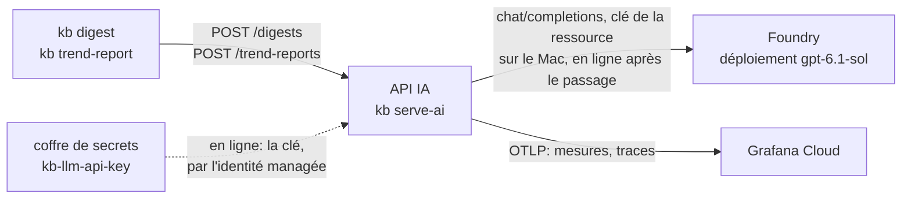

# Le service d'IA de K-B: le déploiement du modèle gpt-6.1-sol

!!! note "Compétences de la certification"

    > Rédaction de la documentation.

    — C8

Cette fiche documente le service d'IA de K-B: le déploiement du modèle `gpt-6.1-sol` dans Microsoft Foundry
(anciennement Azure AI Foundry), fait à la main dans le portail, hors du code de K-B. Elle dit qui y accède,
comment il s'installe et se teste, de quoi il dépend, et quelles données il reçoit. L'API IA, qui l'appelle, a sa
propre fiche, [la fiche de l'API IA](api_ia_pour_docu.md). Le code cité est celui de `main` au commit `cc3d8eaf`
(2026-11-18). Ce qui est hors du code vient de trois relevés: la ressource, ses déploiements et les rôles de
l'opératrice, lus avec `az`, en lecture seule, le 2026-11-18 (« Relire l'état »); le catalogue des modèles et le
formulaire de déploiement de `gpt-6.1-sol` (son type, sa limite de jetons par minute, la zone de données),
captures du portail Foundry du 2026-11-17; l'essai de bout en bout du 2026-11-17 (« Le test »). Une lecture plus
ancienne, du 2026-11-09, n'est citée que pour `DeepSeek-V4-Flash`. Les chemins du code de K-B (`ai_api/…`,
`core/…`) partent de `src/k_b/`, les autres de la racine du dépôt.

## Ce qu'est le service

Le service est une ressource Foundry, en France Central (`francecentral`, lu le 2026-11-18), dans un groupe de
ressources Azure, avec son projet Foundry. La fiche ne les nomme pas: les commandes les notent `<ressource Foundry>`
et `<groupe de ressources>` (« Relire l'état »).

La ressource porte deux déploiements (`az cognitiveservices account deployment list`, lu le 2026-11-18). En tableau,
`az` ne montre pas le type: celui de `gpt-6.1-sol` vient de la capture de son déploiement, le 2026-11-17.

| Déploiement | Version | Type | Capacité | Mise à jour de la version | Filtre de contenu | Appelé par K-B |
|---|---|---|---|---|---|---|
| `gpt-6.1-sol` | 2026-09-29 | `DataZoneStandard` | 250 | `NoAutoUpgrade`: version figée | `Microsoft.DefaultV2` | par l'API IA: sur le Mac depuis le 2026-11-17, en ligne après le passage de la production (« Le branchement de K-B ») |
| `gpt-6-luna` | 2026-09-22 | non relu | 140 | `NoAutoUpgrade`: version figée | `Microsoft.DefaultV2` | par l'API IA, en ligne, jusqu'au passage de la production à `gpt-6.1-sol` |

- **La capacité** est en milliers de jetons par minute: le portail a fixé 250 000 jetons par minute pour
    `gpt-6.1-sol` (capture du 2026-11-17), dont le nombre de requêtes par minute n'a pas été lu. Pour `gpt-6-luna`,
    les en-têtes des réponses donnaient 140 000 jetons et 140 requêtes par minute (`x-ratelimit-limit-tokens`,
    `x-ratelimit-limit-requests`, essai du 2026-10-17,
    [note du branchement de gpt-6-luna](https://github.com/SabineLaurent/K-B/blob/main/docs/journaling/2026-10-17-brancher-gpt-6-luna-sur-foundry.md), « Preuve »).
- **Le choix de `gpt-6.1-sol`**: c'est le modèle que préconise le banc d'essai des modèles du 2026-11-16, réglé à
    l'effort de raisonnement `low`, la plus faible valeur qu'il accepte (journal des décisions d'architecture, ou ADR,
    2026-11-17, « Appel du modèle: les réglages des modèles du banc de C7 »).
- **`DeepSeek-V4-Flash`**, essayé comme candidat juge le 2026-10-17 (même note, « Choix faits et options
    écartées »): une lecture du 2026-11-09, dont la ressource n'est pas établie, le listait; celle du 2026-11-18 ne
    le liste pas sur cette ressource.

### Le type de déploiement: la zone de données de l'Union européenne

`DataZoneStandard` est le type « Zone de données standard »: le prix est à la consommation (par jeton), et le
traitement reste dans une zone de données que Microsoft définit. Pour une ressource en France, c'est la zone de
l'Union européenne; le portail l'a écrit au déploiement de `gpt-6.1-sol`: <q>Votre déploiement dans francecentral
traitera les données dans la zone de données EUR</q> (capture du 2026-11-17). Ce que dit Microsoft Learn (page
« <span lang="en">Understanding deployment types in Microsoft Foundry Models</span> », `ms.date` 2026-08-06, relue
le 2026-11-09):

- <q lang="en">The EU Data Zone follows the Azure EU Data Boundary, which can include European Free Trade Association (EFTA)
    countries and regions such as Norway and Switzerland in addition to EU member states.</q> La zone de l'Union
    peut donc compter, en plus des États membres, des pays de l'Association européenne de libre-échange (AELE), comme
    la Norvège ou la Suisse.
- <q lang="en">Microsoft can add regions to either data zone without prior notice</q>: la zone peut s'étendre à d'autres
    régions sans préavis.
- <q lang="en">Data stored at rest remains in the designated Azure geography</q>: les données au repos restent dans la
    géographie de la ressource.

La page « <span lang="en">Data, privacy, and security for Foundry Models sold by Azure in Microsoft Foundry</span> » (`ms.date`
2026-05-18, relue le 2026-11-09) le dit autrement: <q lang="en">prompts and responses may be processed in that or any other
European Union Member Nation</q>. Les deux pages de Microsoft ne nomment donc pas le même périmètre (« Limites »).

Le type a été choisi le 2026-10-17, pour `gpt-6-luna`, et gardé pour `gpt-6.1-sol`, pour une règle du projet: le lieu
du traitement est choisi et écrit, en zone de l'Union quand le fournisseur l'offre (`.claude/rules/conformite.md`,
« RGPD: sous-traitance et transferts », le règlement général sur la protection des données). Le type Global
Standard, écarté, peut traiter les données dans toute région Azure.

### La version figée

« Refuser les mises à niveau automatiques des versions de modèle » (`NoAutoUpgrade`) fige la version 2026-09-29 de
`gpt-6.1-sol`: le modèle ne change pas sans qu'on le décide, et les mesures de l'essai du 2026-11-17 restent
comparables. La page « <span lang="en">Foundry Models lifecycle and support policy</span> » (`ms.date` 2026-07-24,
relue le 2026-11-09) dit ce qui se passe au retrait de la version, de deux façons (« Limites »): sa foire aux
questions dit que, avec `NoAutoUpgrade`, le déploiement <q lang="en">stops working at retirement</q>, et son tableau « <span lang="en">Lifecycle
stages</span> » qu'une version retirée rend `410 Gone` à toute requête; sa section « <span lang="en">Automatic upgrades</span> » s'ouvre sur
<q lang="en">For Global Standard, Data Zone Standard, and Standard deployment types, Microsoft manages automatic upgrades when
a model version is retired</q>, sans exception pour `NoAutoUpgrade`. La date de retrait de `gpt-6.1-sol` n'a pas
été lue (« Limites »). Microsoft prévient au moins 60 jours avant, par courriel aux propriétaires de l'abonnement
qui ont un déploiement actif (<q lang="en">Sent to subscription owners with active deployments</q>), et
dans Azure Service Health (même page).

### Le filtre de contenu `DefaultV2`

`DefaultV2` (`Microsoft.DefaultV2` pour `az`) est le jeu de garde-fous par défaut de Foundry. Pour un modèle de
texte, il filtre la haine, la violence, le contenu sexuel et l'automutilation dans la demande et dans la réponse, à
partir du niveau de gravité moyen; il détecte les attaques par la consigne (*<span lang="en">jailbreak</span>*) dans la demande, et le
texte ou le code protégés dans la réponse (« <span lang="en">Default safety policies in Microsoft Foundry</span> », `ms.date` 2026-10-08, relue le
2026-11-09). Une demande bloquée rend un 400 `content_filter`; une réponse filtrée se termine par `finish_reason`
`content_filter`. Le client de K-B lit l'un et l'autre `llm_content_filtered`, sans nouvelle tentative
(`ai_api/connectors/llm_client.py:487-491`, `:558-559`). Sur les 18 requêtes de l'essai du 2026-11-17, aucun
filtre ne s'est déclenché.

## La gestion des accès

Deux portes donnent accès au service: le plan de gestion d'Azure (voir, modifier ou supprimer la ressource et ses
déploiements, lire ses clés), tenu par les rôles Azure; et l'appel du modèle, par une clé de la ressource ou par un
jeton Microsoft Entra ID.

### Les rôles de l'opératrice

Le tableau suivant donne les rôles de l'opératrice sur le groupe de ressources du service, dont la ressource
hérite, et sur le coffre de secrets de K-B (`az role assignment list`, lu le 2026-11-18). Seuls ceux qui portent sur
le service et sur sa clé y sont. Chaque définition est celle de Microsoft Learn, relue le 2026-11-09 (pages
« <span lang="en">Azure built-in roles</span> », catégories <span lang="en">Privileged</span>,
<span lang="en">AI + Machine Learning</span> et <span lang="en">Security</span>, `ms.date` 2026-07-01).

| Rôle | Portée | Définition de Microsoft | Ce qu'il permet sur le service |
|---|---|---|---|
| Owner (Propriétaire) | le groupe de ressources | <q lang="en">Grants full access to manage all resources, including the ability to assign roles in Azure RBAC.</q> | tout gérer, attribuer des rôles, lire les clés (action `*`) |
| Contributor (Contributeur) | le groupe | <q lang="en">Grants full access to manage all resources, but does not allow you to assign roles in Azure RBAC […]</q> | tout gérer sauf les rôles, déployer un modèle, lire les clés (action `*`) |
| Foundry User | le groupe | <q lang="en">Grants reader access to Foundry projects, reader access to Foundry accounts, and data actions for an Foundry project.</q> | lire la ressource, lire les clés (`Microsoft.CognitiveServices/accounts/listkeys/action`), appeler le modèle par Entra ID (actions de données `Microsoft.CognitiveServices/*`) |
| Key Vault Secrets Officer | le groupe, et le coffre de secrets de K-B | <q lang="en">Perform any action on the secrets of a key vault, except manage permissions.</q> | poser et lire le secret `kb-llm-api-key`, la clé du service (« La clé de K-B ») |

L'opératrice a donc plus que le nécessaire pour l'usage courant: appeler le modèle demande la clé ou Foundry User,
et Owner, Contributor et Foundry User suffisent chacun à lire la clé. D'autres qu'elle peuvent en faire autant: tout
titulaire d'Owner ou de Contributor sur l'abonnement ou sur le groupe peut lire les clés et modifier les
déploiements; un titulaire de Foundry User, lire les clés; un administrateur général de l'annuaire Microsoft Entra
ID, se donner cet accès. Seuls les rôles de l'opératrice sont listés.

### La clé de K-B

K-B appelle le modèle par la clé de la ressource, envoyée dans l'en-tête `Authorization: Bearer`
(`ai_api/connectors/llm_client.py:214`). L'API IA la lit dans la variable `KB_LLM_API_KEY`
(`ai_api/connectors/llm_settings.py:38`, `:169`). L'authentification par clé est active sur la ressource
(`disableLocalAuth` vaut `False`, lecture du 2026-11-18), et l'essai du 2026-11-17 a appelé
`gpt-6.1-sol` par la clé. Microsoft Learn le rappelle: <q lang="en">If you use key-based authentication instead,
the key grants full access without role restrictions</q> (« <span lang="en">Role-based access control for
Microsoft Foundry</span> », `ms.date` 2026-09-16, relue le 2026-11-09). Qui a la clé appelle donc les deux
déploiements, quels que soient ses rôles.

Où vit la clé:

- **Sur le Mac**: dans le `.env` de l'opératrice, ignoré par git, que `uv run --env-file .env` passe au processus;
    `kb` ne le lit jamais lui-même (`.claude/rules/poc.md`, règle 2).
- **En ligne**: dans le secret `kb-llm-api-key` du coffre de secrets de K-B, posé à la main, collé sans écho
    (`infra/README.md`, « 4. Poser les secrets »). Parmi les identités de K-B, seule celle de l'app `ca-kb-ai-api` le
    lit (`infra/main.bicep:181`, `:205-208`), par le rôle Key Vault Secrets User sur ce seul secret
    (`infra/modules/key-vault-secret-access.bicep:1-9`, `:28-38`). Container Apps le donne au conteneur comme variable
    d'environnement, par une référence au coffre de secrets (Key Vault)
    (`infra/modules/api-container-app.bicep:68-73`, `:75-81`, `:132`, `:152`). La
    clé n'est ni dans l'image ni dans le code.

Changer la clé, par exemple si elle a fuité: la régénérer dans le portail (ressource, « Clés et point de
terminaison »), puis la reporter dans le `.env` et dans le secret `kb-llm-api-key`, par la procédure « Pour refaire
un seul secret » d'`infra/README.md`, qui redémarre `ca-kb-ai-api`. Cette procédure n'a pas été essayée pour cette
clé.

L'accès réseau public de la ressource est activé (`publicNetworkAccess` vaut `Enabled`, même lecture du
2026-11-18). Ses règles réseau (`networkAcls`), qui pourraient le restreindre à des adresses, n'ont pas été lues.

## L'installation

### Le déploiement, à la main

Fait dans le portail Foundry le 2026-11-17, dans le projet Foundry de la ressource (captures du 2026-11-17). Pour le
refaire, sur une ressource Foundry d'une région de l'Union:

1. Ouvrir le projet dans le portail Foundry, **Catalogue**, puis **Modèles**, et choisir `gpt-6.1-sol`; puis
    **Déployer**.
2. **Nom du déploiement**: `gpt-6.1-sol`. C'est la valeur de `KB_LLM_MODEL`.
3. **Type de déploiement**: « Zone de données standard ». Le portail affiche alors <q>Votre déploiement dans
    francecentral traitera les données dans la zone de données EUR</q>.
4. **Paramètres de version du modèle**: version 2026-09-29; **Stratégie de mise à jour des versions de modèle**:
    « Refuser les mises à niveau automatiques des versions de modèle » (`NoAutoUpgrade`).
5. **Limite de débit des jetons par minute**: 250 000.
6. **Garde-fous**: `DefaultV2`, le jeu par défaut. Puis **Déployer**.

Le 2026-11-17, le catalogue montre `gpt-6.1-sol` en « Disponibilité générale », et un nouveau déploiement est
permis. Une fois la version au stade « <span lang="en">Deprecated</span> », 12 mois après sa sortie, ce déploiement ne se
refera que sur un abonnement qui l'a déjà déployée (<q lang="en">"Existing customer" is determined at the subscription level
[…] A new subscription under the same tenant doesn't inherit access.</q>, page « <span lang="en">Foundry Models lifecycle and
support policy</span> »).

### Le branchement de K-B

L'API IA ne connaît du service que des réglages; aucune branche du code n'est propre à Azure
([architecture de l'API IA](https://github.com/SabineLaurent/K-B/blob/main/docs/architecture-api-ia.md), « Vue d'ensemble »).

| Réglage | Valeur pour ce service | Sur le Mac (`.env`, `.env.example:114-133`) | En ligne (`infra/main.bicep`) |
|---|---|---|---|
| `KB_LLM_PROVIDER` | `openai_compatible` | à poser | fixé (`:298`) |
| `KB_LLM_BASE_URL` | `https://<sous-domaine>.openai.azure.com/openai/v1` | à poser | paramètre `llmBaseUrl` de la passe 2 (`:22-23`, `:299`) |
| `KB_LLM_MODEL` | `gpt-6.1-sol` | à poser | paramètre `llmModel` de la passe 2 (`:25-26`, `:300`) |
| `KB_LLM_API_KEY` | la clé de la ressource | à poser | le secret `kb-llm-api-key` (`:181`) |
| `KB_LLM_REASONING_EFFORT` | `low` | à poser: `.env.example` porte `none` (`:128`), la valeur de `gpt-6-luna` | fixé (`:304`) |
| `KB_LLM_SEND_PROMPT_CACHE_OPTIONS` | non posée: `true` (`core/config.py:266`) | non posée (`.env.example:133`, en commentaire) | non posée |

- `KB_LLM_REASONING_EFFORT=low` fait envoyer `reasoning_effort: "low"` au lieu de `temperature: 0`
    (`ai_api/connectors/llm_client.py:419-422`). `gpt-6.1-sol` refuse `none` et `minimal`, et demande `low`; `kb
    serve-ai` n'accepte que `none`, `minimal` et `low` (`core/config.py:260`; journal ADR, 2026-11-17).
- `KB_LLM_SEND_PROMPT_CACHE_OPTIONS`, non posée, vaut `true`: chaque requête porte `prompt_cache_options`, qui coupe
    le cache de la consigne (« Ce que Microsoft en garde »). `gpt-6.1-sol` accepte ce champ (essai du 2026-11-17,
    aucune requête refusée). À `false`, `kb serve-ai` refuse de démarrer en production
    (`ai_api/connectors/llm_settings.py:106-123`).
- La passe 2, ses paramètres et le secret: `infra/README.md`, « 4. Poser les secrets » et « 5. Seconde passe ». Le
    passage de la production à `gpt-6.1-sol` demande l'effort `low` en ligne (`infra/main.bicep:304`), et l'adresse
    (`llmBaseUrl`), le nom (`llmModel`) et la clé (`kb-llm-api-key`) de ce déploiement, posés à la main à la passe 2.
- Le dépôt ne fixe pas la valeur de `KB_LLM_MODEL`: elle vient du `.env` sur le Mac et du paramètre `llmModel` en
    ligne.

### Relire l'état

Les trois lectures du 2026-11-18, en lecture seule. Aucune n'affiche de clé. En `-o table`, `az` ne montre aucune
colonne nommée `type` (ni `id`, ni `etag`): le type des déploiements n'apparaît donc pas dans la sortie de la
première. La dernière affiche des portées complètes, avec l'identifiant de l'abonnement et les noms des groupes: la fiche
n'en garde que le rôle et le type de portée. Le groupe et la ressource sont deux variables, à remplir d'abord.

```sh
RG=<groupe de ressources>
RESOURCE=<ressource Foundry>
# Les déploiements: nom, type, capacité, version, mise à jour de la version, filtre de contenu.
az cognitiveservices account deployment list -g "$RG" -n "$RESOURCE" \
  --query "[].{nom:name, type:sku.name, capacite:sku.capacity, version:properties.model.version, maj:properties.versionUpgradeOption, filtre:properties.raiPolicyName}" -o table
# La ressource: région, accès public, authentification par clé (sortie du 2026-11-18: francecentral, Enabled, False).
az cognitiveservices account show -g "$RG" -n "$RESOURCE" \
  --query "{region:location, acces_public:properties.publicNetworkAccess, cle_coupee:properties.disableLocalAuth}" -o table
# Les rôles du compte connecté, et leur portée.
az role assignment list --assignee "$(az ad signed-in-user show --query id -o tsv)" --all \
  --query "[].{role:roleDefinitionName, portee:scope}" -o table
```

## Le test

### Ce qui a été essayé

- **Le 2026-11-17, sur `gpt-6.1-sol`**, par `kb serve-ai` sur le Mac, au commit `f1eac19c`, avec
    `KB_LLM_REASONING_EFFORT=low` et l'export des mesures vers Grafana Cloud dans le bac à sable
    (`KB_DEPLOYMENT_ENVIRONMENT=sandbox`), sans écrire de fiche dans le coffre. Sa ligne de démarrage dit
    `LLM provider openai_compatible, model gpt-6.1-sol` et `LLM reasoning effort low, prompt_cache_options sent`.
    - Une demande de comptes rendus de veille (`POST /digests`) sur 14 jours, 300 items (le plafond): 200 en 200,0 s,
        l'échéance de la demande. 4 fiches sur 9; les 5 autres sujets en `llm_timeout`, un appel coupé par l'échéance,
        puis quatre jamais appelés. 12 requêtes au modèle, chacune en une tentative: 11 `ok` (`finish_reason: stop`),
        1 `llm_timeout`. 74 383 jetons en entrée, 9 733 en sortie, dont 914 de raisonnement; 199,5 s de modèle,
        les quatre rédactions abouties de 23 à 31 s.
    - Un compte rendu des tendances (`POST /trend-reports`), le premier, sur quatre fenêtres: 200 en 56,0 s; 5 dépôts
        retenus, 20 textes, aucun retiré. 6 requêtes au modèle, toutes `ok` en une tentative; 14 021 jetons en entrée,
        1 281 en sortie, dont 170 de raisonnement.
    - Aucune issue `llm_content_filtered` ni `llm_truncated` sur les 18 requêtes.
    - Une condition de l'essai: sur le Mac, `kb serve-ai` a tourné avec un réglage d'OpenSSL qui retire de TLS
        l'échange de clés ML-KEM; sans lui, aucune requête n'atteignait le modèle (#629, « Limites »).
- **Sur `gpt-6-luna`, le modèle de K-B avant `gpt-6.1-sol`**:
    - le 2026-10-17 (note du branchement, « Preuve »): un appel avec la clé rend 200 et le `model`
        `gpt-6-luna-2026-09-22`; 6 classements, 5 rédactions et 3 jugements d'une veille réelle passent, avec le schéma
        strict de K-B; aucun cache n'est écrit (`cache_write_tokens` vaut 0 sur 20 réponses);
    - le 2026-10-28, par `kb serve-ai` dans le bac à sable: une demande de fiches, sur 3 jours, 10 requêtes au
        modèle, 200 en 56,8 s
        ([note du contenu des appels](https://github.com/SabineLaurent/K-B/blob/main/docs/journaling/2026-10-28-contenu-des-appels-au-modele.md), « Essai réel »);
    - le 2026-11-10, par les deux commandes de [Refaire le test](#refaire-le-test): avec la clé, vers 00:03 UTC, le
        déploiement répond `gpt-6-luna-2026-09-22 stop`; sans clé, il refuse: `HTTP 401`, avec le code `"401"` et le
        message <q lang="en">Access denied due to invalid subscription key or wrong API endpoint […]</q>.

### Refaire le test

Chaque commande se lance depuis la racine du dépôt, dans un terminal où le `.env` n'est pas exporté.
`uv run --env-file .env` passe tout le `.env` à `sh` et à `curl`, et non la seule clé. La clé n'est lue que dans la
variable `KB_LLM_API_KEY`: elle n'est ni tapée, ni affichée, ni écrite dans l'historique du shell. `printf`, une
commande interne du shell, la passe à `curl` par l'entrée standard (`-H @-`), et non sur la ligne de commande, que
voient les autres processus.

1. **L'appel sans clé est refusé**:

    ```sh
    curl -sS -w '\nHTTP %{http_code}\n' -X POST "https://<sous-domaine>.openai.azure.com/openai/v1/chat/completions" \
      -H 'Content-Type: application/json' \
      -d '{"model":"gpt-6.1-sol","messages":[{"role":"user","content":"ping"}],"max_completion_tokens":16}'
    ```

    Attendu: `HTTP 401`. Le corps de la réponse ne contient aucun secret.

2. **L'appel avec la clé répond, avec la version figée**, réglé comme K-B l'envoie (`reasoning_effort` et cache
    coupé):

    ```sh
    uv run --env-file .env sh -c 'printf "Authorization: Bearer %s\n" "$KB_LLM_API_KEY" | curl -sS -H @- \
      -H "Content-Type: application/json" \
      -d "{\"model\":\"$KB_LLM_MODEL\",\"messages\":[{\"role\":\"user\",\"content\":\"ping\"}],\"max_completion_tokens\":16,\"reasoning_effort\":\"$KB_LLM_REASONING_EFFORT\",\"prompt_cache_options\":{\"mode\":\"explicit\"}}" \
      "$KB_LLM_BASE_URL/chat/completions"' \
      | python3 -c 'import json, sys; d = json.load(sys.stdin); print(d.get("model"), d["choices"][0]["finish_reason"] if "choices" in d else d.get("error"))'
    ```

    Attendu: le nom du modèle avec sa version, puis `stop` ou `length`. La commande n'affiche ni la clé ni la réponse
    du modèle. Elle n'a pas été relancée sur `gpt-6.1-sol` (« Limites »).

3. **La chaîne de K-B**: `kb serve-data` et `kb serve-ai` ([README](https://github.com/SabineLaurent/K-B/blob/main/README.md), « Lancer l'API » et « Lancer
    l'API IA »), puis `kb digest` (même README, « Écrire les comptes rendus de veille dans le coffre », le coffre
    Obsidian). Elle envoie une veille réelle au modèle, et coûte ses jetons.

Les tests du dépôt (`uv run pytest`, l'intégration continue ou CI) n'appellent jamais le service: le client du modèle y est servi par un
rejeu ou un transport simulé. Ils vérifient le corps de la requête que K-B envoie: le cache coupé
(`tests/ai_api/test_llm_client.py:204`,
`test_the_request_is_a_chat_completion_with_a_strict_json_schema_written_as_a_dict`), `reasoning_effort`
(`:236`, `test_a_reasoning_model_gets_its_reasoning_effort_and_no_temperature`), et le refus en production du cache
non coupé (`tests/ai_api/test_llm_settings.py:113`,
`test_the_prompt_cache_options_left_out_are_refused_in_production`).

## Les dépendances et les interconnexions

Le schéma suivant montre qui appelle le service et ce dont l'appel dépend. La liste qui le suit le décrit en
texte, élément par élément.



- **Un seul appelant**: l'API IA, par le format d'appel Chat Completions d'OpenAI, sur le chemin
    `chat/completions` (`ai_api/connectors/llm_client.py:40`). Elle n'appelle que lui, sans `store`: aucune des
    fonctions qui gardent des échanges chez Microsoft (<span lang="en">Responses API, Assistants, Stored completions</span>) (registre,
    « Usage par le fournisseur »). Ses clients sont `kb digest` et `kb trend-report` (la fiche de l'API IA). Le
    script d'enregistrement du jeu de référence, `tests/ai_api/digests_reference.py`, lancé à la main, passe lui
    aussi par l'API IA, dans le même processus.
- **En ligne, le modèle est appelé depuis le 2026-11-11.** L'app `ca-kb-ai-api` est réglée pour joindre le
    déploiement que nomment `llmBaseUrl` et `llmModel` (`infra/main.bicep:280-317`): `gpt-6-luna` jusqu'au passage à
    `gpt-6.1-sol` (« Le branchement de K-B »). Le job `caj-kb-digest-watch` (`infra/deployment.json:3`) lance
    `kb digest`, puis `kb trend-report` (`commands/digest_watch_command.py:59-75`), par défaut le lundi et le jeudi à
    10:00 UTC (`infra/main.bicep:31-32`). Lancé à la main le 2026-11-11, il a donné les premiers points de la
    production dans Grafana Cloud, vers 16:00 UTC; lancé par son horaire le 2026-11-12, de 10:00:00 à 10:02:44 UTC, il
    a appelé le modèle (#522). Les autres jobs n'appellent pas le modèle: `caj-kb-smoke-test` n'appelle de l'API IA
    que `GET /health`, qui répond sans lui (`core/api_health.py:12-13`).
- **Le coffre de secrets**, en ligne: il porte la clé; l'identité managée de l'API IA la lit (« La clé de K-B »).
- **Grafana Cloud** reçoit, par OTLP (le protocole d'export d'OpenTelemetry), les mesures de chaque appel au modèle, et, sous réglage, son contenu (« Les données
    envoyées au modèle »). Le monitorage du modèle a sa fiche, [la fiche du monitorage](monitoring_pour_docu.md).
- **Le quota** de 250 000 jetons par minute est partagé: un compte rendu des tendances et un `kb digest` lancés
    dans la même minute le consomment ensemble (journal ADR, « Tendances: le choix du modèle et ses contrôles
    (#368) »).
- **Ce dont dépend le service lui-même**:
    - l'abonnement Azure de la ressource: son accès, son quota et sa facturation;
    - le contrat de Microsoft avec le titulaire de cet abonnement (registre, « Fondement de la sous-traitance »);
    - la date de retrait de la version. Le courriel d'avant retrait va aux propriétaires de l'abonnement.

## Les données envoyées au modèle

### Ce qui part

L'API IA envoie au modèle une consigne, une constante du code, et un message utilisateur qui porte les publications
de la veille (`.claude/rules/poc.md`, règle 8). Le détail est au registre, sections « Envoi des items au modèle des
fiches » et « Envoi des dépôts au modèle du compte rendu des tendances »:

- **Pour les fiches de veille**, une liste blanche de champs par sorte de publication (`FIELDS_BY_KIND`,
    `ai_api/watch_items.py:40-92`), plus `item_id` et `kind` pour chacune:
    - un papier: `title`, `summary`;
    - une vulnérabilité: `cve_id`, `title`, `description`, `vendor`, `product`, `ransomware_use`;
    - une release: `repository_name`, `tag_name`, `title`, `body`;
    - un avis de sécurité: `ghsa_id`, `cve_id`, `title`, `cve_listed_in_cisa_kev`, `packages`;
    - un article de lettre d'information: `edition`, `title`, `summary`.

    Jamais l'auteur ni l'URL. Toute URL devient `[url]` (`ai_api/watch_items.py:28`), et chaque `@login` des notes
    d'une release devient `@user` (`:33`, `:94`). Au classement, chaque publication n'envoie que `item_id`, `kind`,
    `title` et, sauf un avis de sécurité, son texte long (résumé, description ou notes), coupé à 500 caractères
    (`ai_api/stages/classification.py:71-77`, `:289-304`, `core/config.py:464`); à la rédaction, chaque texte est
    coupé à 2 000 caractères (`core/config.py:446`).

- **Pour le compte rendu des tendances**, des champs de chaque dépôt candidat (nom, description, topics, langage),
    puis le README nettoyé des dépôts choisis, coupé à 4 000 caractères (registre).

- **Rien de la bibliothèque de lecture**: ni entrée Zotero ni clip (registre, « Envoi des items au modèle des
    fiches »).

**Données personnelles qui partent** (registre): le login du propriétaire d'un dépôt dans `owner/repo`, quand c'est
une personne; une adresse mail écrite dans les notes d'une release; un nom écrit en texte libre.

### Ce que Microsoft en garde

- **Le modèle ne garde rien et n'apprend rien**: <q lang="en">The models are stateless: no prompts or completions are stored
    in the model. Additionally, prompts and completions are not used to train, retrain, or improve the base models.</q>
    (« <span lang="en">Data, privacy, and security for Foundry Models sold by Azure in Microsoft Foundry</span> », relue le 2026-11-09).
- **Le cache de la consigne est coupé**: à chaque requête, K-B envoie `prompt_cache_options: {"mode": "explicit"}`
    sans point d'arrêt, qui n'écrit aucun cache (`ai_api/connectors/llm_client.py:41`, `:416-417`). Vérifié une fois,
    sur `gpt-6-luna`, le 2026-10-17: `cache_write_tokens` vaut 0 sur 20 réponses. Sur `gpt-6.1-sol`, non relevé: le
    client ne suit pas ce champ.
- **La surveillance des abus garde les demandes signalées.** Une demande et sa réponse que la classification signale,
    ou qui font partie d'un usage potentiellement abusif, peuvent être stockées pour une revue humaine; la revue
    automatique, elle, ne stocke rien. Elles le sont dans la géographie de la ressource, séparées par ressource. Les
    relecteurs sont des employés de Microsoft situés dans l'Espace économique européen, pour un déploiement dans
    l'Espace économique européen. Aucune des deux pages de Microsoft ne publie de durée de conservation (« <span lang="en">Data,
    privacy, and security for Foundry Models sold by Azure in Microsoft Foundry</span> », section « <span lang="en">Preventing abuse</span> »,
    `ms.date` 2026-05-18; « <span lang="en">Foundry Models sold by Azure abuse monitoring</span> », `ms.date` 2026-05-13; relues le
    2026-11-09). Une demande signalée porte les publications de son lot, donc parfois des données personnelles.
- **Cette surveillance est modifiable**, sur demande du titulaire de l'abonnement, s'il remplit les critères
    d'accès limité de Microsoft (« <span lang="en">modified abuse monitoring</span> », page « <span lang="en">Foundry Models sold by Azure abuse
    monitoring</span> »). Sur la ressource de K-B, la capacité `ContentLogging`, qui le dirait, n'a pas été relue
    (« Limites »). Selon Microsoft, <q lang="en">The value of "false" for the "ContentLogging" attribute appears
    only if data storage for abuse monitoring is turned off. Otherwise, this property will not appear</q> (« <span lang="en">Data,
    privacy, and security for Foundry Models sold by Azure in Microsoft Foundry</span> », section « <span lang="en">How can a customer
    verify if data storage for abuse monitoring is off?</span> »).
- **Ce qui relève du titulaire de l'abonnement**: s'il active la protection des services d'IA de Microsoft Defender
    for Cloud, les demandes et les réponses sont gardées 30 jours chez Microsoft; ses politiques sur les journaux de
    diagnostic ne sont pas connues. K-B n'active aucune de ces fonctions (registre des traitements).

### Une copie possible vers Grafana Cloud

Le réglage `KB_TRACE_CONTENT` de l'API IA peut envoyer le contenu d'un appel au modèle (la consigne, les champs
envoyés et la sortie du modèle) à Grafana Cloud, avec les traces. C'est un flux de données personnelles, inscrit au
registre (« Envoi des mesures à Grafana Cloud »).

- **Par défaut, rien ne part**: sans la variable, le réglage vaut `none` (`ai_api/connectors/metrics_export.py:158`).
- **En production**, il est fixé à `none` (`infra/main.bicep:297`), et `all` y est refusé au démarrage
    (`ai_api/connectors/metrics_export.py:186-187`).
- **Dans le bac à sable**, aucun fichier du dépôt ne le pose (`.env.example:173-178`, `.env.e2e_test.example`), et
    `make sandbox-alerts` tourne sur le rejeu, sans le modèle et sans traces (`tests/e2e/test_sandbox_alerts.py`).
    L'essai du 2026-11-17 l'a gardé à `none` (`model content none` au démarrage).
- **À la main**, `KB_TRACE_CONTENT=all` peut être posé pour un essai hors production. Le contenu des appels part
    alors dans Grafana Cloud, qui le garde 14 jours (registre, « Envoi des mesures à Grafana Cloud », « Durée de
    conservation »). Un essai l'a posé le 2026-10-28, avec 10 requêtes à `gpt-6-luna` (note du contenu des appels,
    « Essai réel »). Depuis la réponse de Grafana Labs du 2026-10-29, le réglage reste à `none`: ce qu'elle change
    au contrat de sous-traitance (DPA, <span lang="en">Data Processing Agreement</span>) est à décider (#163; registre, même section, « Contrat »).

## Limites

- **La clé ouvre tout.** L'authentification par clé est active: qui a la clé appelle les deux déploiements, sans
    rôle. L'accès réseau public est activé, et ses règles réseau n'ont pas été lues. Un jeton Entra ID, par
    l'identité managée de l'API IA et le rôle Foundry User sur la ressource, n'est pas codé.
- **Le déploiement est hors du code.** Une modification faite dans le portail (type, version, filtre) n'est vue par
    aucun test de K-B; seule une lecture comme celles de « Relire l'état » la montre.
- **Des réglages restent sans lecture par `az`.** Le type du déploiement de `gpt-6.1-sol` vient de la capture de son
    formulaire, du 2026-11-17; celui de `gpt-6-luna` n'a pas été relu. Le stockage de la surveillance des abus
    (`ContentLogging`) n'a pas été relu sur la ressource: qu'il soit actif ou coupé n'est pas vérifié. Parade: les
    lectures de « Relire l'état », en `-o json` pour le type, et avec
    `properties.capabilities[?name=='ContentLogging'].value` pour le stockage.
- **Les rôles reçus par un groupe ne sont pas lus.** `az role assignment list` ne montre les rôles qu'un groupe
    Microsoft Entra donne à ses membres qu'avec l'option `--include-groups`, que la lecture du 2026-11-18 n'avait pas
    (référence de la commande, Microsoft Learn, lue le 2026-11-18).
- **Les deux commandes de « Refaire le test » n'ont pas été relancées sur `gpt-6.1-sol`.** L'essai du 2026-11-17
    l'a appelé par `kb serve-ai`; sans clé, seul un `GET` de la liste des modèles a été essayé ce jour-là, et `curl`
    a reçu le `401` attendu.
- **Un contournement de TLS a été nécessaire pour l'essai du 2026-11-17** (#629). Sur le Mac, le Python de K-B
    (OpenSSL 3.5.6) a reçu une `SSLEOFError` sur 8 à 9 appels sur 10 vers la ressource, sans clé; `curl` (LibreSSL),
    ou ce même Python en TLS 1.2, ou sans l'échange de clés ML-KEM, a reçu les `401` attendus. Deux hypothèses, non
    tranchées: un équipement du réseau local qui coupe un premier message TLS trop gros, ou un changement du côté
    d'Azure. Que le conteneur en ligne soit touché n'a pas été vérifié.
- **À 300 items, une demande de comptes rendus dépasse son échéance avec `gpt-6.1-sol`**: le 2026-11-17, 4 fiches
    sur 9 en 200 s, les appels faits un par un. L'essai de `gpt-6-luna` du 2026-10-28 portait sur 3 jours: les deux
    ne se comparent pas directement.
- **Le coût estimé par K-B est compté aux prix de `gpt-6.1-sol`** (`core/config.py:293-303`), en contexte court:
    tout appel y est compté, quel que soit `KB_LLM_MODEL`, et le prix du contexte long n'est pas distingué (journal
    ADR, 2026-11-18).
- **`gpt-6-luna` reste déployé.** La production l'appelle jusqu'à son passage à `gpt-6.1-sol`; ensuite, K-B ne
    l'appelle plus, et la clé le permet encore.
- **Deux pages de Microsoft ne disent pas le même périmètre** de la zone de données de l'Union: <q lang="en">that or any other
    European Union Member Nation</q> (« <span lang="en">Data, privacy, and security</span> »), ou la limite des données de l'Union, qui peut
    compter des pays de l'AELE (« <span lang="en">Understanding deployment types</span> »).
- **Deux sections de la même page de Microsoft ne disent pas la même chose du retrait**: avec `NoAutoUpgrade`, le
    déploiement cesse de répondre (foire aux questions), ou il est mis à niveau d'office (« <span lang="en">Automatic upgrades</span> »,
    sans exception pour `NoAutoUpgrade`).
- **La durée de conservation de la surveillance des abus** n'est pas publiée par Microsoft.
- **La date de retrait de `gpt-6.1-sol`** n'a pas été lue.
- **Les métriques du déploiement dans Azure Monitor** n'ont pas été consultées; le suivi du modèle passe par les
    mesures que l'API IA envoie à Grafana Cloud.

## Sources

Pages de Microsoft Learn, relues le 2026-11-09 (en UTC):

- [<span lang="en">Understanding deployment types in Microsoft Foundry Models</span>](https://learn.microsoft.com/en-us/azure/foundry/foundry-models/concepts/deployment-types),
    `ms.date` 2026-08-06
- [<span lang="en">Data, privacy, and security for Foundry Models sold by Azure in Microsoft Foundry</span>](https://learn.microsoft.com/en-us/azure/foundry/responsible-ai/openai/data-privacy),
    `ms.date` 2026-05-18
- [<span lang="en">Foundry Models sold by Azure abuse monitoring</span>](https://learn.microsoft.com/en-us/azure/foundry/openai/concepts/abuse-monitoring), `ms.date` 2026-05-13
- [<span lang="en">Foundry Models lifecycle and support policy</span>](https://learn.microsoft.com/en-us/azure/foundry/openai/concepts/model-retirements), `ms.date` 2026-07-24
- [<span lang="en">Default safety policies in Microsoft Foundry</span>](https://learn.microsoft.com/en-us/azure/foundry/guardrails/default-safety-policies), `ms.date` 2026-10-08
- [<span lang="en">Role-based access control for Microsoft Foundry</span>](https://learn.microsoft.com/en-us/azure/foundry/concepts/rbac-foundry), `ms.date` 2026-09-16
- <span lang="en">Azure built-in roles</span>, `ms.date` 2026-07-01, en trois pages:
    [<span lang="en">Privileged</span>](https://learn.microsoft.com/en-us/azure/role-based-access-control/built-in-roles/privileged) (Owner, Contributor),
    [<span lang="en">AI + Machine Learning</span>](https://learn.microsoft.com/en-us/azure/role-based-access-control/built-in-roles/ai-machine-learning) (Foundry User) et
    [<span lang="en">Security</span>](https://learn.microsoft.com/en-us/azure/role-based-access-control/built-in-roles/security) (Key Vault Secrets Officer)

Lectures par `az`, en lecture seule, le 2026-11-18: les déploiements, la ressource et les rôles de l'opératrice
(« Relire l'état »). Une lecture des déploiements du 2026-11-09, dont la ressource n'est pas établie, pour
`DeepSeek-V4-Flash` seulement (« Ce qu'est le service »). Appels du 2026-11-10 vers 00:03 UTC, avec la clé et sans
clé, sur `gpt-6-luna` (« Le test »). Microsoft Learn, référence de
[<span lang="en">az role assignment</span>](https://learn.microsoft.com/en-us/cli/azure/role/assignment?view=azure-cli-latest),
lue le 2026-11-18, pour l'option `--include-groups`.

Hors du dépôt: les captures du portail Foundry du 2026-11-17 (le catalogue des modèles, le formulaire de
déploiement de `gpt-6.1-sol` avec ses réglages), et le relevé de l'essai de bout en bout du 2026-11-17 (« Le test »).

Dans le dépôt: [la note du branchement de gpt-6-luna](https://github.com/SabineLaurent/K-B/blob/main/docs/journaling/2026-10-17-brancher-gpt-6-luna-sur-foundry.md)
(2026-10-17), [la note du contenu des appels](https://github.com/SabineLaurent/K-B/blob/main/docs/journaling/2026-10-28-contenu-des-appels-au-modele.md)
(2026-10-28), [la note des réglages des modèles du banc](https://github.com/SabineLaurent/K-B/blob/main/docs/journaling/2026-11-17-appeler-les-modeles-du-banc.md)
(2026-11-17), [le registre des traitements](https://github.com/SabineLaurent/K-B/blob/main/docs/registre-traitements.md),
[l'architecture de l'API IA](https://github.com/SabineLaurent/K-B/blob/main/docs/architecture-api-ia.md), le journal ADR (`docs/ADR/journal-decisions-projet.md`),
`infra/README.md`, et le [README](https://github.com/SabineLaurent/K-B/blob/main/README.md), « Lancer l'API IA ».
